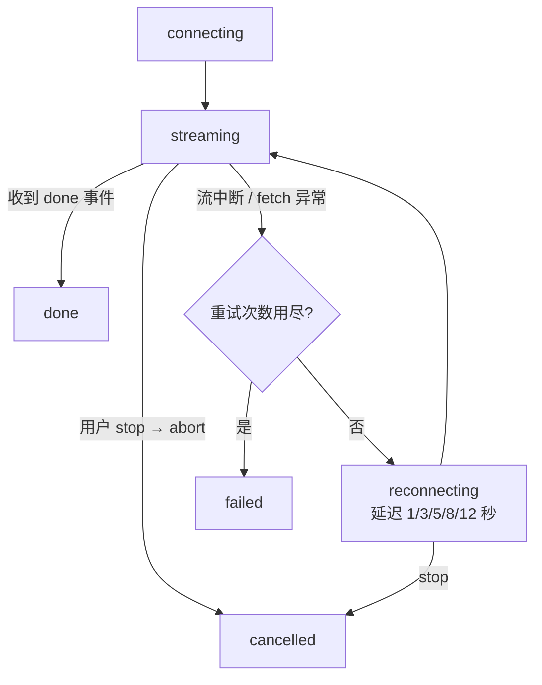

# ai生成中断前端该做什么

AI 生成突然中断，问题通常出在连接层，而不是生成层，作为前端，核心目标是把"中断"转为一个可恢复状态，让用户不丢失已有内容，无感或低成本地继续。

## 核心认知：中断发生在连接层，不是生成层

AI流式生成的完整链路：

```
LLM 模型 ──token 流──▶ 后端服务 ──SSE 流──▶ 网络/代理 ──▶ 前端(浏览器) ──▶ UI
                       （生成层）              （连接层）        （接收层）
```

SSE 是单向、无确认的流。服务端把数据推给客户端，但永远不会知道"客户端收到了哪一段"。且数据流是瞬时的，流过去的 chunk 就消失了，服务端默认不跟踪已发送了什么（除非它主动缓存）,因此"断点"只能在前端处理,所以前端要做两件事

- 缓冲：前端维护一个"已收到内容"的缓存，保证中断时不丢数据，
- 恢复：把缓存（游标 + 已生成文本）作为继续请求的输入，让生成从断点接上。

---

## 三种中断，三种策略

| 中断类型                | 典型表现                   | 后端状态         | 前端策略                       |
| ----------------------- | -------------------------- | ---------------- | ------------------------------ |
| 网络闪断 / 代理超时     | 连接断开，几秒后恢复       | 后端可能还在生成 | 自动重连 + 游标断点续传        |
| 用户主动取消 / 页面刷新 | 用户不想等了 / 手滑关页面  | 后端收到断开     | 保留已生成内容，稍后"继续生成" |
| 后端生成真挂了          | 模型报错 / 超限 / 网关 5xx | 后端无法继续生成 | 明确提示 + 重试，不假装能续传  |

// “网络断了”和“生成挂了”是两回事。网络断了，后端可能在后台继续生成，重连 + 续传即可接上，生成挂了，须提示并给重试入口。前端要把这两种情况在错误路径上分开处理，即区分 `AbortError` 与普通错误。

---

## SSE解析

### 为什么不用原生 EventSource

浏览器原生 `EventSource` 虽然自带断线重连，但有两个硬伤

- 只能发 GET 请求，无法自定义 header，带不了 `Authorization: Bearer xxx`，
- 无法自定义重连,重连间隔、最大次数、重连时携带的游标都不可控

因此在 AI 聊天场景，主流做法是fetch + ReadableStream 手动解析 SSE,既能自定义 header，又能完全掌控重连罗技

### SSE 帧格式速览

SSE 协议按空行分隔事件帧，每帧由若干 `字段: 值` 行组成：

| 字段     | 含义                                 | 示例                     |
| -------- | ------------------------------------ | ------------------------ |
| `id:`    | 事件序号（断点续传的游标来源）       | `id: 12`                 |
| `event:` | 事件类型，默认 `message`             | `event: content`         |
| `data:`  | 数据内容（可多行，多行用 `\n` 连接） | `data: {"delta":"你好"}` |
| `:`      | 注释行，常用来做心跳                 | `: keep-alive`           |

一个完整帧长这样（注意结尾的空行）：

```
id: 3
event: content
data: {"delta":"很高兴"}

```

### 两种断点游标方案

- **方案 A：SSE `id` 字段 + `Last-Event-ID`**。这是协议原生方案，适合原生 `EventSource`，浏览器断线重连时自动带上 `Last-Event-ID` 请求头，服务端据此续传。
- **方案 B：chunk 序号游标**（本文采用）。fetch 手写场景下，自己解析 `id` 字段、维护 `cursor`，重连时放进请求体（如 `resumeFrom: 128`）。服务端从该位置之后继续推送。

AI 场景选B的原因：游标和已生成文本放在同一个请求体里，一次请求同时解决"续传位置"和"续写上下文"两个问题

---

## 前端实现

### 文件结构

```
src/
├── sse/
│   ├── types.ts              # 类型定义（状态机、事件、消息）
│   └── sse.ts                # 手写 SSE 客户端（核心）
├── composables/
│   └── useStreamChat.ts      # 组合式函数：状态 + 缓冲 + 持久化 + 重连 + 继续
├── components/
│   └── StreamChat.vue        # 聊天组件
vite.config.ts                # 开发代理（/api → 后端 3000）
```

### `src/sse/types.ts`

```ts
// File: src/sse/types.ts

/** 流式状态机 */
export type StreamStatus =
  | "idle" // 空闲
  | "connecting" // 首次连接中
  | "streaming" // 正在接收
  | "reconnecting" // 断线重连中
  | "done" // 正常结束
  | "cancelled" // 用户取消
  | "failed"; // 重试耗尽，失败

/** 解析后的单个 SSE 事件 */
export interface StreamEvent {
  id: number; // 事件序号（就是断点游标）
  type: string; // content / done / error ...
  data: string;
}

/** 流客户端配置 */
export interface StreamClientOptions {
  url: string;
  headers?: Record<string, string>;
  body?: Record<string, unknown>;
  /** 起始游标：从该事件 id 之后继续接收（0 = 全新开始） */
  resumeFrom?: number;
  /** 渐进式重连延迟（秒），默认 [1, 3, 5, 8, 12] */
  retryDelays?: number[];
  onEvent?: (ev: StreamEvent) => void;
  onStatus?: (status: StreamStatus) => void;
}

/** 会话中的一条消息 */
export interface ChatMessage {
  id: string; // 消息 id（问答对共用，用于续传定位）
  role: "user" | "assistant";
  content: string;
  streaming: boolean; // 生成中
  interrupted: boolean; // 已中断（可继续）
  error?: string;
}
```

### `src/sse/sse.ts` —— SSE 客户端

```ts
// File: src/sse/sse.ts

import type { StreamClientOptions, StreamEvent, StreamStatus } from "./types";

const DEFAULT_RETRY_DELAYS = [1, 3, 5, 8, 12]; // 秒，渐进式重连

/**
 * 解析一个 SSE 帧（以空行为界的文本块）。
 * 返回 null 表示无有效数据（如心跳注释行）。
 */
export function parseFrame(frame: string): StreamEvent | null {
  let id = -1;
  let type = "message";
  const dataLines: string[] = [];

  for (const line of frame.split("\n")) {
    if (line.startsWith(":")) continue; // 注释行 / 心跳，跳过

    // 按规范：冒号后的第一个空格是分隔符，值保留其余部分
    const sep = line.indexOf(":");
    const field = sep === -1 ? line : line.slice(0, sep);
    let value = sep === -1 ? "" : line.slice(sep + 1);
    if (value.startsWith(" ")) value = value.slice(1);

    switch (field) {
      case "id":
        id = Number(value) || -1;
        break;
      case "event":
        type = value || "message";
        break;
      case "data":
        dataLines.push(value); // 多行 data 用 \n 连接（SSE 规范）
        break;
      default:
        break; // 未知字段忽略
    }
  }

  if (dataLines.length === 0 && id === -1) return null;
  return { id, type, data: dataLines.join("\n") };
}

/**
 *  - fetch + ReadableStream 逐块解析
 *  - 游标追踪：收到事件后立即推进 cursor，重连时通过 resumeFrom 带回
 *  - 错误分类：用户取消（AbortError）不重连，网络/服务端异常走渐进式重连
 */
export class StreamClient {
  private opts: StreamClientOptions;
  private controller: AbortController | null = null;
  private retries = 0;
  private cursor: number;
  private gotDone = false;
  private started = false;
  private status: StreamStatus = "idle";

  constructor(opts: StreamClientOptions) {
    this.opts = opts;
    this.cursor = opts.resumeFrom ?? 0;
  }

  get isActive(): boolean {
    return (
      this.status === "connecting" ||
      this.status === "streaming" ||
      this.status === "reconnecting"
    );
  }

  /** 用户主动停止（取消生成） */
  stop(): void {
    this.started = false;
    this.controller?.abort();
  }

  /** 发起接收（首次连接与断线重连共用） */
  async start(): Promise<void> {
    this.started = true;
    this.gotDone = false;
    this.setStatus(this.retries === 0 ? "connecting" : "reconnecting");

    this.controller = new AbortController();
    const payload = { ...(this.opts.body ?? {}), resumeFrom: this.cursor };

    try {
      const res = await fetch(this.opts.url, {
        method: "POST",
        headers: { "Content-Type": "application/json", ...this.opts.headers },
        body: JSON.stringify(payload),
        signal: this.controller.signal,
      });

      if (!res.ok || !res.body) {
        throw new Error(`HTTP ${res.status}`);
      }

      this.setStatus("streaming");
      await this.readStream(res.body);
    } catch (err) {
      if (err instanceof DOMException && err.name === "AbortError") {
        // 用户主动取消（stop()），不是故障，不重连
        this.setStatus("cancelled");
        return;
      }
      this.handleFailure();
    }
  }

  private async readStream(body: ReadableStream<Uint8Array>): Promise<void> {
    const reader = body.getReader();
    const decoder = new TextDecoder();
    let buffer = "";

    while (true) {
      const { done, value } = await reader.read();
      if (done) break;

      buffer += decoder.decode(value, { stream: true });
      const frames = buffer.split("\n\n");
      buffer = frames.pop() ?? ""; // 末尾可能是半帧，留到下次拼接

      for (const frame of frames) {
        const ev = parseFrame(frame);
        if (!ev) continue;
        this.cursor = ev.id; // 先推进游标，再回调（回调须为同步操作）
        if (ev.type === "done") this.gotDone = true;
        this.opts.onEvent?.(ev);
      }
    }

    if (this.gotDone) {
      this.retries = 0;
      this.setStatus("done");
    } else {
      // 流提前结束（服务端断连），按网络中断处理
      this.handleFailure();
    }
  }

  private handleFailure(): void {
    if (!this.started) return; // 已被 stop，不重连
    const delays = this.opts.retryDelays ?? DEFAULT_RETRY_DELAYS;
    if (this.retries >= delays.length) {
      this.setStatus("failed");
      return;
    }
    this.retries++;
    this.setStatus("reconnecting");
    const delayMs = delays[this.retries - 1] * 1000;
    setTimeout(() => {
      if (this.started) void this.start(); // 重连自动带上最新游标
    }, delayMs);
  }

  private setStatus(s: StreamStatus): void {
    this.status = s;
    this.opts.onStatus?.(s);
  }
}
```

重连状态流转如下



### `src/composables/useStreamChat.ts`

// 状态 + 缓冲 + 持久化

```ts
// File: src/composables/useStreamChat.ts

import { onUnmounted, ref } from "vue";
import { StreamClient } from "../sse/sse";
import type { ChatMessage, StreamStatus } from "../sse/types";

const STORAGE_PREFIX = "ai-stream:";

interface StoredState {
  content: string; // 已生成内容
  cursor: number; // 已处理到的游标
}

function storageKey(chatId: string, messageId: string): string {
  return `${STORAGE_PREFIX}${chatId}:${messageId}`;
}

function loadStored(chatId: string, messageId: string): StoredState | null {
  const raw = sessionStorage.getItem(storageKey(chatId, messageId));
  if (!raw) return null;
  try {
    return JSON.parse(raw) as StoredState;
  } catch {
    return null;
  }
}

function saveStored(
  chatId: string,
  messageId: string,
  state: StoredState,
): void {
  sessionStorage.setItem(storageKey(chatId, messageId), JSON.stringify(state));
}

function removeStored(chatId: string, messageId: string): void {
  sessionStorage.removeItem(storageKey(chatId, messageId));
}

export function useStreamChat(chatId: string, options: { url?: string } = {}) {
  const url = options.url ?? "/api/chat";
  const messages = ref<ChatMessage[]>([]);
  const status = ref<StreamStatus>("idle");

  // 内存态游标表：messageId → cursor（与 sessionStorage 互为备份）
  const cursors = new Map<string, number>();
  let client: StreamClient | null = null;
  let activeMessageId = "";

  /** 刷新后恢复：扫描本会话上次"已中断"的 assistant 消息 */
  function restoreInterrupted(): ChatMessage[] {
    const restored: ChatMessage[] = [];
    for (let i = 0; i < sessionStorage.length; i++) {
      const key = sessionStorage.key(i);
      if (!key?.startsWith(`${STORAGE_PREFIX}${chatId}:`)) continue;
      const messageId = key.slice(STORAGE_PREFIX.length + chatId.length + 1);
      const stored = loadStored(chatId, messageId);
      if (stored && stored.content) {
        restored.push({
          id: messageId,
          role: "assistant",
          content: stored.content,
          streaming: false,
          interrupted: true,
        });
        cursors.set(messageId, stored.cursor);
      }
    }
    return restored;
  }
  messages.value.push(...restoreInterrupted());

  function createClient(
    messageId: string,
    prefix: string,
    resumeFrom: number,
  ): StreamClient {
    return new StreamClient({
      url,
      body: { chatId, messageId, prefix },
      resumeFrom,
      onEvent: (ev) => {
        const msg = messages.value.find((m) => m.id === messageId);
        if (!msg) return;

        if (ev.type === "content") {
          // 1) 追加到内存缓冲（组件状态）
          msg.content += ev.data;
          cursors.set(messageId, ev.id);
          // 2) 持久化兜底（示例直接写，正式项目可 300ms 防抖或走 IndexedDB）
          saveStored(chatId, messageId, {
            content: msg.content,
            cursor: ev.id,
          });
        } else if (ev.type === "error") {
          msg.error = ev.data;
        } else if (ev.type === "done") {
          msg.streaming = false;
          msg.interrupted = false;
          removeStored(chatId, messageId); // 完整生成，清理草稿
          cursors.delete(messageId);
        }
      },
      onStatus: (s) => {
        status.value = s;
        const msg = messages.value.find((m) => m.id === messageId);
        if (!msg) return;

        if (s === "failed") {
          // 后端真挂了：明确提示 + 保留内容，允许用户手动重试
          msg.streaming = false;
          msg.interrupted = true;
          msg.error = msg.error ?? "生成失败，请稍后重试";
          saveStored(chatId, messageId, {
            content: msg.content,
            cursor: cursors.get(messageId) ?? 0,
          });
        }
      },
    });
  }

  /** 发送新消息 */
  function send(text: string): void {
    const content = text.trim();
    if (!content || client?.isActive) return;

    const messageId = crypto.randomUUID();
    activeMessageId = messageId;
    messages.value.push({
      id: `${messageId}:u`,
      role: "user",
      content,
      streaming: false,
      interrupted: false,
    });
    messages.value.push({
      id: messageId,
      role: "assistant",
      content: "",
      streaming: true,
      interrupted: false,
    });

    client = createClient(messageId, "", 0);
    void client.start();
  }

  /** 用户主动取消：保留已生成内容，标记可继续 */
  function cancel(): void {
    client?.stop();
    const msg = messages.value.find((m) => m.id === activeMessageId);
    if (msg) {
      msg.streaming = false;
      msg.interrupted = true;
      saveStored(chatId, activeMessageId, {
        content: msg.content,
        cursor: cursors.get(activeMessageId) ?? 0,
      });
    }
    client = null;
  }

  /** 继续生成：把已生成内容作为 prefix 上下文 + 游标，请求从断点继续 */
  function resume(msg: ChatMessage): void {
    if (client?.isActive) return;
    activeMessageId = msg.id;
    msg.streaming = true;
    msg.interrupted = false;
    msg.error = undefined;

    const cursor =
      cursors.get(msg.id) ?? loadStored(chatId, msg.id)?.cursor ?? 0;
    client = createClient(msg.id, msg.content, cursor);
    void client.start();
  }

  onUnmounted(() => client?.stop());

  return { messages, status, send, cancel, resume };
}
```

- 缓冲双写：内容同时进内存（组件状态）和 `sessionStorage`。内存负责流畅渲染，存储负责"组件卸载 / 页面刷新"后不丢。真正产生数据的那一刻就写，而不是等中断才写——因为中断可能发生在任何一帧之间。
- 游标跟着内容走：`cursor` 与 `content` 存同一个对象，恢复时两个一起拿回来，保证"位置"和"内容"永远一致。
- 三种路径分流：`done` 清缓存、`failed` 留缓存给重试、`cancelled` 留缓存给"继续生成"。

### `src/components/StreamChat.vue`

```vue
<!-- File: src/components/StreamChat.vue -->
<template>
  <div class="chat">
    <div v-if="statusText[status]" class="status" :class="status">
      {{ statusText[status] }}
    </div>

    <div class="messages">
      <div v-for="msg in messages" :key="msg.id" class="msg" :class="msg.role">
        <div class="bubble">
          <span v-if="msg.streaming" class="cursor">▌</span>{{ msg.content }}
        </div>
        <div v-if="msg.error" class="error">{{ msg.error }}</div>
        <div v-if="msg.interrupted && !msg.streaming" class="actions">
          <span class="hint">已中断，保留 {{ msg.content.length }} 字</span>
          <button @click="resume(msg)">继续生成</button>
        </div>
      </div>
    </div>

    <div class="input-row">
      <input
        v-model="input"
        placeholder="输入问题，回车发送…"
        @keydown.enter.prevent="onSubmit"
      />
      <button
        v-if="status === 'streaming' || status === 'reconnecting'"
        class="danger"
        @click="cancel"
      >
        停止
      </button>
      <button v-else @click="onSubmit">发送</button>
    </div>
  </div>
</template>

<script setup lang="ts">
import { ref } from "vue";
import { useStreamChat } from "../composables/useStreamChat";
import type { ChatMessage } from "../sse/types";

const props = defineProps<{ chatId: string }>();

const input = ref("");
const { messages, status, send, cancel, resume } = useStreamChat(props.chatId);

const statusText: Record<string, string> = {
  connecting: "连接中…",
  streaming: "生成中…",
  reconnecting: "连接中断，正在重连…",
  done: "",
  cancelled: "已取消",
  failed: "生成失败",
};

function onSubmit(): void {
  send(input.value);
  input.value = "";
}
</script>

<style scoped>
.chat {
  display: flex;
  flex-direction: column;
  gap: 12px;
  width: 720px;
  margin: 24px auto;
  font-family: system-ui, sans-serif;
}
.status {
  padding: 6px 12px;
  border-radius: 6px;
  font-size: 13px;
  background: #f0f4ff;
  color: #2b5fd9;
}
.status.reconnecting {
  background: #fff7e6;
  color: #b45309;
}
.status.failed {
  background: #fef2f2;
  color: #b91c1c;
}
.messages {
  display: flex;
  flex-direction: column;
  gap: 12px;
  min-height: 320px;
  max-height: 60vh;
  overflow-y: auto;
  border: 1px solid #e5e7eb;
  border-radius: 10px;
  padding: 16px;
  background: #fff;
}
.msg.user {
  align-self: flex-end;
}
.msg.assistant {
  align-self: flex-start;
}
.bubble {
  padding: 10px 14px;
  border-radius: 10px;
  white-space: pre-wrap;
  word-break: break-word;
  max-width: 85%;
  line-height: 1.6;
  background: #f3f4f6;
}
.msg.user .bubble {
  background: #2563eb;
  color: #fff;
}
.cursor {
  animation: blink 1s steps(1) infinite;
}
@keyframes blink {
  50% {
    opacity: 0;
  }
}
.error {
  margin-top: 4px;
  font-size: 12px;
  color: #b91c1c;
}
.actions {
  margin-top: 6px;
  display: flex;
  align-items: center;
  gap: 10px;
}
.hint {
  font-size: 12px;
  color: #6b7280;
}
.actions button {
  font-size: 12px;
  padding: 4px 12px;
  border-radius: 6px;
  border: 1px solid #2563eb;
  background: #2563eb;
  color: #fff;
  cursor: pointer;
}
.input-row {
  display: flex;
  gap: 8px;
}
.input-row input {
  flex: 1;
  padding: 10px 12px;
  border: 1px solid #d1d5db;
  border-radius: 8px;
  font-size: 14px;
}
.input-row button {
  padding: 0 18px;
  border-radius: 8px;
  border: none;
  background: #2563eb;
  color: #fff;
  cursor: pointer;
}
.input-row button.danger {
  background: #dc2626;
}
</style>
```

### 设计决策说明

| 决策                                          | 理由                                                                                      |
| --------------------------------------------- | ----------------------------------------------------------------------------------------- |
| 为什么 `StreamClient` 独立于 Vue              | 纯逻辑可单测，不绑定组件生命周期，换其他前端框架也复用                                    |
| 为什么回调里"先推游标再 onEvent"              | 保证回调抛错时游标也已推进，重连不会整段重放                                              |
| 为什么持久化用 `sessionStorage` 而非常量写    | 页面刷新不丢（会话级），`localStorage` 适合跨会话"历史草稿"，内容很大（>5MB）换 IndexedDB |
| 为什么 `send/cancel/resume` 都检查 `isActive` | 防止并发多个流同时跑，状态机保持单一活跃流                                                |

---

## 后端实现

### SSE响应四件套

```js
res.writeHead(200, {
  "Content-Type": "text/event-stream; charset=utf-8",
  "Cache-Control": "no-cache, no-transform", // no-transform：禁止代理改写/缓冲
  Connection: "keep-alive",
  "X-Accel-Buffering": "no", // 关掉 nginx 缓冲，让 chunk 实时到达
});
res.flushHeaders(); // 立即把响应头发出去
```

外加两件事：心跳（每 15s 写一行注释帧，防止代理掐空闲连接）和断连清理（`res.on('close')` 清理定时器，否则 Node 进程会泄漏定时器）。

### 断点续传的服务端模型

服务端为每条消息缓存已推送的 chunk 历史（内存 Map），并遵守一个简单映射：`chunks 数组下标 k  →  事件 id = k + 1 , resumeFrom = 客户端已处理到的 id  →  从下标 resumeFrom 开始补发`，推送分两个阶段：

1. 重放历史：网络闪断重连时，`chunks` 还在内存，直接从游标位置补发，秒级接上，
2. 继续生成：历史重放完，若模型还在产出，继续生成新 chunk 追加进历史并推送。

还要区分两种"续"：

- 重放式续传：历史还在（网络闪断），纯补发，不重新调模型，
- 上下文式续写：历史已过期或服务端重启（长时间中断 / 用户稍后继续），此时依靠前端回传的 `prefix`（已显示在屏幕上的文本）作为上下文，让模型接着写。这就是为什么前端的"继续生成"要把 `content` 一起发回来。

### `server/server.js`

```js
// File: server/server.js

"use strict";

/**
 * AI 流式生成服务端示例（Node.js 原生 http，零依赖）
 *
 * 职责：
 *  1. SSE 流式推送（id 递增、心跳、断连清理）
 *  2. 会话 chunk 历史缓存：支持网络闪断后的断点续传（resumeFrom 游标）
 *  3. 历史过期后，基于前端回传的 prefix 继续生成（上下文式续写）
 *
 * 运行：node server.js
 */

const http = require("http");
const { randomUUID } = require("crypto");

const PORT = 3000;
const SESSION_TTL = 10 * 60 * 1000; // 会话历史 10 分钟无访问即清理
const CHUNK_SIZE = 8; // 每次推送的字符数（模拟 token 块）

/**
 * 会话历史：key = `${chatId}:${messageId}`
 *   chunks     已推送的文本块，chunks[k] 的事件 id = k + 1
 *   lastAccess 最近访问时间，用于 TTL 清理
 */
const sessions = new Map();

const sleep = (ms) => new Promise((resolve) => setTimeout(resolve, ms));

/** 模拟模型输出：生成一段固定长文本（演示流式效果用） */
const MODEL_TEXT =
  "……这是模型从断点继续生成的内容。实际项目中，这里应调用真实 LLM API，" +
  "把增量 token 逐块 yield。文本写得较长是为了让你观察：流式逐字出现、" +
  "网络中断后的续传、以及游标跳过已接收内容的过程。";

/**
 * 模拟模型：从已生成字符数 skip 处继续产出。
 * 这样"重连后继续生成"与"首次生成"走同一条路径，且内容不重复。
 */
async function* mockModel(skip = 0) {
  for (let i = skip; i < MODEL_TEXT.length; i += CHUNK_SIZE) {
    yield MODEL_TEXT.slice(i, i + CHUNK_SIZE);
    await sleep(30);
  }
}

/** 写一个 SSE 帧。事件 id 从 1 开始，0 表示"尚未处理任何事件" */
function writeSSE(res, id, event, data) {
  res.write(`id: ${id}\n`);
  if (event && event !== "message") res.write(`event: ${event}\n`);
  res.write(`data: ${JSON.stringify(data)}\n\n`);
}

/** 周期性清理过期会话，避免历史无限膨胀 */
function sweepSessions() {
  const now = Date.now();
  for (const [key, session] of sessions) {
    if (now - session.lastAccess > SESSION_TTL) sessions.delete(key);
  }
}
setInterval(sweepSessions, 60 * 1000);

const server = http.createServer((req, res) => {
  if (req.url === "/api/chat" && req.method === "POST") {
    let raw = "";
    req.on("data", (chunk) => {
      raw += chunk;
    });
    req.on("end", () => handleChat(req, res, raw));
  } else {
    res.writeHead(404, { "Content-Type": "application/json" });
    res.end(JSON.stringify({ error: "not found" }));
  }
});

function handleChat(req, res, raw) {
  let params;
  try {
    params = JSON.parse(raw || "{}");
  } catch {
    res.writeHead(400, { "Content-Type": "application/json" });
    res.end(JSON.stringify({ error: "bad json" }));
    return;
  }

  const {
    chatId = "default",
    messageId = randomUUID(),
    resumeFrom = 0, // 客户端已处理到的事件 id
    prefix = "", // 客户端已显示在屏幕上的文本（上下文式续写用）
  } = params;

  // —— SSE 响应头四件套 ——
  res.writeHead(200, {
    "Content-Type": "text/event-stream; charset=utf-8",
    "Cache-Control": "no-cache, no-transform",
    Connection: "keep-alive",
    "X-Accel-Buffering": "no",
  });
  res.flushHeaders();

  // 心跳注释行：防止代理/负载均衡掐断空闲连接
  const heartbeat = setInterval(() => {
    if (!res.destroyed) res.write(": keep-alive\n\n");
  }, 15000);

  // 客户端断开（取消 / 刷新 / 断网）时清理定时器
  res.on("close", () => clearInterval(heartbeat));

  const key = `${chatId}:${messageId}`;
  let session = sessions.get(key);
  const isNewSession = !session;
  if (isNewSession) {
    session = { chunks: [], lastAccess: Date.now() };
    sessions.set(key, session);
  }
  session.lastAccess = Date.now();

  void streamToClient(res, session, resumeFrom, prefix, isNewSession);
}

async function streamToClient(res, session, resumeFrom, prefix, isNewSession) {
  const { chunks } = session;

  // —— 第一步：重放历史（网络闪断后的断点续传）——
  // chunks 下标 k 对应事件 id = k + 1，resumeFrom 是客户端已处理到的 id，
  // 因此从这里开始补发，保证不重不漏。
  for (let k = resumeFrom; k < chunks.length; k++) {
    if (res.destroyed) return; // 客户端已断开，立即停止
    writeSSE(res, k + 1, "content", chunks[k]);
  }

  // —— 第二步：继续生成新内容 ——
  // 已生成文本长度 = 历史块拼接长度，新会话（历史过期/重启）则以前端回传的
  // prefix（已显示在用户屏幕上的文本）作为上下文起点。
  const already = isNewSession ? prefix.length : chunks.join("").length;

  for await (const piece of mockModel(already)) {
    if (res.destroyed) return; // 客户端已断开，立即停止
    chunks.push(piece);
    writeSSE(res, chunks.length, "content", piece);
  }

  // —— 结束 ——
  writeSSE(res, chunks.length, "done", {
    ok: true,
    total: chunks.join("").length,
  });
  res.end();
}

server.listen(PORT, () => {
  console.log(`SSE server listening on http://localhost:${PORT}`);
});
```

### 运行与联调

启动后端：`node server.js`,启动前端：`npm run dev`

## 端到端验证

### 查看curl验证

```bash
# 首次请求，观察 id 递增、content 事件、done 结束
curl -N -X POST http://localhost:3000/api/chat \
  -H 'Content-Type: application/json' \
  -d '{"chatId":"c1","messageId":"m1"}'

# 模拟断点续传：resumeFrom=5 表示已处理到 id 5，应从 id 6 开始
curl -N -X POST http://localhost:3000/api/chat \
  -H 'Content-Type: application/json' \
  -d '{"chatId":"c1","messageId":"m1","resumeFrom":5}'
```

第二个请求返回的内容，应该正好是第一个请求从第 6 块往后的部分

### 前端单测思路

// Vitest
对 `StreamClient` 注入一个可控的 `fetch` 桩，即可单测重连状态机：

```ts
// File: src/sse/sse.spec.ts（示意）

import { describe, it, expect, vi } from "vitest";
import { StreamClient, parseFrame } from "./sse";

function stubFetch(stream: ReadableStream<Uint8Array>) {
  vi.stubGlobal(
    "fetch",
    vi.fn(async () => {
      return { ok: true, status: 200, body: stream } as Response;
    }),
  );
}

it("解析 SSE 帧", () => {
  expect(parseFrame('id: 3\nevent: content\ndata: {"delta":"好"}\n')).toEqual({
    id: 3,
    type: "content",
    data: '{"delta":"好"}',
  });
  expect(parseFrame(": keep-alive")).toBeNull(); // 心跳
});

it("流中途中断后自动重连，并携带最新游标", async () => {
  const encoder = new TextEncoder();
  const mkStream = (chunks: string[]) =>
    new ReadableStream({
      start(c) {
        for (const s of chunks) c.enqueue(encoder.encode(s));
        c.close();
      },
    });

  const events: number[] = [];
  const seenResumeFrom: number[] = [];
  stubFetch(
    mkStream([
      'id: 1\nevent: content\ndata: "a"\n\n',
      'id: 2\nevent: content\ndata: "b"\n\n',
    ]),
  );

  const client = new StreamClient({
    url: "/api/chat",
    onEvent: (ev) => events.push(ev.id),
    onStatus: (s) => {
      if (s === "reconnecting") {
        // 第二次连接：读取请求体里的 resumeFrom
        const body = JSON.parse(
          (vi.mocked(fetch).mock.calls.at(-1)![1] as RequestInit)
            .body as string,
        );
        seenResumeFrom.push(body.resumeFrom);
      }
    },
  });
  await client.start();
  expect(events).toEqual([1, 2]);
  // 断言：重连请求的 resumeFrom === 2（已处理到的最后一个 id）
  expect(seenResumeFrom[0]).toBe(2);
});
```

---

## 注意

1. **心跳不能省**。Nginx / 负载均衡默认会掐掉空闲连接（常见 60s），流式长连接必须周期性写注释帧。
2. **代理缓冲是流式最大的隐形杀手**。响应头必须带 `Cache-Control: no-cache, no-transform` 和 `X-Accel-Buffering: no`，否则 chunk 会被代理攒成一个大包，前端表现为"一直不出字，最后整段蹦出来"。
3. **storage 别每 chunk 都写**。高频写 `sessionStorage` 会卡主线程，量大还会超配额。方案：300ms 防抖合并写，大内容改 IndexedDB，只在"中断/取消/定期"三个时点落盘。
4. **多标签页互踢**。两个标签页同时续传同一消息会重复追加。可用 `BroadcastChannel` 广播"该消息已被接管"，或给续传请求带 `requestId` 做幂等。
5. **4xx 不要重连**。服务端 400/401 重试 5 次纯属浪费切没必要。`StreamClient` 里应按 `res.status` 区分：4xx 直接 `failed`，5xx/网络错误才重连。
6. **服务端历史要有 TTL 和上限**。每条消息的 chunks 全留内存会爆。按会话 TTL 清理 + 单会话块数上限（超出只保尾部游标）。
7. **组件卸载必须 abort**。`onUnmounted(() => client?.stop())` 漏写的话，切路由后流还在跑，回调操作已卸载的 DOM（Vue 中表现为内存泄漏和报错）。
8. **prefix 不能无限长**。上下文式续写把已生成文本全部回传，模型上下文窗口有限。超限时做截断 / 摘要 / 只回传最近 N 个字符。
9. **短时间打量重连**。同时在线用户多时，全员按 [1,3,5,8,12] 秒同步重连会产生惊群。加上随机抖动（±20%）打散重连时刻。

---

## 总结

| 层     | 要做的事                                                |
| ------ | ------------------------------------------------------- |
| 接收层 | 缓冲已生成内容（内存 + sessionStorage），游标跟着内容走 |
| 连接层 | 手写 SSE 客户端：错误分类、渐进式重连、重连自动带游标   |
| 恢复层 | 三种中断三套策略：闪断续传 / 取消保留 / 真挂重试        |
| 服务端 | 缓存 chunk 历史支持重放，接受 prefix 支持上下文式续写   |

## 补充

// 如果你的场景是"内容特别大"（eg长文档生成），`sessionStorage`换成IndexedDB（因为我的项目很小，所哟一没选这套技术栈，这里只是提供思路），如果是"多端同步"，把会话历史从内存 Map 换成 Redis，游标与续传模型不用变。
