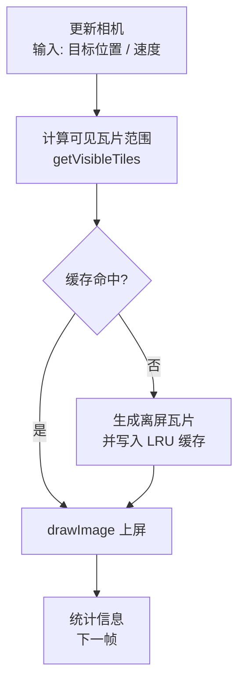

# Canvas瓦片绘制

当画布里的元素从几百个膨胀到几万个、地图从一屏扩展到无限大时，直接绘制会迅速撞上性能墙。瓦片化（Tiling）是地图与 2D 大世界渲染最经典也最有效的解法

// 前置知识：Canvas 2D 基础 API、`requestAnimationFrame`---------(翻看“日常基础分享-基础”，这里不再赘述)
// [LRU](https://baike.baidu.com/item/LRU/1269842)：LRU是Least Recently Used的缩写，即最近最少使用，是一种常用的页面置换算法，选择最近最久未使用的页面予以淘汰。该算法赋予每个页面一个访问字段，用来记录一个页面自上次被访问以来所经历的时间 t，当须淘汰一个页面时，选择现有页面中其 t 值最大的，即最近最少使用的页面予以淘汰。

## 为什么要瓦片绘制

### 直绘的瓶颈

假如要渲染一张 10000 × 10000 的世界地图，或是一个包含 5 万个图元的大屏画布，直接绘制会有三个问题：

1. 绘制指令过多：Canvas 的每次 `fillRect` / `beginPath` / `drawImage` 都是一条绘制指令。几千条没问题，几万条就会让主线程明显掉帧，甚至直接卡死。
2. 全量重绘：任何一次交互（平移、缩放、动画）都要重画整张画布，每帧成本与地图大小成正比，无法扩展。
3. 内存爆炸：把 10000 × 10000 的世界直接渲到一张位图上，RGBA 内存高达约 400MB，根本不现实。

### 瓦片相关的名词

- 切块（Tile）：把世界切成固定大小的格子，每块独立渲染、独立缓存。
- 裁剪（Culling）：每帧只处理视口（Viewport）内可见的瓦片。渲染成本与视口面积成正比，与地图大小无关。
- 缓存（Cache）：复杂瓦片内容只绘制一次（离屏 Canvas），之后上屏只是位图拷贝，速度远超逐元素重绘。
- 瓦片网格（Tile Grid）：把世界按固定大小（如 256 × 256）切成网格，每个格子用整数索引 `(tx, ty)` 标识，渲染一帧只需要三步
  1. 由相机位置算出可见瓦片的行列范围，即m\*n的地图；
  2. 对每个可见瓦片，从缓存取离屏画布，未命中则生成；
  3. 按瓦片在屏幕上的位置 `drawImage` 上屏。

这套思路是 Google Maps、Leaflet、Tiled 地图、SLG 大地图、模拟经营类游戏的标准做法，咱们直接采用,单帧成本 = O(可见瓦片数)，与地图总大小无关。地图再大，只要视口不变，帧开销就恒定。

## 坐标系设计与转换工具

瓦片渲染绕不开三种坐标的互相转换，一下是三种坐标系的说明

| 坐标系   | 表示       | 说明                                                 |
| -------- | ---------- | ---------------------------------------------------- |
| 世界坐标 | `(wx, wy)` | 以世界左上角为原点                                   |
| 瓦片坐标 | `(tx, ty)` | 瓦片网格索引，整数                                   |
| 屏幕坐标 | `(sx, sy)` | 相对 canvas 左上角，`sx = wx - camera.x`（未缩放时） |

// 注意：三个最小工具函数（**负坐标必须用 `floor`，不能用 `trunc`**，否则 -1.2 会错误地落到 0 号瓦片）：

```js
/** 世界坐标 → 瓦片坐标 */
function worldToTile(wx, wy, tileSize = 256) {
  return {
    tx: Math.floor(wx / tileSize),
    ty: Math.floor(wy / tileSize),
  };
}

/** 瓦片坐标 → 世界坐标（瓦片左上角） */
function tileToWorld(tx, ty, tileSize = 256) {
  return { x: tx * tileSize, y: ty * tileSize };
}

/** 瓦片左上角 → 屏幕坐标（相机平移） */
function tileToScreen(tx, ty, camera, tileSize = 256) {
  return {
    x: tx * tileSize - camera.x,
    y: ty * tileSize - camera.y,
  };
}
```

三个函数组合起来就是完整的坐标：屏幕点 → 世界坐标 → 瓦片索引 → 取瓦片 → 贴回屏幕。带缩放时只需在`tileToScreen`的结果上再乘以`camera.zoom`就行

## 方法

### 五步渲染管线

// 每一步的职责单一、可单独测试：相机只管"我在哪"，裁剪只管"该画哪些"，缓存只管"瓦片放哪"，渲染只管"贴图"。
// 一下是流程



### 可见瓦片范围计算

// 这是裁剪的核心,已知相机左上角 `(camera.x, camera.y)` 和视口宽高，可见瓦片的行列范围如下

```js
function getVisibleTiles(camera, viewport, tileSize = 256) {
  const startTx = Math.floor(camera.x / tileSize);
  const startTy = Math.floor(camera.y / tileSize);
  const endTx = Math.ceil((camera.x + viewport.width) / tileSize);
  const endTy = Math.ceil((camera.y + viewport.height) / tileSize);

  const tiles = [];
  for (let ty = startTy; ty < endTy; ty++) {
    for (let tx = startTx; tx < endTx; tx++) {
      tiles.push({ tx, ty });
    }
  }
  return tiles;
}
```

边界细节：右/下边缘用 `ceil` 而不是 `floor`——视口右边缘哪怕只压到瓦片 1px，这块瓦片也必须渲染，否则会出现"边缘露底",以 960 × 600 视口、256 瓦片为例，可见瓦片数恒在 12 ~ 20 之间，与"世界有多大"完全无关。

### 离屏预渲染 +LRU缓存

- 如果瓦片内容是复杂绘制（纹理噪点、多个形状、贴图合成），每帧在主画布上重画成本极高。正确做法是将每张瓦片只绘制一次到独立的小 Canvas 上，之后每帧只需一次`drawImage` 位图拷贝（走GPU 加速），视野移走后，旧瓦片淘汰，成本低非常多，（我之前的一个回合制游戏demo就是死在这个问题，逐帧全量绘制是那个[demo](https://awen-blog.netlify.app/#/demo/draw-game-units)的根，战术站选错了，已经动不了了，）

```js
class TileCache {
  constructor(maxSize) {
    this.map = new Map(); // key: "tx,ty" → canvas
    this.maxSize = maxSize;
    this.hits = 0; // 命中/未命中统计，调试用
    this.misses = 0;
  }

  get(tx, ty) {
    const key = tx + "," + ty;
    if (this.map.has(key)) {
      const canvas = this.map.get(key);
      this.map.delete(key); // 先删
      this.map.set(key, canvas); // 再插 → 移到队尾（最新）
      this.hits++;
      return canvas;
    }
    this.misses++;
    return null;
  }

  set(tx, ty, canvas) {
    this.map.set(tx + "," + ty, canvas);
    // Map 迭代顺序 = 插入顺序，队首即最久未使用
    while (this.map.size > this.maxSize) {
      this.map.delete(this.map.keys().next().value);
    }
  }
}
```

`get` 时"删除再插入"是关键：它把被访问的条目移到队尾，保证队首永远是最久未使用

### 帧循环

```js
function loop(now) {
  // 1. 更新相机（根据输入/惯性/寻路目标）
  // 2. 裁剪 + 取瓦片 + 上屏（见 TileWorld.render）
  world.render();
  requestAnimationFrame(loop);
}
requestAnimationFrame(loop);
```

// 相机静止且无脏数据时可以直接 `return` 跳过渲染（省电省 CPU）

---

## 工具函数

// `TILE_SIZE` 按需调整

| 函数                                | 作用                                 |
| ----------------------------------- | ------------------------------------ |
| `worldToTile(wx, wy)`               | 世界坐标 → 瓦片索引                  |
| `tileToWorld(tx, ty)`               | 瓦片索引 → 左上角世界坐标            |
| `tileToScreen(tx, ty, camera)`      | 瓦片 → 屏幕坐标                      |
| `getVisibleTiles(camera, viewport)` | 视口裁剪，返回可见瓦片数组           |
| `hash2(x, y)`                       | 确定性 2D 哈希，生成可复现的伪随机数 |
| `createTileCanvas(tx, ty)`          | 生成单块瓦片的离屏画布               |
| `TileCache`                         | LRU 瓦片缓存                         |
| `clamp(v, min, max)`                | 数值钳制                             |

### 确定性哈希：瓦片内容可复现的前提

程序化地形时必须唯一确定,同一瓦片每次生成内容要完全一致，否则缓存一命中，画面就"随机变脸"。不能用 `Math.random()`，要用带坐标种子的哈希：

```js
/** 相同 (x, y) 永远返回同一个 [0, 1) 伪随机数 */
function hash2(x, y) {
  let h = Math.imul(x, 374761393) + Math.imul(y, 668265263);
  h = Math.imul(h ^ (h >>> 13), 1274126177);
  return ((h ^ (h >>> 16)) >>> 0) / 4294967296;
}
```

eg：`hash2(tx, ty) > 0.85 ? '草' : '地'`。多个元素用不同乘子错开种子，避免分布雷同：`hash2(tx * 37 + 1, ty * 31 + 2)`。

### 跨瓦片连续性内容

相邻瓦片内容要自然衔接，否则会出现明显的接缝

- 基于世界坐标的连续函数：如河流的河道中心 `cx = 128 + sin(wy * 0.02) * 48`，`wy` 是世界 y，跨瓦片时自然连续，每个瓦片只画自己范围内的片段。
- 元素内边距：树、山等独立物件不要生成在瓦片边缘（如限制在 `[24, 232]` 区间内），否则会被瓦片边界切掉一半。

## Demo

下面是一个Demo（包含程序化地形世界（草地 / 河流 / 森林 / 山脉）、鼠标拖拽平移、LRU缓存、FPS 与缓存命中统计）

```html
<!DOCTYPE html>
<html lang="zh-CN">
  <head>
    <meta charset="UTF-8" />
    <meta name="viewport" content="width=device-width, initial-scale=1.0" />
    <title>Canvas 瓦片绘制 Demo</title>
    <style>
      * {
        box-sizing: border-box;
      }
      body {
        margin: 0;
        min-height: 100vh;
        display: flex;
        align-items: center;
        justify-content: center;
        background: #101418;
        font-family: "SF Mono", Consolas, "Courier New", monospace;
        color: #d8dee9;
      }
      .stage {
        padding: 16px;
      }
      canvas {
        display: block;
        background: #2a3140;
        border: 1px solid #3b4252;
        border-radius: 8px;
        cursor: grab;
        touch-action: none;
      }
      canvas.dragging {
        cursor: grabbing;
      }
      #stats {
        margin-top: 10px;
        font-size: 12px;
        line-height: 1.6;
        color: #88c0d0;
        white-space: pre;
      }
    </style>
  </head>
  <body>
    <div class="stage">
      <canvas id="canvas" width="960" height="600"></canvas>
      <div id="stats"></div>
    </div>

    <script>
      "use strict";

      /* ============================================================
       * 一、工具函数
       * ============================================================ */

      const TILE_SIZE = 256;

      /** 世界坐标 → 瓦片坐标（负坐标必须用 floor） */
      function worldToTile(wx, wy, tileSize = TILE_SIZE) {
        return { tx: Math.floor(wx / tileSize), ty: Math.floor(wy / tileSize) };
      }

      /** 瓦片左上角 → 世界坐标 */
      function tileToWorld(tx, ty, tileSize = TILE_SIZE) {
        return { x: tx * tileSize, y: ty * tileSize };
      }

      /** 瓦片左上角 → 屏幕坐标 */
      function tileToScreen(tx, ty, camera, tileSize = TILE_SIZE) {
        return { x: tx * tileSize - camera.x, y: ty * tileSize - camera.y };
      }

      /** 计算视口内的可见瓦片列表 */
      function getVisibleTiles(camera, viewport, tileSize = TILE_SIZE) {
        const startTx = Math.floor(camera.x / tileSize);
        const startTy = Math.floor(camera.y / tileSize);
        const endTx = Math.ceil((camera.x + viewport.width) / tileSize);
        const endTy = Math.ceil((camera.y + viewport.height) / tileSize);
        const tiles = [];
        for (let ty = startTy; ty < endTy; ty++) {
          for (let tx = startTx; tx < endTx; tx++) {
            tiles.push({ tx, ty });
          }
        }
        return tiles;
      }

      /**
       * 确定性 2D 哈希：相同 (x, y) 永远得到相同的 [0, 1) 伪随机数。
       * 瓦片缓存要求内容可复现，所以这里不能使用 Math.random()。
       */
      function hash2(x, y) {
        let h = Math.imul(x, 374761393) + Math.imul(y, 668265263);
        h = Math.imul(h ^ (h >>> 13), 1274126177);
        return ((h ^ (h >>> 16)) >>> 0) / 4294967296;
      }

      /* ============================================================
       * 二、LRU 瓦片缓存
       * ============================================================ */

      class TileCache {
        constructor(maxSize) {
          this.map = new Map(); // key: "tx,ty" → canvas
          this.maxSize = maxSize;
          this.hits = 0;
          this.misses = 0;
        }

        get(tx, ty) {
          const key = tx + "," + ty;
          if (this.map.has(key)) {
            const canvas = this.map.get(key);
            this.map.delete(key); // 删除后重新插入 → 移到队尾（最新）
            this.map.set(key, canvas);
            this.hits++;
            return canvas;
          }
          this.misses++;
          return null;
        }

        set(tx, ty, canvas) {
          this.map.set(tx + "," + ty, canvas);
          while (this.map.size > this.maxSize) {
            // Map 迭代顺序 = 插入顺序，队首即最久未使用
            this.map.delete(this.map.keys().next().value);
          }
        }
      }

      /* ============================================================
       * 三、瓦片内容生成（程序化地形，确定性）
       * ============================================================ */

      function createTileCanvas(tx, ty) {
        const canvas = document.createElement("canvas");
        canvas.width = TILE_SIZE;
        canvas.height = TILE_SIZE;
        const g = canvas.getContext("2d");

        // ---- 基础草地：两种底色，制造色块差异 ----
        g.fillStyle = hash2(tx, ty) > 0.82 ? "#7fb069" : "#8fbc6f";
        g.fillRect(0, 0, TILE_SIZE, TILE_SIZE);

        // ---- 草地噪点 ----
        for (let y = 0; y < TILE_SIZE; y += 16) {
          for (let x = 0; x < TILE_SIZE; x += 16) {
            const n = hash2(tx * 37 + x / 16, ty * 31 + y / 16);
            if (n > 0.7) {
              g.fillStyle = n > 0.86 ? "#a3c988" : "#79a85c";
              g.fillRect(x, y, 16, 16);
            }
          }
        }

        // ---- 河流：垂直方向，中心 x 随世界 y 波动（跨瓦片连续） ----
        for (let y = 0; y < TILE_SIZE; y += 8) {
          const wy = ty * TILE_SIZE + y;
          const cx = 128 + Math.sin(wy * 0.02) * 48;
          const hw = 14 + hash2(tx, Math.floor(wy / 32)) * 8;
          const x0 = Math.max(0, Math.floor(cx - hw));
          const x1 = Math.min(TILE_SIZE, Math.ceil(cx + hw));
          if (x1 > x0) {
            const lightness = 46 + hash2(tx, Math.floor(wy / 8)) * 10;
            g.fillStyle = "hsl(205, 78%, " + lightness + "%)";
            g.fillRect(x0, y, x1 - x0, 8);
          }
        }

        // ---- 森林：每瓦片 2~4 棵树，避开河道 ----
        const treeCount = 2 + Math.floor(hash2(tx * 17 + 1, ty * 13 + 2) * 3);
        for (let i = 0; i < treeCount; i++) {
          const px =
            24 + hash2(tx * 31 + i * 7, ty * 29 + 3) * (TILE_SIZE - 48);
          const py =
            24 + hash2(tx * 19 + 5, ty * 37 + i * 11) * (TILE_SIZE - 48);
          const wy = ty * TILE_SIZE + py;
          const riverCx = 128 + Math.sin(wy * 0.02) * 48;
          if (Math.abs(px - riverCx) < 26) continue; // 不种在河里
          g.fillStyle = "#6b4a2b";
          g.fillRect(px - 3, py - 4, 6, 10);
          g.fillStyle = "#3e7c4f";
          g.beginPath();
          g.arc(px, py - 10, 9, 0, Math.PI * 2);
          g.fill();
        }

        // ---- 山脉：低概率出现 ----
        if (hash2(tx * 7 + 3, ty * 11 + 5) > 0.85) {
          const px = 40 + hash2(tx * 13 + 1, ty * 17 + 7) * (TILE_SIZE - 80);
          const py = 90 + hash2(tx * 23 + 9, ty * 31 + 11) * 50;
          const h = 50 + hash2(tx * 37 + 13, ty * 41 + 17) * 40;
          g.fillStyle = "#6d7f8f";
          g.beginPath();
          g.moveTo(px - h * 0.9, py + h * 0.5);
          g.lineTo(px, py - h * 0.5);
          g.lineTo(px + h * 0.9, py + h * 0.5);
          g.closePath();
          g.fill();
          g.fillStyle = "#e8eef2";
          g.beginPath();
          g.moveTo(px - h * 0.2, py - h * 0.15);
          g.lineTo(px, py - h * 0.5);
          g.lineTo(px + h * 0.2, py - h * 0.15);
          g.closePath();
          g.fill();
        }

        return canvas;
      }

      /* ============================================================
       * 四、瓦片世界渲染器
       * ============================================================ */

      class TileWorld {
        constructor(canvas, options = {}) {
          this.canvas = canvas;
          this.ctx = canvas.getContext("2d");
          this.viewport = { width: canvas.width, height: canvas.height };
          this.camera = { x: options.x || 0, y: options.y || 0 };
          this.cache = new TileCache(options.cacheSize || 400);
        }

        /** 获取（或生成）瓦片离屏画布 */
        getTileCanvas(tx, ty) {
          let canvas = this.cache.get(tx, ty);
          if (!canvas) {
            canvas = createTileCanvas(tx, ty);
            this.cache.set(tx, ty, canvas);
          }
          return canvas;
        }

        /** 渲染一帧，返回可见瓦片数 */
        render() {
          const { ctx, camera, viewport } = this;
          ctx.fillStyle = "#2a3140";
          ctx.fillRect(0, 0, viewport.width, viewport.height);

          const tiles = getVisibleTiles(camera, viewport);
          for (const { tx, ty } of tiles) {
            const canvas = this.getTileCanvas(tx, ty);
            const pos = tileToScreen(tx, ty, camera);
            // 整数坐标：避免相邻瓦片之间出现 1px 缝隙
            ctx.drawImage(canvas, Math.round(pos.x), Math.round(pos.y));
          }
          return tiles.length;
        }
      }

      /* ============================================================
       * 五、交互与主循环
       * ============================================================ */

      const canvas = document.getElementById("canvas");
      const stats = document.getElementById("stats");
      const world = new TileWorld(canvas, { x: -600, y: -400 });

      let dragging = false;
      let lastX = 0;
      let lastY = 0;

      canvas.addEventListener("pointerdown", (e) => {
        dragging = true;
        lastX = e.clientX;
        lastY = e.clientY;
        canvas.classList.add("dragging");
        canvas.setPointerCapture(e.pointerId);
      });

      canvas.addEventListener("pointermove", (e) => {
        if (!dragging) return;
        world.camera.x -= e.clientX - lastX;
        world.camera.y -= e.clientY - lastY;
        lastX = e.clientX;
        lastY = e.clientY;
      });

      canvas.addEventListener("pointerup", () => {
        dragging = false;
        canvas.classList.remove("dragging");
      });

      let frames = 0;
      let fps = 0;
      let lastTime = performance.now();

      function loop(now) {
        frames++;
        if (now - lastTime >= 1000) {
          fps = frames;
          frames = 0;
          lastTime = now;
        }

        const visibleCount = world.render();

        stats.textContent =
          "FPS: " +
          fps +
          "    可见瓦片: " +
          visibleCount +
          "    缓存命中: " +
          world.cache.hits +
          "    缓存未命中: " +
          world.cache.misses +
          "    缓存大小: " +
          world.cache.map.size +
          "\n相机: (" +
          Math.round(world.camera.x) +
          ", " +
          Math.round(world.camera.y) +
          ")" +
          "    拖拽画布平移视角";

        requestAnimationFrame(loop);
      }

      requestAnimationFrame(loop);
    </script>
  </body>
</html>
```

---

## 优化

### 相机缩放与LOD

```js
// 带缩放的屏幕坐标
function tileToScreen(tx, ty, camera, tileSize = 256) {
  return {
    x: tx * tileSize * camera.zoom - camera.x,
    y: ty * tileSize * camera.zoom - camera.y,
  };
}
```

放大过多时，单张 256px 瓦片会被拉伸模糊。标准解法是瓦片金字塔（LOD）,即为同一区域准备 256 / 128 / 64 三档瓦片，按 `zoom` 选择档位（地图应用里的 `z/x/y` 切片就是这个模型）。缩小时切大块，放大时切小块，

### 静止跳过渲染

相机没动、也没有动态层时，直接不重绘

```js
let lastCamX = 0,
  lastCamY = 0;
function loop(now) {
  if (world.camera.x !== lastCamX || world.camera.y !== lastCamY) {
    world.render();
    lastCamX = world.camera.x;
    lastCamY = world.camera.y;
  }
  requestAnimationFrame(loop);
}
```

### 视口外预生成

拖拽时如果边拖边生成瓦片，会出现短暂的"空白边缘"。可以在可见范围外扩一圈 `margin` 预生成：

```js
function getVisibleTiles(camera, viewport, tileSize, margin = 1) {
  // start - margin, end + margin
}
```

### Web Worker + OffscreenCanvas

`canvas.transferControlToOffscreen()` 可以把渲染放在Worker力。注意：`drawImage`到屏上这一步仍在主线程，它更适合瓦片生成重 CPU的场景（如大规模程序化地形、图像处理），纯贴图场景收益有限。

### devicePixelRatio 适配

```js
const dpr = window.devicePixelRatio || 1;
canvas.width = cssWidth * dpr;
canvas.height = cssHeight * dpr;
ctx.setTransform(dpr, 0, 0, dpr, 0, 0);
```

`drawImage` 前仍要取整坐标（取整到 CSS 像素对齐的整数即可）。

### 分层渲染

把静态层（地面瓦片）和动态层（角色、弹幕、特效）分开，静态层走瓦片缓存，动态层每帧独立重绘。避免角色走一步，整张地图重画一遍。

### ImageBitmap 替代 Canvas

`createImageBitmap(offscreenCanvas)` 得到 `ImageBitmap`，`drawImage` 性能更好、内存更省，还能配合 `transferToImageBitmap` 跨线程传输。瓦片数量大时值得替换。

---

## 注意

1. **负坐标必须用 `floor` 不能用 `trunc`**：`Math.trunc(-1.2 / 256) = -0`，会错误落到 0 号瓦片，世界左上角区域直接错位。
2. **瓦片缝隙**：`drawImage` 的非整数坐标会让相邻瓦片之间露出背景色细线。解法：坐标 `Math.round`，或瓦片绘制时互相重叠 1px。
3. **缓存键必须稳定且是字符串**：`tx + ',' + ty` 最稳。别用对象或数组当 key（引用不同即失配），也别用 `JSON.stringify` 这种重操作。
4. **瓦片内容必须确定性**：程序化内容用带种子的 `hash2`，绝不能用 `Math.random()`，否则缓存命中后内容会"变脸"。
5. **避免每帧产生新对象**：可见瓦片数组、坐标对象在循环里频繁创建会触发 GC 抖动。瓦片数多时可复用数组。
6. **哈希前注意坐标溢出**：`tx * 37` 在世界坐标极大时会溢出 int32，虽不影响确定性但会破坏分布均匀性。极端场景先用取模把坐标折进安全区间再哈希。
7. **内存要有上限**：无限缓存 = 内存炸弹。LRU 上限按"视口瓦片数 × 4 ~ 8"设置比较合理（960×600 视口约 15 块瓦片，上限 64 ~ 128 就足够顺滑）。
8. **首屏体验**：瓦片生成是同步阻塞的，视口太大或瓦片内容太重时首帧会卡。解法：瓦片异步生成（`requestIdleCallback` / Worker）+ 先渲染占位色块。
