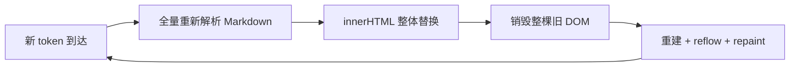

# 流式md渲染

"假设AI 正在流式输出一段 Markdown，如何实现页面不闪烁",这是每个 AI 聊天应用、Copilot 插件、写作助手都绕不开的问题。把 LLM吐出的token直接塞进 `v-html`/ `innerHTML`，页面会像坏掉的霓虹灯一样闪：代码块跳进跳出、滚动条乱窜、动画反复重放、输入框失焦。本文将核心讨论着个问题

## 闪烁的根源

> // 不是渲染太频繁，是渲染方式错了,最常见的错误做法是每个token到达都全量重渲染
> // 自己手写兼容实在太牛马，而且很多极端场景根本考虑不到，本文单纯是为了抬杠讲解技术，实际上社区存在非常成熟的解决方案，比如 [remend](https://github.com/vercel/streamdown/tree/main/packages/remend), `streamdown`等。

```ts
onToken((chunk) => {
  text.value += chunk;
  container.innerHTML = markdown.render(text.value); // 整棵 DOM 树销毁重建
});
```

闪烁有三个独立来源，需要分开治理：

### 1.1 全量重解析 + 全量重渲染

`innerHTML` 赋值意味着销毁整棵旧 DOM 树，从零重建,流式输出每秒可能到达几十上百个 token，等于每秒把整篇文档推倒重盖几十次。重建期间浏览器要执行 HTML 解析、样式计算、布局、绘制,这就是"闪"的主要来源



### 1.2 语法未完成造成的"结构跳变"

Markdown是上下文闭合的语法结构：一个 ` ``` ` 围栏未闭合时，后面所有文本都会被吸进代码块；`**` 未配对时，文本一会儿是普通文本、一会儿是加粗。流式输出的每一帧都是"未完成的语法"，直接解析必然导致结构反复横跳：

- ` ```js ` 刚出现 → 后续正文全部变成代码块样式；
- AI 输出闭合的 ` ``` ` → 内容"弹回"正文，整块高度骤变。

### 1.3 高度突变与 reflow

文本一行 → `h2` + 代码块三十行，高度差是几十倍。高度突变触发整个容器 reflow，浏览器要重新计算所有元素的布局位置，表现为内容跳动、滚动位置丢失

> 结论：控制渲染频率解决"重建太多次"，稳定 DOM解决"每次都重建"，语法感知解析解决"结构反复横跳"

## 控制渲染频率（Buffer & Throttle）

// token到达速度远超渲染能力，先让"数据流"和"渲染流"解耦，一般`30–100ms`的节流或`200ms / 500`字符的缓冲即可，太低无意义（一帧都画不完），太高则感知到了延迟

| 策略             | 行为                                | 适合流式场景吗                                     |
| ---------------- | ----------------------------------- | -------------------------------------------------- |
| 防抖（debounce） | 停止输入后等 N ms 才渲染一次        | 输出是持续不断的，永远等不到"安静"，渲染会一直拖尾 |
| 节流（throttle） | 固定节奏（如每 80ms）渲染一次       | 输出持续时也能稳定推进                             |
| 阈值批处理       | 每累积 N 字符（如 200–500）渲染一次 | 与 token 速率解耦，实践常与节流组合                |

```ts
import { ref, onUnmounted } from "vue";

export function useThrottledStream(intervalMs = 80) {
  const raw = ref(""); // 实时累积的原文（数据真相）
  const view = ref(""); // 节流后的渲染快照
  let timer: number | null = null;

  function append(chunk: string) {
    raw.value += chunk;
    if (timer !== null) return; // 已排队，等下一个周期
    timer = window.setTimeout(() => {
      timer = null;
      view.value = raw.value; // 取最新快照，期间不丢数据
    }, intervalMs);
  }

  onUnmounted(() => {
    if (timer !== null) clearTimeout(timer);
  });

  return { raw, view, append };
}
```

## 稳定 DOM，别让整棵树反复重建

节流解决了"次数"，但每次渲染仍然是全量重建。需要让让已经定型的部分不再重建，在流式场景，唯一会变化的是文档尾部，前面 90% 的内容根本没有变，每次全量渲染却是反复推倒重盖，导致滚动位置、选中状态、图片加载、动画全部被重置,我们的思路是把Markdown按顶层块（block）切分，每个块独立渲染、独立缓存。渲染时只更新新增或变化的块，已定型的块 DOM原样保留,每次新增内容追加一个新块节点并绑定唯一的key控制渲染，确保只有新新增的块才会被渲染

```html
<!-- 每个顶层块一个稳定的 v-for 节点，key 固定为块索引 -->
<div
  v-for="(_, index) in blocks"
  :key="index"
  class="md-block"
  v-html="renderBlock(index)"
/>
```

```ts
import MarkdownIt from "markdown-it";
import { computed } from "vue";

const md = new MarkdownIt({ html: false, linkify: true, breaks: true });

// 按空行切分顶层块
function splitBlocks(src: string): string[] {
  return src.split(/\n{2,}/).filter((b) => b.trim().length > 0);
}

const blocks = computed(() => splitBlocks(view.value));
const blockCache = new Map<number, string>();

function renderBlock(index: number): string {
  if (!blockCache.has(index)) {
    blockCache.set(index, md.render(blocks.value[index] ?? ""));
  }
  return blockCache.get(index)!;
}
```

// 注意：这里的切块必须语法感知。代码块内部允许空行，如果简单按 `\n\n` 切块，会把一个代码块切成多块，内部内容被当成正文渲染。正确做法是先识别围栏，再切块（见下一节）。
// shadcn等组件库的卡片、动画组件在流式期间频繁 remount会导致入场动画反复重放。原则：流式过程中 key 必须稳定，结构定型（流结束后）才允许切换组件形态。这也是很多"流式安全"渲染器的默认策略

### 滚动锚定与焦点保持

自动滚动是双刃剑：用户正在向上回看时，程序强行滚到底部非常恼人。要区分"程序跟随"和"用户滚动"：

```ts
const scrollBox = ref<HTMLElement | null>(null);
const stickToBottom = ref(true); // 是否跟随底部

function onScroll() {
  const el = scrollBox.value;
  if (!el) return;
  // 距离底部 < 24px 视为"跟随模式"，否则视为用户主动上翻
  stickToBottom.value = el.scrollHeight - el.scrollTop - el.clientHeight < 24;
}

watch(view, async () => {
  await nextTick();
  if (stickToBottom.value && scrollBox.value) {
    scrollBox.value.scrollTop = scrollBox.value.scrollHeight;
  }
});
```

焦点同理：不要把 AI 输出渲染进用户正在输入的元素；输出区和输入区物理分离，渲染永远不会碰输入框。

## 语法感知的流式解析

这是最容易踩坑、也最能拉开体验差距的部分。

### 问题：未闭合的围栏

````markdown
```js
const x = 1;
```

（AI 输出到这里，闭合的 ``` 还没来）
````

如果此时全量解析，`const x = 1` 和**后续所有文本**都会被当成代码块内容；等闭合符到达，整块又弹回正文。这就是"代码块闪进闪出"的真相。

### Safe / Pending分离

// 只渲染已经"定型"的部分，未完成的尾部留白，社区称为 safe / pending 分离。

1. 扫描全文，找到未闭合围栏（以及未配对的 `**`、`_`、行内 `` ` `` 等）；
2. 围栏之前的部分是 **safe**，正常切块、缓存、渲染；
3. 围栏及其之后是 **pending**，渲染为"代码块渲染中"的占位容器，**绝不参与正文解析**；
4. 闭合符到达后，pending 自动转正为正式代码块。

未闭合围栏检测（按行扫描，支持 ` ``` ` / `~~~`）：

```ts
function findUnclosedFence(src: string): { start: number } | null {
  const lines = src.split("\n");
  let fenceChar = "";
  let start = -1;

  for (let i = 0; i < lines.length; i++) {
    const m = lines[i].match(/^\s*(`{3,}|~{3,})/);
    if (!m) continue;
    const char = m[1][0];
    if (!fenceChar) {
      fenceChar = char;
      start = i;
    } else if (char === fenceChar) {
      fenceChar = ""; // 已闭合
    }
  }
  return fenceChar ? { start } : null;
}
```

// 完整实现还需校验闭合围栏长度 ≥ 开启长度、围栏后只能跟空格等 CommonMark 细节，此处为演示简化。

配套的语法感知切块（代码块内部不切碎）：

```ts
function splitBlocksSmart(src: string): string[] {
  const lines = src.split("\n");
  const blocks: string[] = [];
  let current: string[] = [];
  let fenceChar = "";

  const flush = () => {
    if (current.length) {
      blocks.push(current.join("\n"));
      current = [];
    }
  };

  for (const line of lines) {
    const m = line.match(/^\s*(`{3,}|~{3,})/);
    if (m) {
      const char = m[1][0];
      if (!fenceChar) fenceChar = char;
      else if (char === fenceChar) fenceChar = "";
    }
    // 代码块内的空行不切块；正文中的空行是块边界
    if (!fenceChar && line.trim() === "") flush();
    else current.push(line);
  }
  flush();
  return blocks;
}
```

### 另一个流派：解析前"修复前缀"（Prefix Repair）

部分团队选择先把未完成的 Markdown 补全成合法语法，再整体解析，闭合未闭合的代码围栏、补上未配对的 `**` / `_` / 行内反引号、把尚未完成的链接 URL 暂时剥离。解析器永远看到合法 Markdown，渲染平滑增长，不闪也不"吸"文本。缺点是要维护一套"补全器"的规则，对表格等复杂语法容易误判；但实现直接，配合节流就能拿到相当好的效果。

### 增量解析

更彻底的方向是流式增量解析器,维护一棵 append-only的 AST，新 token只更新受影响节点，DOM只patch变化区域。Flutter生态的 `streamdown`就是这个思路（未完成的块用临时样式渲染 + 稳定 widget key）。社区里 `@copse/streaming-markdown` 也提供了增量 DOM emitter，避免整块 `innerHTML` 抖动,对大多数 Web 应用，节流 + 块级缓存 + safe/pending已经足够了，且远比自研增量解析器可维护。

## 一个demo

```bash
npm create vite@latest stream-md-demo -- --template vue-ts
cd stream-md-demo
npm i markdown-it

# 把下面俩文件放到对应项目文件夹下
# useStreamingMarkdown.ts    App.vue

npm run dev
```

### `src/composables/useStreamingMarkdown/index.ts`

```ts
import { computed, nextTick, onUnmounted, ref, watch } from "vue";
import { toViewBlocks } from "./streamMarkdown";

interface Options {
  /** 两次提交之间的最小间隔（ms）。token 可以逐字到达，渲染只按这个节奏提交 */
  throttleMs?: number;
}

/** 距底部多少像素内算「贴底」 */
const STICK_THRESHOLD = 48;

/**
 * 流式 Markdown 渲染组合式函数：数据流（逐 token 追加）与渲染流（按节流间隔提交）解耦，
 * 附带滚动跟随能力。
 *
 * @param options 配置项
 * @returns 响应式视图块、追加/重置等方法与滚动跟随状态
 */
export const useStreamingMarkdown = (options: Options = {}) => {
  const throttleMs = options.throttleMs ?? 64;

  /** 已提交到视图的文本 */
  const source = ref("");
  /** 正在累积的文本（token 到这里，但不立刻渲染） */
  let buffer = "";
  let timer = 0;
  let lastCommit = 0;

  const commit = () => {
    if (timer) {
      clearTimeout(timer);
      timer = 0;
    }
    lastCommit = performance.now();
    source.value = buffer;
  };

  const schedule = () => {
    if (timer) {
      return;
    }
    timer = window.setTimeout(
      commit,
      Math.max(0, throttleMs - (performance.now() - lastCommit)),
    );
  };

  /** 追加增量（delta）。不要传全量前缀，否则原文会被重复拼接 */
  const append = (chunk: string) => {
    if (!chunk) {
      return;
    }
    buffer += chunk;
    schedule();
  };

  const reset = (text = "") => {
    buffer = text;
    commit();
  };

  const flush = () => {
    if (buffer !== source.value) {
      commit();
    }
  };

  const blocks = computed(() => {
    return toViewBlocks(source.value);
  });

  // —— 滚动跟随 ——
  const scrollBox = ref<HTMLElement | null>(null);
  const following = ref(true);
  let autoScrolling = false;

  const setScrollBox = (element: unknown) => {
    scrollBox.value = (element as HTMLElement | null) ?? null;
  };

  const toBottom = () => {
    const scrollElement = scrollBox.value;
    if (!scrollElement) {
      return;
    }
    autoScrolling = true;
    scrollElement.scrollTop = scrollElement.scrollHeight;
    requestAnimationFrame(() => {
      autoScrolling = false;
    });
  };

  const onScroll = () => {
    const scrollElement = scrollBox.value;
    if (!scrollElement || autoScrolling) {
      return;
    }
    const bottomDistance =
      scrollElement.scrollHeight -
      scrollElement.scrollTop -
      scrollElement.clientHeight;
    following.value = bottomDistance <= STICK_THRESHOLD;
  };

  /** 滚轮向上：立刻放弃跟随，不等 scroll 事件，手感更跟手 */
  const onWheel = (event: WheelEvent) => {
    if (event.deltaY < 0) {
      following.value = false;
    }
  };

  const resumeFollow = () => {
    following.value = true;
    toBottom();
  };

  watch(
    source,
    () => {
      nextTick().then(() => {
        if (following.value) {
          toBottom();
        }
      });
    },
    { flush: "post" },
  );

  onUnmounted(() => {
    if (timer) {
      clearTimeout(timer);
    }
  });

  return {
    source,
    blocks,
    append,
    reset,
    flush,
    setScrollBox,
    following,
    onScroll,
    onWheel,
    resumeFollow,
  };
};
```

### `src/composables/useStreamingMarkdown/streamMarkdown.ts`

````ts
import MarkdownIt from "markdown-it";

const markdownIt = new MarkdownIt({
  html: false,
  linkify: true,
  breaks: false,
});

export type BlockKind =
  | "heading"
  | "fence"
  | "list"
  | "quote"
  | "paragraph"
  | "hr"
  | "table";

export interface MdBlock {
  /** 稳定标识：类型 + 起始行号。块内容生长时 key 不变，Vue 就不会重建 DOM */
  key: string;
  kind: BlockKind;
  raw: string;
  /** 是否仍在生长（尚未被空行 / 闭合围栏封口） */
  open: boolean;
  lang: string;
  closed: boolean;
  /** 围栏内部已完成的行数，用于占位卡高度估算 */
  lines: number;
}

export interface RenderedBlock {
  key: string;
  kind: BlockKind;
  html: string;
  open: boolean;
  pending: { lang: string; rows: number } | null;
}

const RE_OPEN_FENCE = /^ {0,3}(`{3,}|~{3,})[ \t]*([^\s`]*)[ \t]*$/;
const RE_CLOSE_FENCE = /^ {0,3}(`{3,}|~{3,})[ \t]*$/;
/** 宽松标题：允许 `#` 后暂无空格（否则 "#" → "# " 会让段落跳变成 h1） */
const RE_HEADING = /^ {0,3}(#{1,6})[ \t]*(.*)$/;
/** 宽松列表项：允许 "-" / "1." 后暂无空格 */
const RE_UL = /^ {0,3}[-*+](?:[ \t]+|$)/;
const RE_OL = /^ {0,3}\d{1,9}[.)](?:[ \t]+|$)/;
const RE_QUOTE = /^ {0,3}>/;
const RE_HR =
  /^ {0,3}(?:\*[ \t]*){3,}$|^ {0,3}(?:-[ \t]*){3,}$|^ {0,3}(?:_[ \t]*){3,}$/;

/** 分隔行：| --- | :---: | 这类，只含 - : | 空格 */
const isTableDelimiterRow = (line: string): boolean => {
  const trimmedLine = line.trim();
  return (
    trimmedLine.includes("-") &&
    trimmedLine.includes("|") &&
    /^[-:| ]+$/.test(trimmedLine)
  );
};

/**
 * 语法感知切块：一次性把原文切成「块」，并标记哪一块还在生长。
 * 只有最后一块会随 token 变化，前面的块全部定型。
 *
 * @param source 完整的 markdown 原文（流式过程中是不断生长的前缀）
 * @returns 按出现顺序排列的块列表
 */
export const parseBlocks = (source: string): MdBlock[] => {
  const lines = source.split("\n");
  const lastIndex = lines.length - 1;
  const tailOpen = !source.endsWith("\n");
  const blocks: MdBlock[] = [];

  let kind: BlockKind | null = null;
  let startLine = 0;
  let blockLines: string[] = [];
  let fenceLang = "";
  let fenceChar = "";
  let fenceLength = 0;
  let fenceClosed = false;

  const emit = (isOpen: boolean) => {
    if (!kind) {
      return;
    }
    const raw = blockLines.join("\n");
    if (raw.trim() !== "" || kind === "fence") {
      blocks.push({
        key: `${kind}@${startLine}`,
        kind,
        raw,
        open: isOpen,
        lang: fenceLang,
        closed: kind === "fence" ? fenceClosed : true,
        lines:
          kind === "fence"
            ? Math.max(0, blockLines.length - 1 - (fenceClosed ? 1 : 0))
            : 0,
      });
    }
    kind = null;
    blockLines = [];
    fenceLang = "";
    fenceChar = "";
    fenceLength = 0;
    fenceClosed = false;
  };

  for (let lineIndex = 0; lineIndex <= lastIndex; lineIndex++) {
    const line = lines[lineIndex];

    // 围栏内部：吞掉一切，直到闭合
    if (kind === "fence") {
      blockLines.push(line);
      const closeMatch = line.match(RE_CLOSE_FENCE);
      if (
        closeMatch &&
        closeMatch[1][0] === fenceChar &&
        closeMatch[1].length >= fenceLength
      ) {
        fenceClosed = true;
        emit(false);
      }
      continue;
    }

    if (line.trim() === "") {
      emit(false);
      continue;
    }

    const fenceMatch = line.match(RE_OPEN_FENCE);
    if (fenceMatch) {
      emit(false);
      kind = "fence";
      startLine = lineIndex;
      blockLines = [line];
      fenceChar = fenceMatch[1][0];
      fenceLength = fenceMatch[1].length;
      fenceLang = fenceMatch[2] || "";
      continue;
    }

    const headingMatch = line.match(RE_HEADING);
    if (headingMatch) {
      emit(false);
      blocks.push({
        key: `heading@${lineIndex}`,
        kind: "heading",
        raw: line,
        open: tailOpen && lineIndex === lastIndex,
        lang: "",
        closed: true,
        lines: 0,
      });
      continue;
    }

    if (RE_HR.test(line)) {
      emit(false);
      blocks.push({
        key: `hr@${lineIndex}`,
        kind: "hr",
        raw: line,
        open: false,
        lang: "",
        closed: true,
        lines: 0,
      });
      continue;
    }

    // 表格：以 | 开头的行视为表格行；兼容无首竖线写法（本行含 | 且下一行是分隔行）
    if (
      line.trim().startsWith("|") ||
      (line.includes("|") &&
        lineIndex + 1 <= lastIndex &&
        isTableDelimiterRow(lines[lineIndex + 1]))
    ) {
      if (kind !== "table") {
        emit(false);
        kind = "table";
        startLine = lineIndex;
      }
      blockLines.push(line);
      continue;
    }

    if (RE_UL.test(line) || RE_OL.test(line)) {
      if (kind !== "list") {
        emit(false);
        kind = "list";
        startLine = lineIndex;
      }
      blockLines.push(line);
      continue;
    }

    if (RE_QUOTE.test(line)) {
      if (kind !== "quote") {
        emit(false);
        kind = "quote";
        startLine = lineIndex;
      }
      blockLines.push(line);
      continue;
    }

    // 懒续行：段落 / 列表项 / 引用的后续行归入当前块
    if (kind === "paragraph" || kind === "list" || kind === "quote") {
      blockLines.push(line);
      continue;
    }

    emit(false);
    kind = "paragraph";
    startLine = lineIndex;
    blockLines.push(line);
  }

  emit(tailOpen);
  return blocks;
};

const HTML_ESCAPES: Record<string, string> = {
  "&": "&amp;",
  "<": "&lt;",
  ">": "&gt;",
  '"': "&quot;",
};

const escapeHtml = (source: string): string => {
  return source.replace(/[&<>"]/g, (char) => {
    return HTML_ESCAPES[char];
  });
};

/** 取围栏内部正文（去掉开头的 ``` 行和结尾的闭合行） */
const extractFenceBody = (fenceRaw: string): string => {
  const bodyLines = fenceRaw.split("\n").slice(1);
  if (
    bodyLines.length &&
    RE_CLOSE_FENCE.test(bodyLines[bodyLines.length - 1])
  ) {
    bodyLines.pop();
  }
  return bodyLines.join("\n");
};

/** 拆一行表格为单元格（去掉首尾竖线，按 | 分割） */
const splitTableRow = (line: string): string[] => {
  let content = line.trim();
  if (content.startsWith("|")) {
    content = content.slice(1);
  }
  if (content.endsWith("|")) {
    content = content.slice(0, -1);
  }
  return content.split("|").map((cell) => {
    return cell.trim();
  });
};

/** 从分隔行读出各列对齐方式（center / right / 默认左对齐） */
const columnAligns = (delimiterLine: string): string[] => {
  return splitTableRow(delimiterLine).map((delimiterCell) => {
    const alignsLeft = delimiterCell.startsWith(":");
    const alignsRight = delimiterCell.endsWith(":");
    if (alignsLeft && alignsRight) {
      return "center";
    }
    if (alignsRight) {
      return "right";
    }
    return "";
  });
};

/** 把任务清单前缀转成复选框字符，避免 [ ] / [x] 被显示成普通文本 */
const preprocessTaskLists = (source: string): string => {
  return source.replace(
    /^(\s*(?:[-*+]|\d{1,9}[.)])[ \t]+)\[([ xX])\]/gm,
    (_match, markerPrefix: string, checkboxMark: string) => {
      return `${markerPrefix}${checkboxMark.toLowerCase() === "x" ? "☑" : "☐"}`;
    },
  );
};

/* ------------------------------------------------------------------ *
 * 未闭合 inline 语法检测
 * ------------------------------------------------------------------ */

type InlineKind = "bold" | "italic" | "code" | "link" | "url" | "strike";

interface OpenInline {
  type: InlineKind;
  start: number;
}

const RE_WORD = /[\p{L}\p{N}]/u;

const isWhitespace = (char: string | undefined): boolean => {
  return char === undefined ? true : /\s/.test(char);
};

/**
 * 扫描文本，返回「第一个未闭合 inline 结构的起点」；全部闭合则返回文本长度。
 *
 * 支持的标记：`code`、[text](url)、、**bold**、*italic*、~~strike~~。
 *
 * 关键点：
 * - 按 CommonMark 的 flanking 规则判断能否开启 / 闭合强调符，
 *   因此 `* 列表项` 里的 `*`（后面是空格）不会被误判成斜体起点，
 *   `snake_case` 里的 `_`（两侧都是字母）也不会被误判。
 * - 行尾的裸强调符（`**` / `~~`，后面还没有内容）视为「可能开启」，
 *   先挂起等待下一个字符决定，避免字面量闪现。
 *
 * @param text 待检测的 markdown 文本片段
 * @returns 第一个未闭合 inline 结构的起点下标；全部闭合时等于文本长度
 */
export const findPendingCut = (text: string): number => {
  const openStack: OpenInline[] = [];
  const textLength = text.length;
  let charIndex = 0;

  const stackTop = () => {
    return openStack.length ? openStack[openStack.length - 1] : undefined;
  };

  while (charIndex < textLength) {
    // 行内代码内部：只有等长反引号能闭合，其余标记一律忽略
    if (stackTop()?.type === "code") {
      if (text[charIndex] === "`") {
        let closeRunEnd = charIndex;
        while (closeRunEnd < textLength && text[closeRunEnd] === "`") {
          closeRunEnd++;
        }
        openStack.pop();
        charIndex = closeRunEnd;
        continue;
      }
      charIndex++;
      continue;
    }

    // 链接地址内部：只有 `)` 能闭合
    if (stackTop()?.type === "url") {
      if (text[charIndex] === ")") {
        openStack.pop();
      }
      charIndex++;
      continue;
    }

    const char = text[charIndex];

    // 行内代码：需要找到等长的反引号串才算闭合
    if (char === "`") {
      let openRunEnd = charIndex;
      while (openRunEnd < textLength && text[openRunEnd] === "`") {
        openRunEnd++;
      }
      const openRunLength = openRunEnd - charIndex;
      let scanIndex = openRunEnd;
      let isClosed = false;
      while (scanIndex < textLength) {
        if (text[scanIndex] === "`") {
          let closeRunEnd = scanIndex;
          while (closeRunEnd < textLength && text[closeRunEnd] === "`") {
            closeRunEnd++;
          }
          if (closeRunEnd - scanIndex === openRunLength) {
            isClosed = true;
            charIndex = closeRunEnd;
            break;
          }
          scanIndex = closeRunEnd;
        } else {
          scanIndex++;
        }
      }
      if (!isClosed) {
        openStack.push({ type: "code", start: charIndex });
        charIndex = openRunEnd;
      }
      continue;
    }

    // 图片 / 链接
    if (char === "!" && text[charIndex + 1] === "[") {
      openStack.push({ type: "link", start: charIndex });
      charIndex += 2;
      continue;
    }
    if (char === "[") {
      openStack.push({ type: "link", start: charIndex });
      charIndex++;
      continue;
    }
    if (char === "]") {
      if (stackTop()?.type === "link") {
        if (text[charIndex + 1] === "(") {
          const linkStart = openStack.pop()!.start;
          openStack.push({ type: "url", start: linkStart });
          charIndex += 2;
          continue;
        }
        // 行尾的 "]" 可能是 "(url)" 的前兆，继续保持挂起；否则当作普通方括号文本
        if (charIndex < textLength - 1) {
          openStack.pop();
        }
        charIndex++;
        continue;
      }
      charIndex++;
      continue;
    }

    // 删除线 ~~（GFM；单个 ~ 是字面量，不挂起）
    if (char === "~") {
      let runEnd = charIndex;
      while (runEnd < textLength && text[runEnd] === "~") {
        runEnd++;
      }
      const runLength = runEnd - charIndex;
      if (runLength >= 2) {
        const prevChar = charIndex > 0 ? text[charIndex - 1] : undefined;
        const nextChar = runEnd < textLength ? text[runEnd] : undefined;
        let isClosed = false;
        if (!isWhitespace(prevChar) && stackTop()?.type === "strike") {
          openStack.pop();
          isClosed = true;
        }
        if (!isClosed) {
          // 行尾的裸强调符（如刚敲完 "**"、"~~"、后面还没内容）先挂起：
          // 它是否开启由「下一个字符」决定，先藏起来避免字面量闪现
          if (!isWhitespace(nextChar) || runEnd === textLength) {
            openStack.push({ type: "strike", start: charIndex });
          }
        }
      }
      charIndex = runEnd;
      continue;
    }

    // 粗体 / 斜体（* 与 _）
    if (char === "*" || char === "_") {
      let runEnd = charIndex;
      while (runEnd < textLength && text[runEnd] === char) {
        runEnd++;
      }
      const runLength = runEnd - charIndex;
      const prevChar = charIndex > 0 ? text[charIndex - 1] : undefined;
      const nextChar = runEnd < textLength ? text[runEnd] : undefined;

      let canOpen: boolean;
      let canClose: boolean;
      if (char === "_") {
        // 下划线不允许词内使用
        canOpen =
          !isWhitespace(nextChar) &&
          !(prevChar !== undefined && RE_WORD.test(prevChar));
        canClose =
          !isWhitespace(prevChar) &&
          !(nextChar !== undefined && RE_WORD.test(nextChar));
      } else {
        canOpen = !isWhitespace(nextChar);
        canClose = !isWhitespace(prevChar);
      }

      let isClosed = false;
      if (canClose) {
        for (
          let stackIndex = openStack.length - 1;
          stackIndex >= 0;
          stackIndex--
        ) {
          const stackKind = openStack[stackIndex].type;
          // 闭合符长度必须够：单个 * 关不掉 **粗体
          if (
            stackKind === "italic" ||
            (stackKind === "bold" && runLength >= 2)
          ) {
            openStack.length = stackIndex;
            isClosed = true;
            break;
          }
        }
      }
      if (!isClosed) {
        // 行尾的裸强调符（如刚敲完 "**"、后面还没内容）先挂起，
        // 否则会被当作字面量画到屏幕上，等下一个 token 到达时再跳变。
        if (canOpen || runEnd === textLength) {
          openStack.push({
            type: runLength >= 2 ? "bold" : "italic",
            start: charIndex,
          });
        }
      }
      charIndex = runEnd;
      continue;
    }

    charIndex++;
  }

  let pendingCut = textLength;
  for (const openItem of openStack) {
    if (openItem.start < pendingCut) {
      pendingCut = openItem.start;
    }
  }
  return pendingCut;
};

/* ------------------------------------------------------------------ *
 * 流式渲染
 * ------------------------------------------------------------------ */

/** 裸的块级标记（`- `、`1. `、`> `），单独渲染会产出空元素 */
const RE_BARE_MARKER = /^ {0,3}(?:[-*+]|\d{1,9}[.)]|>)[ \t]*$/;
const RE_LEADING_MARKER = /^ {0,3}(?:[-*+]|\d{1,9}[.)]|>)[ \t]+/;

const isBareBlockMarker = (line: string): boolean => {
  return line.trim() !== "" && RE_BARE_MARKER.test(line);
};

/** 把块切成「可安全渲染的前缀」+「还没长完的尾巴」 */
const splitForStreaming = (
  blockRaw: string,
): { safe: string; pending: string } => {
  const pendingCut = findPendingCut(blockRaw);
  let safe = blockRaw.slice(0, pendingCut);
  let pending = blockRaw.slice(pendingCut);

  // 前缀最后一行若只剩裸标记，挪进 pending，避免渲染出空 <li> / 空引用
  const lastNewlineIndex = safe.lastIndexOf("\n");
  const lastLine =
    lastNewlineIndex >= 0 ? safe.slice(lastNewlineIndex + 1) : safe;
  if (isBareBlockMarker(lastLine)) {
    safe = lastNewlineIndex >= 0 ? safe.slice(0, lastNewlineIndex) : "";
    pending = lastLine + pending;
  }

  return { safe, pending };
};

type Wrap = "strong" | "em" | "code" | "del" | "plain";

/**
 * 从「未闭合片段」里提取该显示的内容。
 * 原则：绝不把  / **(...) 这类语法字符画到屏幕上，
 * 只显示它将来会变成的那段文字，闭合时视觉上只是「样式生效」。
 *
 * @param pending 未闭合的挂起片段（从第一个未闭合标记开始到文本末尾）
 * @returns 该显示的文字与包裹用的标签类型
 */
const describePending = (pending: string): { text: string; wrap: Wrap } => {
  let remaining = pending;
  // 去掉开头的块级标记，可能有多层（"> > "）
  for (let guard = 0; guard < 4; guard++) {
    const markerMatch = remaining.match(RE_LEADING_MARKER);
    if (!markerMatch) {
      break;
    }
    remaining = remaining.slice(markerMatch[0].length);
  }

  const cutAtUrlStart = (value: string) => {
    const urlStart = value.indexOf("](");
    return urlStart >= 0 ? value.slice(0, urlStart) : value;
  };

  /** 末尾残缺的闭合符（如 "**粗体*" 里的 "*"、"![兔兔]" 里的 "]"）不应该显示出来 */
  const trimTailMarkers = (value: string) => {
    return value.replace(/[*_`~]+$/, "");
  };
  const trimLinkTail = (value: string) => {
    return trimTailMarkers(value).replace(/[\])]+$/, "");
  };

  // 任务清单前缀 [ ] / [x]（可能只敲了一半 [ 或 [x）
  const taskMatch = remaining.match(/^\[([ xX])\]/);
  if (taskMatch) {
    return {
      text:
        (taskMatch[1].toLowerCase() === "x" ? "☑ " : "☐ ") +
        trimTailMarkers(remaining.slice(taskMatch[0].length)),
      wrap: "plain",
    };
  }
  if (/^\[[ xX]?$/.test(remaining)) {
    return { text: "", wrap: "plain" };
  }

  if (remaining.startsWith("![")) {
    return {
      text: trimLinkTail(cutAtUrlStart(remaining.slice(2))),
      wrap: "plain",
    };
  }
  if (remaining.startsWith("[")) {
    return {
      text: trimLinkTail(cutAtUrlStart(remaining.slice(1))),
      wrap: "plain",
    };
  }
  if (remaining.startsWith("~~")) {
    return { text: trimTailMarkers(remaining.slice(2)), wrap: "del" };
  }
  if (remaining.startsWith("**")) {
    return { text: trimTailMarkers(remaining.slice(2)), wrap: "strong" };
  }
  if (remaining.startsWith("__")) {
    return { text: trimTailMarkers(remaining.slice(2)), wrap: "strong" };
  }
  if (remaining.startsWith("*")) {
    return { text: trimTailMarkers(remaining.slice(1)), wrap: "em" };
  }
  if (remaining.startsWith("_")) {
    return { text: trimTailMarkers(remaining.slice(1)), wrap: "em" };
  }
  if (remaining.startsWith("`")) {
    let backtickCount = 0;
    while (
      backtickCount < remaining.length &&
      remaining[backtickCount] === "`"
    ) {
      backtickCount++;
    }
    return {
      text: trimTailMarkers(remaining.slice(backtickCount)),
      wrap: "code",
    };
  }
  return { text: trimTailMarkers(remaining), wrap: "plain" };
};

const wrapPending = (html: string, wrap: Wrap): string => {
  switch (wrap) {
    case "strong":
      return `<strong>${html}</strong>`;
    case "em":
      return `<em>${html}</em>`;
    case "code":
      return `<code>${html}</code>`;
    case "del":
      return `<del>${html}</del>`;
    default:
      return html;
  }
};

/** 把 pending 片段放进与块类型一致的外壳，避免闭合瞬间「从段落跳进列表」 */
const wrapPendingBlock = (blockKind: BlockKind, content: string): string => {
  if (blockKind === "list") {
    return `<ul><li>${content}</li></ul>`;
  }
  if (blockKind === "quote") {
    return `<blockquote><p>${content}</p></blockquote>`;
  }
  return `<p>${content}</p>`;
};

/** 渲染「还在生长」的 paragraph / list / quote */
const renderOpenText = (block: MdBlock): string => {
  const { safe, pending } = splitForStreaming(block.raw);
  const safeHtml = safe.trim()
    ? markdownIt.render(preprocessTaskLists(safe))
    : "";

  if (!pending) {
    return safeHtml;
  }

  const { text, wrap } = describePending(pending);
  const pendingSpan = text
    ? `<span class="md-pending">${wrapPending(escapeHtml(text), wrap)}</span>`
    : "";
  if (!pendingSpan) {
    return safeHtml;
  }

  // 前缀以段落收尾时，把尾巴塞进段落末尾，保持同一行，避免换行跳动
  if (block.kind === "paragraph" && /<\/p>\s*$/.test(safeHtml)) {
    return safeHtml.replace(/<\/p>\s*$/, `${pendingSpan}</p>`);
  }
  return safeHtml + wrapPendingBlock(block.kind, pendingSpan);
};

/** 单元格：内容里若有未闭合 inline 语法，同样只显示语义内容 */
const renderCell = (
  cellTag: "th" | "td",
  cellText: string,
  alignment: string,
): string => {
  const pendingCut = findPendingCut(cellText);
  const restText = cellText.slice(pendingCut);
  let cellHtml = pendingCut
    ? markdownIt.renderInline(cellText.slice(0, pendingCut))
    : "";
  if (restText) {
    const { text: pendingText, wrap } = describePending(restText);
    if (pendingText) {
      cellHtml += `<span class="md-pending">${wrapPending(escapeHtml(pendingText), wrap)}</span>`;
    }
  }
  const styleAttr = alignment ? ` style="text-align:${alignment}"` : "";
  return `<${cellTag}${styleAttr}>${cellHtml}</${cellTag}>`;
};

/** 渲染「还在生长」的表格：完整行渲染真表格，最后一行按单元格挂起 */
const renderOpenTable = (block: MdBlock): string => {
  const lines = block.raw.split("\n");
  const delimiterIndex =
    lines.length >= 2 && isTableDelimiterRow(lines[1]) ? 1 : -1;

  // 分隔行还没到：整块先按纯文本挂起（过滤 --- 分隔符碎片，不显示竖线）
  if (delimiterIndex < 0) {
    const pendingText = lines
      .flatMap((line) => {
        return splitTableRow(line);
      })
      .filter((cell) => {
        return cell !== "" && !/^[-:]+$/.test(cell);
      })
      .join("  ");
    return pendingText
      ? `<p><span class="md-pending">${escapeHtml(pendingText)}</span></p>`
      : "";
  }

  const alignments = columnAligns(lines[delimiterIndex]);
  const alignmentOf = (cellIndex: number) => {
    return alignments[cellIndex] ?? "";
  };
  const bodyLines = lines.slice(2);
  const lastBodyIndex = bodyLines.length - 1;
  const lastComplete =
    lastBodyIndex < 0 || bodyLines[lastBodyIndex].trim().endsWith("|");

  const buildRow = (rowLine: string) => {
    return `<tr>${splitTableRow(rowLine)
      .map((cell, cellIndex) => {
        return renderCell("td", cell, alignmentOf(cellIndex));
      })
      .join("")}</tr>`;
  };

  // 拆分复杂表达式：表头、已完整的行、还在生长的最后一行
  const headHtml = `<tr>${splitTableRow(lines[0])
    .map((cell, cellIndex) => {
      return renderCell("th", cell, alignmentOf(cellIndex));
    })
    .join("")}</tr>`;
  const bodyHtml = (lastComplete ? bodyLines : bodyLines.slice(0, -1))
    .filter((line) => {
      return line.trim() !== "";
    })
    .map((line) => {
      return buildRow(line);
    })
    .join("");
  const pendingRowHtml =
    !lastComplete && lastBodyIndex >= 0
      ? buildRow(bodyLines[lastBodyIndex])
      : "";

  return `<table><thead>${headHtml}</thead><tbody>${bodyHtml}${pendingRowHtml}</tbody></table>`;
};

/** 渲染「还在生长」的标题 */
const renderOpenHeading = (level: number, content: string): string => {
  const pendingCut = findPendingCut(content);
  const safe = content.slice(0, pendingCut);
  const pending = content.slice(pendingCut);
  const { text, wrap } = describePending(pending);
  const pendingSpan = text
    ? `<span class="md-pending">${wrapPending(escapeHtml(text), wrap)}</span>`
    : "";
  return `<h${level}>${markdownIt.renderInline(safe.trim())}${pendingSpan}</h${level}>`;
};

const renderBlock = (block: MdBlock): string => {
  switch (block.kind) {
    case "hr":
      return "<hr>";

    case "heading": {
      const headingMatch = block.raw.match(RE_HEADING)!;
      const level = headingMatch[1].length;
      const headingContent = headingMatch[2];
      return block.open
        ? renderOpenHeading(level, headingContent)
        : `<h${level}>${markdownIt.renderInline(headingContent.trim())}</h${level}>`;
    }

    case "fence": {
      const langAttr = block.lang
        ? ` data-lang="${escapeHtml(block.lang)}"`
        : "";
      return `<pre class="code-block"${langAttr}><code>${escapeHtml(extractFenceBody(block.raw))}</code></pre>`;
    }

    case "table":
      return block.open ? renderOpenTable(block) : markdownIt.render(block.raw);

    default: {
      if (block.open) {
        return renderOpenText(block);
      }
      return markdownIt.render(
        block.kind === "list" ? preprocessTaskLists(block.raw) : block.raw,
      );
    }
  }
};

/* ------------------------------------------------------------------ *
 * 缓存 & 对外视图
 * ------------------------------------------------------------------ */

/** 内容寻址缓存：同样的源码只渲染一次，块一旦定型即永久复用 */
const htmlCache = new Map<string, string>();
const CACHE_LIMIT = 400;

/**
 * 渲染单个块（带内容寻址缓存）。块一旦定型，同样的源码只渲染一次。
 * @param block 由 parseBlocks 产出的块
 * @returns 该块的 HTML
 */
export const renderBlockHtml = (block: MdBlock): string => {
  const cacheKey = `${block.kind}\u0000${block.closed ? 1 : 0}\u0000${block.raw}`;
  const cachedHtml = htmlCache.get(cacheKey);
  if (cachedHtml !== undefined) {
    return cachedHtml;
  }
  const renderedHtml = renderBlock(block);
  if (htmlCache.size >= CACHE_LIMIT) {
    const oldestKey = htmlCache.keys().next().value;
    if (oldestKey !== undefined) {
      htmlCache.delete(oldestKey);
    }
  }
  htmlCache.set(cacheKey, renderedHtml);
  return renderedHtml;
};

/**
 * 把完整原文转成视图块列表：围栏未闭合时给占位卡数据，其余块给出渲染后的 HTML。
 * @param source 完整 markdown 原文
 * @returns 供 v-for 渲染的视图块列表
 */
export const toViewBlocks = (source: string): RenderedBlock[] => {
  const viewBlocks: RenderedBlock[] = [];
  for (const block of parseBlocks(source)) {
    if (block.kind === "fence" && !block.closed) {
      viewBlocks.push({
        key: block.key,
        kind: block.kind,
        html: "",
        open: true,
        pending: {
          lang: block.lang,
          rows: Math.min(6, Math.max(2, block.lines + 1)),
        },
      });
    } else {
      viewBlocks.push({
        key: block.key,
        kind: block.kind,
        html: renderBlockHtml(block),
        open: block.open,
        pending: null,
      });
    }
  }
  return viewBlocks;
};
````

### `src/App.vue`

````html
<template>
  <div class="app">
    <header class="bar">
      <div>流式 Markdown</div>
      <div>
        <button style="cursor: pointer;" :disabled="!streaming" @click="toggle">
          {{ paused ? "继续" : "暂停" }}
        </button>
        <button style="cursor: pointer;" @click="start">
          {{ streaming ? "重新输出" : "模拟流式输出" }}
        </button>
      </div>
    </header>

    <div
      :ref="setScrollBox"
      class="scroll-box"
      @scroll.passive="onScroll"
      @wheel.passive="onWheel"
    >
      <div class="md">
        <div
          v-for="(item) in blocks"
          :key="item.key"
          class="md-block"
          :class="[`kind-${item.kind}`, { 'is-open': item.open && !item.pending }]"
        >
          <!-- 未闭合围栏：不展示半截代码，只给占位卡 -->
          <div v-if="item.pending" class="pending">
            <div class="pending-head">
              <span>{{ item.pending.lang || "code" }}</span>
              <span>思考中…</span>
            </div>
            <div class="pending-body">
              <i
                v-for="rowIndex in item.pending.rows"
                :key="rowIndex"
                class="skeleton"
              />
            </div>
          </div>
          <div v-else class="md-html" v-html="item.html" />
        </div>

        <div v-if="!blocks.length">等待第一段内容…</div>
      </div>
    </div>

    <button v-if="streaming && !following" class="jump" @click="resumeFollow">
      ↓ 已暂停跟随，回到底部
    </button>
  </div>
</template>

<script setup lang="ts">
  import { onMounted, onUnmounted, ref } from "vue";
  import { useStreamingMarkdown } from "./composables/useStreamingMarkdown/index";

  const {
    blocks,
    append,
    reset,
    flush,
    setScrollBox,
    following,
    onScroll,
    onWheel,
    resumeFollow,
  } = useStreamingMarkdown({ throttleMs: 64 });

  const DEMO_TEXT = [
    "|header1|header2|header3|",
    "|---|---|---|",
    "|row1|row2|row3|",
    "|row4|row5|row6|",
    "|row7|row8|row9|",
    "##### test",
    "",
    "[兔兔](https://www.baidu.com)",
    "# 流式渲染 Demo",
    "",
    "AI 的输出速度远快于 DOM 的重建速度，",
    "所以要把**数据流**和**渲染流**解耦：token 来一个追加一个，渲染却按帧提交。",
    "",
    "## 三条不跳变的规则",
    "### test",
    "",
    "- 已定型的块只渲染一次，之后的 token 不再碰它",
    "- 标题自己渲染，避免 `#` → `# ` 时从段落跳成标题",
    "- 列表、代码块按块切分，不会一会儿是段落一会儿是列表",
    "* ~~嘟嘟嘟哒哒哒~~",
    "* ~~嘟嘟嘟哒哒哒~~",
    "* ~~嘟嘟嘟哒哒哒~~",
    "* ~~嘟嘟嘟哒哒哒~~",
    "* ~~嘟嘟嘟哒哒哒~~",
    "* ~~嘟嘟嘟哒哒哒~~",
    "* ~~嘟嘟嘟哒哒哒~~",
    "* ~~嘟嘟嘟哒哒哒~~",
    "* ~~嘟嘟嘟哒哒哒~~",
    "",
    "- [x] 已定型块只渲染一次",
    "- [ ] 表格逐行生长，单元格先出文字再成列",
    "- [ ] 任务清单逐项勾选",
    "",
    "普通段落里的删除线 ~~未闭合时不显示波浪线~~ 恢复正常。",
    "",
    "```ts",
    "export function throttle(fn: () => void, wait = 64) {",
    "  let last = 0",
    "  return () => {",
    "    const now = performance.now()",
    "    if (now - last < wait) return",
    "    last = now",
    "    fn()",
    "  }",
    "}",
    "```",
    "",
    "> 这一整篇文字，都是一个 token 一个 token 打出来的。",
    "",
    "围栏没闭合之前，里面的内容只会是一张“渲染中”的占位卡；闭合的那一瞬间它才转正。",
    "",
    "```bash",
    "npm run dev",
    "```",
    "",
    "1. 贴底时自动跟随",
    "2. 向上滚一下，跟随立刻暂停",
    "3. 点右下角的按钮，重新贴底",
  ]
    .concat(
      (() => {
        const stressFenceBlocks: string[] = [];
        for (let fenceIndex = 0; fenceIndex < 50; fenceIndex++) {
          stressFenceBlocks.push("```\n" + `段落 ${fenceIndex}` + "\n```");
        }
        return stressFenceBlocks;
      })(),
    )
    .join("\n");

  const streaming = ref(false);
  const paused = ref(false);
  let timer: number | null = null;
  let tokens: string[] = [];
  let cursorIndex = 0;

  /** 拆成 1~3 字的 token，模拟真实流式输出的 chunk 边界 */
  const chunkify = (text: string): string[] => {
    const chunks: string[] = [];
    let cursor = 0;
    while (cursor < text.length) {
      const tokenLength = 1 + Math.floor(Math.random() * 3);
      chunks.push(text.slice(cursor, cursor + tokenLength));
      cursor += tokenLength;
    }
    return chunks;
  };

  const stopTimer = () => {
    if (timer !== null) {
      clearInterval(timer);
      timer = null;
    }
  };

  const runTimer = () => {
    stopTimer();
    timer = window.setInterval(() => {
      const step = Math.random() < 0.3 ? 2 : 1;
      for (
        let tokenOffset = 0;
        tokenOffset < step && cursorIndex < tokens.length;
        tokenOffset++
      ) {
        append(tokens[cursorIndex]);
        cursorIndex++;
      }
      if (cursorIndex >= tokens.length) {
        stopTimer();
        streaming.value = false;
        paused.value = false;
        flush();
      }
    }, 500);
  };

  const start = () => {
    reset();
    tokens = chunkify(DEMO_TEXT);
    cursorIndex = 0;
    streaming.value = true;
    paused.value = false;
    runTimer();
  };

  const toggle = () => {
    if (!streaming.value) {
      return;
    }
    paused.value = !paused.value;
    if (paused.value) {
      stopTimer();
    } else {
      runTimer();
    }
  };

  onUnmounted(stopTimer);

  onMounted(() => {
    if (new URLSearchParams(location.search).has("auto")) {
      start();
    }
  });
</script>

<style scoped>
  .app {
    padding: 16px;
  }

  .bar {
    display: flex;
    align-items: center;
    justify-content: space-between;
    gap: 12px;
    margin-bottom: 8px;
  }

  .scroll-box {
    height: calc(100vh - 110px);
    overflow-y: auto;
    padding: 12px;
    border: 1px solid #ddd;
  }

  .md-block {
    margin-bottom: 12px;
  }

  .md-html :deep(p) {
    margin: 0 0 8px;
  }

  .md-html :deep(blockquote) {
    margin: 0;
    padding-left: 10px;
    border-left: 3px solid #ccc;
    color: #666;
  }

  .md-html :deep(table) {
    border-collapse: collapse;
    margin: 0 0 8px;
  }

  .md-html :deep(th),
  .md-html :deep(td) {
    border: 1px solid #ddd;
    padding: 4px 10px;
  }

  .md-html :deep(th) {
    background: #f6f8fa;
  }

  .md-html :deep(code) {
    background: #f2f2f2;
    padding: 0 4px;
  }

  .md-html :deep(pre.code-block) {
    position: relative;
    margin: 0;
    padding: 26px 12px 12px;
    overflow-x: auto;
    background: #f6f6f6;
  }

  .md-html :deep(pre.code-block code) {
    background: none;
    padding: 0;
  }

  .md-html :deep(pre.code-block[data-lang])::before {
    content: attr(data-lang);
    position: absolute;
    top: 6px;
    left: 12px;
    font-size: 12px;
    color: #888;
  }

  /* 未闭合片段：按正常文字显示（只保留语义内容，不出现 md 标记符）。
   不加任何颜色 / 底纹，闭合时只发生「样式生效」，不会闪一下。 */
  .md-html :deep(.md-pending) {
    opacity: 0.92;
  }

  .md-block.kind-fence .md-html {
    opacity: 1;
    transition: opacity 0.3s;
  }

  @starting-style {
    .md-block.kind-fence .md-html {
      opacity: 0;
    }
  }

  /* 功能：未闭合围栏的占位卡 */
  .pending {
    padding: 8px 12px;
    border: 1px dashed #bbb;
    color: #888;
  }

  .pending-head {
    display: flex;
    gap: 8px;
    margin-bottom: 8px;
    font-size: 12px;
  }

  .skeleton {
    display: block;
    height: 10px;
    margin-bottom: 6px;
    background: #eee;
  }

  .skeleton:nth-child(2n) {
    width: 80%;
  }

  .jump {
    position: fixed;
    right: 24px;
    bottom: 24px;
  }
</style>
````
