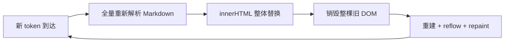

# 流式md渲染

"假设AI 正在流式输出一段 Markdown，如何实现页面不闪烁",这是每个 AI 聊天应用、Copilot 插件、写作助手都绕不开的问题。把 LLM吐出的token直接塞进 `v-html`/ `innerHTML`，页面会像坏掉的霓虹灯一样闪：代码块跳进跳出、滚动条乱窜、动画反复重放、输入框失焦。本文将核心讨论着个问题

## 闪烁的根源

// 不是渲染太频繁，是渲染方式错了,最常见的错误做法是每个token到达都全量重渲染

```ts
onToken((chunk) => {
  text.value += chunk;
  container.innerHTML = markdown.render(text.value); // 整棵 DOM 树销毁重建
});
```

闪烁有三个独立来源，需要分开治理：

### 1.1 全量重解析 + 全量重渲染

`innerHTML` 赋值意味着销毁整棵旧 DOM 树，从零重建,流式输出每秒可能到达几十上百个 token，等于每秒把整篇文档推倒重盖几十次。重建期间浏览器要执行 HTML 解析、样式计算、布局、绘制,这就是"闪"的主要来源



### 1.2 语法未完成造成的"结构跳变"

Markdown是上下文闭合的语法结构：一个 ` ``` ` 围栏未闭合时，后面所有文本都会被吸进代码块；`**` 未配对时，文本一会儿是普通文本、一会儿是加粗。流式输出的每一帧都是"未完成的语法"，直接解析必然导致结构反复横跳：

- ` ```js ` 刚出现 → 后续正文全部变成代码块样式；
- AI 输出闭合的 ` ``` ` → 内容"弹回"正文，整块高度骤变。

### 1.3 高度突变与 reflow

文本一行 → `h2` + 代码块三十行，高度差是几十倍。高度突变触发整个容器 reflow，浏览器要重新计算所有元素的布局位置，表现为内容跳动、滚动位置丢失

> 结论：控制渲染频率解决"重建太多次"，稳定 DOM解决"每次都重建"，语法感知解析解决"结构反复横跳"

## 控制渲染频率（Buffer & Throttle）

// token到达速度远超渲染能力，先让"数据流"和"渲染流"解耦，一般`30–100ms`的节流或`200ms / 500`字符的缓冲即可，太低无意义（一帧都画不完），太高则感知到了延迟

| 策略             | 行为                                | 适合流式场景吗                                     |
| ---------------- | ----------------------------------- | -------------------------------------------------- |
| 防抖（debounce） | 停止输入后等 N ms 才渲染一次        | 输出是持续不断的，永远等不到"安静"，渲染会一直拖尾 |
| 节流（throttle） | 固定节奏（如每 80ms）渲染一次       | 输出持续时也能稳定推进                             |
| 阈值批处理       | 每累积 N 字符（如 200–500）渲染一次 | 与 token 速率解耦，实践常与节流组合                |

```ts
import { ref, onUnmounted } from "vue";

export function useThrottledStream(intervalMs = 80) {
  const raw = ref(""); // 实时累积的原文（数据真相）
  const view = ref(""); // 节流后的渲染快照
  let timer: number | null = null;

  function append(chunk: string) {
    raw.value += chunk;
    if (timer !== null) return; // 已排队，等下一个周期
    timer = window.setTimeout(() => {
      timer = null;
      view.value = raw.value; // 取最新快照，期间不丢数据
    }, intervalMs);
  }

  onUnmounted(() => {
    if (timer !== null) clearTimeout(timer);
  });

  return { raw, view, append };
}
```

## 稳定 DOM，别让整棵树反复重建

节流解决了"次数"，但每次渲染仍然是全量重建。需要让让已经定型的部分不再重建，在流式场景，唯一会变化的是文档尾部，前面 90% 的内容根本没有变，每次全量渲染却是反复推倒重盖，导致滚动位置、选中状态、图片加载、动画全部被重置,我们的思路是把Markdown按顶层块（block）切分，每个块独立渲染、独立缓存。渲染时只更新新增或变化的块，已定型的块 DOM原样保留,每次新增内容追加一个新块节点并绑定唯一的key控制渲染，确保只有新新增的块才会被渲染

```html
<!-- 每个顶层块一个稳定的 v-for 节点，key 固定为块索引 -->
<div
  v-for="(_, index) in blocks"
  :key="index"
  class="md-block"
  v-html="renderBlock(index)"
/>
```

```ts
import MarkdownIt from "markdown-it";
import { computed } from "vue";

const md = new MarkdownIt({ html: false, linkify: true, breaks: true });

// 按空行切分顶层块
function splitBlocks(src: string): string[] {
  return src.split(/\n{2,}/).filter((b) => b.trim().length > 0);
}

const blocks = computed(() => splitBlocks(view.value));
const blockCache = new Map<number, string>();

function renderBlock(index: number): string {
  if (!blockCache.has(index)) {
    blockCache.set(index, md.render(blocks.value[index] ?? ""));
  }
  return blockCache.get(index)!;
}
```

// 注意：这里的切块必须语法感知。代码块内部允许空行，如果简单按 `\n\n` 切块，会把一个代码块切成多块，内部内容被当成正文渲染。正确做法是先识别围栏，再切块（见下一节）。
// shadcn等组件库的卡片、动画组件在流式期间频繁 remount会导致入场动画反复重放。原则：流式过程中 key 必须稳定，结构定型（流结束后）才允许切换组件形态。这也是很多"流式安全"渲染器的默认策略

### 滚动锚定与焦点保持

自动滚动是双刃剑：用户正在向上回看时，程序强行滚到底部非常恼人。要区分"程序跟随"和"用户滚动"：

```ts
const scrollBox = ref<HTMLElement | null>(null);
const stickToBottom = ref(true); // 是否跟随底部

function onScroll() {
  const el = scrollBox.value;
  if (!el) return;
  // 距离底部 < 24px 视为"跟随模式"，否则视为用户主动上翻
  stickToBottom.value = el.scrollHeight - el.scrollTop - el.clientHeight < 24;
}

watch(view, async () => {
  await nextTick();
  if (stickToBottom.value && scrollBox.value) {
    scrollBox.value.scrollTop = scrollBox.value.scrollHeight;
  }
});
```

焦点同理：不要把 AI 输出渲染进用户正在输入的元素；输出区和输入区物理分离，渲染永远不会碰输入框。

## 语法感知的流式解析

这是最容易踩坑、也最能拉开体验差距的部分。

### 问题：未闭合的围栏

````markdown
```js
const x = 1;
```

（AI 输出到这里，闭合的 ``` 还没来）
````

如果此时全量解析，`const x = 1` 和**后续所有文本**都会被当成代码块内容；等闭合符到达，整块又弹回正文。这就是"代码块闪进闪出"的真相。

### Safe / Pending分离

// 只渲染已经"定型"的部分，未完成的尾部留白，社区称为 safe / pending 分离。

1. 扫描全文，找到未闭合围栏（以及未配对的 `**`、`_`、行内 `` ` `` 等）；
2. 围栏之前的部分是 **safe**，正常切块、缓存、渲染；
3. 围栏及其之后是 **pending**，渲染为"代码块渲染中"的占位容器，**绝不参与正文解析**；
4. 闭合符到达后，pending 自动转正为正式代码块。

未闭合围栏检测（按行扫描，支持 ` ``` ` / `~~~`）：

```ts
function findUnclosedFence(src: string): { start: number } | null {
  const lines = src.split("\n");
  let fenceChar = "";
  let start = -1;

  for (let i = 0; i < lines.length; i++) {
    const m = lines[i].match(/^\s*(`{3,}|~{3,})/);
    if (!m) continue;
    const char = m[1][0];
    if (!fenceChar) {
      fenceChar = char;
      start = i;
    } else if (char === fenceChar) {
      fenceChar = ""; // 已闭合
    }
  }
  return fenceChar ? { start } : null;
}
```

// 完整实现还需校验闭合围栏长度 ≥ 开启长度、围栏后只能跟空格等 CommonMark 细节，此处为演示简化。

配套的语法感知切块（代码块内部不切碎）：

```ts
function splitBlocksSmart(src: string): string[] {
  const lines = src.split("\n");
  const blocks: string[] = [];
  let current: string[] = [];
  let fenceChar = "";

  const flush = () => {
    if (current.length) {
      blocks.push(current.join("\n"));
      current = [];
    }
  };

  for (const line of lines) {
    const m = line.match(/^\s*(`{3,}|~{3,})/);
    if (m) {
      const char = m[1][0];
      if (!fenceChar) fenceChar = char;
      else if (char === fenceChar) fenceChar = "";
    }
    // 代码块内的空行不切块；正文中的空行是块边界
    if (!fenceChar && line.trim() === "") flush();
    else current.push(line);
  }
  flush();
  return blocks;
}
```

### 另一个流派：解析前"修复前缀"（Prefix Repair）

部分团队选择先把未完成的 Markdown 补全成合法语法，再整体解析，闭合未闭合的代码围栏、补上未配对的 `**` / `_` / 行内反引号、把尚未完成的链接 URL 暂时剥离。解析器永远看到合法 Markdown，渲染平滑增长，不闪也不"吸"文本。缺点是要维护一套"补全器"的规则，对表格等复杂语法容易误判；但实现直接，配合节流就能拿到相当好的效果。

### 增量解析

更彻底的方向是流式增量解析器,维护一棵 append-only的 AST，新 token只更新受影响节点，DOM只patch变化区域。Flutter生态的 `streamdown`就是这个思路（未完成的块用临时样式渲染 + 稳定 widget key）。社区里 `@copse/streaming-markdown` 也提供了增量 DOM emitter，避免整块 `innerHTML` 抖动,对大多数 Web 应用，节流 + 块级缓存 + safe/pending已经足够了，且远比自研增量解析器可维护。

## 一个demo

```bash
npm create vite@latest stream-md-demo -- --template vue-ts
cd stream-md-demo
npm i markdown-it

# 把下面俩文件放到对应项目文件夹下
# useStreamingMarkdown.ts    App.vue

npm run dev
```

### `src/composables/useStreamingMarkdown.ts`

```ts
import { computed, nextTick, onUnmounted, ref, watch } from "vue";
import { toViewBlocks } from "../lib/streamMarkdown";

interface Options {
  /** 两次提交之间的最小间隔（ms）。token 可以逐字到达，渲染只按这个节奏提交 */
  throttleMs?: number;
}

/** 距底部多少像素内算「贴底」 */
const STICK_THRESHOLD = 48;

export const useStreamingMarkdown = (options: Options = {}) => {
  const throttleMs = options.throttleMs ?? 64;

  /** 已提交到视图的文本 */
  const source = ref("");
  /** 正在累积的文本（token 到这里，但不立刻渲染） */
  let buffer = "";
  let timer = 0;
  let lastCommit = 0;

  const commit = () => {
    if (timer) {
      clearTimeout(timer);
      timer = 0;
    }
    lastCommit = performance.now();
    source.value = buffer;
  };

  const schedule = () => {
    if (timer) return;
    const wait = Math.max(0, throttleMs - (performance.now() - lastCommit));
    timer = window.setTimeout(commit, wait);
  };

  /** 追加增量（delta）。不要传全量前缀，否则原文会被重复拼接 */
  const append = (chunk: string) => {
    if (!chunk) return;
    buffer += chunk;
    schedule();
  };

  const reset = (text = "") => {
    buffer = text;
    commit();
  };

  const flush = () => {
    if (buffer !== source.value) commit();
  };

  const blocks = computed(() => toViewBlocks(source.value));

  // —— 滚动跟随 ——
  const scrollBox = ref<HTMLElement | null>(null);
  const following = ref(true);
  let autoScrolling = false;

  const setScrollBox = (el: unknown) => {
    scrollBox.value = (el as HTMLElement | null) ?? null;
  };

  const toBottom = () => {
    const el = scrollBox.value;
    if (!el) return;
    autoScrolling = true;
    el.scrollTop = el.scrollHeight;
    requestAnimationFrame(() => {
      autoScrolling = false;
    });
  };

  const onScroll = () => {
    const el = scrollBox.value;
    if (!el || autoScrolling) return;
    const distance = el.scrollHeight - el.scrollTop - el.clientHeight;
    following.value = distance <= STICK_THRESHOLD;
  };

  /** 滚轮向上：立刻放弃跟随，不等 scroll 事件，手感更跟手 */
  const onWheel = (e: WheelEvent) => {
    if (e.deltaY < 0) following.value = false;
  };

  const resumeFollow = () => {
    following.value = true;
    toBottom();
  };

  watch(
    source,
    async () => {
      await nextTick();
      if (following.value) toBottom();
    },
    { flush: "post" },
  );

  onUnmounted(() => {
    if (timer) clearTimeout(timer);
  });

  return {
    source,
    blocks,
    append,
    reset,
    flush,
    setScrollBox,
    following,
    onScroll,
    onWheel,
    resumeFollow,
  };
};
```

### `src/App.vue`

````html
<template>
  <div class="app">
    <header class="bar">
      <div>流式 Markdown</div>
      <div>
        <button style="cursor: pointer;" :disabled="!streaming" @click="toggle">
          {{ paused ? "继续" : "暂停" }}
        </button>
        <button style="cursor: pointer;" @click="start">
          {{ streaming ? "重新输出" : "模拟流式输出" }}
        </button>
      </div>
    </header>

    <div
      :ref="setScrollBox"
      class="scroll-box"
      @scroll.passive="onScroll"
      @wheel.passive="onWheel"
    >
      <div class="md">
        <div
          v-for="(item) in blocks"
          :key="item.key"
          class="md-block"
          :class="[`kind-${item.kind}`, { 'is-open': item.open && !item.pending }]"
        >
          <!-- 未闭合围栏：不展示半截代码，只给占位卡 -->
          <div v-if="item.pending" class="pending">
            <div class="pending-head">
              <span>{{ item.pending.lang || "code" }}</span>
              <span>思考中…</span>
            </div>
            <div class="pending-body">
              <i v-for="n in item.pending.rows" :key="n" class="skeleton" />
            </div>
          </div>
          <div v-else class="md-html" v-html="item.html" />
        </div>

        <div v-if="!blocks.length">等待第一段内容…</div>
      </div>
    </div>

    <button v-if="streaming && !following" class="jump" @click="resumeFollow">
      ↓ 已暂停跟随，回到底部
    </button>
  </div>
</template>

<script setup lang="ts">
  import { onMounted, onUnmounted, ref } from "vue";
  import { useStreamingMarkdown } from "./composables/useStreamingMarkdown";

  const {
    blocks,
    append,
    reset,
    flush,
    setScrollBox,
    following,
    onScroll,
    onWheel,
    resumeFollow,
  } = useStreamingMarkdown({ throttleMs: 64 });

  const DEMO_TEXT = [
    "# 流式渲染 Demo",
    "",
    "AI 的输出速度远快于 DOM 的重建速度，",
    "所以要把**数据流**和**渲染流**解耦：token 来一个追加一个，渲染却按帧提交。",
    "",
    "## 三条不跳变的规则",
    "",
    "- 已定型的块只渲染一次，之后的 token 不再碰它",
    "- 标题自己渲染，避免 `#` → `# ` 时从段落跳成标题",
    "- 列表、代码块按块切分，不会一会儿是段落一会儿是列表",
    "* 嘟嘟嘟哒哒哒~~",
    "* 嘟嘟嘟哒哒哒~~",
    "* 嘟嘟嘟哒哒哒~~",
    "* 嘟嘟嘟哒哒哒~~",
    "* 嘟嘟嘟哒哒哒~~",
    "* 嘟嘟嘟哒哒哒~~",
    "* 嘟嘟嘟哒哒哒~~",
    "* 嘟嘟嘟哒哒哒~~",
    "* 嘟嘟嘟哒哒哒~~",
    "",
    "```ts",
    "export function throttle(fn: () => void, wait = 64) {",
    "  let last = 0",
    "  return () => {",
    "    const now = performance.now()",
    "    if (now - last < wait) return",
    "    last = now",
    "    fn()",
    "  }",
    "}",
    "```",
    "",
    "> 这一整篇文字，都是一个 token 一个 token 打出来的。",
    "",
    "围栏没闭合之前，里面的内容只会是一张“渲染中”的占位卡；闭合的那一瞬间它才转正。",
    "",
    "```bash",
    "npm run dev",
    "```",
    "",
    "1. 贴底时自动跟随",
    "2. 向上滚一下，跟随立刻暂停",
    "3. 点右下角的按钮，重新贴底",
  ]
    .concat(
      (() => {
        const list = [];
        for (let i = 0; i < 50; i++) {
          list.push("```\n" + `段落 ${i}` + "\n```");
        }
        return list;
      })(),
    )
    .join("\n");

  const streaming = ref(false);
  const paused = ref(false);
  let timer: number | null = null;
  let tokens: string[] = [];
  let index = 0;

  /** 拆成 1~3 字的 token，模拟真实模型的 chunk 边界（会切在任意位置） */
  const chunkify = (text: string): string[] => {
    const out: string[] = [];
    let i = 0;
    while (i < text.length) {
      const size = 1 + Math.floor(Math.random() * 3);
      out.push(text.slice(i, i + size));
      i += size;
    }
    return out;
  };

  const stopTimer = () => {
    if (timer !== null) {
      clearInterval(timer);
      timer = null;
    }
  };

  const runTimer = () => {
    stopTimer();
    timer = window.setInterval(() => {
      const step = Math.random() < 0.3 ? 2 : 1;
      for (let i = 0; i < step && index < tokens.length; i++)
        append(tokens[index++]);
      if (index >= tokens.length) {
        stopTimer();
        streaming.value = false;
        paused.value = false;
        flush();
      }
    }, 18);
  };

  const start = () => {
    reset();
    tokens = chunkify(DEMO_TEXT);
    index = 0;
    streaming.value = true;
    paused.value = false;
    runTimer();
  };

  const toggle = () => {
    if (!streaming.value) return;
    paused.value = !paused.value;
    if (paused.value) stopTimer();
    else runTimer();
  };

  onUnmounted(stopTimer);

  onMounted(() => {
    if (new URLSearchParams(location.search).has("auto")) start();
  });
</script>

<style scoped>
  .app {
    padding: 16px;
  }

  .bar {
    display: flex;
    align-items: center;
    justify-content: space-between;
    gap: 12px;
    margin-bottom: 8px;
  }

  .scroll-box {
    height: calc(100vh - 110px);
    overflow-y: auto;
    padding: 12px;
    border: 1px solid #ddd;
  }

  .md-block {
    margin-bottom: 12px;
  }

  .md-html :deep(p) {
    margin: 0 0 8px;
  }

  .md-html :deep(blockquote) {
    margin: 0;
    padding-left: 10px;
    border-left: 3px solid #ccc;
    color: #666;
  }

  .md-html :deep(code) {
    background: #f2f2f2;
    padding: 0 4px;
  }

  .md-html :deep(pre.code-block) {
    position: relative;
    margin: 0;
    padding: 26px 12px 12px;
    overflow-x: auto;
    background: #f6f6f6;
  }

  .md-html :deep(pre.code-block code) {
    background: none;
    padding: 0;
  }

  .md-html :deep(pre.code-block[data-lang])::before {
    content: attr(data-lang);
    position: absolute;
    top: 6px;
    left: 12px;
    font-size: 12px;
    color: #888;
  }

  .md-block.kind-fence .md-html {
    opacity: 1;
    transition: opacity 0.3s;
  }

  @starting-style {
    .md-block.kind-fence .md-html {
      opacity: 0;
    }
  }

  /* 功能：未闭合围栏的占位卡 */
  .pending {
    padding: 8px 12px;
    border: 1px dashed #bbb;
    color: #888;
  }

  .pending-head {
    display: flex;
    gap: 8px;
    margin-bottom: 8px;
    font-size: 12px;
  }

  .skeleton {
    display: block;
    height: 10px;
    margin-bottom: 6px;
    background: #eee;
  }

  .skeleton:nth-child(2n) {
    width: 80%;
  }

  .jump {
    position: fixed;
    right: 24px;
    bottom: 24px;
  }
</style>
````
