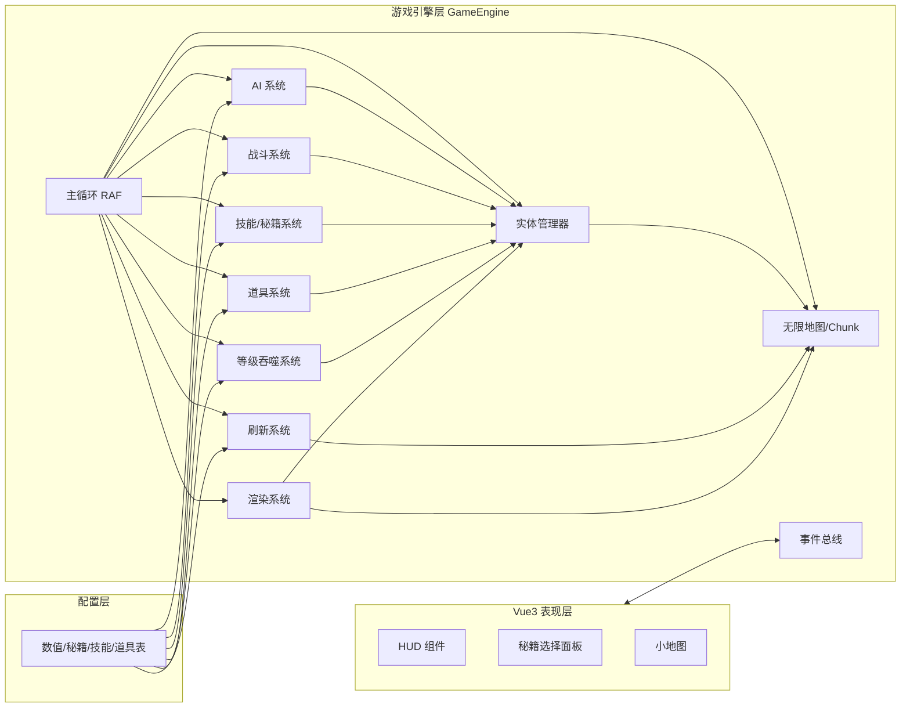
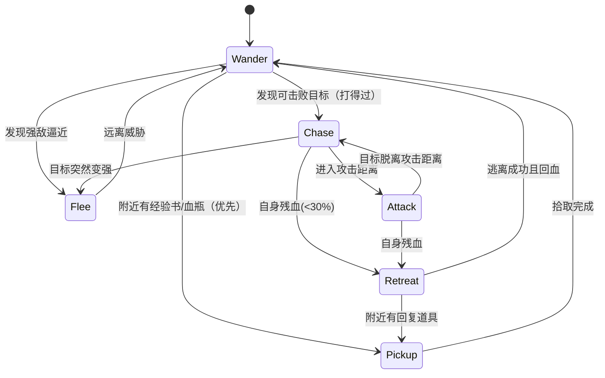

# bro-melee（兄弟大乱斗）技术开发文档

## 1. 项目概述

### 1.1 简介

在一张无限大的 Canvas地图上，玩家与散落各处的、各种等级的敌人互相混战，所有人互为敌人。每击败一个敌人，就能吞噬他的等级，\*每升 5 级，可以在多本武功秘籍中三选一学习或修炼；地图上散落经验书等道具；敌人AI 会残血逃跑、追击自己能打得过的目标、甚至捡经验书升级；敌人刷新带浮动范围，动态避免"玩家无敌无聊"或"玩家升不动被围猎"两种极端。

### 1.2 核心玩法循环

```
探索无限地图 → 遭遇敌人 → 战斗 → 击败并吞噬等级 → 升级
      ↑                                                        │
      └────────── 更强的敌人刷新（浮动难度）← 每 5 级选武功秘籍
```

### 1.3 核心体验目标

| 目标     | 说明                                             |
| -------- | ------------------------------------------------ |
| 成长爽感 | 击败敌人吞噬其等级，数值即时可见地变强           |
| 构筑乐趣 | 每 5 级三选一秘籍，形成"武功流派"                |
| AI 生态  | 敌人不是木桩，有趋利避害的生存行为               |
| 动态平衡 | 刷新浮动范围，让玩家始终"有得打、打得过、有威胁" |

### 1.4 需求要点拆解（PRD 转技术条目）

| 编号 | 需求                               | 技术落点                           |
| ---- | ---------------------------------- | ---------------------------------- |
| R1   | 无限大的 Canvas 地图               | 世界坐标 + 分块 Chunk + 惰性生成   |
| R2   | 散落各种等级的敌人                 | 等级浮动刷新系统                   |
| R3   | 击败敌人吞噬其等级                 | 击杀 → 吞噬 → 升级经验结算         |
| R4   | 每 5 级选择武功秘籍学习/修炼       | 升级事件 → 秘籍三选一 UI           |
| R5   | 所有人互为敌人                     | 统一阵营：每个实体独立阵营/仇恨表  |
| R6   | 敌人残血会跑                       | AI 状态机 RETREAT 状态             |
| R7   | 敌人 AI 追击当前能打过的敌人       | 威胁评估 + 目标选择                |
| R8   | 地图散落道具（经验书等）           | 道具系统 + 掉落 + 定时刷新         |
| R9   | 低等级敌人可拾取经验书避免战斗升级 | AI PICKUP 状态 + 道具拾取          |
| R10  | 敌人刷新有浮动范围                 | 难度自适应：下限防围猎，上限防无敌 |
| R11  | 敌人带技能                         | 敌人技能配置表 + AI 释放逻辑       |

---

## 2. 总体架构

### 2.1 分层架构

```
┌─────────────────────────────────────────────┐
│  Vue3 表现层（UI/视图）                        │
│  HUD、秘籍选择面板、小地图、开始/结算界面、血量条  │
├─────────────────────────────────────────────┤
│  游戏引擎层（纯 JS，不依赖 Vue）                │
│  GameEngine：主循环、实体管理、系统调度           │
│  Map/Chunk、Entity、AI、Spawn、Combat、        │
│  Skill、Item、Level、Render                    │
├─────────────────────────────────────────────┤
│  数据/配置层                                   │
│  数值表、秘籍表、技能表、道具表、敌人配置          │
└─────────────────────────────────────────────┘
```

### 2.2 模块划分



### 2.3 目录结构（已落地）

```text
bro-melee/
├── index.vue                    # 面板路由：开始 / 游戏 / 文档 / 源码
├── constants.js                 # 全局数值基线（战斗 / AI / 刷新 / 配色）
├── config/
│   ├── skills.js                # 玩家秘籍表（26 本常驻 + 14 本奇遇专属 encounterOnly）
│   ├── enemySkills.js           # 敌人技能表（dash/fireball/roar/frenzy/summon）
│   ├── enemies.js               # 敌人类型表（野狼/术士/巨汉/刺客/枭雄/谢逊/武林高手/大内高手/小师妹等 6 位奇遇角色）
│   ├── relics.js                # 神兵表（屠龙刀/倚天剑：加成、绝学、战力估值、合璧）
│   ├── treasures.js             # 奇遇宝物表（神木鼎/盟主令牌/乾坤大挪移/太玄真意/断臂/葵花袈裟）
│   ├── encounters.js            # 奇遇表（27 条：文案、选项、分类）
│   └── items.js                 # 道具表（经验书/金创药/护体符/疾风符/大还丹）
├── core/                        # 纯 JS 引擎层，零 DOM 依赖，可单独跑 Node 探针
│   ├── utils.js                 # 数学/随机/确定性哈希
│   ├── spatial-hash.js          # 空间哈希（邻近查询）
│   ├── chunk-map.js             # 无限地图：分块装饰确定性生成
│   ├── entities.js              # 玩家/敌人/道具/投射物工厂（含对象池重置）
│   ├── stats.js                 # 经验曲线、属性成长、战力评估、吞噬升级、宝物/buff 乘区
│   ├── effects.js               # 特效层（飘字/粒子/刀光/圆环/落雷/折线闪电）
│   ├── zones.js                 # 地面持续伤害区（火莲业火 / 万毒瘴）
│   ├── combat.js                # 伤害结算、近战扇形、范围伤害、死亡流程（破绽/中毒/反弹/随从替死都在 applyDamage）
│   ├── skills.js                # 秘籍三选一、主动武功释放、敌人技能、自动施法选技、奇遇直授
│   ├── ai.js                    # 敌人状态机（Wander/Chase/Attack/Retreat/Pickup/Follow/Escort）
│   ├── items.js                 # 道具掉落/刷新/拾取（含神兵拾取门槛与丢弃免疫）
│   ├── relics.js                # 神兵系统：持有/掉落/AI 评估/猎杀
│   ├── bonds.js                 # 谢逊/张翠山羁绊
│   ├── encounters.js            # 奇遇系统：标记浮出/触发/27 条结算/限时 buff/打坐/随从/追杀
│   ├── spawning.js              # 浮动刷新 + 压力调节 + 首领 + 谢逊 + 猎杀队 + 奇遇额外敌人
│   ├── companions.js            # 随从自修武功：抉择/离队誓约/属性折算
│   └── world.js                 # 主循环（固定步长）+ 输入 + HUD 事件
├── draw/
│   ├── actors.js                # 角色立绘：程序化骨架 + 行走/挥击/施法动画
│   └── renderer.js              # Canvas 渲染（背景缓存/实体/特效/奇遇光环/小地图）
├── composables/
│   └── useBroMelee.js           # Vue 桥接：HUD 节流同步、输入、开局重开
└── components/
    ├── StartPanel.vue           # 开始界面
    ├── CharacterGallery.vue     # 角色图鉴（首页入口，立绘预览 + 属性/武功档案）
    ├── GameMain.vue             # Canvas 宿主 + 输入 + 结算 + 奇遇面板挂载
    ├── EncounterPanel.vue       # 奇遇抉择弹窗 + 结果页（1/2/3 快捷键）
    ├── DebugPanel.vue           # 调试台（秘籍 / 状态 / 敌人 / 神兵 / 奇遇 五标签）
    ├── HudPanel.vue             # 血条/修为/属性/技能栏/首领血条/buff/宝物/随从
    └── SkillSelectPanel.vue     # 秘籍三选一弹窗（1/2/3 快捷键）
```

### 2.4 状态管理策略

- **引擎内部状态**：实体位置、血量、技能冷却等高频数据保存在引擎层（普通对象 + 数组），**不进 Vue 响应式**，避免脏检查开销。
- **Vue 只负责低频 UI 状态**：等级、秘籍列表、游戏状态（进行中/暂停/结算）等，通过事件总线同步到 `ref`。

```js
// 引擎层：普通对象
const player = { x: 0, y: 0, hp: 100, level: 1, ... }

// Vue 层：仅同步展示用数据
const hudState = ref({ hp: 100, maxHp: 100, level: 1, kills: 0 })
engine.on('hud-update', (s) => { hudState.value = { ...s } }) // 节流后触发
```

---

## 3. 无限地图系统

### 3.1 坐标体系

- **世界坐标（world）**：浮点，无边界。实体真正位置。
- **分块坐标（chunk）**：`chunk = floor(world / CHUNK_SIZE)`，用于管理。
- **相机/屏幕坐标**：`screen = world - camera.position`，用于渲染。

```js
const CHUNK_SIZE = 512; // px，每块 512×512
function toChunk(worldX, worldY) {
  return {
    cx: Math.floor(worldX / CHUNK_SIZE),
    cy: Math.floor(worldY / CHUNK_SIZE),
  };
}
```

### 3.2 分块惰性生成与回收

- 仅当 Chunk 进入"活跃区"（相机周围 `ACTIVE_CHUNK_RADIUS` 圈内）才生成实体/装饰。
- 离开活跃区且无实体时，从 Map 中移除，释放内存。

```js
class InfiniteMap {
  constructor() {
    this.chunks = new Map();
  }

  getChunk(cx, cy) {
    const key = `${cx},${cy}`;
    if (!this.chunks.has(key)) {
      this.chunks.set(key, new Chunk(cx, cy));
    }
    return this.chunks.get(key);
  }

  /** 回收相机周围 ACTIVE_CHUNK_RADIUS 之外的 chunk */
  gc(camera) {
    const cc = toChunk(camera.x, camera.y);
    for (const [key, chunk] of this.chunks) {
      const d = Math.max(
        Math.abs(chunk.cx - cc.cx),
        Math.abs(chunk.cy - cc.cy),
      );
      if (d > ACTIVE_CHUNK_RADIUS && chunk.isEmpty()) this.chunks.delete(key);
    }
  }
}
```

### 3.3 空间哈希（邻近查询加速）

战斗、AI、拾取都需要"附近有哪些实体"，用网格哈希把查询从 O(n) 降到 O(邻居)。

```js
class SpatialHash {
  constructor(cellSize = 128) {
    this.cellSize = cellSize;
    this.cells = new Map();
  }

  _key(cx, cy) {
    return `${cx},${cy}`;
  }

  insert(e) {
    const { minX, minY, maxX, maxY } = this._bounds(e);
    for (
      let cx = Math.floor(minX / this.cellSize);
      cx <= Math.floor(maxX / this.cellSize);
      cx++
    ) {
      for (
        let cy = Math.floor(minY / this.cellSize);
        cy <= Math.floor(maxY / this.cellSize);
        cy++
      ) {
        const k = this._key(cx, cy);
        if (!this.cells.has(k)) this.cells.set(k, new Set());
        this.cells.get(k).add(e);
      }
    }
  }

  query(x, y, radius) {
    const out = new Set();
    const minX = x - radius,
      minY = y - radius,
      maxX = x + radius,
      maxY = y + radius;
    for (
      let cx = Math.floor(minX / this.cellSize);
      cx <= Math.floor(maxX / this.cellSize);
      cx++
    ) {
      for (
        let cy = Math.floor(minY / this.cellSize);
        cy <= Math.floor(maxY / this.cellSize);
        cy++
      ) {
        const s = this.cells.get(this._key(cx, cy));
        if (s) for (const e of s) out.add(e);
      }
    }
    return [...out];
  }

  _bounds(e) {
    return {
      minX: e.x - e.r,
      minY: e.y - e.r,
      maxX: e.x + e.r,
      maxY: e.y + e.r,
    };
  }
}
```

> 注意：每个实体移动后要 `remove + insert` 或直接重建哈希；更省的做法是只在实体移动超过一个 cell 时更新。

### 3.4 地图装饰与背景

- 背景用噪声生成草地/道路/石块，绘制到离屏 Canvas 并缓存 chunk 背景位图。
- 装饰物不参与战斗，只进渲染层。

---

## 4. 实体系统

### 4.1 实体基类

```js
class Entity {
  constructor(id, type) {
    this.id = id;
    this.type = type; // 'player' | 'enemy' | 'projectile' | 'item'
    this.x = 0;
    this.y = 0;
    this.vx = 0;
    this.vy = 0;
    this.r = 16; // 碰撞半径
    this.hp = 100;
    this.maxHp = 100;
    this.level = 1;
    this.attack = 10;
    this.speed = 100;
    this.alive = true;
  }

  update(dt) {}
  render(ctx) {}
  takeDamage(amount, source) {}
  die(source) {}
}
```

### 4.2 实体类型

| 类型       | 说明            | 关键字段                |
| ---------- | --------------- | ----------------------- |
| Player     | 玩家，唯一      | 秘籍列表、技能槽        |
| Enemy      | 敌人，AI 驱动   | aiState、目标、技能配置 |
| Projectile | 弹道/技能投射物 | 方向、伤害、来源        |
| Item       | 经验书/血瓶等   | 道具类型、拾取半径      |
| FX（特效） | 伤害数字、粒子  | 生命周期                |

### 4.3 统一阵营（所有人互为敌人 R5）

不设"玩家阵营 vs 敌人阵营"，而是**每个实体独立阵营**：

```js
// 判断双方是否敌对：只要不是同一个"阵营 ID"就敌对
const isHostile = (a, b) => {
  return a.id !== b.id && a.faction !== b.faction;
};
// 敌人之间也互相敌对 → 每个人都是自己的 faction
```

敌人与敌人之间也会互打，超级大乱斗，

### 4.4 对象池（高频实体复用）

投射物、伤害数字、粒子用对象池避免 GC 抖动。

```js
class ObjectPool {
  constructor(factory) {
    this.factory = factory;
    this.free = [];
  }
  acquire(...args) {
    return this.free.pop() ?? this.factory(...args);
  }
  release(obj) {
    this.free.push(obj);
  }
}
```

---

## 5. 等级与吞噬系统

### 5.1 吞噬规则（R3）

- 敌人死亡时，击杀者（玩家或敌人）吞噬其等级
- 吞噬转化为经验值：`expGain = enemy.level * EXP_PER_LEVEL_BASE`，敌人等级越高，收益越高 → 鼓励挑战高等级。

```js
// LevelSystem.js
const onKill = (killer, victim) => {
  const exp = victim.level * 10; // 吞噬：每级 10 经验
  killer.exp += exp;
  killer.kills += 1;
  while (killer.exp >= expToNext(killer.level)) {
    killer.exp -= expToNext(killer.level);
    levelUp(killer);
  }
  eventBus.emit("hud-update", snapshot(killer));
};
```

### 5.2 升级曲线

```js
const expToNext = (level) => {
  return Math.floor(100 * Math.pow(1.15, level - 1)); // 示例：100、115、132…
};
```

### 5.3 属性成长

| 属性      | 每级成长      | 说明                                                             |
| --------- | ------------- | ---------------------------------------------------------------- |
| maxHp     | +12           | 血量上限                                                         |
| attack    | +4            | 攻击力                                                           |
| speed     | +0.5%（封顶） | 移动速度                                                         |
| r（体型） | +0.3          | 碰撞半径，吞噬等级后"变大"的视觉反馈(需要设计最大值，防止太大了) |

### 5.4 升级事件与秘籍入口

- 每次 `levelUp` 检查 `level % 5 === 0` → 触发秘籍选择（见 §6）。

---

## 6. 武功秘籍系统（每 5 级三选一）

### 6.1 触发规则（R4）

```
玩家升级 → 检查 level % 5 === 0 ?
   ├─ 是 → 暂停引擎 → 随机 3 本秘籍 → 玩家三选一 → 应用 → 恢复
   └─ 否 → 继续
```

- 秘籍池按玩家当前构筑过滤：已满级的秘籍不再出现；已学的可以再次出现（用于"修炼"叠层）。

### 6.2 秘籍数据结构

```js
// config/skills.js
export const SKILLS = [
  {
    id: "qi-boosting", // 内功：修炼类
    name: "吐纳心法",
    type: "passive", // passive 修炼 / active 主动武功
    desc: "每 5 秒回复 8% 最大生命",
    maxStack: 5,
    onAcquire(player, stack) {
      player.regen = 0.08 * stack;
    },
  },
  {
    id: "sword-wave",
    name: "剑气斩",
    type: "active", // 主动武功
    desc: "朝面朝方向释放剑气，造成 150% 攻击伤害",
    cooldown: 3,
    maxStack: 3,
    onAcquire(player, stack) {
      player.skills.set("sword-wave", { cooldown: 3, stack });
    },
  },
  // …更多
];
```

### 6.3 秘籍分类

| 分类             | 例子                       | 定位              |
| ---------------- | -------------------------- | ----------------- |
| 外功（主动武功） | 剑气斩、旋风腿、降龙掌     | 增加主动输出/控制 |
| 内功（被动修炼） | 吐纳心法、金钟罩、狂暴血统 | 生存/成长类加成   |
| 轻功（机动）     | 凌波微步、影步             | 移速/闪避/位移    |

// 等等武功 ......

### 6.4 三选一算法

```js
const rollChoices = (player, count = 3) => {
  const pool = SKILLS.filter(
    (s) =>
      !player.isSkillMaxed(s) && // 未满级
      s.unlockLevel <= player.level,
  ); // 解锁等级（可选）
  const weighted = pool.map((s) => ({ s, w: weightOf(player, s) }));
  const picked = [];
  for (let i = 0; i < count && weighted.length; i++) {
    const idx = weighted.length === 1 ? 0 : weightedRand(weighted);
    picked.push(weighted[idx].s);
    weighted.splice(idx, 1);
  }
  return picked;
};

// 已学秘籍权重降低（鼓励尝试新流派），满级排空
const weightOf = (player, s) => {
  const stack = player.skillStacks.get(s.id) ?? 0;
  return stack === 0 ? 1 : 0.6 / stack;
};
```

### 6.5 学习与修炼

- 首次选择 → 学习：注册技能/被动。
- 再次选择同一秘籍 → 修炼：`stack + 1`，效果按 `stack` 倍率强化，直至 `maxStack` 满级。

### 6.6 UI 交互（SkillSelectPanel.vue）

```js
// 引擎暂停并弹出面板
engine.on("skill-select", (choices) => {
  engine.paused = true;
  skillChoices.value = choices;
});
const choose = (skill) => {
  engine.applySkill(skill.id);
  engine.paused = false;
  skillChoices.value = null;
};
```

- 面板为居中卡片，三本秘籍横排，点击即选；键盘 1/2/3 快捷键可选。
- 选择期间引擎暂停，但渲染层继续绘制背景（半透明遮罩）。

---

## 7. 道具系统

### 7.1 道具类型（R8/R9）

```js
// config/items.js
export const ITEM_TYPES = {
  expBook: {
    name: "经验书",
    rarity: "common",
    effect: (e) => e.gainExp(e.level * 20),
  },
  heal: {
    name: "血瓶",
    rarity: "common",
    effect: (e) => e.heal(e.maxHp * 0.3),
  },
  shield: { name: "护盾", rarity: "rare", effect: (e) => (e.shield += 50) }, // buff持续一段时间
  speed: {
    // buff持续一段时间
    name: "疾风符",
    rarity: "rare",
    effect: (e) => (e.speedBoost = 1.5),
  },
  bomb: {
    name: "大还丹",
    rarity: "epic",
    effect: (e) => e.gainExp(e.level * 60),
  },
};
```

### 7.2 道具生成途径

- **敌人死亡掉落**：按概率掉落经验书/血瓶。
- **定时刷新**：每隔 `ITEM_SPAWN_INTERVAL` 在玩家周围（屏幕外一定距离）刷新 1~3 个。
- 经验书是"低等级敌人避免战斗升级"的关键（R9）。

### 7.3 拾取规则

- 任何实体进入道具 `r + 拾取半径` 即可拾取（玩家与敌人都可以）。
- 玩家拾取获得效果；敌人拾取同样生效 → 敌人也会吃经验书升级、吃血瓶回血。

---

## 8. 敌人 AI 系统

### 8.1 AI 状态机



### 8.2 威胁评估（"能不能打过" R7）

每个敌人周期性（如每 0.5s）对周围目标做战力评估：

```js
const threatScore = (e) => {
  return e.level * 10 + e.hp * 0.5 + e.attack * 3 + e.skillPower;
};

const canBeat = (me, target) => {
  const meS = threatScore(me);
  const tS = threatScore(target);
  return meS > tS * 1.25; // 必须明显强于对方才追击（欺软怕硬）
};
```

### 8.3 状态行为细节

| 状态    | 触发条件                             | 行为                                |
| ------- | ------------------------------------ | ----------------------------------- |
| Wander  | 默认                                 | 随机游走 + 偶尔向经验书方向移动     |
| Chase   | 视野内有 `canBeat` 的目标            | 选择评分最高/最近的"打得过"目标追击 |
| Attack  | 目标在攻击范围                       | 停步释放攻击/技能                   |
| Retreat | `hp/maxHp < 0.3`                     | 反向逃离最近的威胁源，寻找道具      |
| Pickup  | 视野内有经验书/血瓶且附近无强敌      | 优先拾取（低等级敌人借此升级 R9）   |
| Flee    | 视野内有 `threatScore > me*2` 的强敌 | 远离强敌，避免送命                  |

**破绽例外**：玩家打坐 / 眩晕（`stunTimer > 0.3s`）时被全地图视为「无还手能力」——跳过 `canBeat` 与威胁评估直接围攻（详见 §25）。

### 8.4 决策节流与邻居查询

- AI 决策不是每帧做，而是 `AI_TICK = 0.5s` 一次，用 SpatialHash 查询邻居，避免每帧全量 O(n²)。
- 敌人互相也是目标（R5）：敌人会追击"它打得过的其他敌人"，形成战场生态。

### 8.5 AI 参数配置表（示例）

| 参数              | 值   | 说明                 |
| ----------------- | ---- | -------------------- |
| VIEW_RADIUS       | 240  | 视野半径             |
| CHASE_MULTIPLIER  | 1.25 | 打得过阈值（战力比） |
| RETREAT_HP_RATIO  | 0.30 | 残血逃跑阈值         |
| FLEE_STRONG_RATIO | 2.0  | 强敌逃跑阈值         |
| AI_TICK           | 0.5s | 决策周期             |
| PICKUP_PRIORITY   | 高   | 低等级敌人优先拾取   |

---

## 9. 敌人技能系统（R11）

### 9.1 技能配置表

```js
// config/enemySkills.js
export const ENEMY_SKILLS = {
  dash: {
    type: "dash",
    damage: 1.2,
    range: 160,
    cooldown: 4,
    desc: "冲锋突袭", // 武功秘籍, 举例
  },
  fireball: {
    type: "projectile",
    damage: 1.5,
    range: 300,
    cooldown: 3,
    speed: 240,
    desc: "远程火球", // 武功秘籍, 举例
  },
  roar: {
    type: "aoe",
    damage: 1.8,
    radius: 120,
    cooldown: 6,
    desc: "范围震击", // 武功秘籍, 举例
  },
  frenzy: { type: "buff", atkMult: 1.5, hpBelow: 0.3, desc: "残血狂暴" }, // 武功秘籍, 举例
  summon: { type: "summon", count: 2, cooldown: 15, desc: "召唤小弟" }, // 武功秘籍, 举例
  // 等等，其他武功秘籍，
};
```

### 9.2 敌人配置（等级 → 技能）

```js
// config/enemies.js
export const ENEMY_TYPES = [
  { id: "wolf", baseLevel: 1, skill: "dash", color: "#a0522d" },
  { id: "mage", baseLevel: 3, skill: "fireball", color: "#4169e1" },
  { id: "ogre", baseLevel: 6, skill: "roar", color: "#2e8b57" },
  {
    id: "boss",
    baseLevel: 10,
    skill: ["roar", "summon", "frenzy"],
    color: "#8b0000",
  },
];
```

### 9.3 技能释放逻辑

- 冷却就绪 + 目标在技能范围内 + 满足血量阈值（如 frenzy 残血触发）→ 释放。
- 释放走与玩家秘籍同一套 `SkillSystem`，复用投射物/范围判定代码。

---

## 10. 刷新系统与难度浮动（R10，核心设计）

### 10.1 设计目标：双向防挫败

- **上限防"无敌无聊"**：总有敌人等级 ≥ 玩家，保持威胁感。
- **下限防"围猎卡死"**：总有低等级敌人/经验书供玩家"刷得动、升得动"，不至于被高等级敌人围殴到无法成长。

### 10.2 浮动范围算法

以玩家等级为基准，浮动区间动态收放：

```js
// config/balance.js
const SPAWN = {
  baseMinOffset: -3, // 基础下浮 3 级
  baseMaxOffset: +2, // 基础上浮 2 级
  minSpread: 3, // 最小等级差（保证有低等级可刷）
  maxSpread: 8, // 最大等级差（防止脱节）
};

// SpawnSystem.js
function calcSpawnRange(player, worldTime) {
  // 时间越久，区间越宽，挑战与机会同步增加
  const drift = Math.min(4, Math.floor(worldTime / 120)); // 每 2 分钟 +1，封顶 +4
  let minLv = player.level + SPAWN.baseMinOffset - drift;
  let maxLv = player.level + SPAWN.baseMaxOffset + drift;
  minLv = Math.max(1, minLv);
  if (maxLv - minLv < SPAWN.minSpread) maxLv = minLv + SPAWN.minSpread;
  if (maxLv - minLv > SPAWN.maxSpread) maxLv = minLv + SPAWN.maxSpread;
  return { minLv, maxLv };
}
```

### 10.3 动态压力调节

- 记录玩家近期击杀率与近期死亡/低血事件：
  - 击杀率高 → `maxOffset +1`（给更强敌人，防无敌）。
  - 频繁低血/死亡 → `baseMinOffset -1`（给更多低等级，防围猎）。

```js
const pressureAdjust = (player) => {
  const kills = player.stats.killsIn30s;
  const danger = player.stats.lowHpEventsIn30s;
  return {
    up: kills > 12 ? 1 : 0, // 杀太快 → 上浮更多
    down: danger >= 2 ? -1 : 0, // 常被打 → 下浮更多
  };
};
```

### 10.4 刷新规则

| 规则         | 值                               | 说明                  |
| ------------ | -------------------------------- | --------------------- |
| 刷新位置     | 玩家屏幕外 300~600px 环带        | 不凭空刷在视野内      |
| 刷新间隔     | 3~5s 一批，每批 1~4 只           | 按玩家等级决定批规模  |
| 场上敌人上限 | `12 + level * 2`（封顶 60）      | 防止同屏过载          |
| 等级分布     | 区间内加权随机（低等级概率更高） | 保证"有的刷"          |
| 特殊事件     | 每 90s 在远方刷一只首领          | 高等级 boss，掉落丰厚 |

### 10.5 防"无敌"与防"围猎"的兜底

- 若场上敌人平均等级比玩家低 4 级以上 → 下一批提高上浮（"养蛊"给压力）。
- 若玩家连续 60s 无击杀且低血 → 立即在附近刷 2 本经验书 + 1 个低等级敌人（"雪中送炭"）。

---

## 11. 战斗系统

### 11.1 攻击判定

- 近战：扇形/圆形范围检测（SpatialHash 查询 + 距离/角度过滤）。
- 远程：投射物实体，命中时回调伤害。
- 所有命中统一走 `CombatSystem.applyDamage(attacker, target, base)`。

### 11.2 伤害公式（示例）

```js
function calcDamage(attacker, target, skillMult = 1) {
  const base = attacker.attack * skillMult;
  const levelDiff = attacker.level - target.level;
  const scale = 1 + levelDiff * 0.03; // 等级压制 ±3%/级
  const crit = Math.random() < attacker.critRate ? 1.5 : 1;
  const dmg = base * scale * crit - target.defense * 0.5;
  return Math.max(1, Math.round(dmg));
}
```

### 11.3 受击反馈

- 击退：`target.vx += dir * knockback`
- 硬直：短暂 `stunTimer`
- 飘字：伤害数字浮动（对象池 FX）
- 闪红：命中帧描边

### 11.4 死亡流程

```
实体 hp <= 0 → die(source)
  ├─ 掉落：按表掉落经验书/血瓶（概率）
  ├─ 吞噬：LevelSystem.onKill(source, victim)
  ├─ 特效：死亡粒子
  └─ 移除：从 SpatialHash 与实体列表移除
```

---

## 12. 渲染系统

### 12.1 Canvas 分层

- 单 Canvas + 绘制顺序（简单方案）：背景 → 道具 → 投射物 → 敌人 → 玩家 → 特效 → UI。
- 性能方案：离屏背景层 + 主实体层 双 Canvas。

### 12.2 相机

```js
class Camera {
  constructor() {
    this.x = 0;
    this.y = 0;
  }
  follow(target, dt) {
    const lerp = 1 - Math.exp(-8 * dt); // 平滑跟随
    this.x += (target.x - this.x) * lerp;
    this.y += (target.y - this.y) * lerp;
  }
}
```

### 12.3 视口剔除

- 只渲染 `camera` 视野（含 margin）内的实体。
- 背景 chunk 只绘制活跃 chunk。

### 12.4 绘制要点

- 敌人按等级染色/缩放体型，等级越高越大越红 → 视觉直觉"打得过/打不过"。
- 残血敌人头顶显示"受惊"标志（!），提示 AI 逃跑状态，玩家可追杀。
- 经验书用发光圆点 + 微弱呼吸动画，吸引拾取。

---

## 13. Vue3 与 Canvas 协作

### 13.1 高频 UI 更新节流

- HUD 血量/等级每帧变化没必要驱动 Vue 渲染：引擎内每 `0.1s` 汇总一次 `hud-update` 事件。

---

## 14. 核心代码骨架（已实现，摘要）

引擎入口（`core/world.js`）：固定步长主循环 + 本帧两段式结算（先决策移动，再刷新空间哈希后结算攻击）。

```js
// 单个固定步长（1/60s），RAF 累加器驱动，切后台跳帧封顶 5 步
step(deltaTime) {
  this.time += deltaTime;
  this.activeActors = [this.player, ...存活敌人];      // 本帧共享快照
  this.updatePlayerTimers(deltaTime);   // 冷却/无敌/护盾/回血/技能CD
  this.updatePlayerIntent(deltaTime);   // 移动速度 + 普攻意图（未结算）
  this.updateEnemies(deltaTime);        // AI 决策 0.5s 节流 + 状态机
  this.applyMotion(deltaTime);          // 位移 = 移动 + 击退（指数摩擦）
  this.separateActors();                // 圆形互推，防重叠
  this.refreshHash();                   // SpatialHash 全量重建（角色+道具）
  this.resolveAttacks();                // 玩家扇形普攻 / 敌人近战 / 敌人技能
  this.resolveDashContacts();           // 冲锋撞击（dashHitIds 防重复）
  this.updateProjectiles(deltaTime);    // 投射物命中 + 穿透计数（对象池复用）
  updateItems(this, deltaTime);         // 道具呼吸动画 + 拾取结算
  this.spawner.update(this, deltaTime); // 浮动刷新 + 压力调节 + 首领 + 兜底
  this.cleanup();                       // 死亡移除 + 远处回收
  this.effects.update(deltaTime);
  this.updateCamera(deltaTime);
  this.trackPlayerCondition();          // 残血事件 → 压力调节
}
```

吞噬升级（`core/stats.js` + `core/combat.js`）：

```js
// 击杀结算：吞噬经验 → 升级 → 每 5 级入队一次秘籍三选一
const expGain = victim.level * BALANCE.EXP_PER_VICTIM_LEVEL;
const levelsGained = grantExp(killer, expGain); // 敌人杀敌人同样生效（R5）
if (killer.isPlayer) world.handlePlayerLevelUp(levelsGained);

// handlePlayerLevelUp 内部：
const earnedTotal = Math.floor(player.level / BALANCE.SKILL_EVERY_LEVELS);
if (earnedTotal > this.skillChoiceCount) {
  /* 队列 + 弹窗暂停引擎 */
}
```

威胁评估与状态机（`core/ai.js`）：

```js
// 战力分：等级 + 现血 + 攻击 + 技能强度软指标
threatScore = level * 10 + hp * 0.5 + attack * 3 + skillPower;
canBeat(a, b) = threatScore(a) > threatScore(b) * AGGRO_RATIO[a.typeId];

// 决策优先级（0.5s 一次）：
// 狂暴中 → 追击 | 残血(<30%) → 捡药/撤离 | 强敌(×1.8) → 逃离
// 比玩家强 ×1.3 → 主动循味猎杀（含首领，1500 码）| 捡道具 | 追可击败目标 | 游荡
```

浮动刷新（`core/spawning.js`）：

```js
const drift = min(4, floor(time / 120)); // 每 2 分钟区间 +1，封顶 4
minLevel = max(1, level - 3 - drift + pressureDown);
maxLevel = level + 2 + drift + pressureUp + 养蛊加成;
if (maxLevel - minLevel > 8) minLevel = maxLevel - 8; // 收窄低端保高端威胁
```

Vue 桥接（`composables/useBroMelee.js`）：引擎状态全部留在普通对象里，仅 HUD 快照以 10Hz 经事件推入 `ref`；秘籍选择时引擎 `paused = true`，选择后恢复。

---

## 15. 性能优化清单

| 项目       | 方案                           |
| ---------- | ------------------------------ |
| 邻居查询   | SpatialHash 网格，避免全量遍历 |
| AI 决策    | 0.5s 节流 + 只对活跃实体       |
| 对象复用   | 投射物/飘字/粒子对象池         |
| 视口剔除   | 只更新渲染视野内实体           |
| 分块回收   | chunk 惰性生成 + 远处回收      |
| 背景缓存   | chunk 背景离屏 Canvas 缓存     |
| 主循环     | 固定步长 + RAF，防切后台跳帧   |
| Vue 响应式 | 高频状态不进 Vue，HUD 事件节流 |
| 内存       | 死亡实体立即移出哈希与列表     |

---

## 16. 开发里程碑

| 阶段          | 内容                             | 验收标准                   |
| ------------- | -------------------------------- | -------------------------- |
| M0 引擎骨架   | 主循环、无限地图、玩家移动、相机 | 可无限移动不卡顿           |
| M1 战斗基础   | 敌人、近战攻击、击杀吞噬升级     | 击败敌人等级+经验正确      |
| M2 秘籍系统   | 每5级三选一、学习/修炼叠加       | 5/10/15 级均能选秘籍且生效 |
| M3 AI 生态    | 残血逃跑、追击可打目标、捡经验书 | 敌人行为符合 R6/R7/R9      |
| M4 技能与道具 | 敌人技能、经验书/血瓶/掉落       | 敌人会用技能，道具可拾取   |
| M5 浮动刷新   | 等级浮动 + 压力调节 + 首领       | 双向防挫败达标             |
| M6 表现层     | HUD、小地图、结算、音效、特效    | 完整可玩闭环               |

---

## 17. 风险与对策

| 风险                       | 对策                                            |
| -------------------------- | ----------------------------------------------- |
| 同屏实体过多掉帧           | 视口剔除 + 对象池 + 刷新上限兜底                |
| AI 全量计算开销            | 决策节流 + 空间哈希 + 只评估视野内              |
| 难度失衡（无敌/围猎）      | 浮动范围 + 压力调节 + 兜底事件（送经验书）      |
| 敌人互打导致玩家"没怪可打" | 刷新保底：保证玩家周围 2~4 个可击败敌人         |
| 吞噬数值膨胀失衡           | 等级差封顶（±5 级伤害缩放封顶）+ 数值表集中调参 |
| 无限地图内存               | chunk 惰性生成与回收 + 装饰位图复用             |

---

## 18. 附录：关键数值表

| 参数               | 值                     | 说明                      |
| ------------------ | ---------------------- | ------------------------- |
| EXP_PER_LEVEL_BASE | 10                     | 每吞噬 1 级得 10 经验     |
| expToNext(1)       | 100                    | 1→2 所需经验，增长率 1.15 |
| hp/level           | +12                    | 每级血量成长              |
| attack/level       | +4                     | 每级攻击成长              |
| 秘籍触发           | level % 5 === 0        | 每 5 级三选一             |
| RETREAT_HP_RATIO   | 0.30                   | 敌人残血逃跑              |
| CHASE_MULTIPLIER   | 1.25                   | 打得过阈值                |
| 刷新下浮/上浮      | -3 / +2（±压力调节）   | 浮动范围基线              |
| 场上敌人上限       | 12 + level\*2，封顶 60 | 防同屏过载                |
| 掉落概率           | 经验书 40%、血瓶 20%   | 死亡掉落                  |

---

## 19. 角色图鉴

- 首页「角色图鉴」按钮 → `components/CharacterGallery.vue`（index.vue 加 gallery 分支），13 个角色（玩家 + 12 类敌人）。
- 渲染零新代码：复用 `draw/actors.js drawActor` + renderer.js 导出的 `drawShadow / drawFootRing / drawHealthBar / drawLevelLabel`；展示朝向固定头朝上（facing = −π/2）。
- 实体由 `createPlayer / createEnemy` 真实工厂创建（属性即真实数值）；敌人按「模拟等级」滑块（1-40）实时重摇武功；出手/施法时长公式与 core 一致。
- 血条/等级文字用屏幕像素尺度重画（proxy 半径 = radius×scale×2.1），避免立绘放大后文字巨大。

## 20. 神兵系统：屠龙刀 + 倚天剑

**配置与常量**

- `config/relics.js`：双兵属性（bonus）、专属绝学（skill）、AI 战力估值（threat）、双兵合璧 `PAIR_BONUS`。注意 `*Multiplier` 是乘算（0.8 = −20%），`cooldownMultiplier / *Bonus / damageReduction` 是加算 —— 初版倚天剑 `dashCooldownMultiplier: -0.3` 被当乘算乘出负数再被 clamp 到 0.28，已改为 0.7。
- `constants.js RELIC_CONFIG`：谢逊 105s 首登场 / 伏诛后 150s 再现（登场等级 = 玩家 +9）；猎杀队 9-14s 一波、单波 1-2 名、场上上限 6、等级 = max(玩家, 持宝者) + 4~7；AI 评估阈值（PICKUP_SELF_RATIO 0.72 / PICKUP_THREAT_RATIO 1.15 / DROP_HP_RATIO 0.3 / DROP_IMMUNE_DURATION 3s）。

**新敌人**（`config/enemies.js`，weight 0 不进随机刷新池）

| 敌人     | 定位                                         | 生成方式                                                         |
| -------- | -------------------------------------------- | ---------------------------------------------------------------- |
| 谢逊     | 金毛狮王 boss，hp×5.6，五门武功，双兵之主    | 105s 定时登场；重刷时若神兵已有主/在地上则空手登场（防双份神兵） |
| 武林高手 | 神兵猎手，近战 + 冲锋，循杀气直扑持宝者      | 持宝者出现后按 HUNT 节奏刷                                       |
| 大内高手 | 神兵猎手，铁布衫 + 引雷 + 冷箭，偏爱远程偷袭 | 同上                                                             |

**核心流转**（`core/relics.js`）

- 神兵唯一：`findRelicHolder`（人手）→ `hasLooseRelic`（地上）→ 都没有才由 `ensureRelicsExist` 延迟 30s 重投。
- 获得即加成：玩家走 passive 乘区（`recalculatePlayerStats`），敌人走基础值乘算（`applyRelicStats`），血量按百分比保持。
- AI 拾取评估 `evaluateRelicPickup`：残血不贪、自身战力 < (自身+threat)×0.72 不贪、900 码内有打不过的强者不贪 → 巨汉会抢、野狼绕开（探针实测）。
- AI 丢宝 `shouldDropRelic`：血量 <30% 或周围敌人够多且平均战力更高 → 丢（1.2s 检查一次）。
- 丢下的神兵有 3s「丢弃免疫」—— 丢的人自己捡不回来，防止原地丢完立刻又拿上（无头冒烟实测发现的体验 bug）。
- 猎杀行为：`findRelicPrey` 锁定最近持宝者；高手无条件扑杀，普通敌人自认打得过才插一脚；`decideSnipe` 让残血/打不过/天生远程的猎手保持 230-360 码放冷箭（伤害 ×1.15）。

**玩家侧**

- Q/E 释放绝学：屠龙一斩（250 码扇形 240% + 击退）、倚天寒光（158 码环形 190% + 减速 2.4s）；R 丢下最后拿到的神兵；HUD 底部双槽（冷却遮罩 + 右键丢弃），持宝时右上角红色「神兵在手 · 高手正在追杀」。
- 双兵合璧额外 +25% 攻势 / +10% 暴击 / −8% 受伤，通知横幅提示。

## 21. 复仇谢逊 + 张翠山羁绊

**背景**：神兵唯一性生效后，「谢逊重刷时双兵已落他人之手」会空手登场,返场升级为复仇者讨还

**登场规则**（core/spawning.js spawnXieXun）

- 重刷时按「神兵唯一」过滤：双兵都被人持着/散在地上 → 谢逊空手现世，进入复仇形态（`revenge=true`，typeName 变「谢逊·复仇」，登场环与通知文案变红）；只带回一把则正常携兵登场、无张翠山。
- 复仇属性走 `RELIC_CONFIG.REVENGE`，**整档替换神兵加成而不是叠加**（讨回刀后仍按复仇算）：攻 ×2.15、血 ×1.5、防 +18、速 ×1.08、近战 +0.55、减伤 0.26 —— 稳定压过「双兵在手」档（实测同等级 攻 120/血 918/减伤 0.26 vs 101/742/0.14）。
- 复仇形态**无视战力评估直扑持兵者**（`findRelicPrey` 半径放大到 XIEXUN_HUNT_RADIUS 2600）
- 同时召唤**张翠山**随行（Lv = 谢逊 −3），`core/bonds.js` 建立双向羁绊。
- 复仇谢逊伏诛必掉大还丹 + 护体符，补偿空手 boss 的收益缺口。

**羁绊系统**（core/bonds.js）

- `linkBond(leader, escort)`：互写 `bondId/bondRole`，登场即吃满加成；`updateBonds` 每 0.5s 检查双方存活，状态变化才重算属性（保持血量百分比）。
- 加成数值：张翠山存活 → 谢逊 +20% 攻 / +8% 速；谢逊存活 → 张翠山 +25% 攻 / +12% 速 / +12% 减伤。任一方倒下，另一方 `bondBuff=null` 并掉档（探针实测 谢逊 120→110、张翠山 44→35）。
- 加成并入 `applyRelicStats`（读 `bondBuff`），与神兵/复仇同一乘区，天然幂等。

**张翠山 AI**（core/ai.js）

- 目标候选先剔除羁绊同伴（两人互不攻击）；`applyDamage` 里再加一层「羁绊豁免」—— 横扫、投射物、持续伤害区对同伴一律免伤（探针曾实测谢逊 sweep 误杀张翠山后修复）。
- 行为优先级：离谢逊 >720 码 → `follow` 状态跑回去（新状态，只贴身不出手）；否则集火谢逊当前目标
- 张翠山带 `bondId` 不参与距离清理；weight 0 不进随机刷新池；图鉴第 13 位「谢逊随从」。

**渲染**：两人之间暗金虚线（`drawBonds`，一方倒下变灰）；谢逊脚下双层红色复仇光环。

**调试**：神兵页新增「刷复仇谢逊 + 张翠山」—— 把双兵统统塞给玩家再刷谢逊，稳定复现复仇形态。

---

## 22. 奇遇系统

地图上随机浮出「奇遇」光环，走近自动触发：世界暂停弹出抉择面板，结算后给结果页，空格/回车继续上路。

### 22.1 触发与节奏

- `constants.js ENCOUNTER_CONFIG`：首遇 20s、之后 28~44s 一次、场上上限 2、半径 320~600 浮出、标记寿命 210s（快过期闪红）、触发判定 = 玩家半径 + 标记半径 + 10。
- `core/encounters.js`：`spawnEncounterToken`（可指定奇遇 id）→ `openEncounter`（`world.paused = true` + `onEncounter` 回调）→ `resolveEncounterChoice` → `pendingEncounterResult` 结果页 → `dismissEncounterResult` 恢复（若秘籍三选一还挂着则保持暂停）。
- 渲染：地面椭圆光环 + 渐变光柱 + 悬浮签（分类色描边、`measureText` 定宽），小地图加菱形标记。

### 22.2 27 条奇遇（config/encounters.js 纯数据表 + RESOLVERS 结算表）

五类：绝世神功 / 武功秘籍 / 队友与人物 / 坑爹与幽默 / 机缘与福利。实现要点：

| 机制                            | 落点                                                                                                                                                                   |
| ------------------------------- | ---------------------------------------------------------------------------------------------------------------------------------------------------------------------- |
| 白猿 50% 暴毙 / 藏经阁 50% 扣血 | `killPlayer` / `hurtPlayer`（奇遇代价不吃无敌与减伤，直接扣血）                                                                                                        |
| 剑冢断臂 −15% 攻 + 二十九剑破绽 | 宝物 `brokenArm` + 秘籍 `twenty-nine-swords`（`vulnerableMark` 写入，`vulnerableCrit` 计入暴击率）                                                                     |
| 太玄经洞打坐 10s                | `startChannel({ interruptible: false })`：`updatePlayerIntent` 早退钉死移动与出招；挨打不散功、伤害照算（`updateChannel` 只在 `interruptible` 时读 `hitFlash` 判散功） |
| 聋哑先生 30s × 3 次传功         | `player.masterPlan` 定时开 channel，打断只顺延 12s                                                                                                                     |
| 神木鼎攻击中毒                  | `applyDamage` 读 `hasTreasure('shenmuDing')` 写 `poisonTimer`，`updatePoison` 每 0.6s 跳伤                                                                             |
| 乾坤大挪移反弹 30%              | `applyDamage` 末段按 `passive.reflect` 弹回（反射致死走 `killEntity`）                                                                                                 |
| 随从替死                        | `applyDamage` 致死判定前找 320 码内 `guardFatal` 随从：伤害 ×0.08、随从阵亡                                                                                            |
| 小师妹 / 知恩图报的敌人         | `spawnCompanion`（`isCompanion`：不掉战利品、不占刷怪上限、不参与距离清理、与玩家互相免伤、青绿脚环 + 小地图青绿点）                                                   |
| 洪七公追杀 60s                  | `spawnNearby` + `forcedHuntTimer/leavesAfterHunt`（AI 优先级最高，到期骂骂咧咧退场）                                                                                   |
| 丐帮长老进刷新池                | `world.extraEnemyTypes`，`spawnBatch` 每批 28% 概率混入                                                                                                                |
| 盟主令牌升级变慢                | 宝物 `expMultiplier: 0.7`，`grantExp` 统一乘                                                                                                                           |
| 假秘籍自晕撕书                  | `castFakeDragon` 30% 自晕 2s + 撕书；`castPlayerSkill` 末尾守卫「书已撕不写冷却」，防幽灵 CD                                                                           |
| 葵花袈裟彩蛋                    | `updateTaunt` 每 9s 让 420 码内敌人飘一句「呸，练那玩意儿的」                                                                                                          |

- 新增 14 本 `encounterOnly` 秘籍（不进三选一池，`rollSkillChoices` 过滤，图鉴单独「奇遇绝学」分组）：九阳神功 / 易筋经 / 二十九剑 / 独孤九剑 / 左右互搏 / 蛤蟆功 / 降龙十八掌 / 打狗棒法 / 天山折梅手 / 葵花宝典 / 太玄真气 / 笑傲江湖曲 / 假·降龙十八掌。
- 新增 6 位奇遇角色（`config/enemies.js` weight 0，`pickEnemyType` 再挡一层 `isCompanion`；`draw/actors.js` 六套新立绘）：小师妹、受伤的敌人、熊孩子、熊孩子他爹、丐帮长老、洪七公。
- 宝物（`config/treasures.js`，永久）：神木鼎 / 盟主令牌（可丢弃，HUD 宝物栏右键销毁）/ 乾坤大挪移 / 太玄真意 / 断臂 / 葵花袈裟。数值经 `stats.js applyModifierList` 并入被动乘区，幂等；`hpMultiplier` 下限 0.4、`cooldownMultiplier` 下限 0.3。
- HUD 新增状态栏：buff chip（倒计时）/ 宝物 chip（可丢弃的右键销毁）/ 随从 chip（血条 + 护主标）；打坐时玩家头顶画进度条。

### 22.3 调试台「奇遇」标签

`core/debug.js`：`spawnEncounter` / `forceEncounter` / `resolveEncounterNow` / `grantTreasure` / `dropTreasure` / `grantBuff` / `spawnCompanion` / `startTestChannel` / `clearEncounters`，另有当前 buff/宝物/随从/打坐状态摘要。

---

## 23. 随从自修武功

小师妹入队，她跟着你一起攒秘籍，但学什么由她自己决定。

### 23.1 规则

| 规则           | 实现                                                                                                                                                                            |
| -------------- | ------------------------------------------------------------------------------------------------------------------------------------------------------------------------------- |
| 同频抉择       | 玩家每多一次秘籍三选一机会（每 5 级一次），她当场自行领悟一本（`core/world.js` 升级钩子 → `grantCompanionManuals`）                                                             |
| 完全自主       | 加权随机：没学过的优先、同本每多一层权重递减、奇遇绝学 ×0.35 降权、主动招式上限 3 本后大幅降权、超出她等级的 `unlockLevel` 不进池                                               |
| 六成火候       | `recalculateCompanionStats`：秘籍数值按 `COMPANION_MANUAL_CONFIG.SCALE = 0.62` 折算（攻/血/防/移速/暴击），吸血/减伤/反弹等战斗字段另乘 0.62、减伤封顶 0.4                      |
| 会放招         | `tryCastCompanionManual`（ai.js 随从攻击分支）：够得着且在冷却时甩主动招式，共用玩家的 `PLAYER_CAST_HANDLERS`，冷却记在 `enemy.manualCooldowns`                                 |
| 绝不碰葵花宝典 | `config/skills.js` 葵花宝典标 `shunnedBy: ['juniorSister']`：抉择池过滤；玩家练了 → `enforceCompanionOath` 当场离队；练了再遇奇遇 → `spawnCompanion` 拒绝入队（结果页写明缘由） |
| 触发面全覆盖   | 奇遇学秘籍（`world.learnSkill`）、调试台单本设置（`setSkillStack`）、一键满级（`maxAllSkills`）都会跑誓约检查                                                                   |
| 离队不掉东西   | `dismissCompanion`：`alive = false`，不掉战利品、不算击杀                                                                                                                       |

---

## 24. 随从跟随与集火

| 行为         | 规则                                                                                                                       |
| ------------ | -------------------------------------------------------------------------------------------------------------------------- |
| 优先跟随     | 空闲时贴回玩家身边（目标 96 码）；离玩家超过 `COMPANION_LEASH`（200）就先归队，绝不自己跑图——玩家 700 码外的敌人她看都不看 |
| 集火         | 玩家最近一次打中的敌人（`applyDamage` 里记 `focusTargetId/focusTargetTime`，4 秒记忆）优先作为她的目标，即使另一只更近     |
| 跟随 > 集火  | 玩家在跑动时（速度 > 30）取消集火宽限，她立刻放弃目标转身跟随——不为了一刀落在 500 码外                                     |
| 追不上就归队 | 目标没了/死了、或她被甩出 leash，立刻 escort                                                                               |
| 集火会过期   | 记忆窗口（4s）过后回到「玩家身边最近的敌人」，且只打 `COMPANION_ENGAGE`（380）半径内的                                     |

参数（constants.js `ENCOUNTER_CONFIG`）：`FOLLOW 96 / LEASH 200 / ENGAGE 380 / FOCUS_MEMORY 4s / FOCUS_BONUS 150`。实测：玩家持续跑动她峰值落后 222 码、停下 2 秒内贴回 96 码；静止集火最远只跟到 350 码（之前 500+）。

---

## 25. 自动战斗

`F` 键开关（HUD 右下按钮 / 调试台勾选）升级为「自动战斗」：不只是自动放武功，技能转冷却时还会穿插普攻，不会站着干瞪眼

### 25.1 决策节奏（core/world.js updateAutoCast / tryAutoMelee）

- 技能评估每 0.14s 一次（沿用 `pickAutoCastSkill`：射程内最近敌人 → 就绪 → autoRange / autoMinTargets / autoPriority）。
- **普攻每帧尝试**，不受 0.14s 节流拖累——但用上一次评估的结论做闸门（`autoCastHasSkill`）：有招可放时普攻让位，没招可放时普攻立刻补上，节奏精确贴 `attackInterval`（实测 2 秒 6 刀 = 0.34s/刀）。
- 出手条件：玩家没自己按攻击键（手动优先，绝不叠加）、普攻冷却已好、不在冲刺/眩晕/打坐传功中。
- 目标选择：普攻扇形射程内（`attackRange + radius`）最近敌人，方向自动转向目标；够不着就绝不挥空刀；`isCompanion` 永远不进候选。
- 联动：普攻命中同样会写 `focusTargetId`，小师妹照常集火她打中的目标。

## 26. 破绽感知

玩家打坐传功或被眩晕时毫无还手能力，敌人不再按 `canBeat` 算"我"打不打得过，而是直接扑上来,不然就会出现`我站着挨打的窗口，满地图敌人却围着我转圈然后走开`的诡异场面。

### 26.1 判定

- `core/ai.js isHelpless(world, actor)`：`actor.stunTimer > AI_CONFIG.EXPOSE_STUN`（0.3s，普通受击硬直 0.12s 不算）或玩家正在 `world.channel`（打坐/传功）。
- **选目标免检**（`findBestTarget`）：破绽目标跳过 `canBeat`，评分加 `EXPOSE_TARGET_BONUS = 60`（压过距离与残血权重）。
- **威胁重估**（`findStrongThreat`）：破绽目标构不成威胁，敌人不会因为它而 flee/retreat。
- **循味半径**（`decideBehavior`）：玩家破绽时，视野外 800/1500 码（普通/Boss）内的敌人一律 chase，不做战力门槛；视野内走免检通道。
- **记仇 4 秒**（`AI_CONFIG.ENGAGE_MEMORY`）：只有玩家**在破绽中挨的打**才写 `attacker.engageUntil`（combat.applyDamage）；破绽刚结束的 4 秒内敌人咬住不放（跳过 strongThreat 判定、玩家跑出视野也继续追），到期后照常恢复战力评估——避免“散功瞬间全场敌人一哄而散”的割裂感。
- 神兵争夺同样吃 `isHelpless`：持兵者眩晕时人人敢抢。
- **例外**：残血敌人（`hp/maxHp < 0.3`）仍会撤退，不因破绽送死。

### 26.2 视觉与参数

- `draw/renderer.js drawPlayer`：破绽时玩家脚下画两层红色脉冲警示环（`rgba(255, 78, 60)`，半径 2.2/2.5 倍角色半径，与血环拉开距离）。
- `AI_CONFIG` 新增：`EXPOSE_STUN: 0.3` / `EXPOSE_TARGET_BONUS: 60` / `ENGAGE_MEMORY: 4`。

## 27. 嘲讽气泡

玩家修习《葵花宝典》或《蛤蟆功》后，路过的敌人会偶尔冒出气泡说话框，说一句风凉话或干脆甩一个鄙视 emoji，你练什么，江湖都看在眼里。

### 27.1 规则（core/taunts.js + config/taunts.js）

- **触发条件**：`player.skillStacks` 里有 `sunflower-manual` / `toad-skill`（或身上带着葵花袈裟 `mockCassock`，原彩蛋台词并入本系统）。
- **节奏**：每 9~13 秒（`TAUNT_INTERVAL` + `TAUNT_JITTER`）挑一个敌人开口，只有玩家 **420 码内**「路过」的敌人才说（`TAUNT_RADIUS`）。
- **挑人**：活着、不是随从、不是羁绊同伴、当前没气泡在嘴上；台词池随机且不连续重复（`world.lastTauntText`）。
- **两种形态**：55% 台词气泡（文字 + 表情），45% 纯表情气泡（`TAUNT_EMOJI_ONLY_RATIO`）；纯表情 24px 高、台词 22px。
- **三套口径**（按功法分池，双修随机切换）：
  - 葵花宝典（粉 `#ffb3d1`）：「哟，这位是……公公？」「难怪身法这么快，了无牵挂啊」… 表情 🪡💅🤭😂🙄🤣
  - 蛤蟆功（绿 `#9fe07a`）：「哪来的蛤蟆，呱呱叫的」「这功夫是跟癞蛤蟆学的吧」… 表情 🐸🤢😂🥴🤣
  - 葵花袈裟（紫 `#c9a6ff`）：「呸，练那玩意儿的」「阿弥陀佛，罪过罪过」… 表情 🙏😂🙄🤣
- 气泡停留 **2.8 秒**，出现 0.18s 弹出淡入、结束前 0.3s 淡出，带轻微上浮；不影响敌人 AI。

### 27.2 绘制（draw/renderer.js drawTauntBubbles）

- 数据挂在 `enemy.bubble = { text, emoji, tone, duration, timer }`，core 每帧倒计时到 0 清空；renderer 只读。
- 圆角气泡 + 指向敌人的小尖角 + 底色 `rgba(16,14,12,0.9)`、描边用池的 tone 色；圆角路径自写 `roundRectPath`（不依赖浏览器 roundRect）。
- emoji 用 `'Segoe UI Emoji'` 字体串渲染；绘制层级在敌人之上、玩家之下。
- **内容必须按框中线垂直居中**：框体占局部坐标 `[-height, 0]`，文字/表情画在 `top + height / 2`（曾画在 0 → 内容全掉到框底外）；emoji 的 middle 基线视觉偏下，额外上抬 0.5px；纯表情框 27px 高防上下顶满，台词框 22px。

## 28 随从阵亡 / 复活 / 传功（§1/8/9/12）

- **阵亡**：`recordCompanionFallen` 拍快照（等级+自修秘籍）进 `world.fallenCompanions`，原地留倒地标记（红橙脉冲环+名牌），同类型本局不再刷新（`canCompanionJoin` 黑名单，复活路径绕过）。
- **施救（V 键）**：走近 150 码按 V 启动，读条 3 秒（可移动、**受击不打断**、禁普攻禁技能、离开 190 码中止），完成半血归队、秘籍原样保留。
- **传功（按住 T）**：对 170 码内受伤同伴持续回血 8%/s，玩家耗 2%/s 当前血；可移动、受击打断、松键收功、满血自停、离 215 码中断；与施救互斥；禁普攻禁技能。
- 渲染：倒地标记 / 施救读条（复用打坐进度条）/ 传功虚线光束。`reviveCompanionFrom` 放在 encounters.js（避免 companions ↔ encounters 循环依赖）。

## 29 技能槽折叠与键位自定义（§7）

- 超过 8 格折叠，右下「展开 N ˅」按钮；悬停槽位浮出秘籍详情 tooltip（`hud.activeSkills` 新增 `detail` 字段）。
- **键位自定义**：`core/keybinds.js` 纯 localStorage CRUD（`bro-melee-keybinds`），冲突自动让位；`components/KeybindPanel.vue` 点击按键框→按任意键完成绑定；局内（技能坞「改键」按钮）与**开局前主界面「键位设置」**共用一套，键位跨局保留；keydown 反查表 O(1) 命中，默认 1-9 仍可用。

---

## 30 噩梦模式与动态压力

普通模式完全沿用 §10.3 的压力曲线；噩梦模式额外开启**动态压力**——你把这张地图砍得越烂，江湖就变得越硬。

### 30.1 模式入口

| 端                          | 改动                                                                                            |
| --------------------------- | ----------------------------------------------------------------------------------------------- |
| `components/StartPanel.vue` | 按钮行新增红色「噩梦模式」（`$emit('start', 'nightmare')`），按钮行下方一行说明文案             |
| `index.vue`                 | `gameMode` ref，`onStart(mode)` 存模式后随 `:mode` 传给 `GameMain`（每局 key 重挂载）           |
| `components/GameMain.vue`   | `props.mode` → `game.setMode(mode)`（在 `game.start()` 前）；结算页噩梦时显示「噩梦模式」小标签 |
| `components/HudPanel.vue`   | 境界徽章旁显示红色「噩梦」角标（读 `hud.spawn.nightmare`）                                      |
| `core/world.js`             | `mode` / `nightmare` 字段 + `setMode()`；`reset()` 保留当前模式（「再来一局」不掉模式）         |

### 30.2 动态压力（core/spawning.js）

判定：玩家**致死一击**打掉目标 ≥ `OVERKILL_HIT_RATIO`（2/3）最大气血时记一次「一击秒杀」，再按被秒者在当前刷新区间的位置分档：

| 被秒的是                                        | 含义           | 调整                       |
| ----------------------------------------------- | -------------- | -------------------------- |
| 区间**最低级**敌人（`level <= minLevel + 0.5`） | 地图整体有点低 | `OVERKILL_STEP_LOW = 0.6`  |
| 区间**最高级**敌人（`level >= maxLevel - 0.5`） | 整张地图都太软 | `OVERKILL_STEP_HIGH = 1.5` |
| 中段敌人 / 没秒掉 / 毒与调试等无致死一击的击杀  | ——             | 不调整                     |

- 累计量 `overkillBonus` 同时加到 `calcSpawnRange` 的**两端**（弱敌不再无限刷），封顶 `OVERKILL_CAP = 10` 级，仍受 `MAX_SPREAD` 约束。
- 回落：超过 `OVERKILL_IDLE_BEFORE_DECAY = 25s` 没有再秒人，按 `OVERKILL_DECAY_PER_SECOND = 0.06`/s 缓慢回落，避免永久钉在封顶。
- 全程**不提示玩家**；召唤物（`isMinion`）与随从不参与判定。

### 30.3 数据链路与调试台

- 致死一击伤害经 `applyDamage → killEntity(world, victim, killer, { hitDamage }) → handleVictimDeath(victim, killer, info)` 传入 `spawner.registerOverkill`；`killEntity` 调用点（毒杀、调试清场等）不传即不计压。
- `buildHudSnapshot` 新增 `spawn` 段（`spawner.describeRange`）：模式、默认区间（只含时间漂移）、当前实际区间、两端调整量,击秒杀累计与低端/高端次数、击杀压力 / 濒死 / 均级补偿 / 时间漂移。
- 调试台「敌人」标签新增「刷新等级区间」面板（含「清零动态压力」按钮，`debugApi.resetSpawnPressure`）；
