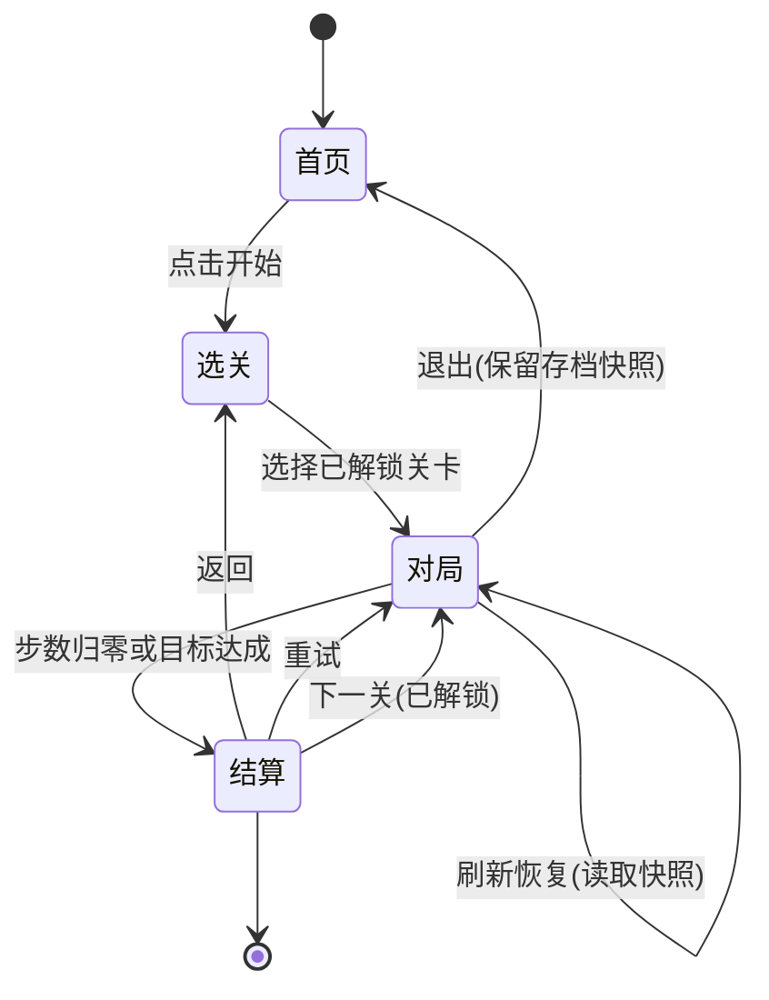

# 开心消消乐 · 需求文档

## 1. 项目概述

### 一句话定位

玩家在 n×m 棋盘上交换相邻方块，凑成三连及以上同色消除，在有限步数内达成关卡目标（目标分数 / 消除指定数量）的三消休闲游戏。

### 产品身份

| 项       | 决定                               |
| -------- | ---------------------------------- |
| 平台     | 只管pc端                           |
| 目标玩家 | 休闲玩家                           |
| 玩家关系 | 单人离线，无联网、无对战、无排行榜 |

### 设计支柱

1. **机会必须可读。** 棋盘静置时必须存在一眼可识别的合法交换；任何无解局面必须在玩家察觉前重洗。反例：一开局就卡死，玩家只能干等重洗动画。
2. **连锁决定手感。** 单次三连的反馈不重要，连锁带来的倍率累进与连续特效才是爽点；计分、飘分动画都围绕连锁设计。反例：每次消除只加固定分，连锁与否无差别。
3. **步数是唯一压力。** P0 不引入限时、随机惩罚；难度只通过"步数收紧 × 目标抬高"表达，玩家失败时能明确归因到"步数不够"。反例：过关失败后玩家不知道是运气差还是打错。

---

## 2. 玩法走读

eg:

棋盘是 n×m、7 种颜色的方块。交换动画 0.12 秒完成，同色方块同时闪烁并消散，飘出 "+30"；上方几个块整体下落补位，顶部补出新的随机块。下落完成时，如果出现恰好连成三连——连锁第一波开始，倍率 ×2，飘出 "+60"。棋盘落定，剩余步数从 20 变成 19，左上角的进度条向目标推进了一截。

玩家凑出一个四连：四只连色块消除，原地生成一枚"直线炸弹"（消除后保留在棋盘上）。又过两步，玩家把直线炸弹与临近一只色块交换触发三连或n连，炸弹触发，整行/列块一起消除，飘分 "+70+50"，一行行方块下落，又带出一次连锁。此时分数已经过了 800，进度条过半。

如果最后一步没凑出消除，步数归零、分数不足，结算界面显示"差 XX 分"，玩家点"重试"原地再来。失败原因始终可读：步数用完了，不是系统惩罚。

---

## 3. 玩法架构

### 三层循环

| 层级             | 内容                                            | 传递物                               |
| ---------------- | ----------------------------------------------- | ------------------------------------ |
| 瞬时（一次操作） | 读盘 → 选交换 → 消除/连锁 → 计分飘字 → 盘面落定 | 每波消除得分、连锁倍率、生成的特殊块 |
| 单局（一关）     | 有限步数内推进目标 → 星级结算 → 重试或进下一关  | 分数、剩余步数、目标进度、星级       |
| 长期（跨局）     | 解锁下一关、关卡目标类型逐步变丰富              | 解锁进度、各关最高星、最高分         |

### Game Flow



---

## 4. 核心机制

### 棋盘与方块

| 项     | 决定                                                          |
| ------ | ------------------------------------------------------------- |
| 棋盘   | m 行 × n 列，格数可在关卡配置中调整                           |
| 基础块 | 7 种颜色，为动物/糖果图标(emoji)                              |
| 特殊块 | 直线炸弹（消整行/整列）、九宫炸弹（消 3×3）、彩球（同色全消） |

**初始生成（RULE-BOARD-GEN）**：逐格填充时规避左右或上下已形成三连的颜色；整盘生成后必须存在至少一个合法交换，否则整盘重洗，重洗上限 3 次，以最后一张盘进入游戏。保证开局无残留三连、无死局。

### 交换与合法性（RULE-SWAP）

- 玩家选择两个相邻块交换（点击两块 / 滑动方向）。
- 只有交换后能在行或列形成不少于 3 个同色连续的交换才合法；合法交换消耗 1 步。
- 非法交换执行回弹动画并复位，不消耗步数、不产生消除。

### 4.3 消除与特殊块生成（RULE-MATCH）

行或列连续 3 个及以上同色块即消除，按消除形状生成特殊块：

| 消除形状      | 生成特殊块 | 触发效果                   |
| ------------- | ---------- | -------------------------- |
| 三连          | 无         | 消除 3 块                  |
| 四连（横/竖） | 直线炸弹   | 消除整行或整列             |
| L 型 / T 型   | 九宫炸弹   | 消除 3×3 九格              |
| 五连          | 彩球       | 与任意同色块交换后全消该色 |

**双特殊块交换（RULE-SPECIAL-COMBO，P1 实现）**：彩球 + 彩球 = 清屏；彩球 + 直线/九宫炸弹 = 先全消同色块再触发对应效果。

### 4.4 连锁（RULE-CASCADE）

- 消除后，上方方块按重力下落、顶部补出新块；补位后重新检测消除并循环，直到无消除为止。
- 第 n 次连锁（n ≥ 1）本波得分 × 2^(n-1)，倍率序列 1 → 2 → 4 → 8，封顶 8。
- 连锁期间持续锁输入；连锁结束才恢复可操作。

### 4.5 步数与胜负结算（RULE-STEP-CONSUME）

- 每次合法交换消耗 1 步；非法交换不消耗。
- 步数归零立即终局（正在播放的连锁取消后续波次，只结算已展示部分）：
  - 达成全部目标 → 胜利，按分数评星；
  - 未达成 → 失败，展示缺口（如"还差 120 分"），可重试或返回选关。

**星级**：1 星 = 达到目标分；2 星 = ≥ 目标 ×1.5；3 星 = ≥ 目标 ×2。

### 4.6 关卡目标类型

| 类型         | 说明                                                  | 优先级 |
| ------------ | ----------------------------------------------------- | ------ |
| 目标分数     | 对局内累计得分 ≥ 目标分                               | P0     |
| 消除指定数量 | 对局内累计消除某色块数量 ≥ 目标（特殊块消除的块计入） | P0     |
| 清除冰块     | 双层方块需消除两次，消除一层变普通块                  | P1     |

---

## 5. 数值设计

### 5.1 计分公式

```
单波得分 = 本波消除块数 × 10 × 连锁倍率 + 特殊块触发奖励
连锁倍率 = 1 / 2 / 4 / 8（第 4 波起封顶）
特殊块奖励在特殊块被触发时结算，生成时不计奖励
```

| 场景                             | 计算                  | 得分 |
| -------------------------------- | --------------------- | ---- |
| 普通三连                         | 3 × 10 × 1            | 30   |
| 三连 + 一次连锁                  | 3×10×1 + 3×10×2       | 90   |
| 四连消除（生成直线炸弹，不触发） | 4 × 10 × 1            | 40   |
| 直线炸弹触发（整行 7 块）        | 7 × 10 × 1 + 奖励 50  | 120  |
| 九宫炸弹触发                     | 9 × 10 × 1 + 奖励 100 | 190  |
| 彩球全消同色（约 7 块）          | 7 × 10 × 1 + 奖励 150 | 220  |

特殊块奖励（触发时结算）：直线炸弹 +50、九宫炸弹 +100、彩球 +150。

### 5.2 动画时序

| 动画     | 时长        | 说明                   |
| -------- | ----------- | ---------------------- |
| 交换     | 0.12 s      | 两格对移动画           |
| 消除     | 0.10 s      | 闪烁 + 消散            |
| 下落     | 0.12 s / 格 | 最长下落 6 格 = 0.72 s |
| 补块生成 | 0.12 s / 格 | 新块从顶部落下         |

单次操作完整结算最坏约 1.04 s（≤ 1.2 s 预算）；每增加一波连锁约 +0.82 s。长连锁（4 波）总时长 ≈ 1.04 + 3×0.82 ≈ 3.5 s，仍在可接受反馈节奏内。

### 5.3 首批关卡数值

| 关卡 | 目标类型                | 步数 | 目标      | 平均分/步 | 2 星线 | 3 星线 |
| ---- | ----------------------- | ---- | --------- | --------- | ------ | ------ |
| 1    | 分数 1500               | 20   | 1500      | 75        | 2250   | 3000   |
| 2    | 分数 2000               | 22   | 2000      | ≈91       | 3000   | 4000   |
| 3    | 分数 2600               | 24   | 2600      | ≈108      | 3900   | 5200   |
| 4    | 分数 3000               | 25   | 3000      | 120       | 4500   | 6000   |
| 5    | 分数 3400 + 消除蓝色 10 | 26   | 3400 / 10 | ≈131      | 5100   | 6800   |

无尽模式：// 线性上升难度

**校准规则**：以上为设计初值，按真实通关数据调整——第 1 关通关率低于 60% 时目标分下调 10%；高于 90% 时上调 10% 或减少 1 步。星级线随目标分同步等比移动。

---

## 6. 界面与交互

### 页面结构

| 页面 | 内容                                                            |
| ---- | --------------------------------------------------------------- |
| 首页 | Logo、开始游戏、音效开关                                        |
| 选关 | 关卡地图（1–5 关，未解锁置灰并显示锁）、各关最高星              |
| 对局 | Canvas 棋盘 + 顶部 HUD（分数、剩余步数、目标进度条）+ 暂停/退出 |
| 结算 | 胜利/失败、星级、得分明细、重试/下一关/返回                     |

### 交互流程

- **点击交换**：点击 A 格高亮 → 点击相邻 B 格触发交换；点击非相邻格则改选 B 格。
- **滑动交换**：pointerdown 选中起点，滑动越过相邻格中心 1/3 以上触发方向交换；未越阈值按点击处理。
- **输入锁**：非 idle 状态（交换/消除/下落/结算）收到的输入事件一律丢弃；保证状态机无并发。

### 反馈规格

| 事件       | 反馈                                               |
| ---------- | -------------------------------------------------- |
| 合法交换   | 0.12 s 对移动画，消耗 1 步                         |
| 非法交换   | 回弹动画，步数不变，轻震动（P1）                   |
| 消除       | 闪烁 + 消散粒子 + 飘分（" +30 "），音效（P0 占位） |
| 连锁       | 倍率飘字（" ×2 "），背景微闪，音效升级             |
| 特殊块生成 | 落子特效 + 类型提示                                |
| 终局       | 结算弹窗，星级动画，得分明细                       |

---
