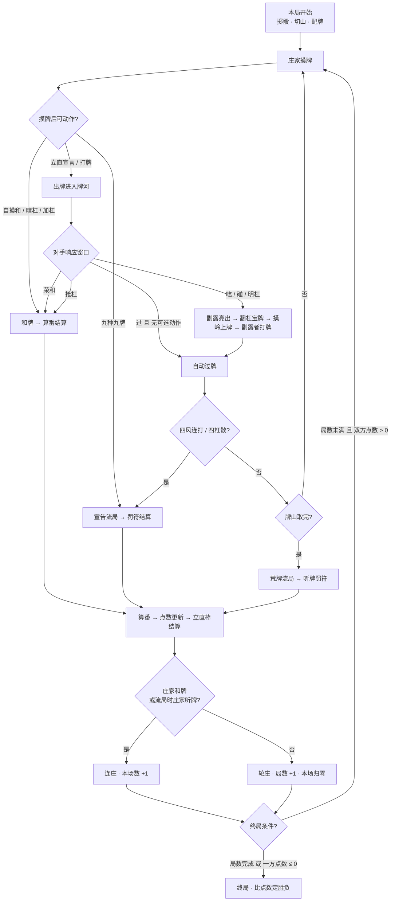

# 规则手册

## 0. 记法与读法

### 0.1 牌谱记法

本文档沿用标准牌谱记法 `数字 + 花色字母`：

| 花色 | 字母 | 例 |
|---|---|---|
| 万子（マンズ） | `m` | `1m` 一万、`9m` 九万 |
| 筒子（ピンズ） | `p` | `5p` 五筒 |
| 索子（ソウズ） | `s` | `3s` 三索 |
| 字牌（ジハイ） | `z` | 直接写牌面汉字 |

### 0.2 本文的三种引用标记

- **【规则】** 本作引擎实际执行的判定，改代码必须同步改这里。
- **【知识】** 日麻通用打法知识，引擎不强制，但记牌器/AI 会参考。
- **【差异】** 本作与标准四人麻将不同，或明确简化的地方。

---

## 1. 牌与牌桌

### 1.1 34 种牌 × 4 张 = 136 张

| 花色 | 内容 | 张数 |
|---|---|---|
| 万子 | 一 ~ 九 | 9 种 × 4 = 36 |
| 筒子 | 1 ~ 9 | 9 种 × 4 = 36 |
| 索子 | 1 ~ 9 | 9 种 × 4 = 36 |
| 字牌 | 東 南 西 北 白 發 中 | 7 种 × 4 = 28 |

**【规则】** 无花牌、无赤宝牌（赤五）。每种牌恒 4 张，这是记牌器"剩余张数"的基础。

### 1.2 牌面怎么认

| 花色 | 牌面特征 |
|---|---|
| 万子 | 上方汉字大写数字（`一 … 九`），下方 `萬`，数字为红色 |
| 筒子 | 圆点个数 = 数字（1 筒为大圆点，5 筒为中央红点 + 四角） |
| 索子 | 竹节根数 = 数字（1 索画成孔雀/竹节特例，绿色） |
| 字牌 | 東 南 西 北 为汉字（藍/黑）；中为红字；發为绿字；**白为空心框**（无字，靠边框识别） |

### 1.3 幺九 / 中张 / 老头

| 术语 | 定义 | 用途 |
|---|---|---|
| **幺九牌（ヤオチュー）** | 1、9 以及**全部字牌**（共 13 种） | 断幺九、混老头、纯全/混全带幺九、国士无双 |
| **老头牌（ロートー）** | 仅 1 和 9（不含字牌，共 6 种） | 纯全带幺九 |
| **中张牌** | 2 ~ 8 | 断幺九的构成素材 |

### 1.4 牌山与王牌

```
136 张
├── 牌山（山）：122 张 —— 正常摸牌用，摸完即荒牌流局
└── 王牌（dead wall）：14 张 —— 永不参与正常摸牌
    ├── 岭上牌：4 张 —— 每次杠成立时补 1 张
    └── 宝牌指示牌位：10 张（本作只用尾部 5 张作表宝牌指示，见 §9）
```

**【规则】**
- 配牌时掷 2 骰（各 1–6），按点数和切山，双方各取 13 张，庄家先摸第 14 张。
- 摸牌自牌山**末端**反向取（`wall.pop()`），即"从尾往头摸"。
- 杠成立时从王牌区**头部**取岭上牌，同时从牌山末端再弃 1 张（保持牌山总量递减）。
- 荒牌判定：牌山取完（`wall.length === 0`）即流局，**王牌 14 张保留不动**。

---

## 2. 手牌结构与和牌形

### 2.1 面子与雀头

| 组件 | 日文 | 构成 | 例 |
|---|---|---|---|
| 顺子 | シュンツ | 同花色连续 3 张 | `123m` `456p` `789s` |
| 刻子 | コーツ | 同种同数 3 张 | `東東東` `555p` |
| 杠 | カンツ | 同种同数 4 张，**算一组面子**，手牌张数 +1 | `中中中中` |
| 雀头 | ジャントウ | 同种同数 2 张（对子） | `55p` `白白` |

### 2.2 三种和牌形（三选一）

| 形态 | 构成 | 番 | 符 |
|---|---|---|---|
| **标准型** | 4 组面子 + 1 组雀头（14 张） | 按役累计 | 按 §10 算 |
| **七对子（チートイツ）** | 7 组**互异**的对子 | 2 番 | **固定 25 符**（不再加任何符） |
| **国士无双（コクシ）** | 13 种幺九牌各 1 张 + 其中任一种第 2 张 | 役满 | **不计符**（符 = 0） |

**【规则】** 七对子要求 7 组**不同种**的对子：`白白白` + `白白` 这类的同种 4 张**不能**拆成两组对子。

### 2.3 五种听牌形（决定符与读牌）

| 听形 | 含义 | 例（听 `4p`） | 符 |
|---|---|---|---|
| **两面（リャンメン）** | 顺子两端任一张 | `23p` 听 `1p/4p` | +0 |
| **嵌张（カンチャン）** | 顺子中间那张 | `35p` 听 `4p` | **+2** |
| **边张（ペンチャン）** | 12 听 3 / 89 听 7 | `89p` 听 `7p` | **+2** |
| **单骑（タンキ）** | 等雀头的第 2 张 | 单张 `4p` 听 `4p` | **+2** |
| **双碰（シャンポン）** | 两个对子任选其一成刻子 | `44p 77s` 听 `4p/7s` | +0 |

**【规则】** 符只加一次（+2），不按待牌数量叠加。同一个和牌可能有多种分解，
引擎取**番数最高、同番取符最高**的那套（`judge()` 遍历所有分解）。

**【知识】** 两面是最强的听形：待牌种类多、可见张数多，且不额外加符（加符其实是好事——符高点数高，
但两面换来的是**进张枚数**，通常更划算）。

---

## 3. 向听与听牌

### 3.1 向听数（シャンテン）

**向听数 = 距离和牌还差几张有效牌。**

| 向听 | 状态 | 含义 |
|---|---|---|
| −1 | 已和牌 | 14 张已成和牌形 |
| **0** | **听牌（テンパイ）** | 再摸/荣和 1 张即和 |
| 1 | 1 向听 | 来 1 张有效牌就听牌 |
| n | n 向听 | 还需 n 张 |

**【规则】** 判定用 13 张（不含摸到的第 14 张）。UI 里 14 张时显示的是"打对哪张能听"，
此时标注为「可听」而非「听牌」——因为**和牌必须在打牌后成立**。

### 3.2 进张（受け入れ）

**进张 = 能让向听数 −1 的所有牌种。** 记牌器实时列出。

```
例：13 张手牌 123m 456m 789m 45p 5s
    → 打 5s 后听 {3p, 6p}（两面听，进张 8 张 - 已见张数）
```

**【知识】** 进张要看**剩余枚数**而不是种类数：听 3p（剩 1 张）+ 6p（剩 4 张）比听两种各剩 1 张好得多。
记牌器的「剩余牌」Tab 就是为此服务的。

### 3.3 形式听牌（空テン）

**【规则】** 流局时的听牌判定只看**形状**是否听牌（`shanten === 0`），
**不管待牌是否还有剩余、也不管是否有役**。

所以"听的牌已经被打光 4 张"在流局时**仍算听牌**——这就是形式听牌，
是终局前保住 3000 点罚符的常见手段。

---

## 4. 一局的流程

### 4.1 一局的流程图



### 4.2 每巡时序

```
1. 摸牌     当前摸牌者从牌山摸 1 张 → 手牌 14 张
2. 自侧动作 自摸和 / 暗杠 / 加杠 / 九种九牌宣告 / 立直宣言 / 打牌
3. 打牌     打出 1 张 → 进入对手响应窗口
4. 响应     对手可选：荣和 / 吃 / 碰 / 明杠 / 过
5. 副露     成立则副露者立即再打一张（不再有第二层响应）
6. 轮换     无人响应 → 对手摸牌，回到第 1 步
```

**【规则】** 庄家开局摸第 14 张后直接进入"打牌"阶段（不重复摸）。

### 4.3 响应优先级

```
和（荣和/自摸）  >  抢杠  >  碰/明杠  >  吃  >  过
```

**【规则】** 双人局每巡只有一位对手，不存在"多家抢和"的竞争，
上表的后半段自然退化为唯一响应者。

### 4.4 自动过牌

**【规则】** 响应窗口里如果 ron / pon / kan / chi **全部为空**，
引擎自动过牌（`autoPass`，停留 420ms）并流转到你的回合——不需要手动点「过」。

只有真的有可选动作时，操作区才会弹按钮。

---

## 5. 副露：吃 · 碰 · 杠

### 5.1 五种副露

| 动作 | 条件 | 门清 | 张数变化 |
|---|---|---|---|
| **吃（チー）** | 对手舍牌能与手牌 2 张组成顺子 | **失去门清** | 手牌 −2，亮 3 张 |
| **碰（ポン）** | 手牌有同种同数 2 张 + 对手舍牌 | **失去门清** | 手牌 −2，亮 3 张 |
| **明杠** | 手牌有同种同数 3 张 + 对手舍牌 | **失去门清** | 手牌 −3，亮 4 张，摸岭上牌 |
| **暗杠** | 手牌有同种同数 4 张 | **保持门清** | 手牌 −4，亮 4 张，摸岭上牌 |
| **加杠** | 已碰的刻子 + 摸到/手上的第 4 张 | 已非门清 | 手牌 −1，亮 4 张，摸岭上牌 |

**【规则】** 副露成立后的操作：
1. 被呼叫的那张牌从对方牌河**撤回**（不再算"已打出"）。
2. 立即翻 1 张杠宝牌指示牌（见 §9）——**明杠/暗杠/加杠都一样，立即翻**。
3. 副露者从王牌区摸岭上牌，然后必须打出一张。
4. 场上任何人的**一发**立即失效（包括自己的暗杠）。

### 5.2 门清与食下がり

**门清（メンゼン）** = 没有吃/碰/明杠（**暗杠不算破门清**）。

**【规则】** 失去门清会同时失去两样东西：
1. **只在门清成立的役**：立直、一発、门前清自摸和、平和、一杯口、两杯口、九莲宝灯、四暗刻、天和/地和。
2. **食下がり（副露减番）**：部分役副露后番数 −1（见 §7.2 表中"副露"列）。

### 5.3 抢杠 / 岭上开花 / 杠振

| 役 | 触发 | 番 |
|---|---|---|
| **抢杠（チャンカン）** | 对方**加杠**时，你荣和那张加杠牌 | 1 番 |
| **岭上开花（リンシャン）** | 自己杠后摸到的岭上牌**自摸**和牌 | 1 番 |
| **杠振（カンフリ）** | 自己杠后（含之后的连续打牌）打出的牌被对方荣和 | 1 番 |

**【规则】**
- **抢杠成立** → 加杠还原为碰（杠子变回 3 张刻子），杠宝牌**不翻**。
- **放弃抢杠** → 杠成立，翻杠宝牌，对方摸岭上牌；此时你处于**同巡振听**（见 §8.2），
  对方摸岭上牌后打出的那张你不能荣和。这是双人局里**唯一能观察到同巡振听**的场景。
- 暗杠**不能**被抢杠（暗杠不公示第 4 张的来源）。

### 5.4 本作不采用的副露规则 【差异】

| 标准规则 | 本作 |
|---|---|
| **食替禁止**（吃/碰后不能立即打出同种或同组成牌） | **不限制**，副露后可打任意手牌 |
| **送杠禁止**（碰后同巡不能加杠） | 不限制（本作加杠在摸牌阶段独立触发） |
| **立直后可暗杠**（形状与待牌不变时） | **立直后不能暗杠**，一律只能摸打 |
| 加杠后同巡振听（其他家抢杠见逃） | 已实现（见 5.3） |

---

## 6. 立直

### 6.1 立直条件（四条全满足）

1. **门清**（无吃/碰/明杠，暗杠可以）
2. **听牌**（打完宣言那一刀后仍听牌）
3. **牌山剩余 ≥ 4 张**
4. **点数 ≥ 1000**

**【规则】** 引擎在 `riichiDiscards()` 里统一把关：返回"切完仍听牌"的候选牌种，
候选非空才允许立直。UI 只点亮这些牌，其余置暗。

### 6.2 宣言那一刀不限于摸切（重要）

**立直宣言时打出的那张，可以是 14 张里的任意一张**，唯一要求是**打完仍听牌**。

> 常见误解：以为立直只能打刚摸的那张。**摸切只对立直之后的每一巡成立。**
> 这一条写错会让每次立直都把听牌打没。

### 6.3 立直后的限制

| 项 | 规则 |
|---|---|
| 打牌 | **每巡必须打出当巡摸到的那张**（摸切），不能换听 |
| 自动摸切 | 立直后若只有摸切一张可打，引擎**自动打出**（`autoCut` 340ms），不需要你点 |
| 吃/碰/明杠 | **禁止** |
| 暗杠 | 本作**一律禁止**（见 5.4） |
| 换听 | **禁止**——所以立直前的振听检查是最后机会 |

### 6.4 一発

**【规则】** 立直后到自己下一次摸牌前和牌，且期间**无人吃/碰/杠**（含自己的暗杠）→ **+1 番**。
UI 里"可荣和/仅自摸"标注会实时反映一発带来的番差。

**【规则】** 另一种失效：立直后自己打出第 2 张牌，一発也失效（`river.length >= riichiIndex + 2`）。

### 6.5 立直棒

| 场景 | 归属 |
|---|---|
| 有人和牌 | **和牌者**收取桌上全部立直棒（含自己押的那根） |
| 荒牌流局 | 结转下一局，本场数 +1 |
| 你被荣和 | 立直棒仍归**和牌者** |

### 6.6 什么时候该立 / 该默听

**【知识】** 立直的判断依据，按重要性排序：

1. **有没有役**。无役的手牌，立直是唯一的和牌途径 → 基本必立。
2. **待牌是否振听**。待牌里有自己打过的牌 → 立直后只能自摸，收益大跌（见 §8）。
3. **待牌枚数**。听 1 张（单骑/嵌张且剩余少）不如先默听改形。
4. **番数**。已经 3–4 番以上且有役（如清一色/混一色 + 役牌），
   可以选择**默听（ダマ）**：不暴露听牌，靠高番吃满贯。
5. **牌山剩余**。快荒牌时立直的意义下降（摸不到牌）。

---

## 7. 役

### 7.1 役是和牌的前提（最重要的一条）

**光凑齐 4 面子 1 雀头并不能和牌——必须同时成立至少一个「役（ヤク）」。**

- **【规则】** 无役时既不能荣和也不能自摸（`judge()` 返回 null），只能继续打牌。
- 这与国标/中式麻将差别最大，是新手和不了牌的第一原因。
- **保底役三件套**：断幺九（副露也成立）、役牌刻子（副露也成立）、立直（门清即可）。

### 7.2 役种表

> 「门清」列：○ = 只在门清成立；空 = 副露也成立。
> 「副露」列的番数即食下がり后的值。

#### 普通役（按番数排序）

| 役种 | 番 | 门清 | 副露 | 说明 |
|---|---|---|---|---|
| 立直（リーチ） | 1 | ○ | — | 听牌宣言 |
| 一発（イッパツ） | 1 | ○ | — | 立直后一巡内和 |
| 门前清自摸和（メンツモ） | 1 | ○ | — | 门清 + 自摸 |
| 平和（ピンフ） | 1 | ○ | — | 全顺子 + 非役牌雀头 + **两面听** |
| 断幺九（タンヤオ） | 1 | | 1 | 全数牌 2–8（**字牌一张都不行**） |
| 役牌 · 三元牌 | 1 | | 1 | 白/發/中 各一组刻子各 1 番，可叠加 |
| 役牌 · 场风 | 1 | | 1 | 場风刻子（東場=東、南場=南） |
| 役牌 · 自风 | 1 | | 1 | 自风刻子（庄家=場风，闲家=下一风位） |
| 一杯口（イーペーコー） | 1 | ○ | — | 同花色同数两组顺子 |
| 抢杠（チャンカン） | 1 | | 1 | 抢对方加杠 |
| 岭上开花（リンシャン） | 1 | | 1 | 杠后岭上牌自摸 |
| 海底捞月（ハイテイ） | 1 | | 1 | 牌山最后一张自摸 |
| 河底捞鱼（ホウテイ） | 1 | | 1 | 最后一张舍牌荣和 |
| 杠振（カンフリ） | 1 | | 1 | 自己杠后舍牌被荣和 |
| 三色同顺（サンショク） | 2 | | **1** | 万筒索同数字顺子 |
| 一气通贯（イッツー） | 2 | | **1** | 同花色 123 + 456 + 789 |
| 混全带幺九（チャンタ） | 2 | | **1** | 每组面子含幺九 + 幺九雀头，**必须含字牌** |
| 对对和（トイトイ） | 2 | | 2 | 4 组全是刻子/杠 |
| 三暗刻（サンアンコウ） | 2 | | 2 | 3 组暗刻 |
| 三杠子（サンカンツ） | 2 | | 2 | 3 组杠 |
| 小三元（ショウサンゲン） | 2 | | 2 | 三元牌 2 组刻子 + 1 组雀头 |
| 混老头（ホンロウトウ） | 2 | | 2 | 全幺九牌（必与对对和或七对子复合） |
| 七对子（チートイツ） | 2 | 特殊 | — | 7 组互异对子，固定 25 符 |
| 两杯口（リャンペーコー） | 3 | ○ | — | 两组一杯口（不与一杯口复合） |
| 纯全带幺九（ジュンチャン） | 3 | | **2** | 每组面子含 1/9 + 1/9 雀头，**不含字牌** |
| 混一色（ホンイツ） | 3 | | **2** | 一种数牌 + 字牌 |
| 清一色（チンイツ） | 6 | | **5** | 单一数牌花色 |
| 宝牌（ドラ） | 每张 1 | | | **不是役**，见 §9 |

#### 役满

| 役种 | 门清 | 说明 |
|---|---|---|
| 国士无双（コクシ） | 特殊 | 13 种幺九各 1 + 任一种第 2 张 |
| 四暗刻（スーアンコウ） | ○ | 4 组暗刻 |
| 四杠子（スーカンツ） | | 4 组杠 |
| 大三元（ダイサンゲン） | | 三元牌 3 组刻子 |
| 小四喜（ショウスーシー） | | 四风牌 3 组刻子 + 雀头 |
| 大四喜（ダイスーシー） | | 四风牌 4 组刻子（**本作不按双倍计**） |
| 字一色（ツーイーソー） | | 全字牌 |
| 绿一色（リューイーソー） | | 仅索子 2/3/4/6/8 + 發 |
| 九莲宝灯（チューレン） | ○ | 同花色 1112345678999（**本作不按双倍计**） |
| 天和（テンホー） | — | 庄家配牌即和 |
| 地和（チーホー） | ○ | 闲家第一巡自摸且无副露 |

**【规则】** 地和的条件严格为：非庄家 + 第一次摸牌 + 全场无副露发生 + 巡数 ≤ 1。

### 7.3 复合与封顶

**【规则】**
- 同一和牌可同时计多个役，番数**相加**。
- 一杯口与两杯口**不复合**（取两杯口 3 番）。
- 混老头必然与对对和或七对子复合。
- 役满成立时**普通役全部不计**，也不计宝牌。
- 多个役满并存时取**一档役满**（本作不做双倍役满）。
- **累计役满**：普通役合计 ≥ 13 番也按役满档计点。
- 番 ≥ 5 或基本点 ≥ 2000 时按 §11.2 档位封顶，不再按公式累乘。

### 7.4 连风牌

**【规则】** 当一张风牌同时是**场风和自风**（東場的庄家手里有東）：
- 作**雀头** → 符 **+2**（只加一次，不是 +4）
- 作**刻子** → 「场风」与「自风」**各计 1 番，共 2 番**

---

## 8. 振听

**振听（フリテン）= 不能荣和，但可以自摸。**

### 8.1 舍牌振听（永久）

**【规则】** 待牌里**任何一张**出现在自己牌河 → **全体待牌都不能荣和**。

> 标准规则的要点是「**连坐**」：不是"打过 1p 就不能荣和 1p"，
> 而是"打过 1p → **所有**待牌都不能荣和"。

**解除**：本局内不解除，除非**换听**（改变待牌）或副露改形。

**【差异】** 立直后不能换听，所以立直时振听 = 本局只能自摸，这是立直前必须看一眼的东西。
UI 会在待牌条上把振听的牌标成红色（`仅摸`）。

### 8.2 同巡振听（临时）

**【规则】** 本巡放弃了能和的那张（见逃）→ 到自己**下一次摸牌**前，全体待牌不能荣和。

**【差异】** 双人局里见逃后立刻轮到自己摸牌，所以同巡振听几乎不可达——
**唯一可观察的路径是"放弃抢杠"**：放弃后对方还要摸岭上牌再打一张，那时你还没摸牌，仍受限制。

### 8.3 立直后振听

【规则】立直后不能换听，因此：
- 立直**前**已振听 → 立直后全程只能自摸。
- 立直**后**对手打出你的待牌 → 同样不能荣和（因为立直不改变已有的舍牌振听）。

### 8.4 对策

**【知识】**
1. 立直前先确认待牌里没有自己打过的牌（UI 的待牌条会标红）。
2. 已经振听时，**副露（吃/碰）改形**可以重设待牌绕开——代价是毁掉门清役。
3. 振听时只考虑自摸：可以安心冲牌，但别指望吃对手的炮。

---

## 9. 宝牌

> **宝牌不是役**：手上有宝牌不加役，必须先有其它役才能和牌；
> 宝牌只在既有役的基础上**每张 +1 番**。

### 9.1 指示牌与推导

| 项 | 规则 |
|---|---|
| 指示牌 | 王牌区尾部固定 5 张候选，**开局翻第 1 张** |
| 翻牌时机 | 每次有人杠成立（明杠/暗杠/加杠）**立刻**翻下一张，新宝牌即刻生效 |
| 不翻的情况 | 抢杠成立 → 杠还原为碰，**不翻** |

**宝牌推导规则**：

| 指示牌类型 | 推导 |
|---|---|
| 数牌 | 按数字升序循环：`1→2→…→9→1` |
| 风牌 | `東 → 南 → 西 → 北 → 東` |
| 三元牌 | `白 → 發 → 中 → 白` |

```
例：指示牌 1m → 宝牌 2m
    指示牌 9p → 宝牌 1p（循环）
    指示牌 中  → 宝牌 白
```

### 9.2 计数范围

**【规则】** 手牌 **+ 所有副露（含暗杠）+ 和了牌本身** 全部参与计张。
一种指示牌对应 4 张宝牌，同一张手牌最多可能同时是多种宝牌（多张指示牌指向它时番数叠加）。

**【规则】** **役满成立时不计宝牌**。

### 9.3 展示

- 顶栏常驻「宝牌指示」区：显示已翻开的指示牌牌面 + 当前手牌宝牌张数。
- 记牌器同时列出「指示牌 → 宝牌」对照。

**【差异】** 本作**不做里宝牌**（只有立直家能看到，双人局里等于给立直方发隐藏信息）。

---

## 10. 符计算

**【规则】** 和牌后按下列项目累加，最后**进位到十位**（如 42 → 50）。
七对子**固定 25 符**（不再加任何项）；国士无双**不计符**（符 = 0，直接按役满档计点）。

| 项目 | 符 | 说明 |
|---|---|---|
| 底符 | 20 | 恒有 |
| 门清荣和 | +10 | 门前清 + **荣和**（自摸不加） |
| 自摸 | +2 | **平和自摸除外**（平和自摸计 20 符） |
| 雀头 | 役牌雀头 +2 | 三元牌 / 自风 / 场风；**连风雀头也只 +2** |
| 明刻 | 中张 2 / 幺九 4 | 每组 |
| 暗刻 | 中张 4 / 幺九 8 | 每组 |
| 明杠 | 中张 8 / 幺九 16 | 每组 |
| 暗杠 | 中张 16 / 幺九 32 | 每组 |
| 听牌形 | 单骑/嵌张/边张 **+2**，两面/双碰 +0 | 取实际听形 |
| **副露平和形** | **强制 30 符** | 副露 + 全顺子 + 非役牌雀头 + 两面听，但平和本身不成立 |
| 合计 | — | **进位到十位** |

**【规则】** 荣和补成的那组刻子**不算暗刻**（按明刻计符），这直接影响三暗刻/四暗刻的成立。

### 10.1 符计算示例

```
例 A：门清荣和，20(底) + 10(门清荣和) + 0(两面) = 30 符
例 B：门清自摸平和，20(底) + 0(自摸不加) + 0(非役牌雀头) + 0(两面) = 20 符
例 C：副露，20(底) + 4(暗刻中张 555p) + 0(两面) = 24 → 但若形状是平和形则强制 30 符
```

---

## 11. 点数计算

### 11.1 公式

```
基本点 = 符 × 2^(2 + 番数)

子家荣和 = 基本点 × 4   → 进位到百位
亲家荣和 = 基本点 × 6   → 进位到百位
自摸     = 基本点 × 2   → 进位到百位（双人局：对手一人付全部）
```

**【规则】** 封顶判定：
- 番数 ≥ 5 → 用档位表
- 番数 < 5 但**基本点 ≥ 2000** → 也按满贯封顶（如 50 符 4 番：50×2^6 = 3200 ≥ 2000）
- 役满或合计 ≥ 13 番 → 役满档

### 11.2 档位表

| 档位 | 番数条件 | 子家荣和 | 亲家荣和 | 自摸（对手付） |
|---|---|---|---|---|
| 满贯 | ≥5 番 | 8000 | 12000 | 4000 |
| 跳满 | 6–7 番 | 12000 | 18000 | 6000 |
| 倍满 | 8–10 番 | 16000 | 24000 | 8000 |
| 三倍满 | 11–12 番 | 24000 | 36000 | 12000 |
| 役满 | 役满役或 ≥13 番 | 32000 | 48000 | 16000 |

### 11.3 番符速查表（未封顶部分）

格式为 **子家荣和 / 亲家荣和 / 自摸**：

| 符 ＼ 番 | 1 番 | 2 番 | 3 番 | 4 番 |
|---|---|---|---|---|
| **20 符** | 700 / 1000 / 400 | 1300 / 2000 / 700 | 2600 / 3900 / 1300 | 5200 / 7700 / 2600 |
| **25 符** | 800 / 1200 / 400 | 1600 / 2400 / 800 | 3200 / 4800 / 1600 | 6400 / 9600 / 3200 |
| **30 符** | 1000 / 1500 / 500 | 2000 / 2900 / 1000 | 3900 / 5800 / 2000 | 7700 / 11600 / 3900 |
| **40 符** | 1300 / 2000 / 700 | 2600 / 3900 / 1300 | 5200 / 7700 / 2600 | **满贯** 8000 / 12000 / 4000 |
| **50 符** | 1600 / 2400 / 800 | 3200 / 4800 / 1600 | 6400 / 9600 / 3200 | **满贯** 8000 / 12000 / 4000 |
| **60 符** | 2000 / 2900 / 1000 | 3900 / 5800 / 2000 | 7700 / 11600 / 3900 | **满贯** 8000 / 12000 / 4000 |

> 20 符只可能来自**平和自摸**（此时至少 2 番：平和 + 门前清自摸和）；
> 25 符只可能来自七对子（至少 2 番）。表中灰色格仅作公式参考，实战不会出现。

### 11.4 附加点数

| 项 | 规则 |
|---|---|
| 本场加点 | 荣和 **+300 × 本场数**（放铳者付）；自摸 **+100 × 本场数** |
| 立直棒 | 和牌者收取桌上全部立直棒（每根 1000 点） |
| 合计 | `点数 = 基础点数 + 本场加点 + 立直棒` |

### 11.5 支付方向

- **荣和**：全部由**放铳者**支付（亲家被荣和按亲家档）。
- **自摸**：双人局只向**对手一人**收取（基础点 × 2）。
- 和牌者**同时**收取自己的立直棒（等于把押出去的 1000 点拿回来）。

---

## 12. 流局

### 12.1 五种流局

| 流局方式 | 触发条件 | 本作处理 |
|---|---|---|
| **荒牌流局** | 牌山取完（王牌 14 张保留）仍无人和牌 | 听牌罚符 |
| **九种九牌** | 第一巡摸牌时手牌含 ≥9 种幺九牌，且全场无副露 | 玩家可宣告；AI 不宣告 |
| **四风连打** | 第一巡双方各打同一张风牌且全场无副露 | 立即流局 |
| **四杠散** | 双方合计 4 个杠且**不是同一人 4 杠**（同一人 4 杠 = 四杠子役满，不流局） | 立即流局 |
| **双家立直** | 双方均已立直后荒牌 | 流局，立直棒结转下局 |

### 12.2 听牌罚符

**【规则】** 荒牌流局时，若一方听牌而另一方未听牌，未听方向听牌方支付 **3000 点**；
双方同听或同不听则不结算。

**【差异】** 四人标准为 1000/2000/3000 三家分摊（合计 3000），双人局无分摊语义，固定 3000。

### 12.3 流局与连庄

**【规则】** 流局时若**庄家听牌** → 连庄（本场数 +1，局数不前进）；否则轮庄。

**【差异】** 标准规则中九种九牌/四风连打/四杠散等**途中流局不执行听牌罚符**，
本作为简化，所有流局统一走 `flowPayments()` 按听牌状态结算。

---

## 13. 场况、连庄与终局

| 项 | 定义 |
|---|---|
| 局制 | **半庄战**（东场 4 局 + 南场 4 局，共 8 局）/ **东风战**（东场 4 局） |
| 初始点数 | 双方各 **10000 点**（立直棒 1000 点单独计数） |
| 本场数 | 每连庄 +1；轮庄时归零 |
| 连庄条件 | 庄家和牌，或流局时庄家听牌 |
| 风位 | 场风恒为**東**（東場）/ **南**（南場）；庄家自风 = 场风，闲家自风 = 场风的下一风位（東→南→西→北） |
| 终局条件 | ① 局数完成；② 任一方点数 ≤ 0（**飞了**）提前终局 |
| 胜负 | 点数高者胜，点数差即胜负幅度（**不做马/顺位点**） |

**【规则】** 连庄不消耗局数——打满 8 局可能实际打了 12 手牌。

---

## 14. 双人适配与本作简化

### 14.1 双人适配（规则层面的必然结果）

1. **上家即对手**：双方互为上家，互相可以吃对方舍牌。每巡只有一位响应者，无多家竞争。
2. **响应窗口唯一**：和/抢杠 > 碰/杠 > 吃 > 过，无「多家抢和」的裁定问题。
3. **自摸只向对手一人收取**（基础点 × 2）。
4. **听牌罚符固定 3000**。
5. **双家立直后荒牌即流局**。
6. **风位**：東場庄家=東 / 闲家=南；南場庄家=南 / 闲家=西。役牌（自风）判定随此轮转。

### 14.2 本作明确不做 / 简化

| 项目 | 说明 |
|---|---|
| 里宝牌 | 只有立直家可见，与「信息可读」原则冲突 |
| 人和 | 是否役满的地域差异大，双人局概率极低 |
| 双倍役满 | 大四喜、纯正九莲按役满单倍计 |
| 赤宝牌 | 无赤五 |
| 食替禁止 / 送杠禁止 | 未实现（见 5.4） |
| 立直后暗杠 | 未实现，立直后只能摸打 |
| 包牌（パオ） | 大三元/大四喜的责任支付未实现 |
| 途中流局不罚符 | 本作统一按听牌罚符结算（见 12.3） |
| 顺位点（马） | 不做，只比点数差 |

---

## 15. 防守基础

**【知识】** 引擎不强制，但这些是读牌与弃牌的核心。

### 15.1 现物（げんぶつ）= 绝对安全牌

**自己牌河里已经打过的牌**，对手**不可能**用它荣和你（舍牌振听了）。
弃和时优先打现物。

> 注意：现物只对你**自己**的牌河成立；对手的牌河里的牌对你不安全。

### 15.2 筋（すじ）

对手打过 `4p` → `1p` 和 `7p` 相对安全（因为如果他听 `1p/4p` 或 `4p/7p` 的两面，
打出 4p 就会振听）。这叫「4 的筋 = 1 和 7」。

| 打过的牌 | 筋牌（相对安全） |
|---|---|
| 1 | 4 |
| 2 | 5 |
| 3 | 1、6 |
| 4 | 1、7 |
| 5 | 2、8 |
| 6 | 3、9 |
| 7 | 4 |
| 8 | 5 |
| 9 | 6 |

**【知识】** 筋只对**两面听**有效，对嵌张、双碰、单骑**无效**。对手立直时筋牌仍可能放炮。

### 15.3 壁（かべ）

某种牌 4 张全部可见（自己手牌 + 双方牌河 + 副露）→ 依赖它组成顺子的听牌**不可能存在**。

```
例：4p 4 张全见 → 对手不可能听 3p/6p（因为 234p 或 456p 都需要 4p）
```

### 15.4 早晚（はやがい）

**【知识】** 对手立直后打出的第 2 张之后的牌（巡数越晚），越是"他确实不需要的牌"，
其同类牌相对安全。反之，立直宣言那一刀的**附近牌**最危险。

---

## 附录 A 术语表

| 术语 | 日文 | 含义 |
|---|---|---|
| 面子 | メンツ | 顺子/刻子/杠的统称 |
| 雀头 | ジャントウ | 对子（和牌形里的"将"） |
| 搭子 | ターツ | 差 1 张成面子的两牌组合 |
| 对子 | トイツ | 同种同数 2 张 |
| 刻子 | コーツ | 同种同数 3 张 |
| 听牌 | テンパイ | 只差 1 张即和 |
| 向听 | シャンテン | 距离听牌的步数 |
| 进张 | ウケイレ | 能推进向听的牌 |
| 门清 | メンゼン | 无吃碰明杠 |
| 副露 | フーロ | 吃碰杠的统称 |
| 立直 | リーチ | 门清听牌宣言 |
| 摸切 | ツモギリ | 直接打出刚摸的牌 |
| 默听 | ダマ | 听牌但不立直 |
| 荣和 | ロン | 吃对手的炮 |
| 自摸 | ツモ | 自己摸到和牌 |
| 放铳 | ホウジュウ | 打出被荣和的牌 |
| 振听 | フリテン | 不能荣和的状态 |
| 见逃 | ミノガシ | 放弃能和的机会 |
| 弃和 | ベタオリ | 放弃和牌，只打安全牌 |
| 亲 / 子 | オヤ / コ | 庄家 / 闲家 |
| 本场 | ホンバ | 连庄计数，影响加点 |
| 飞了 | トビ | 点数 ≤ 0，提前终局 |

---

## 附录 B 速查卡

### B.1 和牌三条件

```
1. 成和牌形  （4 面子 + 1 雀头 / 七对子 / 国士）
2. 有役      （无役不能和 —— 最常见的新手坑）
3. 不振听    （振听只能自摸）
```

### B.2 点数三档记忆

```
基本点 = 符 × 2^(2+番)
子荣 ×4 / 亲荣 ×6 / 自摸 ×2（均进位到百）
≥5 番或基本点 ≥2000 → 档位封顶
```

### B.3 立直前四问

```
1. 打完这一刀还听牌吗？
2. 待牌里有自己打过的牌吗？（振听 → 只能自摸）
3. 待牌还剩几张？（看记牌器「剩余牌」）
4. 有没有其它役？没有的话立直就是唯一出路，基本必立
```

### B.4 UI 标注对照

| UI 显示 | 含义 |
|---|---|
| **荣·摸**（金色） | 这张牌可以荣和，也可以自摸 |
| **仅摸**（红色） | 舍牌振听：待牌里有自己打过的牌，只能自摸 |
| **仅摸**（橙色） | 同巡振听：本巡见逃过，下次摸牌前只能自摸 |
| **无役**（灰色） | 和了形成立但没有役，立直可解 |
| **听牌** | 13 张状态，手牌确实在听 |
| **可听** | 14 张状态，打对某张才能听（记牌器逐切法列出） |

---

> 本文件与 `core/` 下的实现保持一致。修改规则时**先改这里再改代码**，
> 并跑 `.tmp/` 下的测试集回归（`riichi-smoke` / `riichi-dora` / `riichi-furiten2` / `riichi-stress`）。
