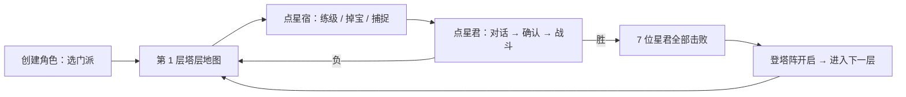
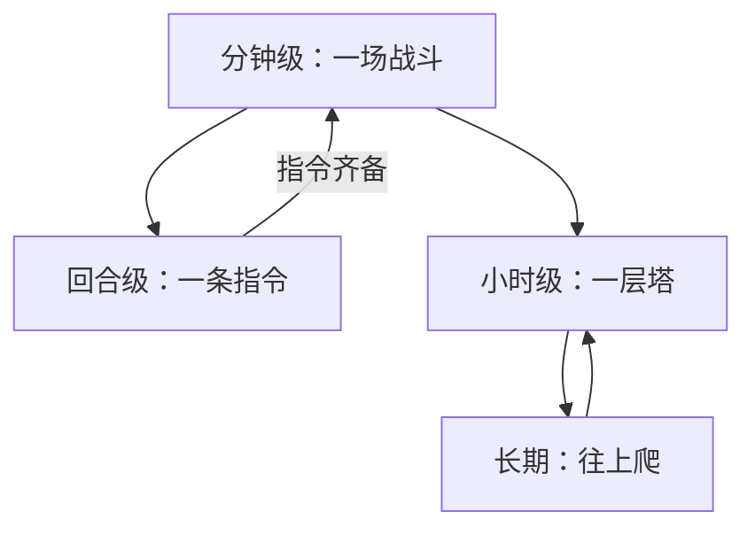
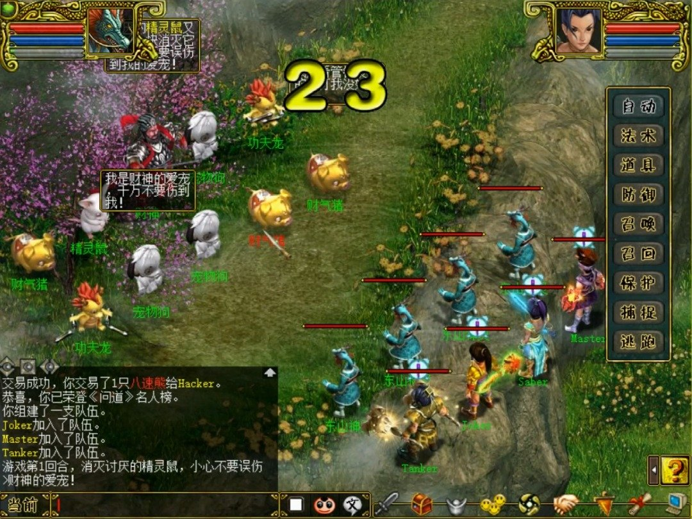
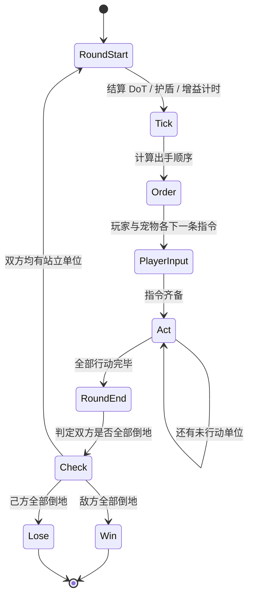
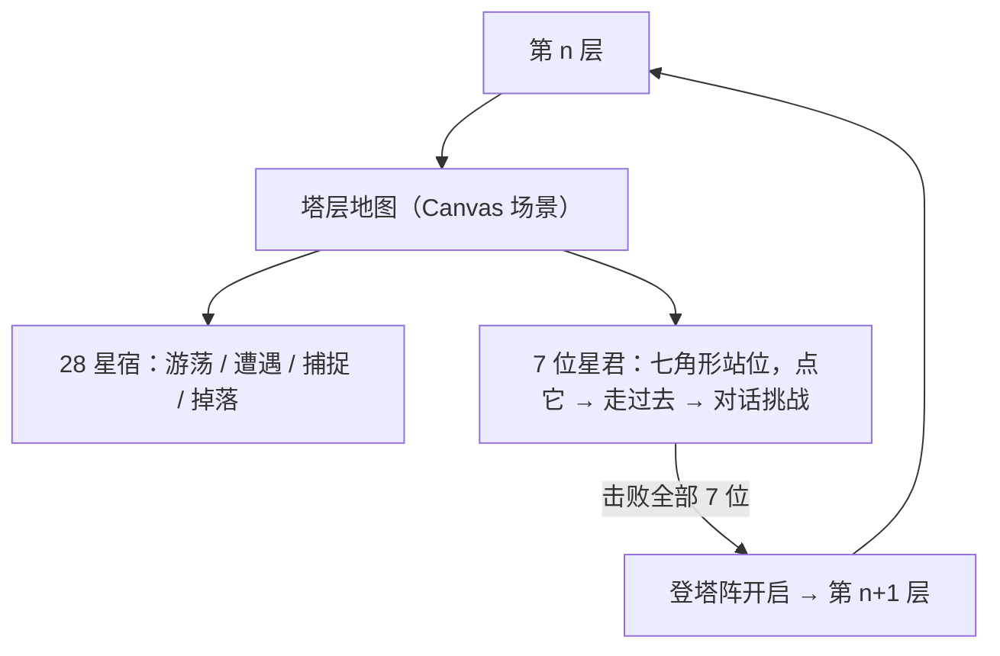
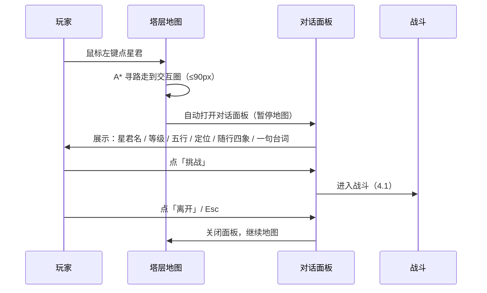
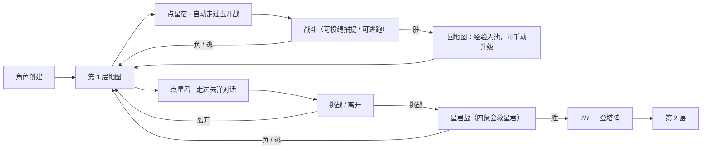
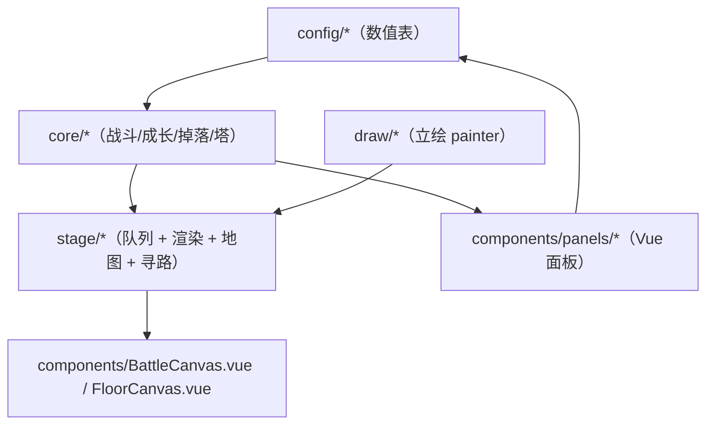

# 通天塔 · 回合制战斗（turn-based-rematch）

> 版本 **1.0** ｜ 需求评审稿 ｜ 本文件只描述需求，不含实现代码
> 开发排期与分期任务见 [`dev-cycle/总进度.md`](dev-cycle/总进度.md)（43 期，每期 1 天）

---

## 目录

- [0. 文档说明](#0-文档说明)
- [1. 产品定位](#1-产品定位)
- [2. 核心循环](#2-核心循环)
- [3. 战斗场景与表现层（Canvas）](#3-战斗场景与表现层canvas)
- [4. 战斗规则](#4-战斗规则)
- [5. 角色成长与加点](#5-角色成长与加点)
- [6. 相性系统](#6-相性系统)
- [7. 装备系统](#7-装备系统)
- [8. 法术系统](#8-法术系统)
- [9. 宠物系统](#9-宠物系统)
- [10. 道具与商店](#10-道具与商店)
- [11. 通天塔](#11-通天塔)
- [12. 数值校验](#12-数值校验)
- [13. 原型与交互说明](#13-原型与交互说明)
- [14. 权限与数据需求](#14-权限与数据需求)
- [15. 非功能需求](#15-非功能需求)
- [16. 集成需求](#16-集成需求)
- [17. 验收标准](#17-验收标准)
- [18. 风险与待确认项](#18-风险与待确认项)
- [19. 来源与确认状态](#19-来源与确认状态)

---

## 0. 文档说明

### 0.1 这份文档要解决什么

这不是一份"把问道复刻一遍"的文档，而是一份**能直接排期开发的单机小体量方案**：把问道里最让人上头的那几层皮——加点、相性、装备改造、宠物、法术、道行、二十八宿——剥出来，装进一座**没有顶**的通天塔。

三条不可退让的边界：

- **战斗全 Canvas**：玩家、宠物、星君、四象随行各有独立立绘与动作帧，法术有弹道与命中特效，指令栏、头像血条、战斗日志、快捷栏全部画在同一张画布上。
- **塔层也是 Canvas**：玩家在七角形塔层地图上用鼠标点地移动，走到星君跟前对话、确认、开打；二十八星宿在地图上晃荡，主动点它才开战，残血可以抓。
- **数值必须闭合**：任何一层的强度都能从公式推出来（第 12 章），不允许"差不多能打过"。

取舍原则：

- **保留"配置感"**：所有让人愿意反复打开面板的东西（洗点、换装、换宠、换法术、买道行）都要有。
- **砍掉"流程感"**：主线剧情、师门任务、交易行一律不做。
- **每个系统都要有一次真实选择**：如果一个系统只是数字变大，它就不进 P0。
- **表现层不得反向污染战斗内核**：内核只产出事件，动画只消费事件（见 3.10）。

### 0.2 优先级定义

| 级别 | 含义 | 处理方式 |
|---|---|---|
| P0 | 首版必须完整可玩 | 缺失即视为未交付 |
| P1 | 首版后追加，架构需预留 | 首版不做，接口留好 |
| P2 | 愿景，不排期 | 仅记录，不设计细节 |

### 0.3 术语表

| 术语 | 定义 | 易混项 |
|---|---|---|
| 层（Floor） | 通天塔的一级，含 7 位星君 + 28 只星宿 | 塔**没有"重"的概念**，只有层，且层数无上限 |
| 星君 | 每层 7 位，北斗七星，固定同一组，随层数变强；塔的守关者 | 星君**不可捕捉** |
| 四象 | 青龙 / 白虎 / 朱雀 / 玄武，**星君战斗时随行的宠物**，每场 2 只 | 四象**不可捕捉**，也**不是**玩家的宠物来源；套装不使用四象命名（7.6） |
| 星宿 | 每层地图上游荡的 28 只野怪（角木蛟…轸水蚓），练级/掉宝/捕捉来源 | 星宿**可捕捉**，捕捉后成为玩家宠物 |
| 相性 | 金木水火土，玩家长期 build 的百分比加成，洗点要钱 | 相性 ≠ 五行（6.3 专章区分） |
| 五行 | 金木水火土，只在伤害结算时做 1.25 / 0.85 克制 | 只有 5 项，**没有日月** |
| 道行 | 障碍类法术（冰封/昏睡/眩晕/中毒/遗忘/定身）的命中对抗值 | 只能用经验购买，不影响伤害（4.7） |
| **倒地（Down）** | **气血归零后的状态，不是死亡**。仍在槽位、仍可被选中，但轮到行动时跳过；被治疗回血即"起身" | 本项目**没有"复活"概念**，只有"倒地 → 起身"（4.8） |
| 起身 | 倒地单位被治疗、气血 > 0 的瞬间 | 起身当回合能否行动取决于出手位是否已过（4.8.1 第 5 条） |
| 脱战 | 宠物气血归零且未触发「神佑复生」→ **当场离场**，本场不再回到战场 | 宠物**没有倒地状态**；脱战后不可复活，玩家可召唤新宠（9.9） |
| 穿透 | 攻方对抗守方抗性的属性，`20 + 0.04 × 攻方等级` | 抗性永远无法把伤害减到 0（6.2） |
| 档（Tier） | 装备的等级段，决定白板数值与穿装等级 | 与品质（词条条数）独立，见 7.1 / 7.3 |
| 扫荡 | 本层 28 星宿全部击败过后解锁的挂机收益 | 不产出掉落与兽魂；**可低概率捕捉**（概率为手打的 1/4，9.4.1）；收益为手打的 60% |

### 0.4 与参考项目 `turn-based-game` 的承接关系

新项目**复用概念与数值口径，不复用代码**。两边的目录、模块、文件名不得互相引用，避免改一边崩两边。

| 概念 | 参考项目做法 | 本项目做法 | 差异原因 |
|---|---|---|---|
| 属性点 | 力/法/防/速/血 五维，加点即乘系数 | 力/敏/体/灵 四维 + 相性百分比 | 保留问道味道，四项更好读 |
| 装备词条 | 基础词条（存点数）+ 强力词条（存数值） | 基础白板 + 品质词条（存绝对值） | 去掉双轨换算，减少口算负担 |
| 装备部位 | 10 个部位 | 9 个部位 | 单机体量，减少换装频率 |
| 障碍技能 | 封印/中毒/冰冻/混乱/昏睡，固定成功率 | 同上 + 定身/眩晕，统一走道行判定 | 成功率与成长挂钩才有 build 意义 |
| 障碍抗性 | 装备词条百分比 | 水相性 + 装备词条，走对抗式公式 | 抗性永不达 100%，也不会因堆高而失效 |
| 连击 | 连击率 / 最大连击次数 | 连击率 + 最多 3 段，逐段伤害递减（4.5） | 保留"追加打击"手感，加上限防爆发 |
| 宠物 | 系数 0.5–3.0 重铸 | 阶位定资质起点，**熔铸堆资质与成长**（9.12） | 把"随机重铸"拆成两段：阶位是抽卡，熔铸是投入 |
| 商店 | 买/卖/重铸/技能强化 | 买/卖/强化/镶嵌/洗髓 | 砍掉随机重铸 |
| 存档 | localStorage 全量快照 | 同上，但分 key 存（玩家/装备/宠物/塔/背包/图鉴） | 单 key 太大易写失败 |
| 战斗表现 | DOM 面板 + CSS 动画 | Canvas 舞台 + 动作帧 + 特效 | 本项目的核心诉求 |
| 战斗内核 | store 直接改 state，组件读 state | 内核产出事件流，表现层排队消费 | 上一版最大痛点：动画与结算纠缠 |
| 死亡 | 死亡即离场、道具复活 | **倒地状态**，回血即起身，没有复活道具 | 速度顺序成为可博弈的机制（4.8.3） |
| 法术冷却 | 按回合冷却 | **无冷却**，只看法力是否够 | 让"蓝量"成为唯一的施法预算 |

---

## 1. 产品定位

### 1.1 一句话定位

一款**单机、离线、无内购**的回合制修仙爬塔小游戏，用 Canvas 还原"人和宠一起站上擂台，指令一条条打出去"的回合制战斗手感。

### 1.2 目标玩家

- 想看到"数字跳出来 + 特效打上去"的即时反馈，而不只是读战斗日志的人。
- 喜欢在战前翻面板调配置、打不过就换一套思路再来的人。
- 玩过问道、记得"抓宝宝"和"洗相性"是什么滋味的人。

### 1.3 平台与输入

| 项 | 规格 |
|---|---|
| 平台 | 现代浏览器（Chrome / Safari / Edge 最近两个大版本） |
| 联网 | 不需要。全部离线，存档在 localStorage |
| 输入 | 鼠标为主（地图点地移动 + 战斗点选指令），键盘为辅（快捷键见 3.12） |
| 分辨率 | 设计基准 1280×720，等比缩放适配容器（见 3.1） |
| 移动端 | 不做。触屏事件不实现，P2 再评估 |

### 1.4 核心幻想

> "这座塔没有顶。我打上去的不是关卡，是一个一个被我请下神位的神仙。"

### 1.5 设计支柱

1. **配置优先于操作**：操作只发生在战前面板、地图点选、每回合一条指令上，胜负主要由配置与针对性决定。
2. **每层都是一次小型考试**：7 位星君各有五行与定位，同一位星君在不同层带的四象随行也不一样，玩家必须换针对方案。
3. **失败不劝退，失败要教学**：星君战失败只扣少量灵石与宠物亲密度（11.7），不掉装备、不毁档；失败面板给出败因归因。
4. **数字必须可解释**：玩家看到的每个伤害数字都能在面板上找到来源（悬停展开算式，P1）。
5. **表现服务于判断**：特效不能遮住血条和状态图标，任何"看不清现在什么情况"的表现都算缺陷。
6. **速度是双刃剑**：速度决定出手顺序，也决定"倒地后谁能把你拉起来"。堆速度堆到极端，会把自己送进"倒下就没人救"的死循环（4.8.3）。这是本作最重要的反直觉设计。
7. **养成的每一步都要看得见**：18 个装备槽（人 9 + 宠 9）、经验三出口、内丹无上限、宠物熔铸——成长不是一条进度条，而是"这件我换下来，宠物立刻穿上"这种可触摸的转移。**装备不绑定角色、但加成只归穿戴者**（7.1 / 9.11）就是这条支柱最直接的落地：一件装备有两次生命，穿上的人（或宠）独享它的全部数值，玩家与宠物互为对方的第二套装备。**熔铸（9.12）则是另一条"看得见"的线**：吃掉一只多余的宠，六项资质条里总有一根会往上走一点——哪怕只有 0.02，玩家也能在面板上看见它。

### 1.6 核心动词

`点地走`（地图移动）→ `点它`（遭遇/挑战）→ `打`（战斗）→ `抓`（捕捉）→ `配`（加点/相性/装备/法术/宠物）→ `买道行`（经验换道行）→ `强`（强化/镶嵌/进阶）→ `再打`

### 1.7 单局结构



- 一层 = 28 只星宿（可无限刷）+ 7 位星君（一次性，击败后本层不再出现）。
- 一层内的完整流程约 25–40 分钟；把宠物练到等级上限、把装备换一档，再上下一层。
- 层数无上限。第 30 层之后不再有新的美术与机制，只有数值与四象配对的轮转（11.3）。

### 1.8 非目标（明确不做）

- 多人、联机、PVP、交易行、摆摊。
- 主线剧情、师门任务、NPC 好感度。
- 转生、飞升、坐骑、结婚、结拜。
- 美术资源级还原（**不采购、不下载问道原版素材**，立绘与特效全部程序化绘制，见 3.4）。
- 商业化（无内购、无广告、无账号体系）。
- 移动端适配与触屏操作。
- **捕获星君与四象**：星君是守关者，四象是星君的随行宠物，两者都不可捕捉（9.4）。
- **复活道具**：本项目只有"倒地 / 起身"，没有"复活"。除宠物兽诀「神佑复生」外，没有任何手段让离场单位回到战场（9.7）。

### 1.9 与原版问道的差异表

| 维度 | 原版 | 本项目 | 理由 |
|---|---|---|---|
| 等级 | 100 级封顶 | **玩家无上限**，宠物上限 = 玩家 + 15 | 塔无顶，等级也不能有顶 |
| 通天塔 | 限时活动，层数固定，有"重"分级 | 无限层，无"重"，每层 7 星君固定同一组 | 本项目就是一座塔 |
| 门派 | 五系多分支 | 5 门派，可花经验跨门派"参悟" | 制造广度取舍 |
| 相性 | 五项可洗 | 五项，每 5 级 1 点；单项上限 30 起，**五项全满后整体 +30**（6.1） | 无限等级下靠上限递增强制均衡 |
| 抗性 | 百分比减伤，可堆到接近免疫 | **对抗式**：`减伤 = 抗性 / (抗性 + 穿透)`（6.2） | 永不到 100%，后期也不失效 |
| 装备 | 打造/改造/炼化/镶嵌/套装 | 掉落 + 强化 + 镶嵌 + 套装（5 相性套） | 砍掉打造链，保留"变强"手感 |
| 宠物 | 捕捉/繁殖/内丹/兽诀 | 捕捉 28 星宿 + 兽诀 + 内丹（无等级上限）+ 加点 + 进阶 | 捕捉是核心养成入口 |
| 宠物倒地 | 可复活 | **没有倒地状态：气血归零即脱战离场**，只有「神佑复生」能留下它，脱战后无复活道具 | 让"宠物的命"有真实重量 |
| 星君随从 | 星侍 / 护法 | **四象（青龙白虎朱雀玄武）**，每场 2 只 | 只做 4 套美术，复用成本最低 |
| 战斗 | 多人组队、九宫格站位 | 2 打 3，固定槽位 | 单机，站位只服务表现与选目标 |
| 战斗画面 | 2D 斜俯视 + 角色立绘 | 同款构图，Canvas 程序化绘制 | 本项目的表现目标 |
| 技能获得 | 师门学、等级成长 | 1 级即学得，靠经验"进修"升级，**无冷却** | 简化，见 8.6 |
| 逃跑 | 有 | **任何战斗都可逃**，成功率逐次递增（4.10） | 塔内不设"只能硬打"的死门 |

### 1.10 成功标准

| 指标 | 目标 |
|---|---|
| 首通率 | ≥ 60% 的测试玩家在 5 小时内打到第 10 层 |
| 卡层可解性 | 同一层连续失败 3 次后，玩家回头刷 2–3 层星宿即可过关；连续失败 6 次仍无解视为数值问题 |
| 战斗节奏 | 星宿战 20–40 秒、星君战 60–100 秒（含演出） |
| 帧率 | 中端集显稳定 60fps，最低不低于 45fps |
| 配置使用率 | ≥ 70% 玩家在挑战星君前调整过至少 2 项配置 |
| 层数体验 | 塔**不设天花板**；玩家能明确指出"我卡在哪位星君、差多少面板"，且知道补面板的四条路径（12.4） |
| 捕捉参与率 | ≥ 60% 玩家在 2 小时内至少成功捕捉 1 只宠物 |
| 速度博弈可见性 | ≥ 50% 玩家能说出"为什么我速度太快反而救不回来"（4.8.3） |

---

## 2. 核心循环

### 2.1 三层循环



| 层 | 时长 | 循环内容 | 玩家获得的爽点 |
|---|---|---|---|
| 回合级 | 5–15 秒 | 选指令 → 看演出 → 改判断 | 读得出"这一刀会不会把我打倒" |
| 战斗级 | 20–100 秒 | 进场 → 打 → 结算（经验/灵石/掉落/捕捉） | 数字跳、特效打、抓到宝宝 |
| 层级 | 25–40 分钟 | 刷星宿练级 → 配装 → 打 7 星君 → 登塔 | 一层打完的"清空感" |
| 长期 | 无上限 | 换档装备、满强化、相性满点、道行追赶、宠物进阶与内丹 | 数值与配置的复利 |

### 2.2 一个回合的决策结构

玩家每回合要为**两个单位**各下 1 条指令（玩家 + 出战宠物）：

| 指令 | 作用 | 代价 |
|---|---|---|
| 普攻 | **1.00 系数物理伤害，单体**；命中回 3% 最大法力 | 无 |
| 法术 | 单体约 **0.71 倍普攻伤害** + 附加效果；群体单目标约 0.27 倍，靠多目标追平 | **法力**（无冷却） |
| 道具 | 回血 / 回蓝 / 解控 / **投绳捕捉** | 消耗品 |
| 防御 | 本回合受到伤害 −50%，速度 +20% | 无 |
| 捕捉 | 星宿战专用，占一次行动 | 捆仙绳 |
| 逃跑 | 任何战斗可用，成功率逐次递增 | 占一次行动 + 失败后白挨一回合 |
| 召唤 | 宠物脱战后补一只新宠（9.9） | 占一次行动 |

**核心张力**：法力不自动回复（8.5），法术没有冷却——所以"这一回合普攻攒蓝，还是交法术"完全取决于蓝够不够，而不是"冷却好了没"。普攻是唯一不花钱的输出手段，也是全游戏单体伤害最高的手段；法术的伤害永远低于普攻，它买的是**附加效果**与**多目标**。

捕捉同理：投一次绳等于放弃一回合输出与一回合治疗，可能换来一只变异的宠物。

### 2.3 长线循环的经济闭环

四条线共同喂养同一个"战力"，且互相不可替代：

- **只刷星宿不换装** → 等级上去了，但装备档没跟上，打星君时防御不够、物攻被减伤吃掉。
- **只换装不练级** → 装备穿不上（穿装等级需求 = 10(t−1)+1），属性点不够，相性点也少。
- **只强化不抓宠** → 单核输出，星君战被二打三拖死（四象随行合计占敌方输出约 38%）。
- **只堆等级不买道行** → 障碍全吃，被控制星君按在地上打（4.7）。

两种货币，两个池子：

| 货币 | 来源 | 出口 |
|---|---|---|
| 经验 | 战斗（按敌方等级结算） | 升级、法术进修、**买道行** |
| 灵石 | 战斗、卖装备 | 强化、宝石、内丹、兽诀、洗髓、药品 |

**宠物本身也是第三种资源池**。抓来的星宿除了出战，还有两个出口：喂 9.6 进阶（抬阶位与天花板）、喂 9.12 熔铸（抬资质与成长的当前值）。两者共用同一个副宠池，所以每多抓一只变异，都要回答"这只留着用、喂进阶、还是喂熔铸"。

**经验是三条路抢一个池子**：升级（4 点属性）、法术进修（+1.2% 系数）、道行（避免被控）。这是全局最硬的一次取舍，也是 5.6 存在的理由。**经验先入池、不自动升级（5.1.1），所以"攒着换道行"才成立；但战斗中一律不许消费（7.8.1）。**

### 2.4 用户故事

| 编号 | 角色 | 故事 | 验收要点 |
|---|---|---|---|
| US-01 | 老玩家 | 我想在进塔前把属性点按 3:3:2:2 分给力体敏灵，看看面板变化 | 加点即时预览，免费重置 |
| US-02 | 老玩家 | 我想在点星君之前看到它的五行、定位、带哪两只四象 | 星君对话面板展示五行/等级/定位/四象 |
| US-03 | 新玩家 | 我想知道为什么我打它只有 80 点，它打我 400 点 | 失败面板给出败因归因 |
| US-04 | 收集向 | 我想抓一只变异星宿当宠物 | 战斗中投绳，捕捉成功进仓库 |
| US-05 | 强迫症 | 我想把一件武器强化到 +10 并镶满宝石 | 强化必成，材料门槛清晰 |
| US-06 | 手残 | 我想挂机刷这一层的星宿 | 28 星宿全清后解锁扫荡；挂机也能低概率抓到宝宝/变异/神兽（9.4.1） |
| US-07 | 情节党 | 我想知道塔顶有什么 | 塔无顶，UI 明确写"无顶层"，不给假承诺 |
| US-08 | 策略向 | 我想弄明白"为什么我速度 999 反而打不过" | 倒地与出手顺序的因果在日志与失败面板里可读（4.8.3） |
| US-09 | 懒人 | 我打不过这只星君，想先跑 | 任何战斗都能逃，成功率逐次提高（4.10） |
| US-10 | 精算型 | 我不想让经验被自动吃掉，想攒一笔去买道行 | 经验先入池、升级手动点，攒多少都不损耗（5.1.1） |
| US-11 | 后悔型 | 我装备穿错了，能不能当场换个法抗的 | 不能，战斗中配置全锁，打完再说（7.8.1） |
| US-12 | 赌徒 | 我想压着等级打比我高 50 级的星君，赌一件仙品 | 跨级越大概率越好，无上限，仅星君战生效（7.7.1） |
| US-13 | 养成党 | 我换下来的旧装备别浪费，给宠物穿上 | 装备不绑定角色，人宠可流转；但加成各归各，卸下即回背包（7.1 / 9.11） |
| US-14 | 爱宠党 | 我想给宠物弄一套和它五行相配的装备 | 宠物 9 槽全开、100% 生效、套装独立触发，加成只算给它自己（9.11） |
| US-15 | 肝帝 | 我抓了一堆废宠，能不能全喂掉把主宠资质堆起来 | 熔铸不限次，一次吃一只阶位达标副宠，六项资质与成长各自封顶 `满值 × 1.5`（9.12） |
| US-16 | 纠结党 | 这只变异是喂给主宠熔铸，还是留着当神兽进阶材料 | 两条路共用副宠池，必须选一个（9.6 / 9.12.7） |

---
## 3. 战斗场景与表现层（Canvas）

### 3.1 画布规格与坐标系

| 项 | 规格 |
|---|---|
| 设计坐标 | **1280 × 720**（16:9），所有数值以此为准 |
| 缩放 | `contain` 等比缩放，居中留黑边；不拉伸、不裁剪 |
| DPR | `min(devicePixelRatio, 2)`，超出按 2 处理（4K 屏不追 3x） |
| 坐标换算 | 屏幕坐标 → 设计坐标只有一份实现 `toDesign(clientX, clientY)`，UI 命中测试与地图寻路全部走它 |
| 地面基准 | 地平线 y = 500；y 越大越靠前，单位层按 `slot.y` 升序绘制 |
| 更新 | `requestAnimationFrame` 单循环；逻辑与渲染同一帧内顺序执行，不做多线程 |

**禁止**：任何模块自行 `getBoundingClientRect` 再手算缩放比。全部走 `toDesign`。

### 3.2 渲染分层

| 层 | 内容 | 是否参与命中测试 |
|---|---|---|
| L0 | 背景（塔层壁画 + 五行雾） | 否 |
| L1 | 远景装饰（立柱、灯、飘带） | 否 |
| L2 | 地面（擂台圈、站位脚印） | 否 |
| L3 | 影子 / 脚环 / AOE 范围环 / 倒地标记 | 否 |
| L4 | 单位立绘（按 slot.y 排序，含倒地姿态） | 是（目标选择） |
| L5 | 投射物（弹道、飞剑、水火球） | 否 |
| L6 | 命中特效（爆炸、斩击、冰晶） | 否 |
| L7 | 战斗 UI（头像卡、指令栏、日志、快捷栏） | 是（按钮） |
| L8 | 全屏层（回合横幅、胜利/失败、黑场） | 是（确认按钮） |

规则：

1. 单位层内部按 `slot.y` 升序绘制，永远后排先画，避免前后排穿插遮挡。
2. L5/L6 不参与命中测试，特效再大也不能挡住点击。
3. L7 永远在 L4 之上——血条被立绘遮住属于缺陷。
4. **倒地单位仍在 L4 绘制**（躺在地上），不沉到 L3 以下。玩家必须看得见"我的人还躺在那"。**宠物不适用**：它气血归零即淡出离场，不留任何倒地立绘（9.9.1）

### 3.3 战场站位与单位槽位

每侧 3 槽，共 6 槽。坐标与缩放如下（单位为设计坐标）：

| 侧 | 槽位 | 用途 | x | y | 缩放 |
|---|---|---|---|---|---|
| 我方 | S1 | 玩家（固定） | 392 | 596 | 1.00 |
| 我方 | S2 | 出战宠物 | 300 | 566 | 0.88 |
| 我方 | S3 | 备用位（P1 第二只宠物 / 召唤新宠时暂存） | 232 | 540 | 0.78 |
| 敌方 | E1 | 星君（固定） | 888 | 596 | 1.00 |
| 敌方 | E2 | 四象随行 A | 980 | 566 | 0.88 |
| 敌方 | E3 | 四象随行 B | 1048 | 540 | 0.78 |

镜像关系：`E(n).x = 1280 − S(n).x`，改一侧必须同步另一侧。

| 规则 | 说明 |
|---|---|
| 空槽 | 不绘制任何东西，也不参与命中测试 |
| **倒地** | 立绘切换为 `down` 姿态（躺地），**不淡出、不清空**；槽位保留，仍可被选中、仍参与速度序列（只是轮到它时跳过）。**仅玩家与敌方单位**，宠物不适用（9.9.1） |
| **起身** | 播放 `getup` 300ms，回到 `idle`；不改变槽位 |
| **宠物脱战** | 气血归零且未触发「神佑复生」→ 立绘向上收缩淡出 400ms，**槽位当场释放**（可被召唤的新宠使用）。宠物不做 `down` 姿态、不保留槽位、不留任何倒地标识 |
| 玩家倒地 | 槽位永不释放。玩家没有"离场"，只有"躺着" |
| 召唤新宠 | 新宠从 S3 淡入并移动到 S2，占玩家一次行动，下回合起参与速度序列（9.9） |
| 选目标 | 站立单位与倒地单位都可被点选（倒地单位被打不掉血，见 4.8.1 第 3 条）；点空白处不取消选择 |
| 遭遇星宿 | 星宿战只有 E1 一个敌方单位，E2/E3 空置 |

### 3.4 立绘规格与动作帧

全部**程序化绘制**（Canvas 2D 路径 + 渐变），不引用任何图片资源。好处是零资源体积、天然支持任意配色派生。

| 单位 | 画布尺寸 | 锚点 | 主色来源 |
|---|---|---|---|
| 玩家 | 132 × 176 | 脚底中心 (66, 172) | 门派色（8.1） |
| 宠物 | 120 × 96（兽形横长） | 脚底中心 (60, 92) | 星宿五行色 |
| 星君 | 168 × 208 | 脚底中心 (84, 204) | 星君五行色 |
| 四象 | 150 × 120（兽形横长） | 脚底中心 (75, 116) | 四象本命色：青龙青、朱雀赤、白虎白、玄武黑 |

**动作帧表**（帧数 / 帧率 / 循环 / 位移）：

| 动作 | 帧数 | 帧率 | 循环 | 位移 | 触发 |
|---|---|---|---|---|---|
| `idle` | 4 | 6fps | 是 | 上下 ±2px 呼吸 | 待机 |
| `ready` | 3 | 10fps | 否 | 前倾 6px | 被选为下一个行动者 |
| `attack` | 4 | 14fps | 否 | 冲向目标 40px 再回位 | 普攻 |
| `cast` | 5 | 12fps | 否 | 原地抬手 + 光环扩散 | 施法 |
| `hurt` | 2 | 20fps | 否 | 后仰 8px + 闪白 80ms | 受击 |
| `defend` | 3 | 8fps | 是 | 无 | 防御指令 |
| `down` | 4 | 10fps | 否 | 倒地、头部朝外、停止呼吸 | 气血归零 |
| `down_idle` | 1 | — | 是 | 保持倒地姿势，每 2s 微动一次 | 持续倒地 |
| `getup` | 3 | 12fps | 否 | 从倒地撑起 → 站直 | 被治疗起身 |
| `retreat` | 4 | 10fps | 否 | 向上收缩 + 淡出 | 宠物脱战 |
| `summon` | 4 | 12fps | 否 | 光点聚合 → 实体 | 召唤新宠 |
| `win` | 4 | 6fps | 是 | 跳跃 ±6px | 胜利 |

绘制规格：

- 外描边 3px，颜色为立绘主色压暗 40%；受击时描边变白闪 80ms。
- 脚下一个椭圆阴影 `rgba(0,0,0,0.28)`，半宽 = 立绘宽 × 0.32，随 `idle` 呼吸一起缩放；倒地时阴影拉长 1.4 倍、透明度降到 0.18。
- 受击闪白用 `globalCompositeOperation = 'lighter'` 叠加一层白色剪影，不要整图 `filter`（性能）。
- 倒地姿态**不做碎裂、不做血泊**：这是"被打趴下"，不是"死了"。视觉上必须让玩家相信"还能拉起来"。
- 同一 painter 换主色即可派生同族单位（星君按五行、宠物按星宿五行），不为每个单位写一套绘制代码。

### 3.5 特效清单与参数

共 20 条。所有特效只消费事件（3.10），不允许特效代码直接改血量。

| # | 特效 | 触发 | 时长 | 层级 | 参数 |
|---|---|---|---|---|---|
| 1 | 弹道·直线 | 单体法术 | 320ms | L5 | 起点=施法者胸高，终点=目标胸口，速度 900px/s |
| 2 | 弹道·贝塞尔 | 飞剑/弧线法术 | 420ms | L5 | 控制点向法线偏移 120px |
| 3 | 弹道·落体 | 落石/天崩 | 360ms | L5 | 起点 y=−60，重力 2400px/s² |
| 4 | 命中·斩击 | 物理命中 | 180ms | L6 | 3 道斜线，长度 90px，白色 |
| 5 | 命中·爆点 | 法术命中 | 260ms | L6 | 6 环扩散，半径 18→56 |
| 6 | 命中·冰晶 | 冰冻命中 | 420ms | L6 | 6 片六角冰晶，随机旋转 |
| 7 | 命中·灼烧 | 火系命中 | 900ms | L6 | 目标身上持续 3 簇火苗，每 300ms 抖动 |
| 8 | 治疗·光柱 | 治疗法术 / 回血道具 | 600ms | L6 | 从脚下升起 4 段光带 |
| 9 | 护盾·六边形 | 护盾生效 | 500ms | L3 | 目标周身 6 边形，透明度 0.35 |
| 10 | 状态·图标弹出 | 任何 buff/debuff | 240ms | L3 | 从目标头顶弹出，上浮 18px |
| 11 | **倒地·砸尘** | 气血归零 | 420ms | L4 | 地面环状尘爆 + 立绘下沉 6px，**不做碎裂** |
| 12 | **起身·光爆** | 倒地→站立 | 500ms | L6 | 白色光环从地面升起，光圈 3 段 |
| 13 | hitstop | 暴击 / 击倒 | 70ms | 全局 | 冻结渲染时钟，UI 输入不受影响 |
| 14 | 震屏 | 暴击 / AOE 命中 | 180ms | 全局 | 振幅 6px，指数衰减 |
| 15 | 回合横幅 | 每回合开始 | 700ms | L8 | 从中间向两侧展开，`第 N 回合` |
| 16 | 先手标记 | 出手顺序确定 | 300ms | L3 | 下一个行动者脚环加亮 |
| 17 | 捕捉·绳光 | 投绳 | 800ms | L6 | 金色绳圈从玩家飞向目标，收紧 3 次 |
| 18 | 捕捉·成功 | 捕捉判定成功 | 900ms | L8 | 目标缩小飞入快捷栏方向 + 星光 |
| 19 | **逃跑·遁光** | 逃跑成功 | 700ms | L8 | 玩家立绘变虚影，向屏幕下方退出 |
| 20 | **召唤·聚形** | 召唤新宠 | 600ms | L6 | S3 位置光点聚合，扩散一圈星屑 |

**粒子预算**：同屏粒子上限 220，超出后新粒子直接丢弃（不排队）；AOE 命中 5 个目标时每目标粒子数自动降到 60%。

### 3.6 飘字系统

| 类型 | 字号 | 填充 | 描边 | 动效 |
|---|---|---|---|---|
| 普通伤害 | 34px | `#FFFFFF` | 3px `#2A1A12` | 上浮 30px / 400ms，缓出 |
| 暴击伤害 | 48px | `#FFD34D` | 4px `#5A2A00` | 上浮 46px + 横向抖动 ±6px / 520ms |
| 治疗 | 34px | `#7BE38A` | 3px `#123A18` | 上浮 30px |
| **起身** | 32px | `#A8E6FF` | 3px `#123048` | 上浮 36px，带一次光环闪 |
| 未命中/闪避 | 28px | `#9AA0A6` | 2px `#1A1A1A` | 原地淡出 / 380ms |
| 状态提示 | 24px | 按状态色 | 2px `#000000` | 上浮 18px / 300ms |
| **已倒地（伤害无效）** | 24px | `#6E6E6E` | 2px `#1A1A1A` | 原地淡出 / 300ms，文案「已倒地」 |
| 经验/灵石 | 26px | `#F2C46B` | 2px `#3A2A10` | 从结算点飘向左上角 |

防重叠：同一目标 400ms 内的飘字横向错开 ±26px 轮转；同一时刻目标身上最多 3 条飘字，超出合并为 `×N`。

> 「已倒地」必须出现。玩家需要立刻知道"这一刀打空了，不是 bug"，否则会以为伤害结算坏了。

### 3.7 战斗 UI 布局

布局参考截图（问道战斗界面）的分区逻辑：**左上我方血条、右上下一个行动者、右侧竖排指令、左下战斗日志、底部快捷栏、中央舞台**。



> 上图为参考原型，只借鉴"区域划分与信息优先级"，不照抄美术风格与具体像素。本项目所有元素均为 Canvas 程序化绘制（3.4）。

#### 3.7.1 区域坐标表

| 区域 | 矩形（x, y, w, h） | 内容 |
|---|---|---|
| 我方头像卡 ×2 | (24, 20, 268, 76) / (24, 104, 268, 76) | 头像框 56×56、名字、等级、血条、蓝条、倒地标记 |
| 敌方目标卡 | (988, 20, 268, 76) | 当前选中/当前行动敌人的头像、五行、血量百分比 |
| 回合与倍速 | (480, 16, 300, 36) | `第 N 回合` + 倍速 1×/1.5×/2× + `自动` |
| 舞台 | (0, 0, 1280, 640) | 单位与特效，UI 之下 |
| 战斗日志 | (24, 470, 300, 146) | 最近 6 条，逐条淡入 |
| 指令面板 | (1030, 300, 226, 316) | 竖排 6 个按钮 |
| 快捷栏 | (470, 650, 340, 56) | 8 格道具，46×46 + 间距 4 |
| 目标提示条 | (470, 596, 340, 44) | "已选择：天权星君 · 水 · 8,540/9,120" |

#### 3.7.2 头像卡内部

| 元素 | 相对位置 | 规格 |
|---|---|---|
| 头像 | (8, 10, 56, 56) | 圆角 6，外框 2px 主色；倒地时头像 40% 灰度 + 右上角斜置「倒」字 |
| 名字 | (74, 12) | 18px 粗体，五行色 |
| 等级 / 五行 | (74, 34) | 14px，`Lv 12 · 水` |
| 血条 | (74, 48, 184, 10) | 底 `#2B1F17`，填充 `#D9463C`，数字右对齐 12px；归零时整条闪烁 2 次后转灰 |
| 蓝条 | (74, 62, 184, 6) | 底 `#1B2230`，填充 `#4C8FE0` |
| 状态图标 | (74, 72) 起横排 | 每个 16×16，最多 6 个，超出显示 `+N` |

#### 3.7.3 指令面板（竖排 6 键）

| 序号 | 按钮 | 矩形 | 快捷键 | 可用条件 |
|---|---|---|---|---|
| 1 | 攻击 | (1030, 300, 226, 44) | `1` / `A` | 恒可用 |
| 2 | 法术 | (1030, 350, 226, 44) | `2` / `S` | 至少 1 个法术且蓝量够 |
| 3 | 道具 | (1030, 400, 226, 44) | `3` / `D` | 背包里有战斗可用道具 |
| 4 | 防御 | (1030, 450, 226, 44) | `4` / `F` | 恒可用 |
| 5 | 捕捉 | (1030, 500, 226, 44) | `5` / `G` | 星宿战 + 目标气血 ≤ 20% + 有捆仙绳 |
| 6 | 逃跑 | (1030, 550, 226, 44) | `6` / `H` | 恒可用（4.10） |

按钮三种状态：可用（底 `#3A2A1C` + 1px 金线）、悬停（底 `#4A3524` + 外发光）、不可用（底 `#241C16`，文字 40% 灰，点击弹原因气泡）。

`自动` 不再占指令位，移到顶部回合区（3.7.1）。原因：逃跑与捕捉都是"每场可能只用一次"的按钮，但都不能被藏起来；自动是持续性开关，属于状态而不是指令。

#### 3.7.4 战斗日志

- 每条格式：`[回合] 单位 动作 → 结果`，例如 `[3] 天权 使用 万剑归宗 → 玩家 -412`。
- 倒地与起身必须单独成条：`[3] 天权 击倒 玩家` / `[3] 宠物 使用 大金创药 → 玩家 起身 +1,240`。
- 「打空」也要记：`[4] 天权 攻击 玩家 → 已倒地，伤害无效`。
- 最多保留 40 条，界面只显示最近 6 条，可滚轮翻看。
- 颜色：己方 `#8FD3A6`、敌方 `#E08A7A`、系统 `#9AA0A6`、倒地/起身 `#A8E6FF`、暴击加 `!` 后缀。

#### 3.7.5 快捷栏

8 格，只放战斗可用道具（10.1）。空格显示虚线框。数量为 0 时灰显但仍占用格子。捕捉道具（捆仙绳）固定第一格，不可拖走。

### 3.8 指令交互

| 状态 | 行为 |
|---|---|
| 等待指令（玩家） | 6 个按钮可用/灰显按规则；点目标可切换攻击目标 |
| 选择法术 | 从右侧滑出法术列表（宽 300，最多 8 条，可滚动）；**列表不显示冷却，只显示法力消耗与"蓝不足"灰显** |
| 选择目标 | AOE 法术悬停时，所有合法目标脚下显示范围环（`rgba(217,70,60,0.35)`）；倒地目标的范围环为灰色虚线 |
| 已选目标 | 目标脚下红环 + 目标提示条更新；`Esc` 或再次点击取消 |
| 指令齐备 | 玩家与宠物都下完指令 → 300ms 后进入结算 |
| 撤销 | 指令未齐备前可重复改选；齐备后不可撤销（已进入演出队列） |
| 自动战斗 | 顶部开关；开启后玩家与宠物都托管，玩家点任意指令按钮即退出（本回合已下达的指令保留） |
| 倒地时 | 玩家倒地仍可下指令（"我要攻击"），但轮到玩家时会被跳过——**指令不取消，除非玩家主动改** |

**宠物指令**：S2 头像卡下方有 5 个小图标（攻击 / 法术 / 防御 / 喂药 / **待命**），点击即下达；宠物行动与玩家同一回合结算，顺序按速度。

**宠物的装备显示**：S2 头像卡右上角有 9 个小方块，对应 9 个槽位（9.11）——有装备填满槽位色（按品质着色），空槽是暗色描边。它是一眼可读的"这只宠养得怎么样"的指示器，鼠标悬浮出装备名。战斗中只读，不能点开换（7.8.1）。

**喂药** 的目标可以是倒地的主人。这是本作最核心的一次交互：宠物给倒地的玩家喂药，玩家起身，然后按速度决定"这一回合还能不能出手"（4.8.2）。

### 3.9 结算时间轴与节奏

单次行动 840ms，拆解如下：

| 阶段 | 时长 | 说明 |
|---|---|---|
| 预备（前倾 + 光圈） | 120ms | 可被 hitstop 冻结 |
| 弹道/位移 | 260ms | 无弹道的近战直接跳到命中 |
| 命中（hitstop + 飘字 + 特效） | 220ms | 暴击额外 70ms hitstop |
| 收势 | 140ms | 回到 idle |
| 缓冲 | 100ms | 留给下一条行动，倍速下按比例压缩 |

- 一场 5 单位 × 8 回合 ≈ 34s 演出；星君战按 TTK 7–11 回合算 60–100 秒。
- 逃跑与召唤也走同一条 840ms 时间轴（预备 → 动作 → 结果 → 收势 → 缓冲），保持节奏一致。
- 倍速：1× / 1.5× / 2×，只缩放 `timeScale`，**hitstop 与飘字时长不缩放**（否则手感变糊）。
- 自动战斗固定 1.5×，避免"托管比手动还慢"。

### 3.10 事件流与表现层解耦

```
内核（core/battle）───事件数组───▶ 编排器（stage/queue）───▶ 渲染（stage/render）
        │                                                     ▲
        └── 只读快照（state snapshot）─────────────────────────┘
```

事件类型（`core/events.js` 集中定义，表现层不得新增）：

`ROUND_START` `TURN_START` `CAST` `DAMAGE` `HEAL` `MISS` `CRIT` `STATUS_ADD` `STATUS_TICK` `STATUS_REMOVE` `DOWN` `GETUP` `RETREAT` `SUMMON` `CAPTURE_TRY` `CAPTURE_OK` `FLEE_TRY` `FLEE_OK` `ROUND_END` `BATTLE_END`

**铁律**：

1. 内核一次行动产出**完整事件数组**后立即返回，不等待动画。
2. 编排器按数组顺序播放，同一事件可触发多个表现（伤害 → 飘字 + 特效 + 震屏）。
3. 表现层不得回写战斗状态；需要"表现影响结算"的效果（如 hitstop 期间不接受输入）只作用于输入层。
4. 内核与表现层**禁止同名函数**（`applyDamage` 两边各有一份，改错一份导致伤害算两次）。
5. **`DOWN` 不是 `DEATH`**。事件名、字段名、变量名一律用 `down / getup`，禁止出现 `death / revive / resurrect`。宠物脱战单独用 `RETREAT`。

### 3.11 性能预算

| 项 | 预算 |
|---|---|
| 单帧绘制调用 | ≤ 900 次 |
| 同屏粒子 | ≤ 220 |
| 立绘离屏缓存 | 每个单位 × 每个动作只缓存一次，缓存池上限 60 张 |
| 内存 | ≤ 220MB（含缓存） |
| 降级策略 | 连续 2s 低于 30fps → 关闭 L1 装饰、粒子上限降到 90、描边改 2px |

### 3.12 输入与键位

**地图内（脱战）以鼠标为主**：

| 输入 | 功能 |
|---|---|
| 鼠标左键点地面 | 玩家寻路移动到该点（11.2.2） |
| 鼠标左键点星君 | 走到交互圈内，自动打开对话面板 |
| 鼠标左键点星宿 | 走到交互圈内，自动进入战斗 |
| 鼠标左键点登塔阵 | 走到阵内，自动登塔（需 7 星君全灭） |
| 鼠标左键点 UI | 配置 / 商店 / 扫荡面板 |
| `Esc` | 关闭对话面板 / 关闭扫荡面板 |

地图内**不响应**：右键、拖拽、WASD、方向键。移动只有"点地寻路"一种方式。

**战斗内**：

| 键 | 功能 |
|---|---|
| `1`–`6` | 指令面板 6 键 |
| `A`/`S`/`D`/`F`/`G`/`H` | 同上（左手位） |
| `Tab` | 切换目标 |
| `Esc` | 取消选择 / 关闭法术列表 |
| `Space` | 确认（指令齐备后跳过缓冲） |
| `~` | 调试面板（仅开发构建） |

法术列表超过 8 条时，第 9 条起折叠为"更多…"，点击展开全部（可滚动）。**列表不显示冷却**，因为没有冷却。

### 3.13 异常与降级表现

| 场景 | 表现 |
|---|---|
| 事件队列为空但内核未结束 | 视为 bug，控制台报错并强制推进 1 帧 |
| 立绘缓存缺失 | 用 32×32 纯色块替代，不阻塞战斗 |
| 帧率骤降 | 按 3.11 降级，不弹提示 |
| 战斗中断（刷新） | 回塔层入口，星君满血，不判负（11.7） |
| 寻路失败（目标点在障碍内） | 停止在最近可达点，不卡死、不报错 |

---
## 4. 战斗规则

### 4.1 战斗形态

| 项 | 星君战 | 星宿战 |
|---|---|---|
| 我方 | 玩家 1 + 出战宠物 1（可召唤替补，9.9） | 同左 |
| 敌方 | 星君 1 + 四象随行 2 | 星宿 1（无随行） |
| 站位 | E1 星君、E2/E3 四象（3.3） | 仅 E1 |
| 目标 TTK | 6.3–11.2 回合（12.2） | 3–5 回合 |
| 单场演出 | 60–100 秒 | 20–40 秒 |
| 可捕捉 | 否 | 是（9.4） |
| 可逃跑 | 是 | 是 |
| 配置调整 | **不可**，进场即锁（7.8.1） | **不可**，进场即锁（7.8.1） |
| 判胜 | 星君 + 2 四象**全部倒地** | 星宿倒地 |
| 失败代价 | 轻惩罚（11.7） | 无 |

### 4.2 回合状态机



**必须遵守的结算顺序**（并发争议的唯一裁决）：

1. **回合开始**：持续治疗/持续伤害 → 护盾到期 → 增益/减益计时 −1。**持续治疗在这一步就可能让倒地单位起身**（4.8 例 3）。
2. **出手顺序**：按**当前**速度降序；速度相同时玩家优先，玩家内部玩家 > 宠物。
3. **单体行动**：检查执行者是否倒地（倒地则跳过）→ 检查目标是否倒地（倒地则改目标）→ 判定命中 → 连击判定 → 暴击判定 → 计算伤害 → 扣血 → 判定倒地 → 触发击倒/反震/连坐。
4. **同一回合内倒地的单位不再行动**，其已下达的指令**保留但不执行**（不消耗道具、不扣法力）；其 DoT 已在本回合开始结算。
5. **回合结束**：检查胜负。**己方所有单位倒地才判负**（4.8）。

**没有"冷却"这一步**。法术只有法力门槛（8.5）。

### 4.3 出手顺序与速度

```
行动顺序 = 单位按 (速度 × (1 + rand(-0.05, +0.05))) 降序
```

- 每回合开始重算一次，回合内不再变化。
- 速度受"兵贵神速/减速/防御指令（+20%）"影响时，按**当前有效速度**排序。
- **倒地单位仍参与排序**，只是轮到它时跳过。这一点必须遵守：如果倒地单位被移出序列，那么"被拉起后能否行动"就无从判断（4.8）。宠物气血归零即离场，直接从序列中移除（9.9.1）。
- 高闪避/高速的星君（摇光）会把玩家压到后手，这是"高速"定位的考点，不是 bug。

### 4.4 伤害公式

**物理伤害**

```
DMG = max(1, (ATK × K − DEF_target × 0.70))
      × (1 − 物抗 / (物抗 + P))
      × ELEM × CRIT × RAND × (1 − MIT)
```

**法术伤害**

```
DMG = max(1, (MATK × K − DEF_target × 0.35))
      × (1 − 法抗 / (法抗 + P))
      × ELEM × CRIT × RAND × (1 − MIT)
```

| 符号 | 含义 | 取值 |
|---|---|---|
| K | 技能系数 | 普攻 1.00；法术单体 1.12；法术群体 0.50（见 8.2） |
| P | 攻方穿透 | `20 + 0.04 × 攻方等级` |
| 物抗 / 法抗 | 守方抗性 | 水相性 + 装备词条 + 套装（6.2） |
| ELEM | 五行克制 | 克制 1.25 / 被克 0.85 / 无关 1.00 |
| CRIT | 暴击系数 | 1.50 起，上限 1.85（火套 4 件 1.75，词条最多补到 1.85） |
| RAND | 随机浮动 | [0.92, 1.08] 均匀分布，单次结算内固定 |
| MIT | 技能/防御减伤 | 加法叠加，上限 0.60 |

**取整**：所有伤害在最终结果上 `Math.floor`，最低 1；中间过程保留浮点，只在显示时取整。

**反震**：受到伤害时按装备词条概率反弹"实际扣除血量"的同等数值，反弹伤害不再触发对方反震（防递归）。

> **为什么抗性用除法而不是减法**：相性可以堆到 200% 以上（6.1），减法公式在 100% 就免疫、超过就负伤害。除法公式 `R/(R+P)` 天然收敛到 1，且因为 `P` 随攻方等级增长，玩家必须持续投资才能维持同等减伤——这就是"不贬值也不膨胀"的实现（6.2 有对照表）。

### 4.5 命中、连击与暴击

```
HIT_RATE  = clamp(0.35, 0.98, 0.80 + (HIT − EVA) / 200)
DODGE     = 装备词条闪避（上限 20%），判定在命中之后
COMBO     = clamp(0, 0.55, 0.05 + 装备连击率 + 套装加成 + 增益)
CRIT_RATE = clamp(0.05, 0.70, 0.05 + 装备暴击率 + 套装加成 + 增益)
```

**连击**（一次攻击后有概率追加打击）：

| 项 | 规则 |
|---|---|
| 触发 | 普攻或物理法术命中后独立判定 `COMBO` |
| 段数 | 最多 3 段（含首段），每段独立判定命中与暴击 |
| 伤害 | 第 n 段系数 `1.0 / 0.65 / 0.42`（乘在本次 K 上） |
| 来源 | 装备词条、木套 4 件、`剑心通明`（8.2） |
| 上限 | 连击率 0.55；连击段不触发反震以外的连锁 |

**判定顺序**：命中 → 闪避 → 连击 → 暴击 → 抗性 → 减伤 → 五行。顺序不可调换，否则概率叠乘结果不同。

### 4.6 五行克制

五行明确为 **金、木、水、火、土** 五项，没有日月。

```
金 → 木 → 土 → 水 → 火 → 金   （相克环）
```

| 攻击方 | 目标 | 系数 |
|---|---|---|
| 克 | 被克方 | 1.25 |
| 被克 | 克方 | 0.85 |
| 无关 | — | 1.00 |

- 星君、四象、星宿、玩家、宠物都有唯一五行（玩家由门派决定，8.1）。
- 法术的五行 = 该法术所属门派五行；普攻的五行 = 攻击者五行。
- 五行只影响伤害系数，不影响命中与控制。

### 4.7 道行与障碍

障碍类法术（冰封、昏睡、眩晕、中毒、遗忘、定身）统一走道行判定：

```
基础命中 = clamp(0.15, 0.90, 0.55 + (DAO_攻 − DAO_防) / (2 × 攻方等级))
实际命中 = 基础命中 × (1 − 障碍抗性 / (障碍抗性 + P))
P = 20 + 0.04 × 攻方等级
```

> 除数用 `2 × 攻方等级` 而不是常数，是为了让道行判定**在所有等级段都有着相同的边际**：道行本身是 `k × 等级`，若除以固定常数，高等级时双方都会顶到 0.90/0.15 的端点，控制与反控就失去意义。等级 200 时 `2 × 200 = 400`，与早期常数完全一致。

| 项 | 说明 |
|---|---|
| DAO 玩家 | `4 × 等级 + 已购买道行`（5.6） |
| DAO 宠物 | `0.7 × 主人当前道行`（不额外花经验） |
| DAO 星君 / 星宿 / 四象 | `6 × 等级`（AI 不购买道行，固定口径） |
| 障碍抗性 | 水相性 1.5%/点 + 装备词条 + 套装，走对抗式 |
| 持续 | 障碍持续 N 回合，每回合结束 −1；被"解除"类效果清除 |
| 免疫 | 冰封期间免疫伤害与治疗，覆盖其他所有 buff（施加即清空） |
| 重复施加 | 同种障碍不叠加，刷新持续回合 |

**这条规则决定了"道行"是一个必须花钱的防御属性**：

- 玩家基础道行只有 `4 × 等级`，星君是 `6 × 等级`。同级时差 2×等级，除以 `2 × 等级`——`0.55 − 1.00 = −0.45`，被压到 0.15 保底。
- 也就是说：**完全不买道行的玩家，会被控制星君稳定控住**（15% 保底意味着几乎每次都能中）。
- 想反过来控星君，要让道行比星君高 `0.7 × 玩家等级 = 0.98 × 星君等级`；因为起手落后 `0.4 × 星君等级`，所以实际要再买 `1.38 × 星君等级` 点，此时 `0.55 + 0.35 = 0.90` 封顶。
- 实际对局里玩家等级约为星君的 1.4 倍（12.4），所以天然道行差是 `6L − 5.6L = 0.4L`（L 为星君等级），被控率约 **0.75**；买够 `0.4 × 星君等级` 点道行才能回到 0.55 的中位。这一笔是中后期必须花的钱。
- 道行的价格随已购点数和等级双重上涨（5.6），所以"控得住"和"升得快"是一组直接冲突的取舍。

### 4.8 倒地与起身（核心机制）

**本项目没有"死亡"，只有"倒地"。** 气血归零 ≠ 出局，它只是一个可以被治疗解除的状态。

**适用范围**：倒地状态只对**玩家**与**敌方单位**（星君 / 四象 / 星宿）成立——它们倒地后仍留在场上、留在速度序列里，可以被治疗或持续回血拉起。

**宠物是唯一的例外**：宠物没有倒地状态。气血归零的那一刻直接进入 9.9 的脱战判定，只有「神佑复生」能把它留下；否则即刻离场，任何治疗、任何回血装备都不再对它生效。

#### 4.8.1 规则表

| # | 规则 |
|---|---|
| 1 | 气血 ≤ 0 → 进入**倒地**状态（**宠物除外**，见第 10 条）。不判定死亡、不判负、不掉落、不结算任何"击杀奖励" |
| 2 | 倒地单位**保留在槽位**、**保留在目标池**、**保留在速度序列**；轮到它行动时**跳过**（指令保留但不执行）。宠物不在此列（第 10 条） |
| 3 | 伤害性行动结算的**瞬间**检查目标是否倒地：若已倒地 → 该次伤害**转移**给另一个站立目标（按仇恨序）；若无站立目标 → 显示「已倒地」，本次作废 |
| 4 | 治疗（道具/法术/持续治疗）对倒地单位正常生效；气血 > 0 的瞬间**起身** |
| 5 | 起身后的行动判定：若本回合**该单位的出手位尚未到** → 正常行动；若**已过** → 本回合不再行动，下回合正常 |
| 6 | 回合开始的持续治疗（木灵护体、春回大地）**先于出手序列**结算，因此被奶起来的单位**当回合可正常行动** |
| 7 | 倒地没有回合数上限，**不会自行起身**，也不会因"倒地太久"而离场 |
| 8 | 判负：**回合结束时己方所有单位均倒地**（宠物已脱战视同不在场） |
| 9 | 判胜：回合结束时敌方所有单位均倒地（星君战需星君 + 2 四象全倒） |
| 10 | **宠物不进入倒地状态**：气血 ≤ 0 先判「神佑复生」，未触发即**当场脱战离场**，本场不可复活（9.9）。规则 2–7 对宠物一律不适用——它不留在槽位、不留在目标池、不留在速度序列，也不会被治疗或木套回血拉起 |

#### 4.8.2 例 1：宠物比玩家慢一点，正好救得回来

```
单位速度：敌人宠物 400 > 敌人 300 > 我的宠物 200 > 玩家 100
本回合指令：玩家=攻击，宠物=给玩家喂药，敌人=打死玩家，敌人宠物=打玩家
```

| 序 | 单位 | 行动 | 结果 |
|---|---|---|---|
| 1 | 敌人宠物 (400) | 打玩家 | 玩家掉血，仍站立 |
| 2 | 敌人 (300) | 打玩家 | **玩家倒地** |
| 3 | 我的宠物 (200) | 给玩家喂药 | **玩家起身**，气血 > 0 |
| 4 | 玩家 (100) | 攻击 | 出手位**尚未到**（排最后），**正常出手** |

这是"标准救场"：宠物速度高于玩家，玩家倒地后一定能在自己出手前被拉起来。

#### 4.8.3 例 2：玩家速度太快，反而救不回来（卡速度）

```
单位速度：玩家 999 > 我的宠物 888 > 敌人宠物 500 > 敌人 400
回合开始时：玩家已倒地
本回合指令：玩家=攻击，宠物=给玩家喂药，敌人=打玩家，敌人宠物=打玩家
```

| 序 | 单位 | 行动 | 结果 |
|---|---|---|---|
| 1 | 玩家 (999) | 攻击 | 出手位到了，但**玩家倒地 → 跳过** |
| 2 | 我的宠物 (888) | 给玩家喂药 | **玩家起身** |
| 3 | 敌人宠物 (500) | 打玩家 | 玩家站着，吃伤害 → **再次倒地** |
| 4 | 敌人 (400) | 打玩家 | 结算瞬间玩家已倒地 → **改打我的宠物** |

玩家这一回合**一次都没出手**，而且站起来又被按倒。

**这就是设计意图**：速度不是越高越好。玩家速度高于宠物时，"被拉起"的时机永远在"自己出手"之后，等于白站一次。玩家必须在加点上做真实抉择：

| 加点倾向 | 后果 |
|---|---|
| 玩家速度 > 宠物速度 | 先手优势大，但倒地后当回合必被跳过，救不回来 |
| 玩家速度 < 宠物速度 | 让出先手，但每次倒地都能在出手前被拉起 |
| 宠物速度远高于玩家 | 安全，但宠物先手会浪费治疗（玩家还没倒） |

**没有任何一套加点能同时拿到"先手"与"被救"**，这是 1.5 支柱 6 的落地。

#### 4.8.4 例 3：回合开始的持续治疗能直接拉起

```
上回合玩家倒地；本回合开始结算「木灵护体」（每回合回 20% 气血）
```

回合开始 → 持续治疗生效 → 玩家起身 → **进入出手序列并正常行动**。

这条规则让"预铺持续治疗"成为一种真正的战术：与其在倒地后花一次行动喂药，不如提前一回合铺好持续治疗，让玩家在回合开始自动站起来，还能保住本回合的出手。

#### 4.8.5 敌我同规则

| 单位 | 倒地后 | 谁能拉起 |
|---|---|---|
| 玩家 | 躺着，可被喂药/治疗 | 自己的宠物、自己的持续治疗、木套 4 件回合首回血、治疗法术 |
| 我的宠物 | **没有倒地状态**：气血归零先判神佑复生，未触发即**当场脱战**，本场不可复活 | 只有神佑复生（不能喂药、不能靠木套回血） |
| 星君 | 躺着，可被喂药/治疗 | 四象随行（会给星君喂药） |
| 四象 | 躺着 | 星君或其他四象 |
| 星宿 | 躺着 | 无人（星宿战必赢，倒地即结算） |

**星君战判胜为什么必须是"三个全倒"**：因为四象会给星君喂药。只要有一只四象站着，星君倒地后就会被拉起来。所以玩家的正确打法是**先清随从，再打星君**；或者用 AOE/控制在同一回合把三个都压下去。

> 这条规则也解释了为什么「致命一击」不能有目标或次数限制（9.7）：星君会被四象救，玩家也可能被宠物救，双方都享有"倒地可被拉起"的规则，任何"直接处决"的效果都必须对等生效，且必须能反复触发——否则"救一次"就等于"永久免死"。

### 4.9 连锁与并发裁决

| 场景 | 裁决 |
|---|---|
| 反震打死施法者 | 反震伤害立即结算，施法者倒地不影响本次伤害已造成的结果 |
| AOE 打倒多个目标 | 按槽位顺序 S1→E3 依次结算，每个目标独立判定暴击/闪避；**已倒地的目标跳过**，伤害不转移（AOE 不追打倒地单位） |
| 治疗与伤害同回合 | 按行动顺序结算，后手治疗看到的是先手伤害后的血量 |
| 护盾吸收与减伤 | 先算抗性与 MIT，再由护盾吸收剩余；护盾不足部分进血量 |
| DoT 致倒 | 该单位在本回合行动前倒地，指令作废；**不算"被击倒"**，不触发击杀类效果 |
| 起身与同回合再倒地 | 允许。同一回合可以"倒 → 起 → 再倒"，每一次都正常结算 |
| 冰封中受击 | 冰封目标免疫伤害（4.8.1 第 3 条仍适用），但仍可被施加"解除"类效果 |
| 连击第 2 段打倒目标 | 后续段不再结算，剩余段数作废 |
| 目标倒地导致改打 | 改打对象由 AI 按仇恨序重新选择；玩家手动指定的目标倒地时不自动改，由玩家下回合重选 |
| 全员倒地瞬间 | 若同一行动同时导致双方全部倒地，按死亡时刻先后判定；后倒的一方获胜 |

### 4.10 逃跑

**任何战斗都可以逃跑**，包括星君战。

| 项 | 规则 |
|---|---|
| 按钮 | 指令面板第 6 键（3.7.3），恒可用 |
| 占行动 | **占玩家本回合的一次行动**；宠物仍按自己已下达的指令行动 |
| 基础成功率 | **30%** |
| 递增 | 每次失败 **+15%**（45% → 60% → 75% → 90% → 100%），第 5 次必成 |
| 计数范围 | 单场战斗内累计；脱战或战斗结束后重置 |
| 成功结果 | 立即结束战斗（`FLEE_OK`）：回地图出生点，敌方回满血，**不扣灵石**，出战宠物亲密度 −5，星君进度不变 |
| 失败结果 | 本回合玩家行动消耗，敌方正常行动（等于白挨一回合） |
| 宠物逃跑 | 不允许。逃跑只能由玩家发起 |
| 星宿战逃跑 | 允许，星宿回满血并留在原地 |

**设计理由**：塔没有软墙，玩家随时可能撞上打不过的星君。如果禁止逃跑，玩家唯一的出路是"刷新页面"，而那等于跳过惩罚——不如把逃跑做成一个明码标价的按钮：你放弃一回合，可能还要挨一刀，但你能走。

30% 起、每次 +15% 的曲线意味着：**最坏情况是 5 回合**。这既不会让逃跑变成无脑操作（失败要付代价），也不会让玩家被永久锁死在一场必败的战斗里。

### 4.11 边界与异常

| 场景 | 规则 |
|---|---|
| **玩家倒地** | **不判负**。玩家从行动序列中跳过，指挥权仍在玩家手里（宠物可喂药）。典型链路见 4.8.2 |
| **判负条件** | 回合结束时，玩家倒地、且出战宠物已脱战（或本就没有出战宠物），场上也没有任何待结算的持续治疗 |
| 判胜条件 | 回合结束时敌方全部单位倒地（星君战需星君与 2 只四象均倒地） |
| 双倒 | 同一回合双方全灭：按结算顺序的倒地时刻比较，己方先倒则负 |
| 宠物倒地 | **没有倒地状态**：未触发「神佑复生」即当场脱战离场，槽位释放，本场不可复活；玩家可召唤新宠（9.9） |
| 治疗超上限 | 不超过最大气血；溢出转为护盾（仅药王谷「春回大地」有此特性，上限 10% 最大气血） |
| 减伤叠加 | 抗性走乘算（对抗式），MIT 走加法叠加（上限 60%），两者相乘 |
| 逃跑 | 任何战斗可用，规则见 4.10 |
| 页面失焦 | 暂停在"等待指令"状态，不自动推进；返回时恢复 |
| 刷新页面 | 战斗中断，回该层入口，星君血量重置（不判负、不扣灵石） |
| 自动战斗中断 | 玩家手动点击任何指令按钮即退出自动模式，本回合保留已自动下达的指令 |
| 全屏白屏超 3s | 视为渲染异常，回滚到本回合开始的状态快照 |

---
## 5. 角色成长与加点

### 5.1 等级与经验

- **玩家等级无上限**，起始 1 级，起始属性点 8 点。
- **升级是手动动作，永不自动发生**：战斗只把经验放进经验池，什么时候扣、扣多少、还是拿去换别的，全部由玩家决定（5.1.1）。
- 升级所需经验：

```
EXP_TO_NEXT(L) = round(50 × L^1.45 / 10) × 10
```

| 等级 | 本级需求 | 等级 | 本级需求 |
|---|---|---|---|
| 1 | 50 | 50 | 14,540 |
| 10 | 1,410 | 80 | 28,740 |
| 20 | 3,850 | 100 | 39,720 |
| 30 | 6,930 | 150 | 71,500 |

**经验来源按敌方等级结算，不按玩家等级**：

```
星宿战经验 = round(1.5 × L_敌^1.45)
星君战经验 = round(6.0 × L_敌^1.45)
```

这个口径决定了"落后可以追"：玩家等级低于本层怪时，升级需求变小而单场收益不变，多刷几场就能补一级；反过来，玩家等级远高于本层时，收益不变但升级需求暴涨，**越级刷低层几乎没有收益**，逼玩家继续往上走。

| 玩家等级 | 星宿战经验 | 约几场升一级 | 星君战经验 | 约几场升一级 |
|---|---|---|---|---|
| 10 | 42 | 33.6 | 169 | 8.3 |
| 30 | 208 | 33.3 | 832 | 8.3 |
| 50 | 436 | 33.3 | 1,744 | 8.3 |
| 80 | 862 | 33.3 | 3,449 | 8.3 |
| 100 | 1,191 | 33.4 | 4,766 | 8.3 |
| 200 | 3,255 | 33.3 | 13,021 | 8.3 |

**升级很慢，这是刻意的**：星宿 33 场 / 星君 8.3 场才升 1 级，一场 20–40 秒，所以"练一级"是 10–20 分钟的事。

**每层净增约 1.5–1.7 级**（7 位星君 + 28 只星宿全清），而星君每层只 +1 级——**玩家的等级会稳定漂在星君等级的 1.4 倍左右**，这个 1.4 就是"同级硬打打不过"的补偿（12.4）。

#### 5.1.1 手动升级与经验池

经验不是"直接变成等级"，而是**先进入一个共享的经验池**，由玩家决定怎么花：

```
经验池 = 累计获得 − 已升级消耗 − 已进修消耗 − 已购道行消耗
```

| 项 | 规则 |
|---|---|
| 入池 | 战斗结算时经验直接加到池里。**不弹升级窗、不扣费、不改变任何面板数值** |
| 升级 | 角色面板点「升级」，扣 `EXP_TO_NEXT(当前等级)`，等级 +1、属性点 +4。**可连点**，一次点到自己想要的等级 |
| 可点条件 | 池内经验 ≥ 本级需求时按钮才亮；不够时置灰并显示还差多少 |
| 上限 | 经验池**不设上限，永不衰减**。攒一百层的经验也不会掉 |
| 时机 | **只允许在战斗外升级**（7.8.1「战斗配置锁」）。进入战斗后「升级」入口禁用，本场已获得的经验也不能在中途消费 |
| 属性点 | 升级只发点，仍要在 5.2 的分配面板分下去——**不分就不生效** |

**为什么战斗中不许升级**：一场战斗在开场就固定了出手序（4.2）、双方血量上限与本回合已下达的指令。中途升级会让气血上限、速度、防御同时跳变，把"这回合谁先动""这刀算多少"变成无法解释的反转，还留下"快死了就升一级回满血"的漏洞。所以升级只发生在战斗之外——一场打完回地图，经验入池，再决定怎么花。

**为什么不做自动升级**：经验是三条路（升级 / 法术进修 / 买道行）共用的一个池子（2.3、5.6、8.6）。如果经验一到账就自动扣成等级，那么"我想攒一笔买道行"这件事**在物理上无法完成**——每凑够一次本级需求就被强制消费掉，永远攒不到大额。手动升级把"何时消费、消费给谁"的决定权还给玩家：

| 玩家的意图 | 操作 | 结果 |
|---|---|---|
| 我要冲等级 | 池子一够就点「升级」 | 等级贴着实到手经验走，面板立刻变强 |
| 我要买道行 | **一直不点升级**，攒到目标点数，一次性买（5.6） | 少几级面板，换来对控制星君的免疫（4.7） |
| 我要练法术 | 同样不点，攒够进修费再投（8.6） | 系数上去，但等级与道行双双落后 |

代价是玩家可能**忘了升级**，带着一池子经验用低级面板去打星君——这属于玩家自己的选择，但必须让他无法"不知道自己能升"：

- 地图左上信息条（11.2.3）的经验条在"够升 1 级"后亮起 `可升级 ↑` 角标，轻微呼吸；
- 右上「配置」按钮带红点，直到经验池低于本级需求；
- 战斗结算面板的 `经验 +N` 后面直接跟一句 `（可升 2 级）`（13.4）；
- 对话面板（11.4）在开始星君战前，若可升级则追加一行提示 `你还能升 2 级，现在升完再打？`。

> **注意**：手动升级不改变任何数值公式，只改变"扣费时机"。12.5 里所有"折合几级"的算法仍然是机会成本，不是自动扣除。

### 5.2 属性点分配

**总点数**：`8 + 4 × (等级 − 1)`。50 级 204 点，100 级 404 点。

| 属性 | 物攻 | 法攻 | 气血 | 法力 | 防御 | 速度 | 命中 | 闪避 |
|---|---|---|---|---|---|---|---|---|
| 力量 | +2.4 | — | — | — | — | — | +0.1 | — |
| 敏捷 | — | — | — | — | — | +0.9 | +0.2 | +0.3 |
| 体质 | — | — | +12 | — | +0.4 | — | — | — |
| 灵力 | — | **+1.4** | — | +3.0 | — | — | — | — |

> **硬约束（数值设计时最容易踩的一条）**：法术可以打多个目标，所以**灵力换来的法攻必须显著低于力量换来的物攻**。当前比值 1.4 / 2.4 = **0.58**，与 5.4 的法攻/物攻面板比（0.58–0.60）一致。任何"法攻看起来太弱想调高"的改动，都必须先扣掉多目标带来的等效倍增，否则法系会全面压过物理系。宠物（9.2）、相性（6.2）、词条（7.3）都遵守同一比例。

**加点交互**（Canvas 外的 DOM 面板）：

- 单点 / 长按连加（10 点/秒）/ 输入框直接填数字。
- 一键"推荐分配"：力 30%、敏 20%、体 30%、灵 20%（第 12 章所有锚点都按这个比例算）。
- 改动即时预览面板变化，不消耗任何资源；未分配点数在按钮上显示红点。
- **速度加点旁必须常驻一行提示**："玩家速度高于宠物时，倒地当回合无法被救起（4.8.3）"。这是防止玩家把速度堆到 999 后困惑的必要说明。

### 5.3 洗点

- **属性点可免费重置（战斗外随时，战斗中锁死，7.8.1）**。理由：单机游戏，让玩家在"打不过"时能立刻改 build，比守住"洗点成本"更重要。
- **相性不可免费重置**，需消耗 `洗髓丹`（掉落/商店 300 灵石）。相性是长期方向，必须有一次"我押错了"的重量。
- **已购道行不可退回**。经验一旦换成道行就永久有效，防止"打控制星君前买满、打完退掉"的套利。

### 5.4 基础属性公式

```
HP   = 200 + 34 × Lv + 体质 × 12   + 装备HP
MP   =  60 +  9 × Lv + 灵力 × 3.0  + 装备MP
ATK  =  20 +  6.0 × Lv + 力量 × 2.4 + 装备ATK
MATK =  12 +  4.2 × Lv + 灵力 × 1.4 + 装备MATK
DEF  =   5 +  1.8 × Lv + 体质 × 0.4 + 装备DEF
SPD  =  12 +  0.6 × Lv + 敏捷 × 0.9 + 装备SPD
HIT  =  90 +  0.6 × Lv + 力量×0.1 + 敏捷×0.2 + 装备HIT
EVA  =  10 +  0.4 × Lv + 敏捷 × 0.3 + 装备EVA
DAO  =   4 × Lv + 已购买道行（5.6，不含任何装备加成）
```

**计算顺序（唯一口径）**：

```
1. 基础值（等级）
2. + 属性点收益
3. + 装备固定值（白板 + 词条 + 强化 + 宝石）
4. = 面板基数（一个完整的数）
5. × (1 + 相性% + 套装% + 临时增益%)     ← 所有百分比先相加，再乘一次
6. 结果只在显示时取整
```

**为什么必须这样**：百分比加成作用于**第 4 步的完整基数**（含装备）。如果改成"先乘相性再加装备"，穿装备的顺序就会影响结果；如果改成"装备不吃百分比"，装备的后期价值会崩。当前写法让"穿脱顺序"和"逐件计算"都不影响最终数字——引擎在结算时汇总一次，不做增量。

**禁止**：在 3 与 6 之间对任何中间步骤取整；禁止把临时增益单独乘（必须并入第 5 步的同一个括号）。

### 5.5 面板锚点表

推荐加点（力 30 / 敏 20 / 体 30 / 灵 20）、裸装、无相性：

| 等级 | 属性点 | 气血 | 法力 | 物攻 | 法攻 | 防御 | 速度 | 基础道行 | 参考道行 |
|---|---|---|---|---|---|---|---|---|---|
| 1 | 8 | 263 | 74 | 32 | 18 | 8 | 14 | 4 | 4 |
| 5 | 24 | 456 | 119 | 67 | 40 | 17 | 19 | 20 | 21 |
| 10 | 44 | 698 | 176 | 112 | 66 | 28 | 26 | 40 | 43 |
| 20 | 84 | 1,182 | 290 | 200 | 120 | 51 | 39 | 80 | 86 |
| 30 | 124 | 1,666 | 404 | 289 | 173 | 74 | 52 | 120 | 129 |
| 50 | 204 | 2,634 | 632 | 467 | 279 | 119 | 79 | 200 | 214 |
| 80 | 324 | 4,086 | 974 | 733 | 439 | 188 | 118 | 320 | 343 |
| 100 | 404 | 5,054 | 1,202 | 911 | 545 | 233 | 145 | 400 | 429 |
| 200 | 804 | 9,894 | 2,342 | 1,799 | 1,077 | 461 | 277 | 800 | 857 |
| 500 | 2,004 | 24,414 | 5,762 | 4,463 | 2,673 | 1,145 | 673 | 2,000 | 2,143 |

- 法攻/物攻 恒在 **0.58–0.60**，这是 5.2 那条硬约束的落地校验。
- 「基础道行」= `4 × Lv`（免费）；「参考道行」= `6 × 星君等级 = 4.29 × Lv`（把道行买到"追平同层星君"，基础命中回到 0.55 中位，5.6）。两者只差 `0.29 × Lv`——因为玩家等级天然比星君高 1.4 倍（12.4），等级本身已经把道行垫高了一截（`5.6L` vs 星君的 `6L`），剩下的缺口不大但必须用经验买。

### 5.6 道行（经验购买）

道行**只能靠经验购买**，没有任何装备、套装、药品、任务能提供道行。它是本项目唯一一条"纯经验"的成长线。

花的是 5.1.1 的**同一个经验池**，而且升级是手动的——所以"故意不点升级、把经验攒成一笔去买道行"是完全合法且常用的打法：少升几级换来不被控，正是 4.7 想要的那种取舍。购买同样只能在**战斗外**进行。

#### 5.6.1 公式

```
基础道行     = 4 × 等级                    （免费，随等级自动获得）
购买第 d 点  = round(20 × 等级^0.7 × (1 + d / 200))     d 从 0 开始计数
参考道行     = 0.4 × 星君等级              （买到这里，被控率回到 0.55 中位）
反控道行     = 1.38 × 星君等级             （买到这里，控制命中封顶 0.90）
星君/星宿道行 = 6 × 等级                    （AI 固定口径）
```

- **无硬上限**。你可以一直买，只是每点越来越贵。
- 价格随 `等级^0.7` 上涨：等级越高，同样 100 点道行越贵。
- 价格随 `1 + d/200` 上涨：已购点数越多，下一点越贵（d=200 时翻倍，d=1000 时 6 倍）。
- **不可退回**（5.3）。
- 为什么"追平"只要 0.4×星君等级：玩家等级约为星君的 1.4 倍（12.4），基础道行 `4 × 1.4L = 5.6L`，星君是 `6L`，天然只差 `0.4L`（4.7）。

#### 5.6.2 购买成本

| 玩家等级 | 升 1 级经验 | 买 0.3L 点（追平） | 买 1L 点（反控） | 追平折合级数 | 反控折合级数 |
|---|---|---|---|---|---|
| 50 | 14,540 | 4,801（15 点） | 17,357（50 点） | 0.3 | 1.2 |
| 100 | 39,720 | 16,164（30 点） | 62,672（100 点） | 0.4 | 1.6 |
| 200 | 108,510 | 56,189（60 点） | 244,426（200 点） | 0.5 | 2.3 |
| 300 | 195,340 | 119,263（90 点） | 568,268（300 点） | 0.6 | 2.9 |
| 500 | 409,710 | 319,090（150 点） | 1,741,721（500 点） | 0.8 | 4.3 |

**读法**：100 级时，把道行买到"追平"（30 点）花 16,164 经验 ≈ 0.4 级；买到"反控"（100 点）花 62,672 ≈ 1.6 级。到 500 级，追平要 0.8 级、反控要 4.3 级。

这就是"越来越难获得"：**不是因为有上限，而是因为等级越高，同样比例的道行越贵**。

#### 5.6.3 三条经验出口的对比

| 出口 | 100 级时的价格 | 收益 | 何时该投 |
|---|---|---|---|
| 升 1 级 | 39,720 | +4 属性点（≈ +10 物攻 / +48 气血） | 通用，永远不亏 |
| 法术进修 1→10 级 | 15,360/招 | 该招系数 ×1.108 | 有明确主招时 |
| 买道行到追平（30 点） | 16,164 | 被控率 0.75 → 0.55 | 打控制星君（天枢/天璇/摇光）前 |
| 买道行到反控（100 点） | 62,672 | 被控率 0.75 → 0.15，并且自己能控住星君 | 想吃"控制流"时 |

**没有任何一条能同时满足**。100 级时"升 1 级 + 追平道行 + 一招进修" ≈ 1.8 级份的经验，而**一层只给 1.0 级**——每投入一样，就要在原地多刷一层。这就是刻意的资源紧张（12.5.1）。

---
## 6. 相性系统

### 6.1 点数与上限

- 每 **5 级** 获得 1 点相性点，未分配的显示红点。
- 五项（金木水火土），初始**单项上限 30**。
- **五项全部点满当前上限后，所有单项上限整体 +30**，如此循环。

| 阶段 | 单项上限 | 需要总点数 | 需要等级 |
|---|---|---|---|
| 第 1 阶段 | 30 | 150 | 750 |
| 第 2 阶段 | 60 | 300 | 1,500 |
| 第 3 阶段 | 90 | 450 | 2,250 |
| 第 4 阶段 | 120 | 600 | 3,000 |
| 第 5 阶段 | 200 | 1,000 | 5,000 |

规则细节：

| 项 | 规则 |
|---|---|
| 解锁条件 | **五项全部达到当前上限**，才整体解锁到下一阶段；不能"只把土堆满就继续堆土" |
| 未满时 | 任意一项都不能超过当前上限，多余的相性点只能存着（显示红点） |
| 溢出表现 | 上限提升时，面板弹出「相性上限提升：30 → 60」的一次性提示 |
| 时机 | **只能在战斗外加点**（7.8.1）；战斗内已加的相性照常生效，但不能再改 |
| 实际意义 | 100 级 20 点、200 级 40 点、750 级 150 点。**前 750 级不会触发溢出**，溢出是长线机制 |

**为什么必须"五项全满才解锁"**：如果允许单项单独突破，玩家会把土堆到 300 点拿 +600% 物攻，其余四项为 0——这会让所有 build 收敛成"纯土"。均衡解锁保证每个玩家最终都是"五项都投了一些"，差异体现在**投的顺序与阶段内的分配比例**，而不是"押哪一项"。

### 6.2 相性收益

| 相性 | 每点效果 | 30 点 | 60 点 | 120 点 | 200 点 |
|---|---|---|---|---|---|
| 金 | 法攻 +2% | +60% | +120% | +240% | +400% |
| 木 | 气血 +1.8% | +54% | +108% | +216% | +360% |
| 水 | 物抗 +1%、法抗 +1%、**障碍抗性 +1.5%** | 30 / 30 / 45 | 60 / 60 / 90 | 120 / 120 / 180 | 200 / 200 / 300 |
| 火 | 速度 +1% | +30% | +60% | +120% | +200% |
| 土 | 物攻 +2% | +60% | +120% | +240% | +400% |

**水相性为什么给三样**：它是唯一一条"抗性路线"。物抗顶物理星君（天权）、法抗顶法系星君（开阳）、障碍抗性顶控制星君（天枢/天璇）——一条相性同时覆盖三种败因，才能和"土 +400% 物攻"这种纯输出相性等价。

**叠加规则**：同为相性的百分比**加法叠加**，再整体乘到"基础 + 加点 + 装备"上。例：土 20 点 = ×1.40，不是 1.02^20。

### 6.3 抗性：对抗式减伤（物抗 / 法抗 / 障碍抗性）

相性可以把抗性堆到 200% 以上，所以减伤**不能用减法**（减法到 100% 就免疫）。本项目统一用**对抗式**：

```
穿透 P        = 20 + 0.04 × 攻方等级
物理减伤      = 物抗 / (物抗 + P)
法术减伤      = 法抗 / (法抗 + P)
障碍命中衰减  = 1 − 障碍抗性 / (障碍抗性 + P)
```

- 抗性来自三处，**加法合并后进入公式**：水相性（1% / 1% / 1.5% 每点）+ 装备词条（7.3）+ 水套 2 件（+8% / +8%）。
- 抗性**没有硬上限**，但受 `R/(R+P)` 约束，永远到不了 100%。
- `P` 随**攻方等级**增长，所以敌人越强，你原来的抗性越"不够用"——必须继续投水才能维持同等减伤。

**减伤对照表**（数值 = 实际减伤百分比）：

| 抗性 \ 攻方等级 | 100 | 300 | 1,000 | 5,000 |
|---|---|---|---|---|
| 10 | 29.4% | 23.8% | 14.3% | 4.3% |
| 20 | 45.5% | 38.5% | 25.0% | 8.3% |
| 30 | 55.6% | 48.4% | 33.3% | 12.0% |
| 60 | 71.4% | 65.2% | 50.0% | 21.4% |
| 90 | 78.9% | 73.8% | 60.0% | 29.0% |
| 120 | 83.3% | 78.9% | 66.7% | 35.3% |
| 200 | 89.3% | 86.2% | 76.9% | 47.6% |

**读这张表的两个要点**：

1. **同等级下抗性收益是递减的**（30 点 → 55.6%，60 点 → 71.4%，翻倍只多了 15.8 个百分点）。这不叫"贬值"，因为——
2. **跨等级看，抗性必须跟着等级投才能维持**。你 100 级时投 30 点水拿到 55.6%；到 300 级时同样的 30 点只剩 48.4%；到 1,000 级只剩 33.3%。想维持 55%，1,000 级要投到约 90 点（此时上限已解锁到 90）。

这就是"既不会 100% 免伤，也不会越点越废"的实现方式：**你的抗性在跟敌人的等级赛跑**。停下来就会掉，继续投就能守住。

**障碍抗性同理**：`实际命中 = 基础命中 × (1 − 障碍抗性/(障碍抗性+P))`。100 级 30 点水（障碍抗性 45）对 100 级敌人的衰减是 `1 − 45/65 = 30.8%`，即星君 0.55 的基础命中被压到 0.38。

### 6.4 相性与五行是两件事（必须讲清楚，防止开发混淆）

| | 相性 | 五行 |
|---|---|---|
| 作用对象 | 玩家自己 | 敌我之间的伤害结算 |
| 时间尺度 | 长期 build（洗点要钱） | 短期战术（每场换法术/宠物） |
| 数值形式 | 百分比加成 / 抗性点数 | 1.25 / 0.85 系数 |
| 取值 | 五项各 0–30 起，可解锁到 200 | 单位只有一个五行 |
| 可否随层改 | 不能（洗点有成本） | 可以（换出战法术、换宠） |

名字撞车是刻意的（都是金木水火土），但**代码里必须是两套类型**：`element`（单值枚举）与 `aptitude`（五点分配表），不得互相赋值。

### 6.5 相性与门派的软绑定

创建角色选门派时，该门派对应相性**首次投入返 5 点**（相当于起始 5 点已投）。目的：新玩家不必理解系统也能拿到合理起点；老玩家仍可全部洗掉走极端 build。

---
## 7. 装备系统

### 7.1 槽位与归属

9 个槽位：**武器、护甲、头冠、战靴、项链、玉佩、腰带、左手环、右手环**。

**装备不绑定角色，但加成只归穿戴者。** 同一件装备，玩家能穿，宠物也能穿，谁换下来另一边可以立刻接上——判定能不能穿只看一条：**穿戴者自身的等级 ≥ 穿装等级**。

但"能换着穿"不等于"能一起吃"：**一件装备同一时刻只归一个单位**，穿在谁身上，它的白板、词条、强化、宝石、洗髓、套装就**只算给谁**。人宠之间不共享任何属性，也不做任何合并计算——宠物穿 9 件就是宠物自己多 9 件，玩家的面板一分不动，反之亦然。

这条规则制造了装备的"两次生命"，也是本作养成感的主要来源：

| 场景 | 结果 |
|---|---|
| 玩家换下旧装备 | 直接给宠物穿上。宠物等级上限是玩家 +15，所以**总有一只宠穿得动玩家刚退役的那一档**（9.1） |
| 宠物等级 > 玩家 | 宠物身上的高档装备可以反过来给玩家用，前提是玩家等级够（不够就灰显"需 Lv 31"） |
| 重新培养一只新宠物 | 老宠物那套 9 件不用扒光变卖，直接从仓库取出来给新宠穿上——**新宠 1 级就能穿满 9 件 1 档装**（9.11） |
| 只有一套好装备 | 人与宠只能有一边穿。这是一个真取舍：给玩家是"我自己扛得住"，给宠物是"它能把我拉起来"（4.8） |

于是"练一只新宠"的成本被大幅拉低：不需要重新刷一套装备，只需要把它练到能穿的等级。而**装备的总需求从 9 件变成 18 件**，这是刻意的——它把"刷装备"从一次性事件变成长期循环，同时又不强制玩家给宠物专门强化（宠物完全可以一直吃玩家退役的装备，12.5.2）。

「档」决定白板数值与穿装等级，「品质」决定词条与孔位，两者独立。

| 档 | 穿装等级 | 说明 |
|---|---|---|
| 1 | 1 | 起始 |
| 2 | 11 | |
| 3 | 21 | |
| … | … | **每 10 级一档，档数无上限** |
| t | 10(t−1)+1 | 通用公式 |

- 档数随塔无限延伸，不存在"最高档"。
- 装备掉落时档位 = `ceil(当前层星君等级 / 10)`，允许 ±1 档浮动（低档可穿、高档等着穿）。
- 穿装等级不足时槽位显示，但不能装备（灰显 + "需 Lv 21"）。

### 7.2 各档白板数值

白板 = `round(基础值 × 档^1.2)`，指数 1.2 让装备成长略慢于面板（面板随等级线性），保证后期"等级仍是主要来源，装备是放大器"。

**装备不提供道行**（道行只能买，4.7 / 5.6）。原来由道行占据的槽位改为抗性：

| 部位 | 档 1 | 档 5 | 档 10 |
|---|---|---|---|
| 武器 | 物攻 24 / 法攻 6 / 命中 2 | 物攻 166 / 法攻 41 / 命中 14 | 物攻 380 / 法攻 95 / 命中 32 |
| 护甲 | 气血 40 / 防御 5 | 气血 276 / 防御 34 | 气血 634 / 防御 79 |
| 头冠 | 气血 24 / 法力 12 / 障碍抗性 1% | 气血 166 / 法力 83 / 障碍抗性 3% | 气血 380 / 法力 190 / 障碍抗性 5% |
| 战靴 | 速度 2 / 闪避 2 | 速度 14 / 闪避 14 | 速度 32 / 闪避 32 |
| 项链 | 法攻 9 / 法力 13 / 法抗 1% | 法攻 62 / 法力 90 / 法抗 3% | 法攻 143 / 法力 206 / 法抗 5% |
| 玉佩 | 气血 34 / 防御 2 / 命中 1 | 气血 235 / 防御 14 / 命中 7 | 气血 539 / 防御 32 / 命中 16 |
| 腰带 | 气血 28 / 防御 3 / 物抗 1% | 气血 193 / 防御 21 / 物抗 3% | 气血 444 / 防御 48 / 物抗 5% |
| 左手环 | 物攻 11 / 速度 1 | 物攻 76 / 速度 7 | 物攻 174 / 速度 16 |
| 右手环 | 法攻 6 / 速度 1 | 法攻 41 / 速度 7 | 法攻 95 / 速度 16 |

**9 件白板合计（人宠各一份，供 §5.5 / §12.3 复算）**：

| 档 | 穿装等级 | 气血 | 法力 | 物攻 | 法攻 | 防御 | 速度 | 命中 | 闪避 | 物抗 | 法抗 | 障碍抗性 |
|---|---|---|---|---|---|---|---|---|---|---|---|---|
| 1 | 1 | 126 | 25 | 35 | 21 | 10 | 4 | 3 | 2 | 1% | 1% | 1% |
| 2 | 11 | 289 | 58 | 80 | 49 | 23 | 9 | 7 | 5 | 2% | 2% | 2% |
| 3 | 21 | 471 | 94 | 131 | 78 | 37 | 15 | 11 | 7 | 2% | 2% | 2% |
| 5 | 41 | 870 | 173 | 242 | 144 | 69 | 28 | 21 | 14 | 3% | 3% | 3% |
| 10 | 91 | 1,997 | 396 | 554 | 333 | 159 | 64 | 48 | 32 | 5% | 5% | 5% |
| 20 | 191 | 4,588 | 910 | 1,275 | 764 | 364 | 145 | 109 | 73 | 10% | 10% | 10% |

同档装备占裸装面板的比例：物攻 0.31（1 档）→ 0.61（10 档）→ 0.71（20 档）；气血 0.18 → 0.40 → 0.46。**装备是乘法器，不是替代品**。

**宠物用同一张白板表，但占比高得多**（9.11）：宠物的物攻成长只有 `3.6 × Lv`（玩家是 `6.0 × Lv`），装备却是固定绝对值——所以同档装备占宠物裸装物攻 **0.79（2 档）→ 0.93（7 档）→ 0.98（10 档）**，而玩家只有 0.31 → 0.61 → 0.71。

一句话：**玩家的装备是放大器，宠物的装备是半条命**。这正好解释了为什么"玩家换下的旧装备给宠物，宠物立刻能用"不会显得敷衍——同档装备对宠物的价值本来就是玩家的 1.5 倍以上。

### 7.3 品质与词条

同一档内装备有 5 种品质，决定**词条条数**与**孔位**：

| 品质 | 颜色 | 词条数 | 孔位 | 掉率（基准） |
|---|---|---|---|---|
| 凡品 | `#9E9E9E` | 0 | 0 | 45% |
| 灵品 | `#4C8FE0` | 1 | 1 | 32% |
| 玄品 | `#9C5AE0` | 2 | 1 | 17% |
| 天品 | `#E89A3A` | 3 | 2 | 5% |
| 仙品 | `#E0433A` | 4 | 2 | 1%（星君首通保底 1 件） |

> 上表是 **Δ=0（星君等级 = 玩家等级）** 的基准掉率。挑战比自己等级高的星君时，天品/仙品权重会上移，**Δ 越大牛皮越多、无上限**（7.7.1）。

**词条池**（每条独立 roll，同名不叠加，取高值）。固定值词条按 `round(基础值 × 档^1.2)` 缩放，百分比词条不随档变：

| 词条 | 基础值（档 1） | 缩放 | 上限 |
|---|---|---|---|
| 物攻 | 8 | ×档^1.2 | — |
| 法攻 | 6 | ×档^1.2 | — |
| 气血 | 40 | ×档^1.2 | — |
| 法力 | 20 | ×档^1.2 | — |
| 防御 | 3 | ×档^1.2 | — |
| 速度 | 1 | ×档^1.2 | — |
| 命中 | 2 | ×档^1.2 | — |
| 闪避 | 2 | ×档^1.2 | 单件 6%，全身 20% |
| 暴击率 | 1% | 固定 | 全身 65% |
| 暴击伤害 | 4% | 固定 | 全身 +35%（叠加基础 1.50 → 上限 1.85） |
| 连击率 | 2% | 固定 | 全身 50% |
| 反震 | 3% | 固定 | 单件 15%，全身 30% |
| 物抗 | 2% | 固定 | 单件 6% |
| 法抗 | 2% | 固定 | 单件 6% |
| 障碍抗性 | 2% | 固定 | 单件 6%，全身 24% |
| 单系五行增伤 | 3% | 固定 | 单系 20% |

> **没有「道行」词条**。道行只能靠经验购买（5.6），装备一分都不给。这一条是硬约束：如果装备能给道行，玩家就会用灵石绕过"经验三选一"的取舍（5.6.3）。

**部位倾向**（同档下该部位优先 roll 的词条，最多占 1 条）：

| 部位 | 倾向词条 |
|---|---|
| 武器 | 物攻、暴击率、暴击伤害、连击率 |
| 护甲 | 气血、防御、反震、物抗 |
| 头冠 | 气血、法力、障碍抗性 |
| 战靴 | 速度、闪避 |
| 项链 | 法攻、法力、法抗 |
| 玉佩 | 气血、防御、命中 |
| 腰带 | 气血、防御、障碍抗性 |
| 左手环 | 物攻、连击率、速度 |
| 右手环 | 法攻、法力、速度 |

### 7.4 强化

- 范围 **+0 → +10**。
- 每级提升**基础属性（不含词条与宝石）** 的 **4%**，线性叠加（+10 = +40%）。
- **成功率 100%**，不设失败。理由：单机小体量，强化失败只会让玩家关掉游戏。
- 成本：`COST(n, t) = round(20 × 1.32^n × t^1.2)`，n 为目标等级，t 为档位。

| 目标 | 本级（1 档） | 累计（1 档） | 累计（5 档） | 累计（10 档） |
|---|---|---|---|---|
| +1 | 26 | 26 | 179 | 412 |
| +3 | 46 | 107 | 738 | 1,696 |
| +5 | 80 | 248 | 1,711 | 3,931 |
| +7 | 140 | 494 | 3,408 | 7,829 |
| +9 | 243 | 921 | 6,354 | 14,597 |
| +10 | 321 | 1,242 | 8,568 | 19,684 |

- **+8 以上额外需要 1 个「天外陨石」**（每级），把"满强化"变成资源门槛而不是点击门槛。
- 强化等级**跟随装备**：换下装备时强化值保留在装备上，不转移到新装备。

### 7.5 镶嵌

- 孔位来自品质（0/1/1/2/2）。
- 宝石 5 级，同级 3 合 1 升下一级。
- **宝石效果 = 基础值 × 所在装备的档位**，所以低级宝石镶在高级装备上依然有用，不会因为换代直接变废铁。
- 拆卸：返还 50% 合成材料（不返还宝石本体），防止"镶嵌即锁死"。

| 宝石 | 1 级 | 2 级 | 3 级 | 4 级 | 5 级 | 作用 |
|---|---|---|---|---|---|---|
| 太阳石 | 3 | 6 | 10 | 15 | 21 | 物攻 |
| 月亮石 | 30 | 60 | 100 | 150 | 210 | 气血 |
| 黑宝石 | 1 | 2 | 3 | 5 | 6 | 速度 |
| 红玛瑙 | 2 | 5 | 8 | 12 | 17 | 法攻 |
| 翡翠 | 2 | 4 | 7 | 10 | 14 | 防御 |
| 紫水晶 | 1% | 2% | 3% | 4% | 6% | 障碍抗性 |

> 表内数值为"基础值"，实际加成 = 基础值 × 装备档位。5 级太阳石镶在 10 档武器上 = 21 × 10 = 210 物攻。

### 7.6 套装（五行五套）

**只有武器、护甲、头冠、战靴四个部位能出套装效果**，其余五个部位不参与套装判定。

套装按**五行**划分，共五套，与相性的五行一一对应。**不再使用青龙/白虎/朱雀/玄武命名**——四象只作为星君随从存在（11.3），套装是玩家的东西，用五行更直白。

| 套装 | 五行 | 2 件 | 4 件 |
|---|---|---|---|
| **金套** | 金 | 法攻 +10% | 法术命中后目标法抗 −15%（2 回合，不叠加）；法术暴击率 +10% |
| **木套** | 木 | 气血 +12% | 每回合开始回复 6% 最大气血（**倒地时也生效，可直接起身**）；受到的治疗 +15% |
| **水套** | 水 | 物抗 +8%、法抗 +8% | 受击时 20% 概率令攻击者速度 −20%（1 回合）；障碍抗性 +15% |
| **火套** | 火 | 速度 +8% | 每回合首次造成伤害 +25%；暴击伤害锁定为 **1.75**（与词条取高，不叠加） |
| **土套** | 土 | 物攻 +10% | 受到物理伤害时反弹 20%（与反震词条**加法合并**，总上限 40%）；防御 +15% |

**两处必须讲清楚的联动**：

1. **木套 4 件与倒地机制**：每回合开始回 6% 气血，这条结算在出手序列之前（4.8.1 第 6 条），所以**倒地的玩家**穿木套 4 件会在回合开始自动起身并正常行动。这是"预铺持续治疗"之外的第二条自动起身路径，木套因此成为"容错套"而不是"血牛套"。**宠物不适用**：它气血归零即离场，不在场就没有回合首结算（9.9.1）。
2. **火套 4 件与暴击上限**：暴击伤害锁定 1.75，词条最多补到 1.85（7.3）。两条路都到不了 2.0 以上，防止"暴击一刀秒星君"。

- 套装来源：星君首通必掉 1 件**该星君五行对应**的套装部件；星宿战 8% 概率掉随机套装部件。
- 集齐 4 件不额外给"毕业"效果，避免出现"只能穿这一套"。
- **套装按穿戴者各自独立判定**（7.1）。玩家身上 4 件金套只给玩家自己触发，宠物身上 4 件另算一套；两人凑不出"共享 4 件"。这条必须钉死，否则"人 2 件 + 宠 2 件"就会白拿一套效果。
- 宠物穿套装同样有效，但**各穿各的、各算各的**：宠物只吃自己身上那 4 件（9.11）。木套的回合首回血、火套的暴击锁定对站着的宠物照常生效；但宠物气血归零即脱战离场，木套回不来（9.9.1）。

### 7.7 掉落规则

**战斗即掉落**，没有宝箱、没有翻牌、没有额外结算界面按钮。

| 来源 | 装备 | 兽魂 | 灵石 | 其他 |
|---|---|---|---|---|
| 星宿战 | 18%（品质按 7.3 基准） | 12% × 1 | `6 + 0.9 × L_敌` | 药品 8% |
| 星君战（首通） | **100%**，品质按 7.7.1 的跨级权重，再 +1 档保底 | ×2 | `50 + 8 × L_敌` | 天外陨石 20% |
| 星君战（重复，P1） | 25%，品质按 7.7.1 的跨级权重（无 +1 档保底） | ×1 | 同上 ×0.5 | — |
| 扫荡 | 不出 | 不出 | 按 11.6.2 折算（手打的 60%） | 不出（**唯一例外是宠物，按 9.4.1 另行判定**） |

- 品质 +1 档保底：掉率表里凡 45% / 灵 32% / 玄 17% / 天 5% / 仙 1%，首通时把结果提升一档（仙品封顶）。
- **掉落的装备没有"宠物专用"这一说**，人与宠穿同一张白板表（7.1 / 9.11）。但**加成只归穿戴者**——所以一件装备掉出来时，玩家要做的第一个决定不是"强不强化"，而是"**给谁穿**"。
- **18 个槽位的供需**：一层全清约出 12 件（7 星君 × 1 + 28 星宿 × 18%），槽位有 18 个——**永远差 6 件**。这个缺口就是"回头刷"的持久动力，也是 12.4.1 那条"每 10 层卡一次"的燃料。
- 装备档位 = `ceil(L_敌 / 10)`，±1 浮动。宠物能不能穿，只看宠物自己的等级够不够这一档（不够就进背包等它长大）。
- **装备不占背包**（24 格只放道具与材料），走独立的**装备仓库**：**60 格**，人宠同一张表，每件用 `wornBy` 标记穿在谁身上（14 章 `equip`）。
- 60 格 ≈ 玩家一套 + 宠物一套 + 12 件备战，够用但不宽裕。**该回收的退役装备要回收**（10.3），别囤——仓满会把新装备挤进邮箱，而邮箱会丢旧的。
- **装备仓库满时，新装备进「临时邮箱」**，邮箱上限 **20 条**；超出时**顶掉最旧的一条**（先进先出），并在 toast 里提示"临时邮箱已满，最早的一件被丢弃"。
- 临时邮箱没有过期时间，但**离开本层时清空**（提示玩家先取）。

#### 7.7.1 跨级挑战：牛皮装备概率上移

**你打的星君等级比你自己高得越多，"牛皮装备"（天品 + 仙品）的出率就越高。没有上限。**

```
Δ = max(0, 星君等级 − 玩家等级)

天品权重 = 5 + 0.30 × Δ
仙品权重 = 1 + 0.10 × Δ
凡品 45 / 灵品 32 / 玄品 17 保持不变

五项权重整体归一化到 100% 即为本次掉落概率
```

| Δ | 凡品 | 灵品 | 玄品 | 天品 | 仙品 | **牛皮合计** |
|---|---|---|---|---|---|---|
| 0 | 45.0% | 32.0% | 17.0% | 5.0% | 1.0% | **6.0%** |
| 5 | 44.1% | 31.4% | 16.7% | 6.4% | 1.5% | **7.8%** |
| 10 | 43.3% | 30.8% | 16.3% | 7.7% | 1.9% | **9.6%** |
| 25 | 40.9% | 29.1% | 15.5% | 11.4% | 3.2% | **14.5%** |
| 50 | 37.5% | 26.7% | 14.2% | 16.7% | 5.0% | **21.7%** |
| 100 | 32.1% | 22.9% | 12.1% | 25.0% | 7.9% | **32.9%** |
| 200 | 25.0% | 17.8% | 9.4% | 36.1% | 11.7% | **47.8%** |
| 400 | 17.3% | 12.3% | 6.5% | 48.1% | 15.8% | **63.8%** |

规则：

| 项 | 说明 |
|---|---|
| 生效范围 | **仅星君战**（首通与 P1 重复挑战都生效）。星宿战、扫荡不受影响 |
| 为什么排除星宿 | 星宿可无限刷新且等级恒 ≤ 星君等级，给它加成等于让玩家**压级刷星宿**刷到饱——那样星君战就没人打了 |
| 与首通保底叠加 | 顺序是"先按上表 roll → 再整体 +1 档（7.7）"。所以首通时天品全部并入仙品，仙品实得 = `仙品% + 天品%`（Δ=0 时 6%、Δ=50 时 21.7%） |
| 与档位关系 | 装备档位 = `ceil(星君等级 / 10)` 不受影响。跨级本身已经让**档位更高**，这里是第二层奖励（同档里品质更好） |
| 不设上限 | Δ 越大越好，理论上 Δ 足够大时会无限接近"必出牛皮" |

**为什么敢不设上限**：

1. **等级差本身就是最硬的墙**。12.4 已经算过：等级差超过约 40 级，星君气血/物攻/防御都是玩家的 2–3 倍，两击必倒、TTK 膨胀到 25 回合以上，**任何配置都打不过**。真正能越级 100 级打赢的人，靠的是装备、相性、宠物、道行全面碾压——那就该给。
2. **手动升级让"压级"成为一个真选项**（5.1.1）。经验池攒着不升级，玩家可以主动把等级压在低位去打高级星君，用面板劣势换掉落质量。这条加成就是给这种玩法的正反馈：**高风险，高回报，且风险是自己选的**。
3. **不给上限也不会通胀**。归一化保证牛皮合计永远达不到 100%（Δ=400 时 63.8%），而 Δ=400 在数值上已经是必死区间。真正可达的区间（Δ ≤ 40）牛皮率在 6%–19% 之间，属于"明显变好但不失控"。

> **已知风险（交给 18.2 第 4 项兜）**：玩家可以停在低等级反复越级首通式挑战来刷牛皮。P1 的"星君重复挑战收益减半"会削弱这条路径；首版接受，因为越级本身就意味着打得慢、药品消耗大。

### 7.8 换装与对比

- 悬浮装备时显示与当前装备的**逐项差值**（升绿降红），不做"总分对比"，因为不同流派不可比总分。
- 对比面板同时显示"强化后预计差值"，避免玩家反复进出强化界面。

#### 7.8.1 战斗配置锁（战斗中一切配置只读）

**战斗是"执行"，配置是"战前"。一旦进入战斗，所有会改变面板的操作全部锁死。**

| 操作 | 战斗外 | 战斗中 |
|---|---|---|
| 穿 / 脱装备（玩家） | 可 | **不可**，9 个槽位全部只读 |
| 穿 / 脱装备（宠物，9.11） | 可 | **不可**，出战宠物与仓库宠物的 9 个槽位一起锁 |
| 强化装备 | 可 | 不可 |
| 镶嵌 / 卸下宝石 | 可 | 不可 |
| 洗髓重铸 | 可 | 不可 |
| 切换套装 | 可 | 不可（套装由武器/护甲/头冠/战靴 4 个部位的五行实时推导，换装才变，7.6） |
| 升级（5.1.1） | 可 | 不可 |
| 分配属性点 / 洗点（5.2、5.3） | 可 | 不可 |
| 加相性点（6.1） | 可 | 不可 |
| 买道行（5.6） | 可 | 不可 |
| 学法术 / 法术进修（8.1、8.6） | 可 | 不可 |
| 换宠 / 给宠物喂内丹 / 换兽诀（9.x） | 可 | 不可 |
| 购买、使用背包道具 | 可 | 只能用战斗内快捷栏的药品（3.7.5） |
| 查看属性、对比装备 | 可 | **可**（只读，不产生任何写入） |

> **不算"换配置"的两个例外**：①**召唤替补宠物**（9.9）是战斗内指令，占一次行动，上场的是你出战前就编好的队伍，不是临场换宠；②**战斗内使用药品**只能走快捷栏（3.7.5），从背包现翻不行。

**为什么锁死**：

1. **保护针对性设计**。星君战的乐趣是"看到它是全灵法伤 → 战前换法抗装"（11.3.1）。如果允许中途换，玩家可以在第一回合被打疼之后立刻换成针对性套装，**所有"战前读面板做决策"的设计瞬间归零**。
2. **保护回合一致性**。一场战斗在开场就固定出手序（4.2）、血量上限与本回合已下达的指令。中途换装会同时跳变防御、速度、气血上限，让"这回合谁先动""这刀算多少"出现无法解释的反转，还留下"快死了就换件血装顶一下"的漏洞。
3. **保护经济决策**。强化、镶嵌、买道行都是灵石与经验的出口，允许战斗中操作等于允许"打不过就现场氪"。

**落实现则**：

- 进入战斗时，配置面板整体切只读态：所有"装备 / 强化 / 镶嵌 / 洗髓 / 升级 / 加点 / 买道行"按钮灰显，悬停提示 `战斗中不可调整配置`。
- 地图右上的「配置」按钮在战斗内禁用（11.2.3），不做"能打开但点不动"的假入口。
- 战斗结束（胜利、失败、逃跑任一出口）立刻解锁，无需回城或重进地图。
- 这条锁把战斗变成一个**封闭系统**：进场那一刻的配置就是你这一场的全部实力，之后唯一的变量是每回合的指令。想改配置，就先活着出去。

---

## 8. 法术系统

### 8.1 门派与法术点

创建角色时选 1 个门派，决定**起始法术包**、**五行**与**相性软绑定**（6.5）。

| 门派 | 五行 | 定位 | 起始法术 |
|---|---|---|---|
| 铸剑庄 | 金 | 物理爆发、连击流 | 金光乍现 |
| 药王谷 | 木 | 治疗续航、团队辅助 | 木灵护体 |
| 玄冰宫 | 水 | 控制减速、冰封压制 | 水滴石穿 |
| 焚天宗 | 火 | 法术群攻、持续灼烧 | 举火焚天 |
| 磐石堡 | 土 | 减伤护盾、眩晕反打 | 天崩地裂 |

- 学本门法术：消耗经验。学他门法术（"参悟"）：消耗经验 × 1.6。
- 法术**不可遗忘**，学了就一直在列表里。
- **没有冷却，只有法力**。法力够就能一直放，不够就只能普攻攒蓝（8.5）。
- 没有法术点上限：法术广度靠经验买，深度靠进修（8.6）。

### 8.2 门派法术表

**系数基准（先看这一行再看表）**：

```
普攻         K = 1.00（吃物攻，单体，免费）
法术单体     K = 1.05–1.15（吃法攻，最终伤害约为普攻的 0.63–0.72 倍）
法术群体     K = 0.45–0.55（吃法攻，单目标约 0.27–0.33 倍，3 目标总量约 0.81–0.99 倍）
```

**普攻永远是最高的单体输出手段**，法术单体的伤害只有它的 0.63–0.72 倍。法术买的是**附加效果**（控制、治疗、破防、群体压血），不是伤害数字。想打最高单体伤害，永远用普攻。

**铸剑庄（金）**

| 法术 | 类型 | 系数 K | 法力 | 附加效果 |
|---|---|---|---|---|
| 金光乍现 | 法术单体 | 1.15 | 24 | 25% 追加一次同系数攻击（不耗蓝，独立于连击） |
| 万剑归宗 | 法术全体 | 0.52 | 48 | 每个目标独立判定暴击 |
| 剑心通明 | 增益自身 | — | 30 | 暴击率 +25%、连击率 +20%，3 回合 |
| 如痴如梦 | 障碍多体 | — | 26 | 遗忘：目标本回合指令作废，3 回合（走道行） |

**药王谷（木）**

| 法术 | 类型 | 系数 K | 法力 | 附加效果 |
|---|---|---|---|---|
| 鬼哭狼嚎 | 法术单体 | 1.05 | 22 | 50% 令目标一个增益效果回合数 −1 |
| 春回大地 | 治疗单体 | — | 44 | 每回合回 50% 最大气血与 50% 最大法力，3 回合；溢出转护盾（上限 10% 最大气血） |
| 木灵护体 | 增益全体 | — | 38 | 每回合回 20% 最大气血与 20% 最大法力，3 回合 |
| 醉生梦死 | 障碍多体 | — | 30 | 中毒 3 回合，每回合开始扣 8% 最大气血（走道行，不致死） |

**玄冰宫（水）**

| 法术 | 类型 | 系数 K | 法力 | 附加效果 |
|---|---|---|---|---|
| 水滴石穿 | 法术单体 | 1.10 | 24 | 30% 冰冻 1 回合 |
| 怒海狂涛 | 法术全体 | 0.48 | 50 | 命中目标防御 −20%、障碍抗性 −15%，2 回合 |
| 铜墙铁壁 | 增益全体 | — | 34 | 吸收 30% 受到伤害（转由护盾承担），3 回合 |
| 冰封千里 | 障碍多体 | — | 40 | 冰冻 3 回合（不可行动 + 免疫伤害 + 不可被治疗），走道行 |

**焚天宗（火）**

| 法术 | 类型 | 系数 K | 法力 | 附加效果 |
|---|---|---|---|---|
| 举火焚天 | 法术单体 | 1.12 | 26 | 目标速度 −25%，本回合剩余时间内有效 |
| 炼天火海 | 法术全体 | 0.55 | 52 | 50% 清除目标各一个增益 |
| 兵贵神速 | 增益自身 | — | 32 | 速度 +35%，3 回合 |
| 恍如隔世 | 障碍全体 | — | 36 | 昏睡 3 回合（受击即醒），走道行 |

**磐石堡（土）**

| 法术 | 类型 | 系数 K | 法力 | 附加效果 |
|---|---|---|---|---|
| 天崩地裂 | 法术单体 | 1.08 | 22 | 追加自身物攻 × 0.5 的物理伤害（吃物防减免） |
| 地动山摇 | 法术全体 | 0.45 | 46 | 目标命中 −20%，2 回合 |
| 移形换影 | 增益自身 | — | 36 | 闪避 +25%，3 回合 |
| 天旋地转 | 障碍全体 | — | 42 | 眩晕 3 回合（不分敌我随机攻击），走道行 |

**系数校验**：单体 1.05–1.15、全体 0.45–0.55。单体上限 1.15 对应"0.72 倍普攻"，**没有任何一个法术的单体伤害能超过普攻**。群体 0.55 在命中 3 目标时总量约为普攻的 0.99 倍，命中 4 目标才真正超过——这就是"群体法术只在多目标时值钱"的定量表达。

### 8.3 通用法术（所有门派可学）

| 法术 | 类型 | 法力 | 效果 |
|---|---|---|---|
| 静思极动 | 自增益 | 0 | 跳过本回合，下回合伤害 +150%（只加一次） |
| 力破千钧 | 物理多目标 | 18 | 对一条线上的目标造物理伤害，主目标 100%、其余 50% |
| 清静无为 | 解控 | 20 | 解除友方 1 个负面状态（冰封除外） |
| 借力打力 | 自增益 | 16 | 给友方套护盾，免疫当次伤害并按 30% 衰减反弹，3 回合或触发后消失 |

### 8.4 出战法术槽

**没有槽位上限**：学过的都能用。法术列表在战斗中从右侧滑出（3.8），超过 8 条折叠。

这样设计的原因：法术广度已经用经验定价了，再加槽位限制只会让玩家反复进面板换招，收益是负的。

### 8.5 法力（无冷却）

- **没有冷却**。法术只看法力是否足够，够就放，不够就灰显。
- **法力不自动回复**。来源只有三个：道具（清心散）、木系回复法术、普攻命中回 3% 最大法力。
- 所以"法力"是本作唯一的施法预算。一个 50 级玩家（法力 632）连放 12 发 50 蓝的群攻就见底，之后只能普攻或喝清心散。
- 星君与四象的法力无限（AI 不为蓝发愁），但每场只带 2 个主动技能 + 普攻，防止"技能海"。

**为什么删掉冷却**：冷却会把"这一回合放什么"变成"哪个招转好了"，玩家只需照着亮的按钮点。删掉冷却后，每个回合的决策变成"我这一发蓝值不值得"，而蓝是不可再生的——这才是资源决策。

### 8.6 法术进修（升级）

法术初始 1 级，可消耗经验进修到 **20 级**：

```
法术系数 = 基础系数 × (1 + 0.012 × (法术等级 − 1))     // 20 级 = 1.228×
进修消耗经验 = round(40 × 目标等级²)
```

| 目标等级 | 本级经验 | 累计 | 系数倍率 |
|---|---|---|---|
| 2 | 160 | 160 | 1.012× |
| 5 | 1,000 | 2,160 | 1.048× |
| 10 | 4,000 | 15,360 | 1.108× |
| 15 | 9,000 | 51,360 | 1.168× |
| 20 | 16,000 | 115,360 | 1.228× |

- 把一个法术从 1 级堆到 20 级，约等于 100 级时 3 级的总经验。**不可能所有招都满级**，只能集中投 2–3 个主招。
- 进修与升级、买道行抢同一个经验池（5.6.3）：多升一级（4 点属性）、把主招再提一级（+1.2% 系数），还是买 100 点道行（少被控一次）——面板上要能看到三者的预估。
- **进修只在战斗外进行**（7.8.1）；战斗内法术等级只读，本场打出的系数在进场时就已定死。

---
## 9. 宠物系统

### 9.1 携带与出战

- 携带上限 **3**，仓库无限。
- 出战 1 只，固定在战场 S2 槽（3.3）。
- 非战斗状态可随时切换出战，不消耗资源。
- **宠物等级独立培养，不跟随主人**；上限 = `主人等级 + 15`。
  - 上限存在的意义：宠物可以越级，但不能无限越级。玩家 100 级时宠物最多 115 级。
  - 宠物经验来源与玩家相同（按其自身等级结算），所以练宠就是多打几场。
- 战斗中可以**召唤**替补宠物（9.9），占玩家一次行动。

### 9.2 宠物属性公式

```
HP   = 资质血 × 成长 × (90 + 15 × Lv)  + 体质点 × 6.5  + 内丹   （再 × 亲密度） + 装备白板
ATK  = 资质攻 × 成长 × (8 + 3.6 × Lv)  + 力点 × 1.6   + 内丹                + 装备白板
MATK = 资质法 × 成长 × (6 + 1.7 × Lv)  + 灵点 × 0.8   + 内丹                + 装备白板
DEF  = 资质防 × 成长 × (2 + 0.85 × Lv) + 体点 × 0.22  + 内丹                + 装备白板
SPD  = 资质速 × 成长 × (6 + 0.38 × Lv) + 敏点 × 0.55  + 内丹                + 装备白板
```

**装备加成 100% 生效**：宠物穿什么就是什么，不打折扣、不折算、不受"宠物专用系数"影响（9.11）。所以下面所有面板都要分"裸装"和"满装"两种口径看——**裸装是理论下限，满装才是实战值**。

- 资质**五项各自独立**（资质血 / 资质攻 / 资质法 / 资质防 / 资质速），捕捉时按阶 roll（9.4），**可被熔铸改写**（9.12）。成长由阶决定（9.3），**同样可被熔铸堆高**。
- 两者在公式里都是**乘法**（`资质 × 成长 × 等级项`），所以熔铸的收益是乘算的：资质 +20% 与成长 +20% 叠在一起是 +44%，不是 +40%。
- 每级 4 点自由分配，四项（力/敏/体/灵），分配比例与玩家相同（30/20/30/20）。
- **法攻 / 物攻 = 0.47**，比玩家的 0.58 更低：宠物允许学主人的全体法术，多目标收益更高，所以单点法攻必须更保守。

| 宠物等级 | 主人等级 | 气血（裸 → 满） | 物攻（裸 → 满） | 法攻（裸 → 满） | 防御（裸 → 满） | 速度（裸 → 满） | 满装血/攻 占主人 |
|---|---|---|---|---|---|---|---|
| 16 | 1 | 480 → 769 | 101 → 181 | 46 → 94 | 21 → 44 | 20 → 29 | 1.98 / 2.71 |
| 25 | 10 | 699 → 1,170 | 154 → 285 | 69 → 147 | 32 → 69 | 28 → 43 | 1.42 / 1.94 |
| 35 | 20 | 942 → 1,607 | 213 → 398 | 94 → 205 | 44 → 97 | 36 → 57 | 1.09 / 1.42 |
| 45 | 30 | 1,185 → 2,054 | 271 → 512 | 119 → 264 | 56 → 125 | 45 → 73 | 0.96 / 1.22 |
| 65 | 50 | 1,671 → 2,973 | 389 → 751 | 169 → 386 | 80 → 183 | 62 → 103 | 0.85 / 1.06 |
| 95 | 80 | 2,400 → 4,397 | 565 → 1,120 | 244 → 577 | 116 → 274 | 88 → 151 | 0.78 / 0.97 |

> 表按"宠物顶到 +15 上限、人宠都穿同档 9 件 +0 装备、**宠物零熔铸**（资质 1.00 / 成长 1.10）"算。占比列是**满装对满装**。熔铸之后的面板见 9.12.4——它只会让这张表往上走，不会改变曲线形状。
>
> 低等级段越级红利依然极大（1 级主人带 16 级宠是 2.7 倍攻），随等级升高被稀释；但**装备不会把这个曲线抹平**——因为宠物的裸装基数低，同档装备对它的相对提升更大（物攻 ×1.98–2.14，玩家只有 ×1.63–1.75）。结果是曲线整体上台：从"前期外挂、后期 0.77 倍"变成"前期外挂、后期 0.97 倍"。

**同等级时宠物约为玩家的 0.65 倍血、0.79 倍攻**；练到 +15 上限才追到 0.78 / 0.97——**"宠物必须练得比主人高"这条养成直觉依然成立，只是终点的差距从 23% 缩到 3%**。宠物因此从"搭档"升级为"并列的第二战力"：它值得一套自己的装备，也值得你为它多刷几层。

> 数值后果（已计入 12.1）：人宠双满装让团队 DPS 约为裸装的 **1.76–1.89 倍**、团队气血约 **1.54–1.65 倍**。12.3 的星君数值已按此抬过一轮，所以"塔照样碾压玩家"不变。

### 9.3 品质（阶）

| 阶 | 名称 | 成长 | 技能格 | 内丹槽 | 初始资质范围 | 捕捉出现率 | 扫荡单场捕捉率 |
|---|---|---|---|---|---|---|---|
| 1 | 野生 | 0.90 | 3 | 1 | 0.80–0.95 | 70% | 11.2% |
| 2 | 宝宝 | 1.00 | 4 | 2 | 0.90–1.05 | 24% | 3.84% |
| 3 | 变异 | 1.10 | 5 | 2 | 1.00–1.15 | 5.5% | 0.88% |
| 4 | 神兽 | 1.20 | 6 | 3 | 1.10–1.25 | 0.5% | 0.08% |

- 「捕捉出现率」是**星宿出生时**的阶位分布；「扫荡单场捕捉率」是**扫荡结算时**每场成功抓到的概率，恒为 `捕捉出现率 × 0.16`（= 手打真实产出 × 0.25，推导见 9.4.1）。两列不是同一件事：前者决定"你撞见什么"，后者决定"你挂机能捡到什么"。

- **阶在星宿出生时确定**，捕捉后保留；地图上不显示阶，只有打起来看血量/伤害才猜得出（打之前不知道是不是变异，是"抓宝宝"的核心刺激）。
- 形态变化（进阶）时**保留**加点、技能、内丹与亲密度，只改成长与上限。
- **"初始"二字是关键**：这张表只管捕捉那一刻 roll 出来的范围。熔铸之后，资质可以超出本阶初始范围，一直堆到 `本阶上限 × 1.5`（9.12.2）。阶位决定的是**起点与天花板**，不是最终数值。

### 9.4 来源与捕捉

**宠物只有两条来路，都出自 28 星宿**（11.5）：

| 通道 | 方式 | 产出强度 |
|---|---|---|
| **手打投绳**（本节） | 战斗中把目标打到 ≤ 20% 气血，投 `捆仙绳` | 基准值，也是唯一能"指定抓哪一只"的方式 |
| **扫荡自动捕获**（9.4.1） | 挂机每场结算时做一次低概率判定 | 手打真实产出的 1/4，不能选目标 |

星君与四象不可捕捉（1.8）。

捕捉流程（战斗中）：

| 步骤 | 规则 |
|---|---|
| 1 | 星宿战把目标打到 **≤ 20% 气血**，指令面板的 `捕捉` 按钮亮起 |
| 2 | 点击 `捕捉` 占玩家本回合的一次行动，消耗 1 个 `捆仙绳` |
| 3 | 成功率 = `clamp(0.03, 0.95, 0.03 + (1 − 血量%) × 0.45 + 道具加成 + 阶修正)` |
| 4 | 成功 → `CAPTURE_OK` 事件，星宿消失，宠物进仓库（携带满则只进仓库） |
| 5 | 失败 → 星宿回 10% 气血并继续战斗，本回合玩家已消耗 |

| 修正项 | 值 |
|---|---|
| 捆仙绳 | +25% |
| 阶：野生 / 宝宝 / 变异 / 神兽 | +10% / 0 / −15% / −30% |
| 血量 20% / 10% / 5% | 基础 0.39 / 0.44 / 0.46（含绳 0.64 / 0.69 / 0.71） |

- 捕捉成功后该星宿在本层图鉴标记"已捕获"，60 秒后重新出现（可反复抓，但同种阶位随机）。
- 捕捉**不消耗**星君战次数，也不影响 28 星宿"全清解锁扫荡"的计数（击败或捕获都算清）。

#### 9.4.1 扫荡捕捉

扫荡（11.6.2）也能抓到宠物——**挂机不是只有经验**。规则：

| 项 | 规则 |
|---|---|
| 触发 | 每场扫荡结算时做**一次独立判定**，与经验/灵石入账同一时刻完成；不播演出、不占行动、不插结算界面 |
| 目标 | 等概率抽本层一只星宿（28 只，**种族与等级偏移一起抽**），按抽到的种族与等级生成宠物——不按"平均等级"虚拟一只
| 判定 | 按 9.3 表「扫荡单场捕捉率」**逐阶判定，一场最多出一只**；单场总概率 16.0% |
| 概率来源 | `捕捉出现率 × 0.16`，其中 `0.16 = 手打成功率(含绳 ≈ 0.64) × 1/4`。含义：**"这场你也手打、也把血打残、也投了一根绳，能抓到的概率"的四分之一** |
| 产物 | 种族、等级（= 该星宿等级）、阶位、按阶 roll 的六项资质，与手打捕获完全一致 |
| 去向 | **直接进仓库**，不占携带 3 格，也不会因为携带满而被丢弃；仓库无上限，离线回来一次进几十只也没问题 |
| 图鉴 | 与手打同口径更新「已捕获的最高阶」与「已捕获阶位」 |
| 消耗 | **不消耗捆仙绳，也不消耗灵石**（扫荡本来就不接道具消耗，见 18.2 #15） |
| 不产出 | 装备、兽魂、药品、牛皮概率全部不变（7.7 的"扫荡不出"照旧） |
| 进度 | 不影响星君进度；扫荡本就要求本层 28 星宿全清，所以也不改变全清计数 |

**为什么是 1/4**：

- **1/4 让挂机有养成侧回报**：8 小时挂机（640 场）期望 71.7 野生 / 24.6 宝宝 / 5.6 变异 / 0.5 神兽（12.6.1）。变异与神兽的量刚好够"回来喂几轮熔铸、攒几只进阶材料"，但远不够替代手打。
- **不能再高**：装备、兽魂、套装已经不给扫荡了，宠物如果再给足，手打就只剩"星君首通"一个理由。1/4 保证「想要一只变异主宠」仍然得去地图上把它打残、投那根绳。
- **不能再低**：压到 1/10 时 8 小时才 2 只变异，"练级不再枯燥"的补丁在养成侧就完全没了回报，挂机变成纯粹的等级机器。
- **不随层数、不随跨级变化**：星君战的跨级牛皮加成（7.7.1）不适用；扫荡概率是层内常数，避免"挂高层刷神兽"成为最优解，也避免玩家为了概率差去挑层。

**表现**：不播捕捉动画（3.6 的 17/18 号特效只属于手打投绳）。抓到时只在扫荡面板的「已抓 N」上跳一下并金闪，不会弹窗；领取时在战果列表里逐条列出（13.4）。挂机是后台行为，不打断玩家正在做的任何事。

### 9.5 宠物加点

- 每级 **4 点**自由分配，四项独立：

| 加点 | 收益 |
|---|---|
| 力量 | 物攻 +1.6 |
| 敏捷 | 速度 +0.55、命中 +0.12、闪避 +0.15 |
| 体质 | 气血 +6.5、防御 +0.22 |
| 灵力 | 法攻 +0.8、法力 +1.5 |

- 与玩家同一逻辑：**灵力收益只有力量的 0.5 倍**（0.8 / 1.6），理由同 5.2。
- 加点可免费重置（与玩家一致）。**阶位不可直接改**（只能走 9.6 进阶），**资质与成长可改**（熔铸，9.12）——但熔铸是长期投入、不可逆，加点才是那个"随时能调"的旋钮。
- **速度加点是本作最反直觉的一项**：宠物速度略高于主人，才能保证主人倒地时"被拉起来还能出手"（4.8.2 / 4.8.3）。推荐给宠物留出比主人高 5%–15% 的速度。

### 9.6 宠物进阶

| 目标阶 | 材料 | 灵石 | 成功率 |
|---|---|---|---|
| 2 宝宝 | 兽魂 ×3 | 200 | 100% |
| 3 变异 | 兽魂 ×8 | 500 | 100% |
| 4 神兽 | 兽魂 ×20 + 同阶宠物 1 只（被吞） | 1,500 | 100% |

- 兽魂来源：星宿战 12%、星君战 2 个、商店 200 灵石/个。
- 进阶**不改变**已学技能与内丹，只提升成长率与上限。
- 被吞的宠物必须是非出战、非锁定状态，二次确认。
- **进阶不重置熔铸成果**（9.12.5）：熔铸堆到 1.35 成长的野生，进阶成宝宝后这 1.35 照样保留，而且天花板从 1.35 抬到 1.50，可以接着往上堆。
- 进阶与熔铸共用"消耗多余宠物"这个出口，但方向相反：**进阶抬的是阶位与天花板，熔铸填的是当前值**。神兽进阶还要吞一只同阶宠，与熔铸抢同一批副宠。

### 9.7 兽诀（宠物技能）

宠物技能通过 `兽诀` 学习，覆盖同名技能需二次确认（旧技能不返还）。

| 技能 | 效果 | 触发 |
|---|---|---|
| 舍生取义 | 自身气血归零离场时，主人获得 2 回合无敌（免疫伤害与障碍） | 自身气血归零时 |
| **致命一击** | 目标气血 < 20% 时 15% 概率直接**击倒**（**对任何目标生效，包括星君**；**无目标限制、无次数限制**，同一目标可反复触发） | 任意攻击 |
| 神龙庇护 | 给友方（优先主人）套护盾，免疫一次致倒伤害，3 回合或触发后消失 | 友方连续遭到同一敌人 2 次以上攻击 |
| 越战越勇 | 造成伤害的 25% 治疗当前血量最低的友方（优先主人） | 任意攻击 |
| 神圣之光 | 驱散目标 1 个增益 | 被攻击时 / 主动攻击时 |
| **神佑复生** | 自身气血归零时 35%（+亲密度加成）**立即起身，气血回满 100%，并清空全部状态（正面与负面）** | 自身气血归零时 |
| 料敌机先 | 己方全体速度 +12% | 常驻 |
| 后发制人 | 己方全体速度 −20%，防御与气血 +100% | 常驻 |

**三条必须钉死的规则**：

1. **致命一击既没有目标限制，也没有次数限制**。星君倒地后四象会给他喂药拉起来，玩家也可能被宠物拉起——双方的"倒地可被救"是对等的，所以"处决"效果也必须对等、且必须能反复用：只要目标还能被拉起来，就得允许再处决一次，否则"救起来"就变成了无解的死循环。**不做"每场一次"或"每目标一次"的限制**，因为那会让四象的救人变成免死金牌。
2. **神佑复生是宠物唯一的"复活"路径**，也是全游戏唯一能让离场单位回到战场的效果。触发时**清空所有状态**（增益、减益、持续伤害、持续治疗全部清除），气血回 100%，避免"带着灼烧满血起身又立刻倒地"。
3. **神佑复生不触发，宠物当场脱战**（9.9）。它没有"倒地等救"的阶段，也没有喂药留人的窗口；脱战后没有还魂丹、没有复活法术、没有第二次机会。

**宠物法术**：宠物可学 6 个法术，从主人已学法术中选，消耗宠物自身法力。宠物法术系数 = 主人同法术系数 × 0.85。

### 9.8 内丹

槽位由阶位决定（1/2/2/3），提供固定属性。**内丹没有等级上限**，可以一直升，只是越升越贵：

```
内丹效果(n) = round(基础值 × n^0.72)
升级成本(n → n+1) = round(80 × 1.22^n)
```

| 内丹 | 基础值 | 10 级 | 20 级 | 30 级 |
|---|---|---|---|---|
| 玄火丹（物攻） | 12 | +63 | +104 | +139 |
| 玄水丹（法攻） | 10 | +52 | +86 | +116 |
| 玄土丹（气血） | 120 | +630 | +1,037 | +1,389 |
| 玄金丹（防御） | 8 | +42 | +69 | +93 |
| 玄木丹（速度） | 2 | +10 | +17 | +23 |

| 内丹等级 | 本级成本 | 累计成本 |
|---|---|---|
| 2 | 98 | 98 |
| 3 | 119 | 217 |
| 5 | 177 | 539 |
| 8 | 322 | 1,341 |
| 10 | 479 | 2,213 |
| 15 | 1,295 | 6,736 |
| 20 | 3,499 | 18,960 |
| 30 | 25,558 | 141,287 |

- 收益按 `n^0.72` 递减，成本按 `1.22^n` 递增——两条曲线交叉在 20–30 级附近，**30 级以后基本是灵石黑洞**，只有极后期玩家会继续点。
- 内丹是**固定值**，不随宠物等级缩放——所以它在前期占面板很大一块，后期自然稀释。这正是"前期养宠有即时反馈"的来源。

### 9.9 气血归零、脱战与召唤

宠物的"倒下"与玩家完全不同：**它不倒地，它离场**。

#### 9.9.1 脱战判定

```
宠物气血 ≤ 0
  → 检查是否学会「神佑复生」
    → 学会：按 35% + 亲密度加成 判定
      → 成功：立即起身，气血 100%，清空全部状态（留在场上）
      → 失败：脱战
    → 未学会：脱战
  → 脱战：播放 retreat，槽位释放，本场不可复活
```

| 项 | 规则 |
|---|---|
| 判定时机 | 气血归零的**同一瞬间**，不占行动、不进待处理队列、不参与当回合的后续结算 |
| 不留场 | 宠物**不进入倒地状态**：不占槽位、不入目标池、不在速度序列、不做倒地姿态，直接播放 retreat 淡出 |
| 治疗无效 | 神佑复生失败即视为已离场，**本场任何治疗都追不回来**——喂药、治疗法术、木套回合首回血、持续治疗，一律不再对它生效 |
| 脱战后 | 本场不可复活。**没有任何道具能复活已经脱战的宠物**（还魂丹已删除，10.2） |
| 玩家选择 | 要么召唤新宠（占一次行动），要么当光杆司令打完 |
| 召唤时机 | 只能在玩家自己的回合发起（与攻击/道具同类） |
| 召唤代价 | 占玩家本回合一次行动；新宠**从下回合开始**参与速度序列 |
| 召唤来源 | 携带列表（上限 3）里未出战的宠物；没有则不能召唤 |
| 一换再换 | 新宠再次气血归零且未触发神佑 → 再次脱战，还可以再召唤（只要携带列表里还有） |
| 亲密度 | 每次脱战 −10 |

**神佑复生是宠物唯一的第二条命**：它没有"倒地等救"的阶段，也没有"喂药留住"的操作窗口。气血归零的那一刻，要么站起来，要么这一场就结束了。这条与玩家完全不同——玩家倒地仍在场、仍占槽位、仍可被任何治疗拉起（4.8）。

#### 9.9.2 光杆司令

宠物脱战且不再召唤时，场上只剩玩家一人：

- 玩家倒地且场上没有其他己方单位 = 己方全灭 → **回合结束时判负**（4.8.1 第 8 条）。
- 没有宠物给你喂药，玩家倒地就再也起不来（除非穿木套 4 件，或在倒地前铺了持续治疗）。
- 这是"宠物不能一直送死"的硬约束：宠物不是消耗品，它是你的保命装置。

#### 9.9.3 为什么不做"复活宠物"

三个理由：

1. **倒地机制已经足够宽容**：玩家倒地仍在场、能被任何治疗拉起，宠物才需要有"真死"的重量，否则整场战斗没有任何不可逆的损失。宠物的倒下必须是当场离场——**加一个回合的缓冲，就等于给"失去"开了一个可以讨价还价的窗口**，那"神佑复生"也就不值钱了。
2. **神佑复生因此变成真正值钱的兽诀**：它是唯一的第二条命，值得占用一个技能格。
3. **道具表少一条冗余**：还魂丹在原设计里是"复活死亡单位"，但宠物脱战后不可复活，它对本作毫无用处。删掉它，换成九转金丹（10.2），把"道具格"留给真正有意义的选择。

### 9.10 亲密度

- 亲密度 0–100。出战每场 +1，脱战 −10，喂食「宠物口粮」+5，星君战失败 −10（11.7），逃跑 −5（4.10）。
- 全属性加成：`1 + 亲密度 × 0.0005`（满值 +5%）。
- 亲密度 < 30 时宠物有 10% 概率"拒命"（本回合待命不动），提示"宠物不愿出战"——给玩家"别让宠物一直送死"的压力。
- 神佑复生的成功率受亲密度加成：`0.35 + 亲密度 × 0.002`（满值 +20%，即 55%）。

### 9.11 宠物装备

**宠物和玩家穿的是同一套装备**——没有"宠物专用装备"，也没有"宠物不能穿武器"这种限制（7.1）。但"同一套"指的是**物品可以流转**，不是加成可以共享：一件装备同一时刻只归一个单位，穿在谁身上、它的全部属性与套装效果就只算给谁。

| 项 | 规则 |
|---|---|
| 槽位 | **9 个，与玩家完全相同**：武器 / 护甲 / 头冠 / 战靴 / 项链 / 玉佩 / 腰带 / 左手环 / 右手环 |
| 解锁 | **抓来就全开**，不随等级、亲密度、阶位解锁。唯一限制是穿装等级（`宠物自身等级 ≥ 穿装等级`，7.1） |
| 归属 | **各自穿各自的 9 件，各自享受各自的加成**。一件装备只归一个单位，不会同时给人和宠加分；人和宠的属性、套装、治疗量全部各算各的 |
| 属性 | **100% 生效**。白板、词条、强化、宝石、洗髓、套装全部照常，不打折、不折算 |
| 套装 | **各自凑、各自算**（7.6）：宠物只吃自己身上那 4 件。木套回合首回血、火套暴击锁定照常生效，但回血只回给站着的宠物自己（见下） |
| 独占 | 一件装备同一时刻只能被一个单位穿戴。穿上即从背包/对方身上移走，脱下立刻回背包 |
| 换装时机 | 非战斗状态随时可换，不消耗资源；**战斗中锁定**（7.8.1） |
| 立绘 | 宠物立绘**不随装备变化**（避免美术量爆炸）。装备只体现在头卡的 9 格图标与面板数值上 |

**计算顺序与玩家完全一致**（5.4）：

```
1. 等级基础值
2. + 加点收益 + 内丹
3. + 装备固定值（白板 + 词条 + 强化 + 宝石）
4. = 面板基数
5. × (1 + 套装% + 亲密度%)        ← 百分比先相加，再乘一次
6. 只在显示时取整
```

所以"先穿鞋后穿甲"、"先喂丹后穿装"都不会改变任何数字——引擎在结算时汇总一次，不做增量。

**为什么给 100% 而不打折**：宠物裸装基数低（同等级只有主人的 0.65 倍血、0.79 倍攻），同一件装备对它的相对提升本来就更大（物攻 ×1.98–2.14，玩家只有 ×1.63–1.75）。再打折就会让"给宠物配装"变成一件不值得做的事，养成感反而消失。抬起来的战力由 12.3 的星君数值一起吸收，塔难度不变。

**木套对宠物就是"回血"，没有额外逻辑**：

宠物穿木套 4 件，回合开始回 6% 最大气血——这就是 7.6 描述的那条效果本身，不多不少。它**不是**"倒地保险"，也不构成第二条复活路径：

```
宠物气血 ≤ 0
  → 判「神佑复生」
    → 成功：起身，血 100%，清空状态
    → 失败 / 未学：当场脱战离场
  （木套不参与这个判定，也不改变这个分支）
```

- 木套回血只结算给**场上站着的宠物**，与玩家的木套回血是同一套逻辑、各算各的（4.8.1 第 6 条）。
- 宠物气血归零的那一刻已经离场，下一次"回合开始结算"里根本没有它，所以木套不可能把它拉回来。
- 木套对宠物的价值只在于**让它更不容易归零**——那 6% 是续航，不是第二条命。
- 想让宠物活下来，只有两条路：**堆得够硬别倒下**，或者**学「神佑复生」赌那 35%**。装备不提供第三条。

**换宠与装备继承**：

- 重新培养一只新宠时，提供 `继承装备` 按钮：把老宠的 9 件一次性转移到新宠，逐件判穿装等级——够的直接穿，不够的进背包。
- 这个按钮**不消耗资源、不损失装备**，但要求新宠不在战斗中，且老宠已卸下出战位。
- "练新宠"的成本因此只剩等级与内丹，装备可以整套复用——这正是 7.1 那条"装备有两次生命"的落地。

**装备分配的取舍**（这是本作新增的一个真实决策）：

| 给谁 | 收益 | 代价 |
|---|---|---|
| 全给玩家 | 玩家面板最大化，容错高，倒地少 | 宠物脆，一旦脱战就没人拉你 |
| 全给宠物 | 宠物能扛能救，是稳定的"保命装置" | 玩家面板偏低，容易被秒 |
| 混搭（推荐） | 玩家输出件 + 宠物生存件（气血/防御/木套） | 两边都不极致，需要按当前星君的定位调整 |

> 到后期（12.5.2），玩家会自然形成"**玩家穿新档、宠物穿退役档**"的两层结构：新装备永远先给玩家，淘汰下来的整套直接转给宠物。这不需要额外设计，是 7.1 的规则自然长出来的。

### 9.12 熔铸（堆资质与成长）

**阶位决定起点，熔铸决定终点。** 这是全游戏唯一能突破"阶位决定资质"的路径，也是唯一一条**没有次数上限、只有数值上限**的养成线：吃掉的宠物会永久消失，换来的是一点点往上顶的资质。

宠物之所以能比玩家"牛皮"，就靠这一条——一条宠物的五项资质与成长全部堆到顶，满装面板可以是同等级玩家的 **1.6 倍左右**。但它要吃掉上百只同阶宠物，**这是给肝帝准备的目标，不是必经之路**（9.12.7）。

#### 9.12.1 规则

| 项 | 规则 |
|---|---|
| 主宠 | 仓库或携带中的任意宠物；**不能是出战宠**，不能是锁定宠 |
| 副宠 | **阶 ≥ 主宠阶**：野生主宠可吃任意阶；宝宝吃宝宝及以上；变异吃变异及以上；神兽只能吃神兽 |
| 次数 | **不限**。每熔铸一次消耗 1 只副宠，副宠永久消失，不可找回 |
| 消耗 | **只消耗副宠**，不花灵石、不花兽魂、不扣亲密度 |
| 时机 | 非战斗状态（地图、宠物面板）；战斗中锁定（7.8.1） |
| 保留 | 等级、加点、技能、内丹、亲密度、已穿的 9 件装备**全部保留**，只改资质与成长 |
| 确认 | 二次确认，副宠格子显示「将被吞噬」红框；已锁定的宠物不出现在副宠候选里 |
| 立绘 | 不变。熔铸的结果只体现在面板数值与图鉴的资质条上 |

**为什么副宠要卡阶位**：副宠的资质会参与"取高"（9.12.3），一只变异副宠的五项资质底子是 1.00–1.15，一只野生副宠只有 0.80–0.95。卡住阶位，等于卡住了"能一次跳多高"。这也是 9.6 进阶之后的第二条消耗宠物出口——**练废的、抓多的、阶位不合适的宠，全部有去处**。

**副宠的等级、加点、内丹、技能一概不影响结果**——只看它的**阶位**与**资质**。一只 1 级神兽喂进去，和一只 200 级神兽喂进去，效果完全一样。所以练废的低级宠也有价值。

#### 9.12.2 取值范围

**满资质 = 该阶资质范围的上限**，**满成长 = 该阶成长**。熔铸区间一律是 `满值 × [0.5, 1.5]`——这就是"10 ± 10 × 0.5"。

| 阶 | 满资质 | 资质区间 | 满成长 | 成长区间 | 乘积上限 |
|---|---|---|---|---|---|
| 1 野生 | 0.95 | 0.475 – 1.425 | 0.90 | 0.45 – 1.35 | 1.92 |
| 2 宝宝 | 1.05 | 0.525 – 1.575 | 1.00 | 0.50 – 1.50 | 2.36 |
| 3 变异 | 1.15 | 0.575 – 1.725 | 1.10 | 0.55 – 1.65 | 2.85 |
| 4 神兽 | 1.25 | 0.625 – 1.875 | 1.20 | 0.60 – 1.80 | 3.38 |

- 五项资质（血/攻/法/防/速）**各自独立**取值、独立熔铸、独立封顶。
- 成长只有一项，与五项资质并列，共 **6 个可堆项**。
- "乘积上限"= `资质上限 × 成长上限`，是公式里 **`资质 × 成长` 这一项的绝对天花板**。神兽 3.38、野生只有 1.92——阶位越高，天花板越高，所以"先抓一只好阶位，再慢慢熔铸"永远比"熔铸一只野生"划算。
- 区间下限 0.5 倍是硬底：**任何一项都不会跌破 `满值 × 0.5`**，熔铸永远不可能把宠物熔废。

#### 9.12.3 一次熔铸的结果

六个可堆项（成长 + 五项资质），每次熔铸按下面三步结算：

```
1. 主融项 = 6 项中随机 1 项
2. 主融项：
     基准 = max(主宠该项, 副宠该项)
     新值 = 基准 × (1 + 0.015 ~ 0.030)        // 小幅上浮
     封顶 = 该项区间上限
3. 其余 5 项：各自 50% 概率上升、50% 概率下降，幅度 1% ~ 3%
4. 保护：已达区间上限的项永不下降；任何项不跌破区间下限
```

| 情况 | 结果 |
|---|---|
| 副宠该项资质高于主宠 | 主宠**直接跳到副宠水平再上浮**，一次可能涨 10% 以上——这是"吃到好副宠"的爆点 |
| 副宠该项低于主宠 | `max` 取主宠自己，只吃到 1.5%–3% 的上浮 |
| 该项已经封顶 | **锁定**，不再参与升降，相当于永久保住 |
| 其余项恰好下降 | 掉 1%–3%，但不会跌破 0.5 倍下限 |

**主融项是随机的，这是刻意的**。如果让玩家指定，最优解就是"盯着一项连点到满"，熔铸会退化成一个没有波动的进度条。随机意味着：**你每喂一只，六项里总有一项会涨，但涨哪一项由运气决定**；而其余五项的五五开波动，会把"平均堆"的策略彻底打死——只堆平均值，期望收益接近零。唯一有效的打法只有一种：**集中某一项，一直喂到它封顶锁定，再换下一项**。

这也是为什么"达到最大值不会下降"这条保护必须存在：它是玩家把一项堆满之后**唯一的既得利益**，没有它，后面堆第二项时第一项会被波动拖回去，熔铸就永远堆不出结果。

**界面上必须有的三样东西**：

| 要求 | 理由 |
|---|---|
| 副宠列表显示阶位 + 五项资质，**高于主宠的项标绿** | 不显示就没法选，玩家只能瞎喂 |
| 六项数值条同时标「当前值 / 区间上限」 | 让"我还差多少封顶"一眼可见，这是养成感的来源 |
| 结果**不可预览、不可撤销** | 随机是这套机制的本质；能预览就变成纯计算题，能撤销就等于没有风险 |

#### 9.12.4 熔铸后的面板

以 65 级变异宠（初始资质 1.00、成长 1.10）、7 档 9 件装备为例，括号内为相对 0 次熔铸的倍率：

| 熔铸次数 | 资质 | 成长 | 裸装气血 | 满装气血 | 满装物攻 | 团队 DPS | 团队气血 |
|---|---|---|---|---|---|---|---|
| 0 | 1.00 | 1.10 | 1,671 | 2,973 | 751 | 1,360（1.00×） | 7,635（1.00×） |
| 40 | 1.16 | 1.28 | 2,075 | 3,377 | 843 | 1,427（1.05×） | 8,040（1.05×） |
| 80 | 1.35 | 1.48 | 2,620 | 3,922 | 967 | 1,516（1.11×） | 8,584（1.12×） |
| 120 | 1.56 | 1.65 | 3,241 | 4,543 | 1,108 | 1,618（1.19×） | 9,206（1.21×） |
| 150 | 1.73 | 1.65 | 3,530 | 4,832 | 1,174 | 1,666（1.22×） | 9,495（1.24×） |

> 150 次时资质与成长双双封顶，宠物满装气血是基准的 **1.62 倍**、物攻 **1.56 倍**。因为团队 DPS 里玩家占大头（0.85 × ATK_玩家），宠物单边翻 1.56 倍只把团队推到 1.22 倍——**这就是"宠物可以比玩家牛皮，但推不动整个塔"的原因**。

- 熔铸的收益是**只作用于宠物自己**的：宠物面板涨、玩家面板不动，团队收益被天然稀释。
- 熔铸**不需要重算 12.3 的星君数值**。12.3 的锚点是"宠物零熔铸、资质 1.00、成长 1.10"，熔铸出来的部分是**超出锚点的额外战力**，等价于玩家多练了几级、多刷了几件装备。塔的难度不会因为熔铸而塌，因为它本来就是按"裸锚点"设计的（12.4 的卡层照样成立）。

#### 9.12.5 与进阶的关系

**熔铸与进阶互不撤销，但会重算区间。**

```
宠物：野生 → 熔铸到 成长 1.35、资质 1.42
   ↓ 进阶到宝宝（兽魂 ×3 + 200 灵石）
成长 1.35、资质 1.42 原样保留（不再是"上限 0.90 的 1.5 倍"，而是新阶的当前值）
新区间变成宝宝档：资质 [0.525, 1.575]、成长 [0.50, 1.50]
   → 累计投入一分不浪费，反而解锁了更高的天花板
```

- **进阶不重置熔铸**，这是"先熔后进"与"先进后熔"两条路线都成立的关键。
  先熔后进：拿低阶宠提前开始堆，进阶后接着堆，总投入最低。
  先进后熔：先攒兽魂推到神兽，再开始熔铸，过程最舒服但前期慢。
- **反向不成立**：熔铸不能提升阶位。资质堆到 1.8 的野生，仍然是野生（3 个技能格、1 个内丹槽）。
- 阶位只在两处影响熔铸：**副宠门槛**（9.12.1）与**区间上限**（9.12.2）。

#### 9.12.6 为什么会有人熔铸

| 玩家类型 | 动机 | 停手点 |
|---|---|---|
| 收集党 | 把一只宠的五项资质全推满，图鉴上六条满格 | 150 次左右（全封顶） |
| 强度党 | 团队 DPS 1.1 倍就够过一层，不需要满 | 60–80 次 |
| 省心党 | 只把成长从 1.10 堆到 1.30，其余随缘 | 45 次以内 |
| 不熔 | 装备已经够穿，不如把副宠拿去进阶 | 0 次 |

#### 9.12.7 肝度

| 熔铸 1 次要 | 换算 |
|---|---|
| 1 只副宠（阶 ≥ 主宠） | 变异主宠 → 每只副宠都是变异 |
| 变异出现率 5.5% × 捕捉成功率约 55%（9.4） | 约 33 场星宿战出 1 只变异 |
| 1 场星宿战约 30 秒 | 1 次熔铸 ≈ 16 分钟 |
| 改走扫荡（45 秒/场，变异 0.88%/场，9.4.1） | 约 114 场 ≈ **85 分钟**出 1 只变异副宠，且全程不需要操作 |
| 全堆满约 150 次 | **约 41 小时纯手打**；换挂机则约 212 小时（≈9 天）后台时长 |

- 两条路不是替代关系：手打约 16 分钟一只，扫荡约 85 分钟一只（≈5 倍耗时），但**扫荡可以关掉页面去做别的事**。熔铸的"肝度"因此从"必须坐 41 小时"变成"顺手攒"——这也是给扫荡留捕捉口子的真正目的（9.4.1）。

- 这个数字是刻意留的：**熔铸是"没事干的时候把废宠喂掉"的日常，不是"必须完成的任务"**。
- 反过来说，堆满带来的收益只有团队 +22%，**打不过的层不会因为熔铸就打得过**（12.4 的等级差与装备档才是决定项）。它更像是"我多练了 20 级"的那种边际补强。
- 与 9.6 进阶共用副宠池：**同一只多余宠物，既可以喂熔铸，也可以当进阶材料**（神兽进阶要吞同阶宠）。这个冲突是刻意的——它逼玩家决定"这只变异是留着自己变强，还是喂给主宠"。

---

## 10. 道具与商店

### 10.1 背包规则

- 24 格，同类堆叠上限 99。
- 战斗内使用道具**占一次行动**，按速度决定是否在敌方行动前生效。
- 快捷栏（3.7.5）与背包共享同一份数据，不复制。
- **道具不可在塔层地图上使用**（战斗中才能用），避免"走两步吃一口药"的无限续航。
- **任何回血道具都能让倒地目标起身**。这是核心规则，不需要专门的"复活道具"。

### 10.2 道具表

| 道具 | 效果 | 售价 | 战斗可用 | 堆叠 |
|---|---|---|---|---|
| 金创药 | 回复 25% 最大气血（倒地时使用即起身） | 30 | 是 | 99 |
| 大金创药 | 回复 50% 最大气血（倒地时使用即起身） | 80 | 是 | 99 |
| 九转金丹 | 回复 60% 最大气血，解除全部负面状态（冰封除外），可起身 | 300 | 是 | 99 |
| 清心散 | 回复 40% 最大法力 | 25 | 是 | 99 |
| 捆仙绳 | 捕捉用，成功率 +25% | 120 | 是 | 99 |
| 洗髓丹 | 重置全部相性点 | 300 | 否 | 99 |
| 洗髓丹碎片 | 4 个合成 1 个洗髓丹 | — | 否 | 99 |
| 天外陨石 | +8 以上强化必需 | 500 | 否 | 99 |
| 兽魂 | 宠物进阶材料 | 200 | 否 | 99 |
| 兽诀 | 学习/覆盖宠物技能 | 400 | 否 | 99 |
| 宠物口粮 | 亲密度 +5 | 40 | 否 | 99 |
| 灵石 | 通用货币 | — | 否 | 无限 |

**没有「还魂丹」**。原设计里它是"复活死亡单位"，但本作两条路都用不上它：玩家只有"倒地"，回血即起身，不需要专门道具；宠物只有"脱战"，离场即不可复活，任何道具都追不回来。纯属冗余，因此删除，功能并入九转金丹：更贵、回得更多、附带清状态。

**九转金丹的定位**：它是"救命药"，不是"复活药"。玩家倒地时，宠物用九转金丹拉人，起来就是 60% 血 + 全状态清空，能立刻接着打；而大金创药拉起只有 50% 血且带着中毒/灼烧，可能下一回合又倒。

### 10.3 商店

- 库存：药品/捆仙绳/九转金丹无限；宝石、兽诀、天外陨石**每层刷新 3 件**；洗髓丹限 2 个/层。
- 刷新时机：进入新一层时整店刷新（不是按时间）。
- **不卖道行**。道行只能用经验买（5.6），商店里没有这个入口——否则玩家会用灵石绕过经验取舍。
- 回收：装备按"白板价值 × 品质系数"卖回，为商店价的 30%。

| 档 | 回收价（凡/灵/玄/天/仙） |
|---|---|
| 1 | 20 / 35 / 55 / 90 / 150 |
| 2 | 45 / 75 / 115 / 185 / 300 |
| 3 | 75 / 125 / 195 / 310 / 480 |
| 5 | 150 / 240 / 365 / 560 / 860 |
| t | `round(档^1.2 × 基础价)` |

### 10.4 商店界面要点

- 商店属于**非战斗界面**，用 DOM 实现（与第 3 章"战斗全 Canvas"的边界一致）。
- 商品卡片显示：图标、名称、价格、当前持有数、"买 1 / 买 5"两个按钮。
- 灵石不足时按钮灰显并显示差额（"还差 120"），不做弹窗拦截。
- 商店分四个标签页：**买 / 卖 / 强化 / 镶嵌**，洗髓与内丹在"配置"面板里。

---
## 11. 通天塔

### 11.1 结构



**核心结构不变量**（开发与配置不得改动）：

| # | 不变量 |
|---|---|
| 1 | 塔**没有层数上限**，也**没有"重"的分级**；UI 只显示"第 N 层"，不显示"共 N 层" |
| 2 | 每层固定 7 位星君，永远是同一组北斗七星，不换人、不随机 |
| 3 | 星君等级 = **`n + 1`**（n = 当前层数）。同层 7 位**等级完全相同**，彼此只差定位与五行；**等级只由层数决定，不受玩家等级影响** |
| 4 | 7 位星君可**任意顺序**挑战，没有前置锁。因为等级相同，先后顺序不产生任何数值差异 |
| 5 | 每层 28 只星宿，等级 = **`n`**（比同层星君低 1 级），可无限刷新 |
| 6 | 星君与四象**不可捕捉**；只有星宿可捕捉 |
| 7 | 层与层之间不需要"重新创建角色"，所有成长与积累跨层保留 |

### 11.2 塔层地图（Canvas 场景）

进入一层后，玩家看到的不是关卡列表，而是一张**可以走的地图**。这张地图与战斗共用同一套画布规格（3.1）与坐标换算（`toDesign`）。

#### 11.2.1 布局

```
七角形站位：中心 (640, 400)，外接圆半径 250
顶点角度 θ(i) = −90° + (i − 1) × 51.4286°      i = 1..7
星君站位   = 中心 + (R − 55) × (cos θ, sin θ)   // 向内收 55，避免贴着顶点
```

| 元素 | 位置 | 说明 |
|---|---|---|
| 星君 ×7 | 七角形 7 个角内侧 | 每人脚下有五行色光柱，柱高 120；已击败则光柱熄灭、立绘转 40% 灰度 |
| 星宿 ×28 | 环形区域 `150 ≤ r ≤ 300` 内随机，且限制在可走区内（`y ≥ 200`） | 出生点每层固定种子生成，避免"同层反复进出位置乱跳" |
| 登塔阵 | 中心 (640, 400)，半径 70 | 7 星君全灭前为暗色石台；全灭后亮起并缓慢旋转 |
| 玩家出生点 | (640, 660) | 每次进层/失败/逃跑回地图都在此处 |
| 石柱障碍 ×6 | 半径 240 环上均布 | 圆形碰撞体（半径 26），只挡路不挡视线 |

#### 11.2.2 移动与交互（鼠标点击寻路）

**地图移动只有一种方式：鼠标左键点地，玩家自动寻路走过去。** 不使用 WASD、不使用方向键、不响应拖拽。

| 项 | 规格 |
|---|---|
| 移动触发 | 鼠标左键点击地图空白处 |
| 寻路 | A* 网格寻路，格子 **20 × 20px**；石柱按半径 **+18px** 膨胀为障碍格 |
| 路径平滑 | 合并共线点、拉直可直达的拐点，避免"锯齿走位" |
| 移动速度 | 240px/s（与 4 方向时代一致） |
| 移动中再点击 | **立即重新寻路**，不排队、不等待当前路径走完 |
| 目标点不可达 | 停在最近的可达点，头顶冒一次「走不过去」提示（不弹窗） |
| 点击星君 | 寻路到该星君交互圈（90px）内 → **自动打开对话面板**（11.4） |
| 点击星宿 | 寻路到该星宿交互圈（70px）内 → **自动进入战斗** |
| 点击登塔阵 | 寻路到 70px 内 → 若 7 星君全灭则自动登塔，否则提示"还需击败 N 位星君" |
| 点击 UI | 不移动，只响应 UI |
| 右键 / 拖拽 / WASD | **全部无响应** |
| 路径反馈 | 点击处生成一个 24px 金色目标环（1.2s 淡出），脚下显示一条 2px 淡金路径线（1s 淡出） |

**为什么改成点地寻路**：

1. **塔层地图是"看"的场景，不是"操作"的场景**。玩家在这里做的事是"看哪只星宿值得打、哪位星君还没打"，WASD 会让玩家的注意力从"读地图"变成"控制角色"。
2. **点击就是意图**。点星宿就是要打它，点星君就是要和它说话——把"走过去"和"确认动作"合成一次点击，比"WASD 走过去再按空格"少一次操作，也少一次误触。
3. **和战斗的操作语言统一**。战斗里全是鼠标点选（指令、目标、道具），地图里也全是鼠标点选，玩家不需要在两套输入之间切换。

#### 11.2.3 地图 UI

| 区域 | 矩形 | 内容 |
|---|---|---|
| 左上 | (24, 20, 340, 96) | 上行 `第 12 层` + 星君进度 `4/7` + 星宿进度 `19/28`；下行**经验条**（当前池 / 本级需求）+ `Lv 17` |
| 可升级角标 | 经验条右端 (318, 74, 34, 20) | 池内经验够升 1 级时显示 `可升级 ↑`，金底呼吸（1.6s 循环）；不够时隐藏 |
| 右上 | (1036, 20, 220, 72) | 两个按钮：`配置`（打开战前面板）、`商店` |
| 底部提示条 | (340, 664, 600, 40) | 情境提示："击败全部 7 位星君可登塔" / "已击败 19/28 星宿，全清后可扫荡" |
| 扫荡面板 | (940, 120, 300, 190) | 全清后出现在右上：`扫荡中` / `已累积 N 场` / `已抓 N 只` / `领取`；点「领取」向下展开战果列表（11.6.2 / 9.4.1） |

- 经验条只反映**经验池**，不反映"离下一级还差多少"的自动进度——因为升级是手动的（5.1.1）。条走满=能升，具体升几级看角标数字（`可升级 ×2`）。
- 战斗中「配置」与「商店」两个按钮同时禁用并压暗（7.8.1），避免"能点开但全是灰按钮"的假入口。

地图上**不显示**星宿的阶（9.3），也不显示星君的具体数值——数值只在对话面板里给出（11.4）。

### 11.3 七位星君与四象随行

#### 11.3.1 星君总表

**同层 7 位星君等级完全相同（都是 `n + 1`），"序"只是图鉴编号，不代表难度、不代表挑战顺序。**

| 序 | 星君 | 北斗名 | 五行 | 定位 | 招牌技能（取自 8.2/8.3） | 玩家的针对点 |
|---|---|---|---|---|---|---|
| 1 | 天枢 | 贪狼 | 木 | 控制·高速障碍 | 醉生梦死、鬼哭狼嚎 | 买道行 + 堆障碍抗性，或先手秒掉 |
| 2 | 天璇 | 巨门 | 土 | 控制·反震 | 天旋地转、移形换影 | 别用多段物理打（反震），改法术 |
| 3 | 天玑 | 禄存 | 土 | 肉盾·法抗低 | 移形换影、天崩地裂 | 用法术磨，别硬拼物理 |
| 4 | 天权 | 文曲 | 水 | 物理·超高物攻慢速 | 力破千钧、水滴石穿 | 堆物防/物抗，抢先手 |
| 5 | 玉衡 | 廉贞 | 火 | 肉盾·高血高防 | 兵贵神速、炼天火海 | 带破甲、靠五行克制（水克火） |
| 6 | 开阳 | 武曲 | 金 | 法术·全灵法伤 | 万剑归宗、金光乍现 | 堆法抗（水相性），速杀 |
| 7 | 摇光 | 破军 | 水 | 高速·低血量 | 水滴石穿、冰封千里 | 抢先手或用高速宠压制，血薄可速杀 |

- **等级相同，强度不同**：同层的 7 位星君面板由"等级 × 定位系数"决定（12.3），所以肉盾的血是高速的 3.5 倍、高速的输出是肉盾的 3 倍——差异全部来自定位，不来自等级。
- **难度不随顺序变化**：玩家可以按任意顺序打，先打谁只影响"先拿到哪块拼图"，不影响最终强度。
- 五行覆盖：木 1、土 2、水 2、火 1、金 1——**五项齐全**，没有日月，也没有"土系敌人缺失"的漏洞。
- 同一位星君在每一层的技能、定位、五行都不变，变的只有等级带来的数值与四象随行（11.3.2）。
- 星君每场只带 2 个主动技能 + 普攻，不随层数增加技能（防止后期变成"技能海"）。
- **星君显著强于同层星宿**：气血约为星宿的 **6.2 倍**、物攻 1.6 倍、防御 1.8 倍（12.3.2）。这 6 倍厚度就是"练级怪能刷、星君要备齐配置"的分界线。
- **星君也会倒地，也会被拉起**（4.8.5）。星君倒地后，四象会给他喂药；所以判胜条件必须是"三个全倒"。

#### 11.3.2 四象随行

青龙、白虎、朱雀、玄武是**星君战斗时随行的宠物**，每场 2 只，构成 3v2 的敌方阵容。**玩家不可捕捉**它们。

| 四象 | 五行 | 定位 | 随行技能 | 数值（相对同场星君） |
|---|---|---|---|---|
| 青龙 | 木 | 辅助·续航 | 木灵护体（每回合回 20% 气血给星君） | 气血 ×0.19、物攻 ×0.31、防御 ×0.60、速度 ×1.10 |
| 白虎 | 金 | 物理·连击 | 力破千钧 + 连击率 +25% | 同上 |
| 朱雀 | 火 | 法术·群攻 | 炼天火海（打玩家与宠物） | 同上，法攻按 ×0.31 取 |
| 玄武 | 水 | 肉盾·减速 | 铜墙铁壁 + 怒海狂涛 | 同上，防御额外 ×1.3 |

**四象最关键的职责不是输出，是救人**：

| 行为 | 规则 |
|---|---|
| 星君倒地且四象还站着 | 四象有 60% 概率放弃攻击，改为给星君喂药（回 40% 气血），把星君拉起来 |
| 另一只四象倒地 | 站着的四象同样会救它 |
| 两只四象都倒地 | 星君倒地即判胜 |
| 四象之间互救 | 会。所以只打倒一只四象没有意义，要两只一起倒 |

这条规则把星君战从"打血条"变成"先剪羽翼"：**不清随从，星君永远打不死**。

**抽取规则**（同一层每场都不同，越往上越需要重新配装）：

```
第 n 层第 i 位星君的随行 = [ FOUR[(i + n − 2) mod 4], FOUR[(i + n − 1) mod 4] ]
FOUR = [青龙, 朱雀, 白虎, 玄武]
```

第 1 层的配对：

| 星君 | 随行 |
|---|---|
| 天枢 | 青龙 + 朱雀 |
| 天璇 | 朱雀 + 白虎 |
| 天玑 | 白虎 + 玄武 |
| 天权 | 玄武 + 青龙 |
| 玉衡 | 青龙 + 朱雀 |
| 开阳 | 朱雀 + 白虎 |
| 摇光 | 白虎 + 玄武 |

到第 2 层整体错一位（天枢变朱雀 + 白虎），第 5 层回到第 1 层的配对。**4 层一个循环**，玩家想"一套打穿"最多撑 4 层。

> 四象不可捕捉、不进图鉴、不掉落，只是"会动的机制"和"会救人的随从"。这样只需要 4 套美术就能支撑无限层。

### 11.4 对话触发与挑战流程

战斗**必须玩家主动触发**，不做"走近自动开打"。



**对话面板规格**：

| 项 | 规格 |
|---|---|
| 位置 | (160, 440, 960, 220)，底部居中 |
| 左侧 | 星君头像 96×96 + 五行色边框（复用 3.4 painter 的头部特写） |
| 名称行 | `天权星君 · 文曲 · Lv 12`，五行色 |
| 信息行 | `五行 水 · 定位 物理·超高物攻慢速 · 随行 玄武 / 青龙` |
| 台词 | 每位星君 3 句轮换（第 1 次见 / 重复挑战 / 击败后回来），按层数取模 |
| 按钮 | `挑战`（主）、`离开`（次）；键盘 `Enter` / `Esc` |
| 数值披露 | 只披露等级、五行、定位、随行，**不披露具体血量与攻击**（避免玩家做算术题，只做定性判断） |
| 跨级提示 | Δ = 星君等级 − 玩家等级 > 0 时，信息行后追加 `跨级 +50 级 · 牛皮率 21.7%`（Δ ≤ 20 用金色、> 20 用红色）；Δ = 0 时不显示（7.7.1） |

台词示例（天权）："剑不是用来讲的。你若听得懂，就不必来了。"

**开战前的升级提醒**：若经验池够升 ≥1 级，对话面板在按钮上方追加一行金色提示 `你还能升 2 级，现在升完再打？`，并给一个 `去升级` 按钮（打开角色面板，不关闭对话面板，升完回来仍是这个面板）。**这是全流程唯一一次"劝你升级"的时机**——进去之后配置就锁死了（7.8.1），再提醒也来不及。

**挑战失败后**：星君回到满血，玩家回出生点，扣惩罚（11.7），可立刻再战。

### 11.5 二十八星宿

星宿是**玩家在每层塔内地图游荡时遭遇的野生怪**，用于练级、掉宝、赚灵石、捕捉宠物。它们不是守关者，没有任何进度门槛。

#### 11.5.1 五行归属

字面带五行的直接取字（角木蛟 = 木）。带 **日 / 月** 的 8 只按**所在方位**归五行：

| 方位 | 对应五行 | 含日月的星宿 |
|---|---|---|
| 东方苍龙 | 木 | 房日兔、心月狐 |
| 北方玄武 | 水 | 虚日鼠、危月燕 |
| 西方白虎 | 金 | 昴日鸡、毕月乌 |
| 南方朱雀 | 火 | 星日马、张月鹿 |

这样 28 只的分布是：木 6、金 6、火 6、水 6、土 4，五行**五项齐全**，且避免"日月算不算五行"的争议。

#### 11.5.2 星宿总表

| # | 星宿 | 方位 | 五行 | 定位 | 等级偏移 | 相对星君的数值系数（血/攻/法/防/速） |
|---|---|---|---|---|---|---|
| 1 | 角木蛟 | 东 | 木 | 物理 | −2 | 0.16 / 0.62 / 0.40 / 0.55 / 1.05 |
| 2 | 亢金龙 | 东 | 金 | 物理 | −2 | 同上 |
| 3 | 氐土貉 | 东 | 土 | 肉盾 | −1 | 0.24 / 0.30 / 0.26 / 0.95 / 0.70 |
| 4 | 房日兔 | 东 | 木 | 高速 | −3 | 0.13 / 0.50 / 0.48 / 0.50 / 1.30 |
| 5 | 心月狐 | 东 | 木 | 控制 | 0 | 0.15 / 0.44 / 0.44 / 0.52 / 1.12 |
| 6 | 尾火虎 | 东 | 火 | 物理 | −1 | 0.16 / 0.62 / 0.40 / 0.55 / 1.05 |
| 7 | 箕水豹 | 东 | 水 | 法术 | −3 | 0.15 / 0.40 / 0.62 / 0.52 / 0.98 |
| 8 | 斗木獬 | 北 | 木 | 物理 | 0 | 0.16 / 0.62 / 0.40 / 0.55 / 1.05 |
| 9 | 牛金牛 | 北 | 金 | 肉盾 | −3 | 0.24 / 0.30 / 0.26 / 0.95 / 0.70 |
| 10 | 女土蝠 | 北 | 土 | 法术 | −2 | 0.15 / 0.40 / 0.62 / 0.52 / 0.98 |
| 11 | 虚日鼠 | 北 | 水 | 高速 | −1 | 0.13 / 0.50 / 0.48 / 0.50 / 1.30 |
| 12 | 危月燕 | 北 | 水 | 控制 | −3 | 0.15 / 0.44 / 0.44 / 0.52 / 1.12 |
| 13 | 室火猪 | 北 | 火 | 法术 | −2 | 0.15 / 0.40 / 0.62 / 0.52 / 0.98 |
| 14 | 壁水貐 | 北 | 水 | 肉盾 | −1 | 0.24 / 0.30 / 0.26 / 0.95 / 0.70 |
| 15 | 奎木狼 | 西 | 木 | 物理 | −2 | 0.16 / 0.62 / 0.40 / 0.55 / 1.05 |
| 16 | 娄金狗 | 西 | 金 | 法术 | −3 | 0.15 / 0.40 / 0.62 / 0.52 / 0.98 |
| 17 | 胃土雉 | 西 | 土 | 高速 | 0 | 0.13 / 0.50 / 0.48 / 0.50 / 1.30 |
| 18 | 昴日鸡 | 西 | 金 | 物理 | −2 | 0.16 / 0.62 / 0.40 / 0.55 / 1.05 |
| 19 | 毕月乌 | 西 | 金 | 控制 | −1 | 0.15 / 0.44 / 0.44 / 0.52 / 1.12 |
| 20 | 觜火猴 | 西 | 火 | 法术 | −3 | 0.15 / 0.40 / 0.62 / 0.52 / 0.98 |
| 21 | 参水猿 | 西 | 水 | 物理 | −2 | 0.16 / 0.62 / 0.40 / 0.55 / 1.05 |
| 22 | 井木犴 | 南 | 木 | 法术 | −1 | 0.15 / 0.40 / 0.62 / 0.52 / 0.98 |
| 23 | 鬼金羊 | 南 | 金 | 肉盾 | −3 | 0.24 / 0.30 / 0.26 / 0.95 / 0.70 |
| 24 | 柳土獐 | 南 | 土 | 控制 | −2 | 0.15 / 0.44 / 0.44 / 0.52 / 1.12 |
| 25 | 星日马 | 南 | 火 | 高速 | 0 | 0.13 / 0.50 / 0.48 / 0.50 / 1.30 |
| 26 | 张月鹿 | 南 | 火 | 控制 | −3 | 0.15 / 0.44 / 0.44 / 0.52 / 1.12 |
| 27 | 翼火蛇 | 南 | 火 | 法术 | −2 | 0.15 / 0.40 / 0.62 / 0.52 / 0.98 |
| 28 | 轸水蚓 | 南 | 水 | 肉盾 | −1 | 0.24 / 0.30 / 0.26 / 0.95 / 0.70 |

**星宿数值口径**：

```
L_星宿 = n + 等级偏移                  // n = 当前层数；偏移 −3 … 0，恒低于同层星君
属性   = 同层星君（Lv n+1，天权位）× 对应系数
道行   = 6 × L_星宿                    // 与星君同口径
```

**星宿永远比同层星君低 1–4 级**（星君 n+1，星宿 n−3 … n），叠加 0.15–0.24 的血量系数后，同层星宿只有星君的 **1/5 左右厚度**——这就是"能刷的怪"和"要备齐配置的 Boss"的分界。

例如第 11 层（星君 Lv 12、星宿 Lv 8–11）的星宿（按偏移 0，即 Lv 11）：

| 定位 | 气血 | 物攻 | 法攻 | 防御 | 速度 |
|---|---|---|---|---|---|
| 物理 | 235 | 132 | 56 | 17 | 26 |
| 法术 | 221 | 85 | 87 | 16 | 24 |
| 高速 | 191 | 106 | 67 | 16 | 32 |
| 肉盾 | 353 | 64 | 36 | 30 | 17 |
| 控制 | 221 | 94 | 61 | 16 | 28 |

- 星宿战为 1v2（敌方只有星宿本体），TTK 3–5 回合，20–40 秒一场。
- 星宿只掉 7.7 表里的常规掉落（装备/兽魂/药品/灵石），**不参与任何星君进度**。

#### 11.5.3 刷新与"全清"

| 项 | 规则 |
|---|---|
| 同屏数量 | 28 只（每层都有完整的 28 宿，不是随机抽 10 只） |
| 重生 | 被击败或捕获后 60 秒在环形区域另一处重生（同一只星宿，阶位重新 roll） |
| 全清计数 | 用"本层已击败过的星宿 ID 集合"，击破或捕获都记入；重生不清除记录 |
| 全清奖励 | 解锁本层扫荡（11.6.2，**含低概率抓宠** 9.4.1），并在底部提示条显示"可扫荡" |
| 跨层 | 进入新层时清空该层计数，28 只全部重新出现 |

### 11.6 层推进、扫荡与图鉴

#### 11.6.1 登塔

1. 本层 7 位星君全部击败 → 中心登塔阵亮起（3 秒渐亮 + 音效提示，音频 P1）。
2. 点击登塔阵 → 玩家自动走进阵内 → 播放登塔演出（白光上升 1.2s）。
3. 进入第 n+1 层：星君全部复活、28 星宿重新生成、商店刷新、地图 UI 层号 +1。
4. **不结算、不给过层奖励**——奖励已经在 7 场星君战里逐场发过了。

#### 11.6.2 扫荡

| 项 | 规则 |
|---|---|
| 解锁 | 本层 28 星宿全部击败过（含捕获） |
| 形式 | 后台自动战斗，不播演出；右上角面板显示累计场次与已抓只数 |
| 节奏 | 每 45 秒 1 场 |
| 收益 | 经验 = `0.6 × 本层星宿平均经验`，灵石 = `1.0 × 本层星宿平均灵石`；**无掉落、无兽魂**、不计星君进度。**捕捉不参与收益计算**：抓到宠物的那一场，经验与灵石和没抓到的场次完全相同 |
| 捕捉 | 每场做一次**低概率自动捕获**（9.4.1）：野生 11.2% / 宝宝 3.84% / 变异 0.88% / 神兽 0.08%，一场最多一只，抓到直接进仓库，不消耗捆仙绳 |
| 上限 | **第一期不设上限**，离线与在线都持续累计 |
| 退出 | 离开本层（登塔或回退）时结算并清空累计；**待领的宠物与经验灵石一起入账**，战果列表在领取面板里逐条列出 |

**扫荡为什么"不设上限"**：它是"练级不再枯燥"的补丁，不是主要收益来源——经验只有手打的 60%，装备与兽魂一件不出，宠物捕捉率也只有手打的 1/4（9.4.1）。真正值钱的东西（套装、兽魂、指定某一只）依然只能手打。宠物这条线给扫荡留了一个小口子，是为了让挂机八小时的人回来时手里有几只宝宝可以喂熔铸，而不是"只涨了几级、别的什么都没有"。

**为什么这个口子不会破坏经济**：抓到的大多是野生（占 70%），而熔铸的副宠门槛是"阶 ≥ 主宠阶"（9.12.1）——野生副宠只喂得动野生主宠。所以真正稀缺的变异/神兽产出仍是 0.88% / 0.08% 每场，8 小时期望 5.6 / 0.5 只。挂机能补材料，补不出主力。

P2 再评估是否加上限（例如 8 小时），但首版不加，避免玩家为了不浪费而被迫挂着。

#### 11.6.3 图鉴

- 记录 28 星宿与 7 星君的：首次遭遇层数、最高击败层数、最高单次伤害、已捕获阶位。
- 星宿图鉴额外记录"已捕获的最高阶"（野生/宝宝/变异/神兽），集齐 28 只神兽是 P2 的长线目标。
- 宠物图鉴为每只宠展示六条资质条（成长 + 五项资质），**标出当前值与该阶区间上限**——熔铸堆满的项显示为金色满格，这是收集党唯一的成就展示面（9.12.3）。
- 图鉴用 DOM 实现（13.1），立绘复用 3.4 的 painter 做静态预览。

### 11.7 失败惩罚

| 场景 | 惩罚 |
|---|---|
| 星君战失败 | 损失 **10% 当前灵石**（单次上限 `20 × 星君等级`）；出战宠物亲密度 −10；回到地图出生点；该星君恢复满血。不扣装备、不掉道具、不退出塔 |
| 星宿战失败 | 无惩罚，回出生点，星宿回满血 |
| **逃跑成功** | 不扣灵石；出战宠物亲密度 −5；回出生点；敌方回满血 |
| 刷新页面 / 关闭标签 | 视同逃跑：回本层出生点，星君满血，不扣灵石 |

- 惩罚上限随层数上调（`20 × 星君等级`），保证高层的失败依然有痛感，但不会一次清空家底。
- 失败面板必须给出**败因归因**（1.5 支柱 3）：例如"本场被冰封 3 次（累计 9 回合无法行动），你的道行 400 / 星君 600""物理伤害被减免 42%，建议提高物攻或改用五行克制""宠物在本场第 4 回合脱战，之后无人能拉起你"。
- 失败面板给三个快捷入口：`调整配置`（打开战前面板）、`买点道行`（直接打开道行购买页）、`先去刷星宿`（关闭面板回地图）。

---
## 12. 数值校验

### 12.1 复算口径（必须声明）

本表所有数值均由下列口径一次算出，**禁止手填、禁止局部微调**。改动任一输入必须整表重算：

```
玩家：
  属性点  P = 8 + 4 × (L − 1)，推荐分配 力30% 敏20% 体30% 灵20%
  HP   = 200 + 34L + 12×体
  ATK  = 20 + 6.0L + 2.4×力
  MATK = 12 + 4.2L + 1.4×灵          // 法攻/物攻 ≈ 0.58–0.60
  DEF  = 5 + 1.8L + 0.4×体
  SPD  = 12 + 0.6L + 0.9×敏
  DAO  = 4L + 已购买道行

宠物（阶 1.10 / 资质 1.00）：
  HP  = 1.10 × (90 + 15L)  + 6.5×体点  + 装备
  ATK = 1.10 × (8 + 3.6L)  + 1.6×力点  + 装备
  MATK= 1.10 × (6 + 1.7L)  + 0.8×灵点  + 装备

  ★ 装备口径：宠物 9 槽、100% 生效（9.11），与玩家用同一张白板表，但加成只算给穿戴者。
    本章所有"满装"均指 人 9 件 + 宠 9 件、同档、+0——两侧各穿各的、各结算各的，
    团队 DPS / 气血是两个独立面板的相加，不存在任何跨单位的共享加成。

  ★ 熔铸口径：本章全部数值按 零熔铸（资质 1.00 / 成长 1.10）计算。
    熔铸（9.12）堆出来的资质与成长是"超出锚点的额外战力"，不进入 12.3 的星君锚点，
    也不需要为它重算星君——塔按裸锚点设计，熔铸相当于玩家多练几级、多刷几件装备。

星君：
  L_star(n) = n + 1                  // 同层 7 位星君等级完全相同
  L_su(n, 偏移) = n + 偏移            // 星宿：偏移 −3 … 0
  t = ceil(L / 10)                   // 装备档，跟随等级
  玩家每回合输出 DPS = 0.85 × (ATK_玩家满装 + 0.85 × ATK_宠物满装)
  敌方总血   = DPS × TTK × 定位血系数
  敌方总输出 = (HP_玩家满装 + HP_宠物满装) / (TTK × 1.30) / 0.72
  TTK = 7.0 × 定位 TTK 系数        （范围 6.3 – 11.2）
  R   = 1.30 × TTK                 （不变式：玩家能撑 1.3 个 TTK）
  星君本体占敌方总血 72%、总输出 62%；
  两只四象各占 14%（血）与 19%（输出），即 四象 = 星君 × 0.19（血）/ × 0.31（攻）

  ★ 星君的防御与速度取「裸装玩家面板 × 定位系数」，不随玩家装备浮动——
    星君是有固定强度的守关者，它的硬度只由等级与定位决定。
    只有它的气血与输出跟着"玩家满装"走（否则玩家一换装，塔就整体变简单）。

伤害：
  物理 = max(1, ATK×K − DEF×0.70) × (1 − 物抗/(物抗+P)) × ELEM × CRIT × RAND × (1 − MIT)
  法术 = max(1, MATK×K − DEF×0.35) × (1 − 法抗/(法抗+P)) × ELEM × CRIT × RAND × (1 − MIT)
  P = 20 + 0.04 × 攻方等级
  普攻 K = 1.00；法术单体 K = 1.05–1.15；法术群体 K = 0.45–0.55

装备：
  白板(t) = round(基础值 × t^1.2)，t = ceil(L / 10)
  强化 +n 白板 × (1 + 0.04n)
  词条固定值 = round(基础值 × t^1.2)，百分比词条不随档变

成长：
  EXP_TO_NEXT(L) = round(50 × L^1.45 / 10) × 10
  星宿战经验 = round(12 × L_敌^1.35)，星君战经验 = round(48 × L_敌^1.35)
  购买道行第 d 点 = round(20 × L^0.7 × (1 + d/200))
```

**复算判定**：

1. 任意层的 7 位星君都必须满足 `R / TTK = 1.30 ± 0.02`，且 TTK 落在 6.3–11.2。
2. 任意等级下，`法术单体最终伤害 / 普攻最终伤害` 必须落在 **0.63–0.72**（即普攻是法术单体的 1.4–1.6 倍）。
3. 任意对抗等级下，抗性减伤必须满足 `R/(R+P)`，且**永远 < 100%**。

三条任一不满足，说明系数被人手改过。

### 12.2 普攻 / 法术 / 群体 对照

同等级、裸装、推荐加点，敌防取玩家防御：

| 等级 | 物攻 | 法攻 | 敌防 | 普攻(K=1.00) | 法术单体(K=1.12) | 单体/普攻 | 群攻单体(K=0.50) | 群攻×3 | 群攻×4 |
|---|---|---|---|---|---|---|---|---|---|
| 10 | 112 | 66 | 28 | 92 | 64 | 0.70 | 23 | 70 | 93 |
| 30 | 289 | 173 | 74 | 238 | 168 | 0.71 | 61 | 182 | 243 |
| 50 | 467 | 279 | 119 | 383 | 271 | 0.71 | 98 | 293 | 391 |
| 100 | 911 | 545 | 233 | 747 | 529 | 0.71 | 191 | 573 | 764 |
| 200 | 1,799 | 1,077 | 461 | 1,476 | 1,045 | 0.71 | 377 | 1,131 | 1,508 |

**结论**：

- 普攻恒定是法术单体的 **1.40–1.43 倍**。想打单体最高伤害，永远用普攻。
- 群体法术要命中 **4 个目标**才在总量上超过普攻（3 目标只有 0.81–0.99 倍）。星君战只有 3 个敌人，所以群攻在星君战里"不赚"，它的价值在"同时把星君和两只四象压到低血线，方便一回合全倒"。
- 这套关系是 5.2「灵力系数必须低于力量」的落地校验：法攻面板只有物攻的 0.58，再加上系数只有 1.12，两者相乘才是 0.71。
- 这里用裸装只为看得清楚；**满装口径下比例同样是 0.70–0.71**——装备同时抬物攻、法攻与防御，分子分母一起涨，比例几乎不动。所以"普攻永远是单体最高"这条结论与穿不穿装备无关。

### 12.3 星君数值（含定位系数）

定位系数（乘在"敌方总血 / 敌方总输出 / 玩家防御 / 玩家速度"上）：

| 定位 | 血 | 物攻 | 法攻 | 防御 | 速度 | TTK |
|---|---|---|---|---|---|---|
| 控制 | 0.88 | 0.92 | 0.92 | 0.95 | 1.22 | 1.08 |
| 反震 | 0.94 | 0.86 | 0.82 | 1.05 | 1.22 | 1.14 |
| 肉盾 | 1.42 | 0.60 | 0.52 | 1.55 | 0.66 | 1.50 |
| 物理 | 1.00 | 1.28 | 0.84 | 0.95 | 0.86 | 1.00 |
| 铁壁 | 1.52 | 0.58 | 0.50 | 1.62 | 0.66 | 1.60 |
| 法术 | 0.94 | 0.78 | 1.28 | 0.90 | 0.96 | 1.04 |
| 高速 | 0.78 | 1.04 | 0.98 | 0.84 | 1.32 | 0.90 |

#### 12.3.1 星君采样

星君采样（表中气血/物攻/法攻为**星君本体**，四象按 11.3.2 的比例另算）：

| 层 | 等级 | 星君 | 五行 | 定位 | 气血 | 物攻 | 法攻 | 防御 | 速度 | 道行 | TTK | R |
|---|---|---|---|---|---|---|---|---|---|---|---|---|
| 1 | 2 | 天枢 | 木 | 控制 | 494 | 57 | 57 | 10 | 19 | 12 | 7.6 | 9.8 |
| 1 | 2 | 天璇 | 土 | 反震 | 557 | 50 | 48 | 11 | 19 | 12 | 8.0 | 10.4 |
| 1 | 2 | 天玑 | 土 | 肉盾 | 1,106 | 27 | 23 | 16 | 10 | 12 | 10.5 | 13.7 |
| 1 | 2 | 天权 | 水 | 物理 | 519 | 85 | 56 | 10 | 13 | 12 | 7.0 | 9.1 |
| 1 | 2 | 玉衡 | 火 | 铁壁 | 1,263 | 24 | 21 | 16 | 10 | 12 | 11.2 | 14.6 |
| 1 | 2 | 开阳 | 金 | 法术 | 508 | 50 | 82 | 9 | 15 | 12 | 7.3 | 9.5 |
| 1 | 2 | 摇光 | 水 | 高速 | 365 | 77 | 72 | 8 | 20 | 12 | 6.3 | 8.2 |
| 3 | 4 | 天枢 | 木 | 控制 | 607 | 68 | 68 | 14 | 22 | 24 | 7.6 | 9.8 |
| 3 | 4 | 天璇 | 土 | 反震 | 684 | 61 | 58 | 15 | 22 | 24 | 8.0 | 10.4 |
| 3 | 4 | 天玑 | 土 | 肉盾 | 1,360 | 32 | 28 | 23 | 12 | 24 | 10.5 | 13.7 |
| 3 | 4 | 天权 | 水 | 物理 | 638 | 103 | 67 | 14 | 15 | 24 | 7.0 | 9.1 |
| 3 | 4 | 玉衡 | 火 | 铁壁 | 1,552 | 29 | 25 | 24 | 12 | 24 | 11.2 | 14.6 |
| 3 | 4 | 开阳 | 金 | 法术 | 624 | 60 | 99 | 13 | 17 | 24 | 7.3 | 9.5 |
| 3 | 4 | 摇光 | 水 | 高速 | 448 | 93 | 87 | 12 | 24 | 24 | 6.3 | 8.2 |
| 10 | 11 | 天枢 | 木 | 控制 | 1,341 | 136 | 136 | 29 | 33 | 66 | 7.6 | 9.8 |
| 10 | 11 | 天璇 | 土 | 反震 | 1,512 | 120 | 115 | 32 | 33 | 66 | 8.0 | 10.4 |
| 10 | 11 | 天玑 | 土 | 肉盾 | 3,006 | 64 | 55 | 47 | 18 | 66 | 10.5 | 13.7 |
| 10 | 11 | 天权 | 水 | 物理 | 1,411 | 204 | 134 | 29 | 23 | 66 | 7.0 | 9.1 |
| 10 | 11 | 玉衡 | 火 | 铁壁 | 3,432 | 58 | 50 | 50 | 18 | 66 | 11.2 | 14.6 |
| 10 | 11 | 开阳 | 金 | 法术 | 1,379 | 119 | 196 | 28 | 26 | 66 | 7.3 | 9.5 |
| 10 | 11 | 摇光 | 水 | 高速 | 991 | 184 | 173 | 26 | 36 | 66 | 6.3 | 8.2 |
| 50 | 51 | 天枢 | 木 | 控制 | 5,266 | 498 | 498 | 116 | 98 | 306 | 7.6 | 9.8 |
| 50 | 51 | 天璇 | 土 | 反震 | 5,937 | 441 | 420 | 128 | 98 | 306 | 8.0 | 10.4 |
| 50 | 51 | 天玑 | 土 | 肉盾 | 11,802 | 234 | 203 | 189 | 53 | 306 | 10.5 | 13.7 |
| 50 | 51 | 天权 | 水 | 物理 | 5,541 | 748 | 491 | 116 | 69 | 306 | 7.0 | 9.1 |
| 50 | 51 | 玉衡 | 火 | 铁壁 | 13,475 | 212 | 183 | 197 | 53 | 306 | 11.2 | 14.6 |
| 50 | 51 | 开阳 | 金 | 法术 | 5,417 | 438 | 719 | 110 | 77 | 306 | 7.3 | 9.5 |
| 50 | 51 | 摇光 | 水 | 高速 | 3,890 | 675 | 637 | 102 | 106 | 306 | 6.3 | 8.2 |
| 100 | 101 | 天枢 | 木 | 控制 | 10,509 | 977 | 977 | 224 | 178 | 606 | 7.6 | 9.8 |
| 100 | 101 | 天璇 | 土 | 反震 | 11,849 | 866 | 825 | 248 | 178 | 606 | 8.0 | 10.4 |
| 100 | 101 | 天玑 | 土 | 肉盾 | 23,552 | 459 | 398 | 365 | 96 | 606 | 10.5 | 13.7 |
| 100 | 101 | 天权 | 水 | 物理 | 11,057 | 1,469 | 964 | 224 | 126 | 606 | 7.0 | 9.1 |
| 100 | 101 | 玉衡 | 火 | 铁壁 | 26,892 | 416 | 359 | 382 | 96 | 606 | 11.2 | 14.6 |
| 100 | 101 | 开阳 | 金 | 法术 | 10,810 | 861 | 1,412 | 212 | 140 | 606 | 7.3 | 9.5 |
| 100 | 101 | 摇光 | 水 | 高速 | 7,762 | 1,326 | 1,249 | 198 | 193 | 606 | 6.3 | 8.2 |

> 表内数值 = "玩家等级与星君等级相同、**人宠双满装**（各 9 件同档 +0）、无相性加成、**宠物零熔铸**（资质 1.00 / 成长 1.10）"时的锚点。**同一层 7 行的等级完全相同**，血量差异（365 → 1,263，3.5 倍）全部来自定位系数。
>
> **熔铸的加成不在这张表里**（9.12.4）：把宠物资质与成长堆到顶，只是让玩家一侧的战力超出锚点，星君不会跟着变强。这是刻意的——熔铸是"长期投入换边际优势"，不是"必须做完才能过层"的前置。
>
> 实际对局里玩家的等级会停在星君的 **1.4 倍**左右（12.4），所以真实 TTK 比表内短、R 比表内长——这是"你有余量才敢打"的张力来源。

#### 12.3.2 星君 vs 星宿（同层的强弱断层）

以第 10 层为例（星君 Lv 11、星宿 Lv 10）：

| 项 | 星君（天权·物理） | 星宿（物理） | 倍率 |
|---|---|---|---|
| 气血 | 1,411 | 226 | **6.2×** |
| 物攻 | 204 | 126 | 1.6× |
| 防御 | 29 | 16 | 1.8× |
| 速度 | 23 | 25 | 0.92× |

- 星君的厚度是星宿的 6 倍——刷星宿是 3–5 回合一场，打星君是 7–11 回合一场，两者不是同一量级的战斗。
- 星宿速度略高于星君（系数 1.05），所以"刷怪"不会因为出手顺序被拖长。
- 这条断层的意义：**星宿负责供给，星君负责设门槛**。玩家不能靠刷星宿把星君刷死，只能靠刷星宿把等级、装备、道行刷起来，再回头打星君。

**四象锚点**（第 3 层天权，星君 Lv 4）：气血 121 / 物攻 32 / 防御 14 / 速度 17。四象只有星君 19% 的血，但速度是星君的 1.1 倍——所以它们总能先手把倒地的星君拉起来。

### 12.4 同级打不过：塔的门槛在哪

星君等级 = 层数 + 1，同层 7 位同级（11.1）。所以**难度不再由等级差制造，而由"同等级下的面板差"制造**。

把第 n 层拆开看：

| 项 | 相对同级玩家的量级 |
|---|---|
| 星君本体气血 | 1.0–1.5 倍（依定位，肉盾 1.5、高速 0.8） |
| 星君单发输出 | 玩家最大气血的 42%（脚本硬截断，防止一击秒杀） |
| 2 只四象 | 再加 **+38% 血、+62% 输出** |
| 四象救人 | 星君倒地后 60% 概率喂药，回 40% 气血 |

**结论**：完全同级、**裸装**时，团队 DPS 只有满装的 56%、团队气血只有 65%——7 回合的仗要打成 13 回合，而你在第 3 回合就会被放倒（R 掉到 0.85 个 TTK）。**裸装同级必输，而且不是"差一点"，是差一倍。**

穿上同档的 **9 + 9 件**，才回到 TTK 7 / R 1.3 的及格线（12.1）。**装备在这里不是加成，是入场券**——不上装备，连算数值的资格都没有。这也是"宠物也要穿装备"（9.11）最直接的理由：少一边的 9 件，团队 DPS 就掉 **20–23%**、气血掉 **18%**，及格线直接没到。

及格线之上，要"稳过"，还得再补 20–40% 的余量，来源是练度四件套：

| 来源 | 量级 | 怎么拿 |
|---|---|---|
| 等级 | +8 级 ≈ +40% 面板 | 刷本层星宿，33 场/级（5.1） |
| 装备档 + 强化 | 满装 1.00×，掉一档 → 0.72× | 每 10 级换一档，+10 再叠（7.x） |
| 相性 | 单项 30 点 ≈ 1.4–1.6 倍 | 每级 4 点，150 点解锁第二阶段（6.1） |
| 道行 / 宠物 / 法术进修 | 反控、续航、系数 | 5.6 / 9.x / 8.x |

**需要多少级 / 什么装备才能过硬**（等级乘在星君等级上）：

| 层 | 星君等级 | 裸装 | 同档满装（9+9） | 满装 + 相性 + 道行齐备 |
|---|---|---|---|---|
| 1 | 2 | 3 | 2 | 2 |
| 5 | 6 | 9 | 6 | 5 |
| 10 | 11 | 16 | 11 | 9 |
| 25 | 26 | 37 | 26 | 21 |
| 50 | 51 | 72 | 51 | 41 |
| 100 | 101 | 142 | 101 | 81 |

- 裸装系数 **×1.40**、同档满装 **×1.00**、齐备 **×0.80**。
- **同档满装 = 同级即可过**。这是本作最重要的一条设计：塔不是靠"等级碾压"卡你，是靠"装备换代"卡你——每 10 级一档，档位没跟上就掉回裸装区（0.72×），一层都推不动。
- 玩家自然停留的等级约为星君的 **1.4 倍**（12.5.1），也就是说**推塔的实际瓶颈不是等级，是"有没有把人和宠的 18 件都换到当前档"**。
- 相性与道行越好，需要的等级越低：上表最后一列 81 级就能打第 100 层，这就是"实力溢出"。

#### 12.4.1 卡层是怎么发生的

因为"同档满装 = 同级即可过"，所以卡层不是每层都卡，而是**每 10 层卡一次**——卡在档位线上。

| 阶段 | 状态 |
|---|---|
| 第 1–9 层（1 档） | 人宠 18 件都是 1 档，同级能过。逐层推进靠的是星宿给的零散装备与等级 |
| 第 10 层（跨到 2 档） | 星君开始掉 2 档装，但你身上还是 1 档。**相对新档掉 28% 面板**，这一层最容易卡住 |
| 换装期 | 回头刷本层星宿（18% 出装），把能换的先换掉。不需要 18 件全换，**换掉武器 / 护甲 / 头冠这 3 件就能补回大半** |
| 第 11–19 层 | 又变成"同级能过"，一路推到下一个十位线 |

于是玩家的真实节奏是：**平推 8 层 → 卡 1 层 → 刷 1–2 层补齐装备 → 再平推 8 层**。卡的那一层不是墙，是"装备账单到期"。

这条节奏之所以成立，是因为装备掉率刚好卡在"够用但不够爽"的位置：一层全清（7 星君 100% + 28 星宿 18%）约出 **12 件**，而槽位有 18 个——**永远差 6 件**。差的那 6 件，就是玩家下次回头的理由（7.7）。

> 这也是"宠物装备 100% 生效"（9.11）的另一层意义：它把 9 个槽位变成 18 个，让"装备永远差几件"这个稀缺感持续到很后期，而不是 20 层就毕业。

#### 12.4.2 实力溢出是奖励，不是 bug

如果玩家等级远超层数（比如 100 级去打第 60 层，星君 Lv 61），按上表的满装列 **61 级就够**，而他身上还是 10 档装备（星君只掉 7 档）——装备同步领先，他会**一路连推十几层**。

这是刻意的：

- 塔记录的是**你的实力**，不是"你熬了多久"；
- 连推十几层的手感是"我练到位了"，而不是"我又肝了一层"；
- 反过来，裸装硬爬会被卡得很死，两种玩法的差距一眼可见。

塔本身不设软墙、不设提示、不设上限。**你什么时候打不动了，什么时候就是你的层数。**

#### 12.4.3 反向选择：越级挑战用面板换品质

12.4.1 讲的是"打不过就回去补面板"，反过来也成立——**不补，硬打**。

因为升级是手动的（5.1.1），玩家可以主动把等级压住，去打等级比自己高的星君。代价与回报都是明码的：

| | 压级越级 | 正常等级 |
|---|---|---|
| 面板 | 低 Δ 级（Δ=100 时星君气血/攻防约 2 倍、你的有效输出掉到 57%，12.3） | 与星君持平或更高 |
| 药品消耗 | 高（战斗回合数长） | 正常 |
| 胜负 | Δ > 40 基本必败 | 稳 |
| 牛皮装备（天+仙） | **Δ=25 → 14.5%、Δ=50 → 21.7%、Δ=100 → 32.9%**（7.7.1） | 6%（首通 +1 档后合计仍是 6%，只是全变仙品） |

这条设计的意义：**塔的"正确打法"不再唯一**。想稳，就把等级练上去平推；想赌，就压着等级去打高级星君，用时间与药品换品质。两条路都不设限，选哪条取决于玩家当下缺什么。

> 请注意 Δ > 40 时的期望：掉落再好也拿不到，因为打不过。**这条加成只在"你确实打得过、但打得很吃力"的区间（Δ 10–40）真正生效。**

### 12.5 经验与灵石经济

#### 12.5.1 经验（三条出口抢一个池子）

"玩家典型等级"取星君等级的 1.4 倍（12.4 的均衡值），一层全清（7 星君 + 28 星宿）的收入：

| 层 | 星君等级 | 玩家典型等级 | 一层经验收入 | 折合级数 | 追平道行（0.4L 点） | 折合级数 | 占收入 |
|---|---|---|---|---|---|---|---|
| 1 | 2 | 3 | 168 | +0.67 | 43（1 点） | 0.17 | 26% |
| 3 | 4 | 6 | 511 | +0.76 | 141（2 点） | 0.21 | 28% |
| 10 | 11 | 15 | 2,534 | +1.00 | 537（4 点） | 0.21 | 21% |
| 25 | 26 | 36 | 9,212 | +1.02 | 2,512（10 点） | 0.28 | 27% |
| 50 | 51 | 71 | 24,773 | +1.02 | 8,281（20 点） | 0.34 | 33% |
| 100 | 101 | 141 | 67,193 | +1.03 | 28,051（40 点） | 0.43 | 42% |

- **一层刚好给 1 级**（均衡点）。层数每层涨 1，所以"跟得上"意味着**把每一层的经验全部投进等级**，一点不能挪。
- **"折合级数"是机会成本，不是自动扣除**。升级手动（5.1.1），所以玩家完全可以攒 2–3 层的经验一口气买道行，再回头补等级——代价只是这几层用矮一截的面板去打（12.4 的等级差倍率）。**能攒，但攒了要挨打**，这才是取舍。
- **任何别的投入都是掉队**：追平道行要 21–42% 的一层收入（相当于每 2–5 层要"停一层不升级"），法术进修是另一个 15–30%。
- 这个约束是设计意图：**它把"我该练什么"变成一个每层都要重新回答的问题**，而不是"全都练满"。
- 想同时拿等级和道行只有一条路：**用装备与相性替代部分等级**（12.4 的 ×1.10 / ×0.75 两列），把 1.4 倍的等级要求压到 1.1 甚至 0.75——省下来的等级就是你的道行预算。

#### 12.5.2 灵石（强化 / 宝石 / 内丹 / 兽诀 / 药品）

| 层 | 星君等级 | 灵石收入（7 星君 + 28 星宿） | 单件 +10 强化 | 收入折合 |
|---|---|---|---|---|
| 1 | 2 | 154 | 306 | 0.50 件 |
| 3 | 4 | 420 | 780 | 0.54 件 |
| 10 | 11 | 1,645 | 3,055 | 0.54 件 |
| 25 | 26 | 4,753 | 9,759 | 0.49 件 |
| 50 | 51 | 10,836 | 24,233 | 0.45 件 |
| 100 | 101 | 24,731 | 60,956 | 0.41 件 |

- 一层的净收入约为"一件装备从 +0 到 +10"的 **0.4–0.55 倍**，所以**玩家全身 9 件 +10 是 15–20 层的长线目标**。
- **宠物那 9 件不需要单独强化**。强化值跟随装备（7.4），玩家退役的 +10 装转到宠物身上时，强化等级一起过去——所以强化的总预算是"9 件的预算"，不是"18 件"。18 个槽位只提高**换装频率**，不提高**强化成本**（9.11）。
- 唯一要额外注意的是**宝石**：拆卸只返还 50% 合成材料、不返还宝石本体（7.5）。把带宝石的装备给宠物之前，要么连宝石一起给，要么先拆到新装备上——这是一次真实的取舍，不是免费的搬运。
- 药品消耗约 400–600/层（约 50 次用药），占收入 25–35%，是唯一"必须花"的钱。宠物气血归零即脱战（9.9.1），**喂药救不回宠物**，所以药品开销全部花在玩家自己身上，不会因为养宠而上浮。
- 灵石不产生利息、不可交易，所以攒钱只有"强化/宝石/内丹/兽诀"四个出口，不会通胀。

### 12.6 概率与上限校验

| 项 | 上限 | 校验 |
|---|---|---|
| 命中率 | 0.98 | `0.80 + (HIT−EVA)/200`，同等级时 ≈ 0.80–0.90；高闪避星君压到 0.75 |
| 最低命中 | 0.35 | 低于 0.35 按 0.35 计，防止"完全打不中" |
| 闪避 | 0.20 | 装备词条合计上限 20%，判定在命中之后 |
| 连击率 | 0.55 | 词条 + 木套 4 件 + 剑心通明，超 0.55 截断 |
| 连击段数 | 3 | 段系数 1.0 / 0.65 / 0.42 |
| 暴击率 | 0.70 | 词条 + 套装 + 增益，超 0.70 截断 |
| 暴击伤害 | 1.85 | 基础 1.50 + 词条最多 +0.35；火套 4 件锁 1.75，与词条取高 |
| 减伤 MIT | 0.60 | 技能 + 防御指令加法叠加后截断 |
| 物抗 / 法抗 | **无硬上限** | 由 `R/(R+P)` 保证永远 < 100%；100 级 30 点 = 55.6%，1,000 级 90 点 = 60% |
| 障碍命中 | 0.90 / 0.15 | 道行差 ≥ `+0.7 × 攻方等级` 封顶 0.90；≤ `−0.8 × 攻方等级` 压到 0.15 |
| 致命一击 | **无次数上限** | 单次 15%；前提是目标当前 < 20% 气血，被拉满后需重新打下来才再判定（9.7）。不做每场/每目标限次 |
| 障碍抗性 | **无硬上限** | 同抗性公式，`实际命中 × (1 − R/(R+P))` |
| 捕捉成功率 | 0.95 / 0.03 | 上限 0.95，下限 0.03 |
| 扫荡单场捕捉率 | 16.0%（合计） | 11.2 / 3.84 / 0.88 / 0.08（野生/宝宝/变异/神兽），恒为 `出现率 × 0.16`，即手打真实产出的 1/4；不随层数、不随跨级变化（9.4.1） |
| 逃跑成功率 | 1.00 | 30% 起，每次失败 +15%，第 5 次必成 |
| 扫荡累积 | **无上限** | 第一期不设限（11.6.2） |
| 内丹等级 | **无上限** | 成本 `80 × 1.22^n` 指数上涨，30 级后基本不可达 |
| 宠物资质 / 成长（熔铸） | **各阶 `满值 × 1.5`** | 六项各自独立封顶；封顶后永不下降；熔铸次数无上限但数值有硬顶（9.12.2 / 9.12.3） |
| 牛皮装备（天+仙） | **无上限** | 跨级权重上移后归一化，Δ=50 → 21.7%、Δ=100 → 32.9%、Δ=400 → 63.8%，**永远到不了 100%**（7.7.1） |

> 上表每一项都是"多来源叠加 → 统一截断"，截断只做一次，且只在最终值上做。禁止在中间步骤截断（会导致"穿了更多装备反而更弱"）。

#### 12.6.1 扫荡捕捉期望（9.4.1 的数）

以 45 秒/场计，1 小时 = 80 场：

| 阶 | 单场 | 每小时 | 8 小时（640 场） | 30 天全挂（57,600 场） |
|---|---|---|---|---|
| 野生 | 11.2% | 8.96 | 71.7 | 6,451 |
| 宝宝 | 3.84% | 3.07 | 24.6 | 2,212 |
| 变异 | 0.88% | 0.70 | 5.6 | 507 |
| 神兽 | 0.08% | 0.064 | 0.5 | 46 |

- **神兽约 15.6 小时一只**。对收集向玩家是长线盼头；对战向玩家意义有限——抓到的是本层等级的宠，不是"战力跃迁"，只是"多一个坯子或一份材料"。
- **对照手打**：30 秒/场、每场投一次绳（成功率 0.55–0.64），变异 3.0–3.5%/场 → 约 30 场 ≈ **17 分钟一只**。**手打快 5 倍，但要一直盯着；扫荡慢 5 倍，可以不管。**
- **两条通道互不影响**：扫荡判定不消耗、也不消耗手打的机会；同层边挂边打完全合法，只是收益各算各的。
- 抓到的大头是野生（70%），而熔铸副宠要求"阶 ≥ 主宠阶"（9.12.1）——所以 71 只野生宠对变异主宠**一只都用不上**。这是这组数字不破坏经济的根本原因。

**四条必须能复现的对抗校验**：

| 场景 | 期望 |
|---|---|
| 100 级，水相性 0 点，被 100 级星君打 | 物理减伤 0% |
| 100 级，水相性 30 点（物抗 30），被 100 级星君打 | 物理减伤 55.6% |
| 100 级，水相性 30 点，被 300 级星君打 | 物理减伤 48.4%（穿透从 24 涨到 32） |
| 500 级，水相性 30 点，被 500 级星君打 | 物理减伤 48.4%，与"300 级打 30 点"同值——**抗性必须跟等级涨才不掉** |

---
## 13. 原型与交互说明

### 13.1 原型范围

首版原型覆盖 6 个界面，全部可点击走通：

| 界面 | 载体 | 说明 |
|---|---|---|
| 角色创建 | DOM | 选门派（决定五行/起始法术/相性软绑定）+ 输入道号 |
| 塔层地图 | **Canvas 全屏** | 七角形站位、鼠标点地寻路、星宿游荡、星君对话（11.2 / 11.4） |
| 战斗 | **Canvas 全屏** | 第 3 章全部内容 |
| 战前配置 | DOM | 加点 / 相性 / **道行** / 装备 / 法术 / 宠物 六个标签页；宠物页内含 **熔铸子页**（9.12） |
| 商店 | DOM | 买 / 卖 / 强化 / 镶嵌 / 洗髓 |
| 图鉴 | DOM | 28 星宿 + 7 星君 |

**边界**：战斗与地图内不出现任何 DOM 元素；地图与战斗之外不出现 canvas（除图鉴立绘预览，复用同一 painter）。

**为什么地图也必须是 Canvas**：星君站位是七角形几何、星宿在环上巡游、玩家要沿路径实时走位——用 DOM 做会变成 28 个绝对定位的 div 每秒改 transform，既卡又难做遮挡。地图与战斗共用 `toDesign` 与 painter，是成本最低的做法。

### 13.2 原型入口

| 项 | 值 |
|---|---|
| 预览地址 | `http://127.0.0.1:5501/#/demo/turn-based-rematch` |
| 版本 | v1.0 需求评审稿（无代码，仅本文件） |
| 路由登记 | 需在 `/route-list/demo.json` 登记（实现阶段） |

### 13.3 核心用户路径



### 13.4 页面状态与操作反馈

| 场景 | 反馈 |
|---|---|
| 地图点地 | 目标环 24px 金色（1.2s 淡出）+ 路径线 2px（1s 淡出） |
| 地图点星君 | 走过去 → 对话面板从底部升起 240ms |
| 点击可交互元素 | 元素按下态 2px 下沉，120ms 回弹 |
| **升级成功** | 等级数字滚动 200ms + 金色光环从角色扩散 600ms + `属性点 +4` 飘向左下加点按钮 |
| **经验够升级** | 地图经验条走满 + `可升级 ↑` 角标呼吸；「配置」按钮红点常驻 |
| **战斗中开配置** | 「配置」「商店」按钮压暗不可点；若走键盘入口，顶部 toast `战斗中不可调整配置`（7.8.1） |
| 结算经验 | `经验 +N`，可升时追加金色 `（可升 2 级）`；不可升时不显示括号 |
| 指令不可用 | 灰显 + 点击弹原因气泡（3.8） |
| 目标悬停 | 白描边 + 血条加粗；倒地目标描边改灰色虚线 |
| **单位倒地** | 立绘切 `down` + 地面尘爆 + 头像卡转灰 + 飘字「已倒地」 |
| **单位起身** | `getup` 300ms + 白色光爆 + 飘字「起身」 |
| **宠物脱战** | 立绘向上淡出 400ms + 日志「宠物脱战」+ S2 槽空出 |
| **熔铸成功** | 主融项数值金色滚动 260ms + 该项资质条白闪一次；下降项红闪 200ms；页脚 `已熔铸 N 次` +1 |
| **熔铸封顶** | 该项资质条拉到满格转金色锁形图标，toast `资质血已封顶，不再下降`（9.12.3） |
| **熔铸选副宠** | 副宠物入框即套红边 + `将被吞噬` 角标；点「熔铸」再弹一次二次确认 |
| **扫荡抓到宠物** | 面板「已抓 N」+1 并金闪 200ms；不弹窗、不停地图、不切场景（9.4.1） |
| **领取扫荡战果** | 面板展开战果列表：`经验 +N / 灵石 +N` 两条 + 宠物逐条（种族 · 阶 · Lv · 五行 · 定位）；点「领取」后经验入池、宠物进仓 |
| 数值变化 | 数字滚动 200ms + 变化方向色闪（面板内升绿降红；战斗内掉血一律红飘字） |
| 存档写入 | 右下角"已保存"淡入 800ms（不在战斗与地图内提示） |
| 操作失败 | 顶部 toast 1.8s，不弹模态框 |
| 登塔 | 全屏白光 1.2s + 层号翻页动画 |

### 13.5 空状态与异常态

| 状态 | 表现 |
|---|---|
| 无装备 | 槽位显示灰色轮廓 + "点击装备"提示 |
| 无法术 | 法术页显示"尚未参悟" |
| 无宠物 | 战斗 S2 槽空置；宠物页显示"未捕捉" |
| 宠物已脱战 | S2 槽空置，指令面板出现「召唤」入口（有替补时）；无替补时灰显"无可用宠物" |
| **无副宠可熔** | 熔铸子页的副宠列表为空 → 显示"仓库里没有阶位 ≥ 主宠的宠物"，下方一行小字"去地图抓几只星宿"（9.12.1） |
| 背包满 | 道具/材料提示"背包已满"；装备另走装备仓库（60 格），仓库满才进临时邮箱（上限 20，顶掉最旧） |
| 灵石不足 | 按钮灰显 + 差额文本 |
| 无存档 | 直接进创建角色流程 |
| 星君已全灭 | 地图上 7 个光柱全熄，中心登塔阵高亮 |
| 本层星宿未全清 | 扫荡面板不出现，提示条显示 `19/28` |
| 道行不足被控 | 战斗日志标注「道行 400 / 星君 600，被控概率高」 |

### 13.6 FR 与界面映射

| 模块 | 界面 | 关键交互 |
|---|---|---|
| 地图寻路 | 塔层地图 | 11.2.2 |
| 星君对话 | 塔层地图 · 对话面板 | 11.4 |
| 战斗 | 战斗 canvas | 3.8 |
| 加点 | 战前配置 · 属性页 | 5.2 |
| 相性 | 战前配置 · 相性页 | 6.1 |
| **道行购买** | 战前配置 · 道行页 | 5.6 |
| 装备 | 战前配置 · 装备页 | 7.8 |
| 法术 | 战前配置 · 法术页 | 8.4 |
| 宠物 | 战前配置 · 宠物页 | 9.5 / 9.8 |
| **熔铸** | 战前配置 · 宠物页 · 熔铸子页 | 9.12 |
| 商店 | 商店页 | 10.3 |
| 图鉴 | 图鉴页 | 11.6.3 |
| 扫荡 | 塔层地图 · 右上 | 11.6.2 |

---

## 14. 权限与数据需求

### 14.1 权限

单机离线，无账号体系、无服务端。所有功能对本地用户全开放，**不存在角色权限与数据权限**。

唯一需要约束的是**调试能力**：

| 能力 | 开放条件 |
|---|---|
| 调试面板 | 仅开发构建（URL 带 `?debug=1` 或本地环境） |
| 跳层 / 给资源 / 改等级 / 改道行 / 强制刷四象 / 强制触发倒地 | 仅调试面板内，正式构建不打包 |

### 14.2 数据对象

| 对象 | 说明 | 存储 |
|---|---|---|
| `player` | 等级、**经验池（`expPool`，未消费余额）**、属性点（已分配 + 未分配）、相性点、**已购道行（`daoBought`）**、门派、已学法术与等级 | localStorage `tbr.player` |
| `equipments` | 已获得装备（含词条、强化、宝石）与已穿槽位 | localStorage `tbr.equip` |
| `pets` | 宠物列表（阶、**六项资质与成长的当前值 + 熔铸次数**、等级、加点、技能、内丹、亲密度、**9 个装备槽的 `instanceId`**）、出战位、携带/仓库 | localStorage `tbr.pet` |
| `equip` | **人宠同一张装备表**：每件装备的 `instanceId`、档、品质、部位、词条、强化、宝石、`wornBy`（`player` / 宠物 id / `null`）。加成只结算给 `wornBy` 指向的那一个单位 | localStorage `tbr.equip` |
| `tower` | 当前层、本层已击败星君 ID 集合、本层已击败星宿 ID 集合、各层最高记录、扫荡累计与时间戳、**待领取的战果队列（经验 / 灵石 / 抓到的宠物快照，领取后清空）** | localStorage `tbr.tower` |
| `bag` | 道具、灵石、**临时邮箱（上限 20）** | localStorage `tbr.bag` |
| `codex` | 图鉴点亮、最高伤害、已捕获最高阶 | localStorage `tbr.codex` |
| 战斗状态 / 地图状态 | **不持久化**（刷新即重置，见 4.11 / 11.7） | 内存 |

`tower` 的字段（唯一权威定义）：

```
{
  version: 1,
  floor: 12,                    // 当前层
  starDefeated: [1,2,4,5,7],    // 本层已击败的星君序号
  mobDefeated: [3,7,11,...],    // 本层已击败过的星宿 ID（1..28）
  bestFloor: 12,                // 历史最高层
  sweep: { floor: 12, count: 37, since: 1730000000000, claimed: 0 }
}
```

`player` 中道行相关字段：

```
{
  daoBought: 200,        // 已购买道行点数（不可退回）
  daoTotal: 600          // = 4 × level + daoBought，落地时重算，不存冗余
}
```

**分 key 存储的理由**：单 key 全量快照在数据变大后容易超限或写失败，分 6 个 key 各自独立校验与回滚。

### 14.3 数据口径

| 口径 | 规则 |
|---|---|
| 数值取整 | 面板值 `Math.round`，伤害 `Math.floor`（最低 1） |
| 时间 | 全部用毫秒整数 |
| 随机数 | 战斗内使用可播种 PRNG（种子存入战斗快照），保证重放一致 |
| 星宿出生 | 每层用 `floor` 作为种子生成 28 个出生点与阶位，同层反复进出一致 |
| 版本号 | 每份存档带 `version`，升级时按版本迁移，迁移失败则该 key 重置并提示 |
| 道行 | `daoTotal` 永远由 `4 × level + daoBought` 现算，不单独存，避免"升级后道行没涨" |

### 14.4 保留与清理

- 存档不自动清理；提供"重置游戏"入口（二次确认）。
- 图鉴数据在重置时可选保留（勾选框"保留图鉴"）。
- 关闭标签页时立即写盘一次（`visibilitychange`），避免扫荡累计丢失。

---

## 15. 非功能需求

### 15.1 性能

| 项 | 要求 |
|---|---|
| 首屏可交互 | ≤ 1.5s（本地静态资源） |
| 地图帧率 | ≥ 60fps（28 星宿 + 7 星君 + 玩家同屏 + 寻路路径线） |
| 战斗帧率 | ≥ 60fps（中端集显） |
| 帧率下限 | ≥ 45fps，低于 30fps 持续 2s 触发降级（3.11） |
| 寻路耗时 | 单次 A* ≤ 3ms（60×36 网格），不阻塞点击响应 |
| 内存占用 | ≤ 220MB（含立绘缓存） |
| 存档写入 | ≤ 16ms，不阻塞动画帧 |
| 扫荡批量结算 | 离线 8 小时（640 场）回到页面时一次性结算 ≤ 20ms：经验/灵石累加 + 最多约 100 只宠物的快照生成，不阻塞地图渲染（9.4.1 / 11.6.2） |

### 15.2 兼容性

| 项 | 要求 |
|---|---|
| 浏览器 | Chrome / Edge / Safari 最近两个大版本 |
| 分辨率 | 1280×720 至 2560×1440 正常显示 |
| 缩放 | 浏览器 100%–150% 缩放下布局不重叠 |
| 依赖 | 无第三方运行时依赖（Canvas 2D 原生 API） |
| 输入设备 | 需要鼠标（左键）。**触屏不实现**，触屏点击不映射为地图移动 |

### 15.3 可用性

- 所有可点击区域 ≥ 40×40（快捷栏 46×46 已满足）。
- 关键信息（气血/法力/回合/倒地状态）在三处冗余呈现：头像卡、头顶血条、日志。
- 颜色不作为唯一区分手段：状态图标同时带形状与文字（色盲友好）；倒地用"姿态 + 头像灰化 + 斜置『倒』字"三重标记，不只靠颜色。
- 战斗内任意操作都可在 1 步内撤销（指令未齐备前）。
- 地图上点地移动不会触发战斗，只有点星宿/星君才会开战。
- 逃跑按钮永远可见可用，玩家不会陷入"只能刷新"的死局。

### 15.4 可维护性

| 要求 | 说明 |
|---|---|
| 目录隔离 | `core/`（纯逻辑，零 DOM/Canvas）、`draw/`（立绘 painter）、`stage/`（渲染与动画）、`components/`（Vue 面板）、`config/`（数值表） |
| 数值外置 | 所有数值表在 `config/` 里，不写死在逻辑中；第 12 章的公式必须与 `config/` 一一对应 |
| 事件契约 | 事件类型集中在 `core/events.js`，表现层不新增类型 |
| 禁止跨层同名 | 内核与表现层不得出现同名函数（0.4、3.10） |
| 术语唯一 | 代码里只有 `down/getup/retreat`，**禁止出现 `death/revive/resurrect`** |
| 单位工厂唯一 | 玩家/宠物/星君/四象/星宿都走 `createUnit(kind, level, opts)`，禁止各处手搓对象 |
| 寻路唯一 | 地图与（P1）战斗位移共用 `stage/pathfind.js`，不得各写一份 |

---

## 16. 集成需求

### 16.1 宿主集成

| 项 | 说明 |
|---|---|
| 宿主 | `async-demo` 的统一 demo 容器（`async-view`） |
| 路由 | 需在 `/route-list/demo.json` 登记，`path` 为 `turn-based-rematch` |
| 预览地址 | `http://127.0.0.1:5501/#/demo/turn-based-rematch` |
| 样式 | 游戏自包含配色，**不引用** `theme.scss`（游戏类 demo 豁免） |
| 响应式 | 不使用 CSS 媒体查询（项目约束）；缩放由 canvas 适配函数完成 |

### 16.2 内部模块依赖



**约束**：`core` 不得 import `stage` 或 `draw`；`draw` 不得 import `core`（只接收纯数据）。地图与战斗共用 `stage/toDesign.js` 与 `stage/pathfind.js`，不得各写一份。

### 16.3 失败处理

| 场景 | 处理 |
|---|---|
| 存档解析失败 | 该 key 重置为初始值，日志记录，不阻塞进入游戏 |
| 数值表缺失字段 | 启动自检报错，开发环境直接抛错，生产环境降级为 0 并打日志 |
| canvas 创建失败 | 显示"浏览器不支持 Canvas 2D"提示页 |
| 星君数据缺失（配置错） | 该层不可进入，toast 提示并停留在当前层 |
| 寻路网格生成失败 | 回退为"直线移动 + 遇障碍停住"，并打日志 |

---

## 17. 验收标准

### 17.1 场景验收

| 编号 | 场景 | 通过标准 |
|---|---|---|
| A-01 | 新档进入第 1 层 | 地图上可见 7 个星君光柱 + 28 只星宿，点地可移动 |
| A-02 | 点星君 | 玩家自动寻路走到 90px 内，对话面板自动弹出，显示等级/五行/定位/随行 |
| A-03 | 点「挑战」 | 进入星君战，敌方为 1 星君 + 2 四象，站位符合 3.3 |
| A-04 | 击败 7 位星君 | 中心登塔阵亮起，点它自动走进并进入第 2 层，层号与等级段正确变化 |
| A-05 | 星宿打到 20% 血 | `捕捉` 按钮亮起，投绳后按 9.4 的概率判定，成功进仓库 |
| A-06 | 28 星宿全清 | 扫荡面板出现，45 秒/场持续累积（无上限），每场按 9.4.1 做一次捕捉判定；领取后经验、灵石与抓到的宠物一起入账 |
| A-07 | 星君战失败 | 扣 10% 灵石（不超上限）、宠物亲密 −10、回出生点、星君满血、面板给出败因 |
| A-08 | 刷新页面 | 回本层出生点，星君满血，灵石不掉 |
| A-09 | **玩家被击倒** | 立绘倒地不淡出；宠物喂药后起身；起身当回合按出手位决定能否行动（4.8.2） |
| A-10 | **玩家速度高于宠物时被击倒** | 当回合出手被跳过、宠物拉起后仍不能再出手（4.8.3） |
| A-11 | **宠物气血归零且未触发神佑复生** | 当场脱战淡出、槽位释放、本场不可复活（不做倒地姿态、不保留槽位）；玩家可召唤替补（占一次行动，下回合可战） |
| A-12 | **星君被击倒但四象还站着** | 四象放弃攻击改为喂药，把星君拉起来 |
| A-13 | **星君 + 2 四象全部倒地** | 立即判胜，进入结算 |
| A-14 | **点逃跑** | 首次 30%，失败 +15%，第 5 次必成；成功回出生点，不扣灵石 |
| A-15 | **相性五项全满 30** | 全部上限提升到 60，面板弹出提示；未满时不能单点超过 30 |
| A-16 | **扫荡跑 100 场** | 约抓到 11 野生 / 4 宝宝 / 0.9 变异，全部直接进仓库（不占携带 3 格）、等级 = 本层星宿等级、不消耗捆仙绳；未抓到的场次只有经验与灵石（9.4.1） |
| A-17 | **扫荡期间不点领取直接登塔** | 离开本层时自动结算：经验入池、灵石入账、抓到的宠物进仓，战果列表随之清空（11.6.2） |

### 17.2 规则验收

| 编号 | 规则 | 通过标准 |
|---|---|---|
| R-01 | 五行 | 五行只有金木水火土；相克环 金→木→土→水→火→金；系数 1.25/0.85/1.00 |
| R-02 | 灵力约束 | 玩家、宠物、词条三处的"法攻/物攻"系数比均 ≤ 0.60 |
| R-03 | **普攻优势** | 同等级同装备下，普攻单体伤害 / 法术单体伤害 ∈ [1.40, 1.60]；任何法术单体都打不过普攻 |
| R-04 | 判定顺序 | 命中 → 闪避 → 连击 → 暴击 → 抗性 → 减伤 → 五行，顺序可被日志验证 |
| R-05 | 连击 | 最多 3 段，段系数 1.0/0.65/0.42，第 2 段击倒后不再结算第 3 段 |
| R-06 | **倒地不是死亡** | 气血归零不判负、不掉落、不清槽；倒地单位仍可被选中，但伤害结算时改打站立目标。**宠物例外**：它气血归零即脱战离场（9.9.1） |
| R-07 | **起身时序** | 出手位未到 → 可行动；已到 → 跳过；回合开始的持续治疗 → 可行动 |
| R-08 | **判负** | 玩家倒地、且场上无其他己方单位（宠物已脱战），且无持续治疗待结算 |
| R-09 | **判胜** | 星君 + 2 四象全部倒地 |
| R-10 | **宠物不可复活** | 除神佑复生外，没有任何道具/法术能让脱战宠物回场；道具表里不存在复活道具 |
| R-11 | **神佑复生** | 触发时气血回 100%，清空所有正负状态 |
| R-12 | **致命一击** | 对星君也生效；**无目标限制、无次数限制**，同一目标只要回到 < 20% 气血即可再次触发（15%/次） |
| R-13 | **道行来源** | 除 `4×等级` 与经验购买外，任何装备/套装/药品都不提供道行（词条池里没有道行） |
| R-14 | **道行定价** | 第 d 点价格 = `20 × L^0.7 × (1 + d/200)`，且不可退回 |
| R-15 | **相性解锁** | 五项全满才整体 +30；未满时单项不能超上限 |
| R-16 | **抗性公式** | 减伤 = `R/(R+P)`，任意 R 下都 < 100%；同抗性跨等级会衰减 |
| R-17 | **无冷却** | 法术列表不显示冷却；同一法术只要蓝够可连续施放 |
| R-18 | 逃跑 | 30% 起，每次失败 +15%，5 次内必成；占一次行动 |
| R-19 | 五行套装 | 只有金木水火土五套，不存在青龙/白虎/朱雀/玄武套装 |
| R-20 | 等级上限 | 宠物可练到主人 +15，超过则不再获得经验；玩家等级无上限 |
| R-21 | 星君等级 | 第 n 层 7 位星君**全部等于 n+1**，彼此完全相同、与玩家等级无关；星宿等级 = n + 偏移(−3…0)（用调试面板改层数与玩家等级验证） |
| R-22 | 同层同级 | 任一层 7 位星君的面板差异只能来自定位系数；若出现等级差即为 bug |
| R-23 | 四象轮转 | 第 n 层第 i 位随行 = FOUR[(i+n−2)%4]、FOUR[(i+n−1)%4]，连续 4 层不重复 |
| R-24 | 捕捉限制 | 星君与四象身上 `捕捉` 按钮永不可用 |
| R-25 | 概率截断 | 12.6 表中每一项都能在调试面板复现（喂满词条后取上限值） |
| R-26 | 经验口径 | 星宿战 = `round(1.5 × L^1.45)`、星君战 = `round(6 × L^1.45)`；一层全清约 +1.2–1.7 级（12.5.1） |
| R-27 | **手动升级** | 经验到账后等级**不变**；须在角色面板点「升级」才扣 `EXP_TO_NEXT` 并晋级；经验池无上限、不衰减；攒满 3 级经验后一次点 3 次可连升 3 级 |
| R-28 | **战斗配置锁** | 战斗中升级 / 换装 / 强化 / 镶嵌 / 洗髓 / 加点 / 洗点 / 相性 / 买道行 / 学法 / 换宠全部不可执行；战斗结束后立即恢复 |
| R-29 | **跨级掉落加成** | 星君战按 `Δ = max(0, 星君等级 − 玩家等级)` 上移天品/仙品权重（`5+0.30Δ` / `1+0.10Δ` 后归一化）；**无上限**；星宿战与扫荡不受影响；Δ=50 时牛皮 21.7%、Δ=100 时 32.9%（7.7.1） |
| R-30 | **宠物装备 9 槽全开** | 新抓的 1 级宠物即可穿满 9 个槽位，不受等级/亲密度/阶位限制；唯一拦截是穿装等级（9.11） |
| R-31 | **人宠装备可流转、加成各归各** | 玩家换下的装备可直接装到宠物身上、反之亦可；同一件装备不能同时被两个单位穿戴；穿上后属性与套装**只结算给穿戴者**，双方面板互不影响；`卸下`立刻回背包，不丢失、不绑定（7.1 / 9.11） |
| R-32 | **宠装 100% 生效** | 白板、词条、强化、宝石、洗髓、套装对宠物全额生效，不打折；加成只算给宠物自己。木套 4 件的回合首回血只对**站着的宠物**生效——宠物气血归零即脱战，木套不能把它拉回（7.6 / 9.9.1 / 9.11） |
| R-33 | **宠物没有倒地状态** | 宠物气血 ≤ 0 时不做 `down` 姿态、不进目标池、不占出手位；神佑未触发即当场脱战，喂药 / 木套回血 / 治疗法术一律无法把它拉回（9.9.1 / 9.11） |
| R-34 | **套装独立判定** | 玩家 2 件 + 宠物 2 件**不**触发任何套装效果；两边各按自己身上的件数独立计算（7.6） |
| R-35 | **熔铸门槛与消耗** | 副宠阶必须 ≥ 主宠阶（野生吃任意、变异只吃变异及以上、神兽只吃神兽）；每次熔铸只消耗副宠，不扣灵石/兽魂/亲密度；次数不限；主宠的等级、加点、技能、内丹、亲密度、已穿装备全部保留（9.12.1） |
| R-36 | **熔铸结算与封顶** | 每项数值恒在 `该阶满值 × [0.5, 1.5]` 内；主融项走 `max(主,副) × (1 + 1.5%~3%)`，其余五项五五开涨跌 1%~3%；**已达上限的项永不下降**；跌破下限被钳制（9.12.2 / 9.12.3） |
| R-37 | **进阶不重置熔铸** | 熔铸过的宠进阶后，六项当前值原样保留，区间按新阶重算；野生堆到 1.35 成长→进阶宝宝后仍为 1.35 且可继续堆到 1.50（9.12.5） |
| R-38 | **扫荡可捕捉** | 每场扫荡做一次独立判定：等概率抽本层星宿 → 按 11.2% / 3.84% / 0.88% / 0.08%（野生/宝宝/变异/神兽）出结果，一场最多一只；抓到直接进仓库、不占携带、**不消耗捆仙绳**、不播演出、不改收益；概率恒为手打真实产出的 1/4，不随层数与跨级变化（9.4.1） |

### 17.3 数据与权限验收

| 编号 | 项 | 通过标准 |
|---|---|---|
| D-01 | 分 key 存档 | 6 个 key 独立存在；删除任一 key 不影响其余 |
| D-02 | 跨层保留 | 从第 5 层到第 6 层，等级/装备/宠物/相性/**道行**/图鉴全部保留 |
| D-03 | 本层进度重置 | 进入新层时 `starDefeated` 与 `mobDefeated` 清空 |
| D-04 | 调试闸门 | 正式构建中 `?debug=1` 不生效，调试面板不加载 |
| D-05 | 存档迁移 | 带旧 `version` 的存档能迁移；迁移失败只重置该 key |
| D-06 | **道行派生** | `daoTotal` 不进存档，升级后道行自动 +4 |

### 17.4 表现验收

| 编号 | 项 | 通过标准 |
|---|---|---|
| V-01 | 全 Canvas | 地图与战斗内 DOM 中只有 `<canvas>` 一个元素（不含调试面板） |
| V-02 | 事件解耦 | 内核单测可在无 canvas 环境跑完一场战斗并输出事件数组 |
| V-03 | 站位遮挡 | 后排单位永远画在前排之下，无穿插 |
| V-04 | 命中测试 | 6 个槽位与 6 个指令按钮的点击区域与 3.3 / 3.7 坐标表一致 |
| V-05 | 性能 | 28 星宿 + 7 星君 + 特效同屏时 ≥ 60fps；低于 30fps 触发降级 |
| V-06 | 降级 | 连续 2s 低帧后装饰层关闭、粒子上限降为 90 |
| V-07 | **倒地姿态** | 倒地单位躺地可见、不淡出、不碎裂；头像卡灰化 + 斜置「倒」字 |
| V-08 | **打空反馈** | 攻击倒地目标且无其他站立目标时，飘字显示「已倒地」，不出现伤害数字 |
| V-09 | **地图路径** | 点地后出现目标环与路径线，路径绕开石柱，不出现穿墙走位 |

---

## 18. 风险与待确认项

### 18.1 风险

| 风险 | 影响 | 应对 |
|---|---|---|
| 无限塔导致后期数值溢出 | 面板值超过可读性上限 | 数值显示加"万/亿"单位；内部全用 Number，不做定点数 |
| 28 只星宿同屏 + 7 星君 + 玩家 | 低端机帧率不足 | 星宿立绘用小尺寸 + 离屏缓存；远离屏幕的星宿降帧更新（每 3 帧一次） |
| 玩家在高层反复失败后流失 | 体验断崖 | 失败面板必须给"先去刷星宿""买点道行"的出口；逃跑永远可用 |
| 捕捉判定被反复重开刷 | 玩家用"打残—投绳—失败—重开"刷变异 | 捕捉失败后星宿回 10% 血并继续战斗，不提供"重开即刷新"的捷径 |
| **扫荡挂机把"抓宝宝"变成副产品** | 变异/神兽的兴奋感被挂机稀释，手打投绳变得没必要 | 概率压到 1/4、不播演出、不弹窗；8 小时期望变异 5.6 / 神兽 0.5，且抓到的是本层等级的坯子而非战力跃迁，主力仍以手打为渠道（9.4.1 / 12.6.1） |
| 四象轮转让玩家必须准备 4 套方案 | 配置负担过重 | 四象只影响"抗性与优先级"，不允许用一套泛用方案硬打也打得过 |
| 法术系因多目标过强 | 破坏 0.58 约束 | 12.2 与 17.2 R-03 双重校验；改系数必须整表重算 |
| **倒地机制被玩家理解为 bug** | 玩家看到"打空"以为卡了 | 必须有「已倒地」飘字、日志单独成条、失败面板解释"你被打倒后无人拉起" |
| **速度加点的反直觉导致差评** | 玩家堆速度后被反复打倒却不明白 | 加点面板常驻提示（5.2）+ 失败面板归因 + 教程关（P1） |
| **相性溢出机制到 750 级才触发** | 绝大多数玩家永远见不到 | 视为长线彩蛋，不做前期提示；调试面板可强制验证 |
| **道行定价在中后期劝退** | 50 层后经验缺口 37% | 允许玩家放弃道行走"抗性+木套"路线；不做强制引导 |

### 18.2 待确认（需评审决策）

| # | 问题 | 建议方案 | 备选 |
|---|---|---|---|
| 1 | 星君战是否允许"自动战斗" | 允许，但自动不会用道具、不会逃跑、不会召唤，且固定 1.5× | 星君战禁用自动，逼玩家手动 |
| 2 | 扫荡是否应该在离线时也累计 | 累计，第一期不设上限 | 只在线上累计 |
| 3 | 星宿重生是否保留上一次的阶位 | 不保留，每次重生重 roll（保护"抓变异"的稀缺性） | 保留阶位，只换位置 |
| 4 | 星君击败后是否可重复挑战 | 首版不可；重复挑战放 P1（收益减半、不再掉首通保底） | 首版就允许重复刷 |
| 5 | 玩家等级是否要设软上限 | 不设；靠 12.4 的「每 10 层一次装备换代」自然形成推进节奏 | 设 200 级软上限 |
| 6 | 图鉴是否需要记录"最高单次伤害" | 记录，用于展示 build 成果 | 只记录首通与捕获阶 |
| 7 | 是否保留"宠物拒命"这种负面彩蛋 | 保留，但只影响本回合、且亲密度 < 30 才触发 | 删除，避免玩家觉得宠物不可靠 |
| 8 | **四象救主的概率 60% 是否合适** | 保持 60%：太高会让星君战变成无限拉锯 | 改为 40%，或改为"每只四象每场最多救 2 次" |
| 9 | **道行是否允许"退回"** | 不允许（5.3），防套利 | 允许退回 50% 经验 |
| 10 | **手动升级下是否需要"一键升满"** | 需要：长按「升级」800ms 进入连升，直到经验不足；否则攒了 20 级的经验要手点 20 次 | 只做单点，逐级点 |
| 11 | **18 个槽位"永远差 6 件"是否会让玩家挫败** | 保持当前掉率：缺口是"回头刷"的动力，且只换武器/护甲/头冠就能补回大半（12.4.1） | 星宿掉率提到 25%，或把宠物槽位砍到 5 个 |
| 12 | **宠物装备 100% 生效后，宠物会不会盖过玩家** | 不会：同等级只有玩家 0.65 倍血、0.79 倍攻，练到 +15 才 0.78 / 0.97（9.2）。但也因此**宠物值得一套自己的装备**，这正是养成感的来源 | 宠物装备按 70% 生效，把宠物压回"辅助"定位 |
| 13 | **熔铸的主融项要不要让玩家指定** | 保持**随机 6 选 1**：一旦可指定，最优解就是"盯着一项点到满"，熔铸退化成没有波动的进度条（9.12.3） | 改为玩家指定主融项，代价是每次多耗 1 只副宠 |
| 14 | **熔铸 150 次堆满是否太肝** | 保持：堆满只给团队 +22%，且 12.4 的卡层由等级与装备档决定，熔铸只是边际补强（9.12.7） | 把单次上浮从 1.5%–3% 提到 3%–5%，或允许副宠阶位降一级 |
| 15 | **扫荡捕捉是否消耗捆仙绳** | 不消耗：扫荡不接道具消耗。若按"每抓一只扣 1 根"算，挂机 8 小时期望吃掉约 102 根绳（≈12,200 灵石），玩家回来才发现钱包空了 | 每抓一只扣 1 根，绳子不够就跳过该次捕捉；或改为扣灵石 |

---

## 19. 来源与确认状态

### 19.1 来源产物

| 来源 | 用途 |
|---|---|
| [turn-based-game/需求.md](../turn-based-game/需求.md) | 属性点口径、装备词条分类、障碍技能表、宠物系统、商店与存档设计 |
| [战斗界面参考截图](battle-ui-reference.jpg) | 3.7 UI 分区布局、指令面板竖排、头像血条位置、伤害数字样式 |
| 本文件历次需求条目 | 通天塔结构（无限层 / 每层 7 星君 / 七角形地图 / 主动触发）、四象随行、28 星宿游荡与捕捉、五行五项、宠物等级上限 +15 |

### 19.2 确认状态

| 条目 | 状态 |
|---|---|
| 战斗全 Canvas、地图全 Canvas、面板类 DOM | 已确认 |
| 通天塔无限层、无"重"、每层 7 星君固定、任意顺序挑战 | 已确认 |
| 星君战主动触发（点它 → 走过去 → 对话 → 确认） | 已确认 |
| 四象为星君随行宠物，玩家不可捕捉，会救星君 | 已确认 |
| 28 星宿为地图游荡怪，可捕捉为宠物 | 已确认 |
| 五行仅金木水火土 | 已确认 |
| 玩家等级无上限、宠物上限 = 玩家 + 15 | 已确认 |
| 水相性提供物抗/法抗/障碍抗性 | 已确认 |
| 法术因多目标，灵力加点系数低于力量 | 已确认 |
| 星君战失败为轻惩罚 | 已确认 |
| 捕捉为战斗中投绳 | 已确认 |
| **普攻收益显著高于法术（普攻 1.4 倍于法术单体）** | 已确认（12.2 落地） |
| **脱战地图用鼠标点地寻路，不用 WASD** | 已确认（11.2.2 落地） |
| **任何战斗都可逃跑，30% 起每次 +15%** | 已确认（4.10 落地） |
| **倒地不是死亡，回血即起身，卡速度是设计** | 已确认（4.8 落地，含三个例子） |
| **宠物倒地未触发神佑复生即脱战，无复活道具** | 已确认（9.9 落地）；**宠物没有倒地状态，气血归零即离场**（9.11） |
| **宠物可穿 9 件装备，同一装备池可流转，但加成只算给穿戴者，100% 生效** | 已确认（7.1 / 9.11 落地） |
| **道行只能用经验买，无硬上限、越买越贵** | 已确认（5.6 落地） |
| **相性五项全满才 +30 解锁** | 已确认（6.1 落地） |
| **抗性用对抗式 R/(R+P)，永不 100% 免伤** | 已确认（6.3 落地） |
| **百分比加成全量乘，引擎保证顺序无关** | 已确认（5.4 落地） |
| **套装为金木水火土五套，无四象命名** | 已确认（7.6 落地） |
| **临时邮箱上限 20，满了顶掉最旧** | 已确认（7.7 落地） |
| **法术无冷却，只看法力** | 已确认（8.5 落地） |
| **致命一击无目标、无次数限制** | 已确认（9.7 落地） |
| **跨级挑战提高牛皮装备概率，无上限，仅星君战** | 已确认（7.7.1 落地） |
| **神佑复生清空全部状态、回满血** | 已确认（9.7 落地） |
| **内丹无等级上限，越升越贵** | 已确认（9.8 落地） |
| **扫荡第一期不设上限** | 已确认（11.6.2 落地） |
| **扫荡也能捕捉宝宝/变异/神兽，概率低于手打，不额外计收益** | 已确认（9.4.1 / 12.6.1 落地：手打的 1/4，不耗绳、不播演出、不占携带） |
| **宠物熔铸：副宠阶 ≥ 主宠阶、不限次、满值 × [0.5,1.5]、满值锁定不降** | 已确认（9.12 落地） |
| 18.2 的 15 项 | 待评审 |
